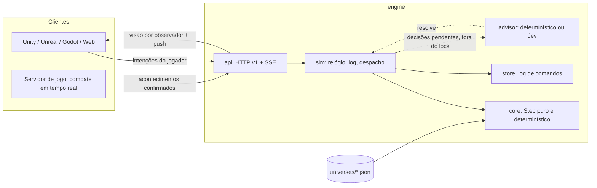

# Arquitetura do World Simulation Engine

## Camadas

Regra de dependência: `core` importa só a biblioteca padrão (verificado por `TestCoreHasNoInfrastructureImports`). Não conhece rede, banco, engine gráfica, combate ou gênero. Tudo o que é específico de um jogo está no universo JSON.

## Conceitos do núcleo

| Conceito | No motor |
|---|---|
| Entidade | `Entity{ID, Kind, Name, Num, Tag}`: tipos e propriedades declarados pelo universo |
| Verdade do mundo | `Fact{Holder, P, S, O, Cause}`. `Holder` vazio = verdade compartilhada (que ninguém conhece automaticamente); preenchido = fato privado daquele personagem |
| Conhecimento | `Belief{P, S, O, Holds, Source, From, At}` por entidade. Fontes: `observation`, `communication`, `publication`, `initial`. Pode ficar desatualizado |
| Regras | Periódicas (`every`), por tipo de entidade (`forEach`) ou agendadas (`schedule`). É isso que mantém o mundo vivo |
| Ações | Declaradas com quem pode enviá-las: `player` (intenção), `adapter` (servidor de jogo confirmando um acontecimento), `agent` (NPC, só interno) |
| Agentes NPC | Objetivos com prioridade e condição (normalmente sobre crenças). Se a tentativa falha contra a verdade, o NPC observa os fatos que leu errado |
| Histórias | `Arc` = DAG de `Beat`. Capítulo único (primeiro a cumprir o objetivo vence) ou compartilhado (todos podem cumprir; o arco avança por condição coletiva) |
| Missões | Modelos com elegibilidade, parâmetros ligados a entidades, objetivo e recompensas. Geram instâncias diferentes por jogador |
| Decisões | Escolhas pendentes (`offer`, `story`) com opções já validadas, contexto, padrão e prazo |
| Efeitos | Conjunto fechado: `assert`, `retract`, `adjust`, `set`, `observe`, `inform`, `schedule`, `emit` (com `reveals`), todos com `if` opcional |

Condições: `all`, `any`, `not`, `fact`, `knows` (de `$self` ou de outro), `num`, `tag`, `beat`. Variáveis: `$self`, parâmetros de ação/missão, `$it`, `$claimant`.

## Um comando = um passo puro

`World.Step(state, command) -> (state', delta, err)` trabalha sobre uma cópia. Comando recusado não tem efeito. Repetir o mesmo log a partir de `NewState` reproduz o mesmo `Digest` (SHA-256 do estado canônico).

| Tipo | Origem permitida | Efeito |
|---|---|---|
| `tick` | `system` | Avança o tempo (sequencial: `tick:N+1`) |
| `join` | `adapter`, `system` | Cria um personagem a partir do modelo do universo |
| `act` | `player`, `adapter` | Executa uma ação permitida para essa origem |
| `accept` / `decline` / `abandon` | `player` | Ciclo de vida de missões |
| `resolve` | `advisor` | Aplica a escolha de uma decisão pendente, revalidada |

Idempotência por `requestId` (janela de 4096 revisões), guarda opcional `expectedRevision`.

### Ordem de um tick

1. Agendamentos vencidos (ordem estável por prazo e chave).
2. Regras periódicas, na ordem declarada; `forEach` em ordem de ID.
3. Histórias: abre o capítulo atual quando `opens` vale; capítulos compartilhados avançam quando `advanceWhen` vale.
4. Decisões vencidas recebem o padrão. Se o padrão perdeu a validade, oferece-se outra opção ainda válida.
5. Agentes NPC, em ordem de ID: no máximo uma tentativa por agente.
6. Missões: retira ofertas sem sentido, expira as ignoradas, conclui as cumpridas, reivindica capítulos e gera novas ofertas.

## Cenários únicos e histórias dinâmicas

1. Um capítulo único abre silenciosamente. Os jogadores o descobrem pelas missões oferecidas a eles.
2. Vários jogadores podem persegui-lo em paralelo, em estado privado.
3. **Qualquer jogador que cumpra o objetivo reivindica o capítulo**, com ou sem a missão-guia. O primeiro vence de forma atômica, dentro de um único `Step`.
4. Os demais concorrentes têm a missão marcada como `superseded` e recebem os efeitos `rival` (fatos privados, recompensas de consolação), que liberam continuações próprias.
5. Com várias continuações possíveis, cria-se uma decisão `story`. O Jev escolhe pelo contexto; no prazo, aplica-se o padrão (primeiro ramo cuja condição já vale).
6. O novo capítulo muda o que é elegível para todos, e as ofertas de cada jogador mudam junto.

## Jev assíncrono sem afetar o jogo

- O lock do runtime só envolve `Step` (microssegundos). Chamadas ao Jev rodam em goroutines, fora do lock.
- O Jev recebe as opções com IDs opacos (`o1..oN`), contexto curto e instruções fixas. A resposta é mapeada de volta, conferida (opção, modelo, confiança) e enviada como comando `resolve`.
- O motor revalida a escolha: precisa estar entre as opções **e** continuar válida agora. Resposta atrasada ou inválida é recusada, e o padrão determinístico vale no prazo.
- Testado: 200 comandos de jogo concluídos com um conselheiro travado (`TestSlowAdvisorNeverBlocksTheWorld`).
- As resoluções entram no log, então o replay é determinístico mesmo com um conselheiro não determinístico.

## Persistência

O log de comandos é a fonte da verdade. `store.FileLog` grava JSONL com `fsync` a cada comando; o cabeçalho prende o log ao universo (`Fingerprint`); uma última linha corrompida por queda é descartada. Na abertura, o runtime refaz o estado pelo replay e redespacha as decisões que estavam pendentes. Nada é publicado antes de estar gravado.

## Confiança

- Clientes de jogador enviam **intenções**; o servidor de jogo envia **acontecimentos confirmados** (`adapter`); o motor nunca recebe dano, HP ou inventário declarados.
- Hoje, a origem vem no corpo da requisição. Por isso o `serve` só escuta em loopback. Em produção, a origem deve vir da autenticação: token de jogador → `player`; credencial do servidor de jogo → `adapter`.
- A visão de um observador nunca inclui crenças, fatos privados ou eventos privados de outros (`TestPrivateKnowledgeAndViews`, `TestStreamPushesOnlyVisibleEvents`).

## Limitações conhecidas

- Uma instância por mundo; o estado inteiro é copiado a cada comando. Adequado a protótipos e a mundos de dezenas de jogadores; para milhares, ver os próximos passos.
- O replay parte do tick 0 (ainda sem snapshots).
- A crônica guarda até `maxEvents` eventos; os mais antigos saem da visão, mas continuam no log.
- Os arcos têm fim. Um mundo vivo de longo prazo precisa de novos arcos, escritos à mão ou gerados.
- Sem autenticação de produção, rate limiting nem CORS.

## Próximos passos

1. Snapshots periódicos e compactação do log.
2. Autenticação (JWT Supabase do backend anterior, recuperável no histórico) mapeando a origem por credencial.
3. Particionar por região ou shard e reduzir a cópia de estado (estrutura persistente ou deltas).
4. SDKs finos de cliente (C# para Unity, C++ para Unreal, GDScript para Godot) gerados a partir do contrato v1.
5. Geração de novos arcos e modelos de missão assistida pelo Jev, sempre validada pelo `Compile`.
6. Integração com um servidor de jogo 3D real, que envia acontecimentos `adapter`.
