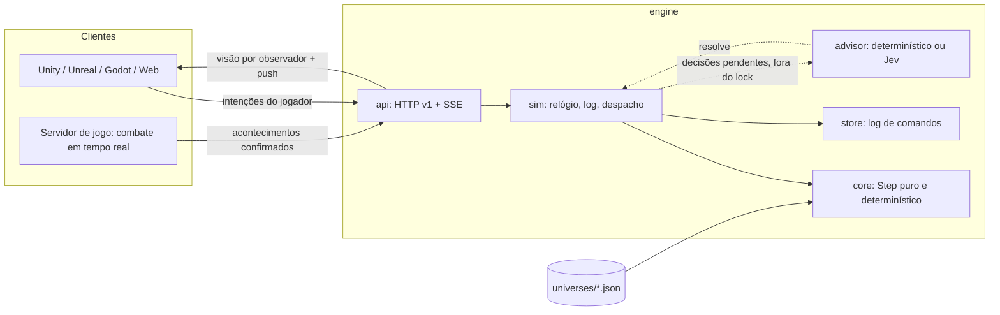

# Arquitetura do World Simulation Engine

## Camadas

Regra de dependência: `core` importa só a biblioteca padrão (verificado por `TestCoreHasNoInfrastructureImports`). Não conhece rede, banco, engine gráfica, combate ou gênero. Tudo o que é específico de um jogo está no universo JSON.

O experimento de [mundos pessoais do Hospedeiro](Hospedeiro/PersonalWorlds.md) reutiliza o core em WASM, fora da thread gráfica. `personal` é um adaptador privado de journal/checkpoints, sem alterar a autoridade da API compartilhada. Seus saves usam storage e RPC próprios no Nakama; visitas usam o cliente anfitrião como autoridade de combate via WebRTC. Nenhum acontecimento ou journal desse modo entra no runner do MMORPG.

## Conceitos do núcleo

| Conceito | No motor |
|---|---|
| Entidade | `Entity{ID, Kind, Name, Region, Num, Tag}`: tipos e propriedades declarados pelo universo |
| Lugares | Entidades dos tipos em `regionKinds`. Cada entidade pode estar em um lugar. O servidor de jogo informa as mudanças (`move`); a posição exata fica no cliente. Ações podem exigir lugar (`in`, `near`); NPCs podem se deslocar (`relocate`) |
| Verdade do mundo | `Fact{Holder, P, S, O, Cause}`. `Holder` vazio = verdade compartilhada (que ninguém conhece automaticamente); preenchido = fato privado daquele personagem |
| Conhecimento | `Belief{P, S, O, Holds, Source, From, At}` por entidade. Fontes: `observation`, `communication`, `publication`, `initial`. Pode ficar desatualizado |
| Regras | Periódicas (`every`), por tipo de entidade (`forEach`) ou agendadas (`schedule`). É isso que mantém o mundo vivo |
| Ações | Declaradas com quem pode enviá-las: `player` (intenção), `adapter` (servidor de jogo confirmando um acontecimento), `agent` (NPC, só interno) |
| Agentes NPC | Objetivos com prioridade e condição (normalmente sobre crenças). Se a tentativa falha contra a verdade, o NPC observa os fatos que leu errado |
| Histórias | `Arc` = DAG de `Beat`. Capítulo único (primeiro a cumprir o objetivo vence) ou compartilhado (todos podem cumprir; o arco avança por condição coletiva) |
| Missões | Modelos com elegibilidade, parâmetros ligados a entidades, objetivo, recompensas e o NPC que oferece (`giver`). Geram instâncias diferentes por jogador. A oferta chega onde o jogador estiver: a distância não limita, a coerência sim |
| Decisões | Escolhas pendentes (`offer`, `story`, `world`) com opções já validadas, contexto, padrão e prazo |
| Diretor do Mundo | A cada `director.every` ticks, reúne os acontecimentos (`happenings`) elegíveis e pergunta ao Jev qual ocorre (ou `none`). Cada acontecimento tem `cooldown` |
| Efeitos | Conjunto fechado: `assert`, `retract`, `adjust`, `set`, `observe`, `inform`, `schedule`, `emit` (com `reveals`), todos com `if` opcional |

Condições: `all`, `any`, `not`, `fact`, `knows` (de `$self` ou de outro), `num`, `tag`, `beat`. Variáveis: `$self`, parâmetros de ação/missão, `$it`, `$claimant`.

## A "mente" do mundo (`core/mind.go`)

Baseada na literatura listada em [Research.md](Research.md): modelo do jogador (`tags`, `Styles`); saliência para a escolha padrão de oferta (especificidade, estilo, história, relação, menos cansaço e lotação), também enviada ao Jev como `[fit N]`; boatos (`gossip`); relações por par (`relate`/`rel`); ritmo (`tension`, `intensity`, fases do diretor); sorte determinística (`chance`) e hora do dia (`time`, `dayLength`).

## Habilidades (`core/skills.go`)

O motor conta o que cada jogador faz (`Deeds`), descobre habilidades quando a condição `learn` vale (`discover`, avaliado em `completeFor`), concede por efeito `grant`, anuncia com `skill-learned` (raridade, descrição, como foi obtida) e transforma as raras em `fame` pública. O Jev recebe as habilidades no perfil do jogador; a visão traz `skills`.

Recompensas também podem usar `acquire-gene` com `v` apontando para uma mutação declarada. O gene entra na biblioteca privada, sem substituir a expressão atual. A aquisição é idempotente e emite `gene-acquired`; expressar continua sendo uma intenção separada e validada. Valores e efeitos de combate pertencem ao adaptador do jogo.

## Um comando = um passo puro

`World.Step(state, command) -> (state', delta, err)` trabalha sobre uma cópia. Comando recusado não tem efeito. Repetir o mesmo log a partir de `NewState` reproduz o mesmo `Digest` (SHA-256 do estado canônico).

| Tipo | Origem permitida | Efeito |
|---|---|---|
| `tick` | `system` | Avança o tempo (sequencial: `tick:N+1`) |
| `join` | `adapter`, `system` | Cria um personagem a partir do modelo do universo |
| `move` | `adapter`, `system` | O servidor de jogo informa a região em que o personagem entrou |
| `act` | `player`, `adapter` | Executa uma ação permitida para essa origem |
| `accept` / `decline` / `abandon` | `player` | Ciclo de vida de missões |
| `resolve` | `advisor` | Aplica a escolha de uma decisão pendente, revalidada |

Idempotência por `requestId` (janela de 4096 revisões), guarda opcional `expectedRevision`.

### Ordem de um tick

1. Agendamentos vencidos (ordem estável por prazo e chave).
2. Regras periódicas, na ordem declarada; `forEach` em ordem de ID.
3. Histórias: abre o capítulo atual quando `opens` vale; capítulos compartilhados avançam quando `advanceWhen` vale. Depois, o Diretor do Mundo cria a decisão `world`, se for a hora.
4. Decisões vencidas recebem o padrão. Se o padrão perdeu a validade, oferece-se outra opção ainda válida.
5. Agentes NPC, em ordem de ID: no máximo uma tentativa por agente.
6. Missões: encerra como `obsolete` as missões ativas que perderam a elegibilidade, retira ofertas sem sentido, expira as ignoradas, conclui as cumpridas, reivindica capítulos e gera novas ofertas (uma missão por vez, respeitando `questGap`).

## Como uma missão chega ao jogador

1. Algo acontece no mundo (uma regra, um acontecimento do diretor, um capítulo da história, uma ação de alguém) e torna um modelo de missão elegível para aquele jogador.
2. Se o jogador não tem missão ativa nem proposta pendente, e o intervalo `questGap` já passou, o motor monta os candidatos. Com um só candidato, oferece direto; com vários, o Jev escolhe o mais coerente (contexto: perfil, local, história, o que outros receberam).
3. O evento `quest-offered` diz **quem chama** (`actor` e `data.giver`), **onde o jogador está** (`data.region`) e **o quê** (`text`, `data.quest`). O cliente apresenta como quiser: o NPC vem até o jogador, um mensageiro, um chamado no rádio.
4. A oferta traz a "janela do sistema": `rank`, `objective`, `reward`, `penalty`.
5. Enquanto ativa, a missão **evolui**: estágios (`stages`) entram quando sua condição vale, trocando título, objetivo, rank e meta (evento `quest-updated` com `rankFrom` → `rank`). Ela **falha** se `fail` valer ou o `timeLimit` vencer (`quest-failed`, com `failEffects`). Recusar aplica `onDecline`.
6. Num cenário único, quem tinha a missão do capítulo **ou** cumpria o critério `contender` recebe os efeitos de rival e uma continuação própria.
7. O jogador aceita ou recusa. Aceita, a missão precisa ser concluída antes da próxima (se o universo não permitir abandono). Se deixar de fazer sentido, ela é encerrada como `obsolete` e libera a vaga.

### Confirmação de recebimento — 25/10/2026

O cliente pode enviar a intenção aditiva `act: acknowledge-quest`, com `args.quest` apontando para sua própria oferta ou missão ativa. Ela grava `Quest.acknowledged` no log. Uma missão recebida deixa de expirar por silêncio, de ser retirada por mudança dos requisitos de oferta ou de se tornar obsoleta só por sair da região. O jogador pode aceitar depois de alcançar o objetivo; nesse caso a conclusão normal é avaliada ao aceitar. Continua havendo apenas uma proposta pendente e, no Hospedeiro, uma missão ativa.

Conclusão, recusa, abandono permitido, falhas explícitas, prazo de execução e disputas de cenários únicos continuam válidos. A confirmação não aceita a missão nem entrega recompensas. O cliente do Hospedeiro confirma o recebimento ao apresentar a oferta/objetivo; em falha de rede, tenta novamente nas próximas visões. Universos e históricos sem essa intenção mantêm o comportamento anterior, permitindo atualizar o mundo existente sem reset nem alteração de fingerprint.

## Cenários únicos e histórias dinâmicas

1. Um capítulo único abre silenciosamente. Os jogadores o descobrem pelas missões oferecidas a eles.
2. Vários jogadores podem persegui-lo em paralelo, em estado privado.
3. **Qualquer jogador que cumpra o objetivo reivindica o capítulo**, com ou sem a missão-guia. O primeiro vence de forma atômica, dentro de um único `Step`.
4. Os demais concorrentes têm a missão marcada como `superseded` e recebem os efeitos `rival` (fatos privados, recompensas de consolação), que liberam continuações próprias.
5. Com várias continuações possíveis, cria-se uma decisão `story`. O Jev escolhe pelo contexto; no prazo, aplica-se o padrão (primeiro ramo cuja condição já vale).
6. O novo capítulo muda o que é elegível para todos, e as ofertas de cada jogador mudam junto.

## Jev assíncrono sem afetar o jogo

- O lock do runtime só envolve `Step` (microssegundos). Chamadas ao Jev rodam em goroutines, fora do lock.
- O Jev recebe as opções com IDs opacos (`o1..oN`), contexto curto e instruções fixas. A resposta é mapeada de volta, conferida (opção, modelo, confiança) e enviada como comando `resolve`.
- O motor revalida a escolha: precisa estar entre as opções **e** continuar válida agora. Resposta atrasada ou inválida é recusada, e o padrão determinístico vale no prazo.
- Testado: 200 comandos de jogo concluídos com um conselheiro travado (`TestSlowAdvisorNeverBlocksTheWorld`).
- As resoluções entram no log, então o replay é determinístico mesmo com um conselheiro não determinístico.
- Cada decisão aplicada guarda, no evento `decision`, o provedor, o modelo, o ID da chamada, a confiança, a latência e o custo informados.
- O contexto enviado ao Jev inclui o perfil do jogador (título, atributos, missões concluídas e perdidas, crenças com fonte, eventos recentes), a história até agora, os indicadores do mundo e o que já foi oferecido a outros jogadores, para dar variedade.

### O Jev medido ao vivo (19/10/2026)

| Corrida | Decisões | Pelo Jev no prazo | Latência média | Custo |
|---|---|---|---|---|
| Valdoria, 150 ticks de 0,8 s, 4 jogadores | 14 (13 `world`, 1 `story`) | 14 | ~680 ms | US$ 0,00042 |
| Valdoria, 120 ticks de 0,7 s, 4 jogadores | 11 | 11 | ~635 ms | US$ 0,00033 |
| Kepler-9, 100 ticks de 0,7 s, 3 jogadores | 9 | 9 | ~645 ms | US$ 0,00025 |
| Valdoria com lugares e quem oferece, 150 ticks de 0,7 s | 16 (2 `offer`, 13 `world`, 1 `story`) | 16 | ~650 ms | US$ 0,00048 |
| Kepler-9 com lugares, 100 ticks de 0,7 s | 10 | 10 | ~640 ms | US$ 0,00027 |

Com `decisionTimeout` de 3 ticks e ticks de 0,7 a 1 s, o prazo (2,1 a 3 s) fica bem acima da latência observada. Ticks mais curtos pedem um `decisionTimeout` maior.

## Persistência

O log de comandos é a fonte da verdade. `store.FileLog` grava JSONL com `fsync` a cada comando; o cabeçalho prende o log ao universo (`Fingerprint`); uma última linha corrompida por queda é descartada. Na abertura, o runtime refaz o estado pelo replay e redespacha as decisões que estavam pendentes. Nada é publicado antes de estar gravado.

## Confiança

**Hospedeiro, 24/10/2026:** a implantação online usa Nakama e Godot headless. Com `serve -adapter-key` (ou `HOSPEDEIRO_ADAPTER_KEY`), comandos `adapter` exigem a credencial do servidor; o token de jogador deixa de poder confirmar acontecimentos. O gateway Nakama deriva o ator da sessão e encaminha apenas intenções. O `core` continua independente de rede e combate. `-nakama http://127.0.0.1:7350` expõe somente a API de cliente e WebSocket sob `/nakama/`, pelo mesmo domínio do jogo. Detalhes em [Hospedeiro/Nakama.md](Hospedeiro/Nakama.md). As descrições históricas abaixo sobre a origem no corpo se referem ao modo de desenvolvimento e à configuração sem a opção de autoridade.

- Clientes de jogador enviam **intenções**; o servidor de jogo envia **acontecimentos confirmados** (`adapter`); o motor nunca recebe dano, HP ou inventário declarados.
- Hoje, a origem vem no corpo da requisição. Por isso o `serve` só escuta em loopback. Em produção, a origem deve vir da autenticação: token de jogador → `player`; credencial do servidor de jogo → `adapter`.
- A visão de um observador nunca inclui crenças, fatos privados ou eventos privados de outros (`TestPrivateKnowledgeAndViews`, `TestStreamPushesOnlyVisibleEvents`).

## Limitações conhecidas

- Uma instância por mundo; o estado inteiro é copiado a cada comando. Adequado a protótipos e a mundos de dezenas de jogadores; para milhares, ver os próximos passos.
- O replay parte do tick 0 (ainda sem snapshots).
- A crônica guarda até `maxEvents` eventos; os mais antigos saem da visão, mas continuam no log.
- Os arcos têm fim. Um mundo vivo de longo prazo precisa de novos arcos, escritos à mão ou gerados.
- Sem autenticação de produção, rate limiting nem CORS.

## Próximos passos

1. Snapshots periódicos e compactação do log.
2. Autenticação (JWT Supabase do backend anterior, recuperável no histórico) mapeando a origem por credencial.
3. Particionar por região ou shard e reduzir a cópia de estado (estrutura persistente ou deltas).
4. SDKs finos de cliente (C# para Unity, C++ para Unreal, GDScript para Godot) gerados a partir do contrato v1.
5. Geração de novos arcos e modelos de missão assistida pelo Jev, sempre validada pelo `Compile`.
6. Integração com um servidor de jogo 3D real, que envia acontecimentos `adapter`.
