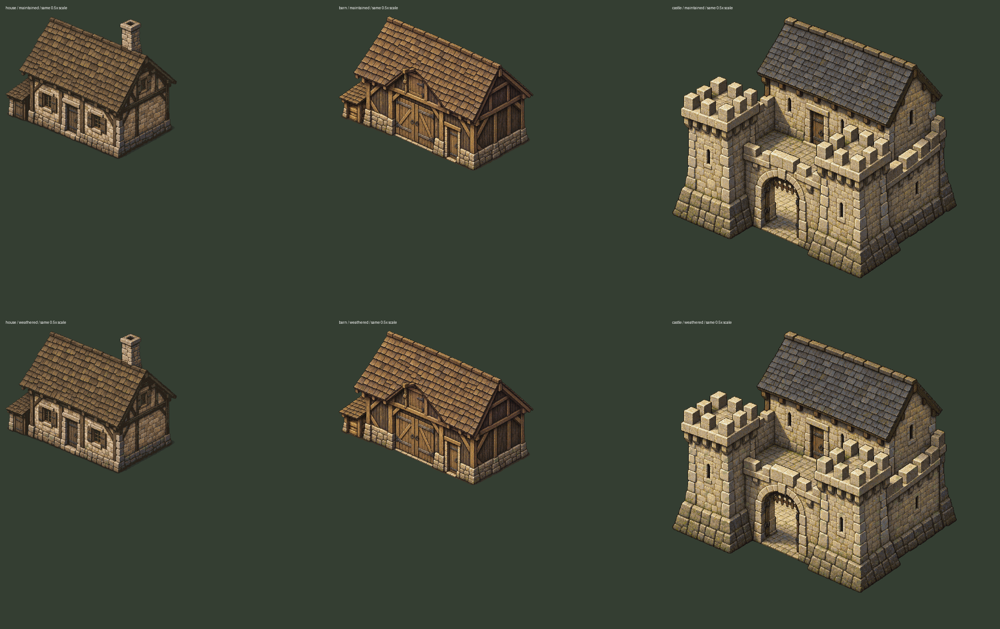

# Valdoria — padrão arquitetônico v1

Consultar primeiro a [linguagem visual central](ValdoriaVisualLanguage.md). Referências aprovadas: casa07R, celeiro08 e pequeno castelo08. Revisões09 continuam candidatas. Este guia não aprova um lote ou uma nova família automaticamente.

A galeria é um comparador neutro, não uma vila implantada. O contexto geográfico de casa/celeiro está nos laboratórios próprios; o castelo permanece sublaboratório.

## Biblioteca e materiais

Catálogo: `ArtSource/Labs/World2026/WorldStudio09/catalog.json`, schema `valdoria-architecture-catalog/v1`, versão `valdoria-visual-direction/1.0.0`.

| Família | Identidade que deve continuar legível | Ajuste09 |
|---|---|---|
| Casa rural | Alvenaria irregular, estrutura de madeira, anexo baixo, chaminé, telha de madeira | Estado mantido preserva os pixels da referência; variante acrescenta envelhecimento localizado |
| Celeiro | Grande vão agrícola, porta de serviço, pranchas verticais, cobertura com volume e beirais | Reduzir o dourado da cobertura e aproximar o valor da fundação |
| Pequeno castelo | Cantaria, torres, ameias, pátio, portão aberto e torreão com cobertura mineral | Reduzir discretamente brilho quente da pedra, preservar ardósia e leitura militar |

Madeira, pedra irregular, cantaria, cobertura de madeira e ardósia pertencem à família de materiais das referências aprovadas. Os tratamentos09 dessas famílias precisam de revisão. Não uniformizar todas as pedras ou trocar a ardósia por marrom para forçar semelhança.

## Forma e estrutura

- Manter lateral substancial e profundidade da entrada. Uma fachada frontal com estreita aba lateral não atende ao padrão.
- Telhado precisa de duas inclinações legíveis quando visíveis, cumeeira, espessura de beiral e sombra de contato. Não usar uma placa plana sobre uma caixa.
- Fundação tem espessura e peças irregulares, sem pedestal alto sem função. Ajustar desenho ao lote, sem aplainar o mundo silenciosamente.
- Janelas ficam entre vigas e dentro dos planos da fachada; peitoril, rebaixo e verga precisam responder à luz.
- Conservação modifica líquen, fibra exposta e desgaste localizado. Não equivale a trocar a cor de todo o sprite.

## Relação com Quaternius

| Referência | Altura da abertura registrada | Altura aparente/Quaternius |
|---|---:|---:|
| Casa | 4,8387u | 1,0587 |
| Celeiro, porta de serviço | 4,8794u | 1,0676 |
| Castelo, porta do torreão | 4,8931u | 1,0706 |

Comparação usa Quaternius no mesmo plano, 32PPU e escala visual1,25. O vão agrícola e o portão externo podem ser maiores por função; não confundir esses vãos com a porta humana medida. Não alterar escala do protagonista ou esticar o prédio para corrigir uma porta.

## Sombra, âncora e cutaway

Sombra de chão separada. Âncora não é o centro do PNG. Offsets de recorte preservam o canvas e a linha de chão do documento. Fundação, parede e telhado possuem funções distintas mesmo quando compartilham atlas.

Footprint vem de metadados de chão, não do retângulo do sprite. O telhado pode sobrepor o personagem sem bloquear toda a copa visual. Casa/celeiro têm um envelope de profundidade; castelo possui cinco grupos e sete polígonos físicos separados.

`ReferenceHouseDepth` usa envelope frontal projetado, pés do ator e interseção dos bounds dos volumes. Roof→alpha0,18; parede→0,28 durante cutaway; fundação/chão permanecem. É uma aproximação por bounds, sem interior oculto modelado nem oclusão pixel a pixel. Não atravessar uma parede porque ficou transparente.

## Receitas realmente suportadas

Usar `valdoria-authored-architecture-recipe/v1`, separado do planejador histórico de sites07. Campos: `catalogVersion`, `family`, `seed`, `dimensionsProjectedUnits`, `orientation`, `roof`, `materials`, `openings`, `annex`, `decoration`, `conservation`, `position`, `placement`.

As dimensões são o bounds projetado do footprint autorado. Não são uma planta cartesiana3D paramétrica. Nesta versão largura/profundidade projetadas, orientaçãoSE, cobertura, aberturas e anexos são valores fixos compatíveis por família. Outras dimensões, faces ocultas, nova cobertura, orientação, porta deslocada ou anexo exigem nova arte e nova análise de lote.

Partes têm IDs como `house.roof.v1`, source/metadata/export por hash e restrição de família. São peças de uma pintura exterior específica. **Não** encaixar livremente o telhado do celeiro na casa. Reutilizáveis agora: vocabulário de materiais, papéis das camadas, tratamentos de conservação, exportação, análise de lote, acesso e sorting. Geometria pintada continua específica.

Variação automática disponível: `maintained` ou `weathered` nas três famílias. `seeded` seleciona um desses dois estados de modo determinístico por família, versão e seed. O desenho de líquen/desgaste possui patternSeed910209 e fica editável no Aseprite; não existem infinitas silhuetas por seed.

## Produzir uma revisão

1. Copiar a fonte para diretório de revisão novo e editar Aseprite; conservar origem/licença.
2. Exportar os layers reais com `architecture07r_reference.py export`, destino inexistente.
3. Criar versão do catálogo com refs/hashes dos novos exports e restrições explícitas. Se mudar alpha/geometria, reavaliar âncoras, colisões e profundidade.
4. Compilar receita com `visual_unification09.py build --catalog <catalogo> --recipe <receita> --output <destino-novo>`.
5. Para lote novo, o compilador usa terreno/água/estrada/rocha, calcula acesso e regenera o consumidor de vegetação com exclusões. Não retirar plantas silenciosamente.
6. Validar em laboratório, comparar com referência e obter avaliação visual antes de promoção.

No09, as mesmas posições de casa/celeiro reproduzem exatamente navegação e ecologia anteriores. O castelo só aceita o pátio técnico fixo; `placement=world` é recusado até existir implantação validada. A biblioteca09 não implementa interiores, portas funcionais, novos pavimentos ou nova construção em runtime.
