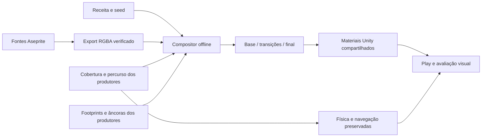

# Valdoria — solo, estradas e contatos, Ground11

**Referência Ground11 aprovada artisticamente em 18/10/2026.** O usuário avaliou a entrega `37555798710a6202fe8fdd5c3d14833c4a9e9bce` e respondeu “Ficou bom”. [Registro formal e hashes](Approvals/Ground11-2026-10-18.json). A aprovação abrange o resultado apresentado, sem promoção automática à cena oficial ou aprovação de futuras variantes. Referências aprovadas: construções07R/08/09 e as duas árvores/duas rochas Nature10. [Registro Nature10](Approvals/Nature10-2026-10-18.json), [evidências reais desta rodada](../Validation/ValdoriaGround11-TerrainAndRoads.md).

## Direção comum

A arquitetura explica volume com planos, encontros e sombra; as árvores usam massas sobrepostas e suporte; as rochas usam fraturas e faces. O solo compartilha a intenção, sem copiar telhas ou copas como textura. Suas formas são swards baixos, clareiras de desgaste, fragmentos de terra e pequenos agregados, subordinados ao personagem e aos objetos. Realces vêm do alto/esquerda. Nenhuma dessas pequenas irregularidades significa nova altura física.

Trabalhar em três escalas: manchas grandes e áreas de descanso; agrupamentos médios de grama/terra; poucos acentos de folha, grão e fragmento. A massa pintada vem da fonte artística. Os campos procedurais modulam organização e intensidade, não substituem o desenho por pixels aleatórios. Evitar um piso totalmente liso e também um tapete de detalhe uniforme.

32px/u, Point, sem mips/compressão. Casa, árvores, pedras e Quaternius mantêm exatamente os assets e escalas anteriores. As superfícies são projetadas por UV no plano2D; não há terreno3D novo. Examinar a1× e2×inteiros: detalhe bonito a200% não garante leitura no gameplay.

## Componentes e autoridade



Fontes: `ArtSource/Labs/World2026/Ground11/SourceV2/`. `meadow.aseprite` e `earth.aseprite`:384², quatro camadas de propriedade exterior — recuos/juntas, pigmento, planos e acentos claros. Elas recompõem a pintura interpretada, não são reconstruções de superfícies ocultas. `edge-grammar.aseprite`:512×128, quatro camadas; oito ritmos de pequenas lâminas, fragmentos de terra e folhas caídas.

`Masters/` preserva as duas pinturas assistidas por ImageGen e `prompts.json` registra os pedidos exatos. Aseprite foi executado para selecionar um recorte512², interpretar a384² por nearest, limitar a96cores e separar camadas. A primeira interpretação usava a pintura completa e ficou granulada demais; a revisão aumentou o tamanho dos agrupamentos na escala nativa. Não se alega pintura manual integral. A pintura IA não é determinística; a reprodução garantida começa nas fontes Aseprite retidas.

O bootstrap `prepare` recusa a fonte existente e **não** é o comando de atualização da arte. Nunca o executar sobre pixels revisados. Atualizar por edição de cópia e exportação das camadas reais. Nenhum comando de export/build chama ImageGen.

## Como criar uma nova superfície

1. Usar a casa, árvore, rocha e Quaternius aprovados na composição de escala. Decidir formas e hierarquia antes de aumentar a quantidade de grãos.
2. Pintar massas baixas reconhecíveis e trechos calmos. Os planos de terra devem sugerir compactação e agregados embutidos, sem virar calçamento ou novos obstáculos.
3. Organizar camadas editáveis. Manter a mesma direção de luz. Não rotacionar ou espelhar luz pintada para fabricar variantes.
4. Conferir a interpretação nativa no Aseprite e na Unity. Um master grande pode perder forma quando reduzido demais; corrigir a escala da interpretação, não apenas sua saturação.
5. Exportar em destino ausente, verificar hashes, compor e revisar de novo no jogo. A fonte é a autoridade; PNG integrado é um derivado.

O compositor amostra janelas256px dentro da pintura384px, com translações por seed e suportes sobrepostos em coordenadas globais. As janelas ficam dentro da fonte: não há wrap de uma borda incompatível para o meio da região. Pesos contínuos evitam cortes no suporte128px. Não reiniciar fase em cada célula32px. Mistura de suportes gera valores intermediários; a composição não promete uma paleta final de exatamente96cores.

`grass.paintStrength`, `macroAmplitude`, `mesoAmplitude` e `quietAreaFraction` controlam a relação entre pintura e áreas calmas. Densidade maior não equivale a qualidade maior. A textura precisa funcionar em áreas abertas suficientemente extensas para revelar repetição.

## Estradas e conexões

O compositor recebe cobertura e percursos, não uma lista de tiles de conexão. Na região atual, une a cobertura Organic Roads com a máscara original do acesso07R. Isso permite que estrada e entrada compartilhem o mesmo material e acabamento na junção. O SpriteRenderer antigo do acesso só aparece no estado anterior; sua pose e os dados funcionais não mudam.

O campo de distância da **união** fornece margem, interior e direção do contato. Uma franja visual limitada quebra a borda; o núcleo navegável original fica explicitamente protegido. Grama curta e fragmentos se concentram em trechos selecionados da margem, sem uma linha contínua de tufos. Uma faixa externa pequena intercala solo e grama; luz/sombra de lábio é interrompida e baixa, sem criar um degrau físico.

Desgaste interno segue distância longitudinal e transversal do percurso. Orientações concorrentes reduzem sua força em junções; não sobrepor duas trilhas escuras formando um símbolo no T/cruzamento. A largura e os samples oficiais não são reescritos. Ajustes de franja são visuais, não expansão/redução de circulação.

Parâmetros: `road.paintStrength`, `edgeVisualPixels` (até6px), `brokenRimStrength`, `wearStrength`, `junctionWearSuppression`. Não trocar a geometria da estrada para resolver um material. Uma mudança de rota pertence ao Terrain Agent e exige outro contrato/QA.

Para expandir a gramática visual, editar `court-network.json`: paths, slots, larguras e curva opcional Catmull–Rom. A bancada usa **o mesmo compositor** para horizontal, vertical, curva suave, canto, bifurcação, T, cruzamento, ponta e variação de largura. Ela não é um segundo gerador de estradas oficiais: não usa obstáculos/topografia para planejar a rede e não fornece navegação de mundo. É uma prova de material sobre máscaras adversas, claramente separada da região jogável.

## Contatos reutilizáveis

Separar footprint físico, influência visual e bounds do sprite. Raízes usam influência elíptica curta e quebrada; rochas e fundações usam distância analítica ao polígono autorado. A exposição de solo é mesclada com material pintado e fragmentada por contexto; não desenhar um halo uniforme. Folhas caídas aparecem perto de árvores. Não aumentar collider nem redesenhar o objeto para esconder um problema de chão.

`reference_contact_sites()` adapta os dados Nature10/07R. `contacts(x,y,seed,sites=...)` aceita descritores com:

- árvore: `kind="tree"`, `point`, `influenceRadii`;
- pedra/fundação: `kind="rock"` ou `"foundation"`, `footprint` absoluto no plano de chão.

`render(..., world=False, sites=...)` permite usar esses mesmos tratamentos com outras posições/polígonos, sem refazer os pixels do material. Os raios de influência são visuais; não são o raio de colisão. Um novo consumidor precisa fornecer e validar seus próprios dados físicos. `world=True` é o adaptador específico desta região64×48 e mantém o pigmento do platô anterior; não alegar suporte automático a qualquer bioma/região.

## Reconstrução e importação

```powershell
python Tools/ArtPipeline/WorldGen/ground_finish11.py export --source ArtSource/Labs/World2026/Ground11/SourceV2 --output Temp/Ground11-export-novo
python Tools/ArtPipeline/WorldGen/ground_finish11.py build --library Temp/Ground11-export-novo --recipe ArtSource/Labs/World2026/Ground11/recipe.json --output Temp/Ground11-world-novo
python Tools/ArtPipeline/WorldGen/ground_finish11.py court --library Temp/Ground11-export-novo --output Temp/Ground11-court-novo
python Tools/ArtPipeline/WorldGen/ground_finish11.py build --bounds '[256,1200,768,336]' --output Temp/Ground11-patch-novo
python -m unittest discover -s Tools/ArtPipeline/WorldGen -p test_ground_finish11.py -v
unity command run_script --file AgentScripts/BuildGround11.cs --entry BuildGround11.Main --caller plugin --skill unity-pipeline --format json
```

Todos os destinos offline devem estar ausentes. O build usa `ExportV2` por padrão; `--library` e `--recipe` selecionam explicitamente outra exportação/receita, sem substituir a biblioteca canônica do estudo. A API `render` também recebe `library`. Inputs e caminhos de estudo são explícitos. Não há geração por Play.

`GroundFinish11Importer.Build` recusa cenas/arte existentes. Cria `ValdoriaGroundFinishLab` e `ValdoriaSurfaceGrammarLab`, preservando a cena oficial e fontes aprovadas. Reutiliza os28 meshes de solo; não cria um objeto por pixel ou tufo. A malha e a navegação permanecem anteriores. `QueuePaintRefresh()` é uma ação explícita de reimportação **somente dos PNGs derivados Ground11**, com manifests e domínio esperados, destinada a iteração deste laboratório. Não redimensiona sprites, altera geometria ou substitui fontes aprovadas.

Materiais Default RGBA32, Point, NPOT resize desativado, max4096, sem mips/compressão. PPU do TextureImporter de textura Default não define escala: o UV existente fornece32px/u. Na bancada a malha60×37,5u corresponde a1920×1200px. Sem Tilemap ou RuleTile novo: um campo de cobertura contínuo lida com as conexões sem multiplicar tiles especiais.

## Validação e decisões que não automatizamos

Teclas1–4: anterior, base, transições, final. As quatro apresentações têm os mesmos colisores e bytes de navegação. Comparar câmera `(28,5;14,25;-10)`, ortográfica14,0625,1600×900 e mesmo ator. A1× a arte deve sustentar leitura; detalhes2× são inspeção complementar. Capturar outra área da região e os nove casos da bancada, sem limitar a prova ao jardim da casa.

Revisão artística escolhe forma das massas, tamanho do grão, hierarquia, qualidade das bordas, equilíbrio dos contatos e relação com os assets aprovados. Não automatizar essa aprovação. Seed, patches, distribuição subordinada, hashing, exportação, máscaras e importação são reproduzíveis. Testar movimento/esquiva, acesso, colisões, oclusão e câmera com Input System real, perfil Temp e restauração dos dispositivos/opções.

Não anunciar aprovação geral, escalada, erosão física nova, desgaste por gameplay, molhamento dinâmico, streaming ou floresta refeita. Vegetação histórica e platô continuam pendentes. Novas variantes e biomas exigem avaliação própria; a aprovação Ground11 não promove automaticamente os assets ao mundo oficial.
