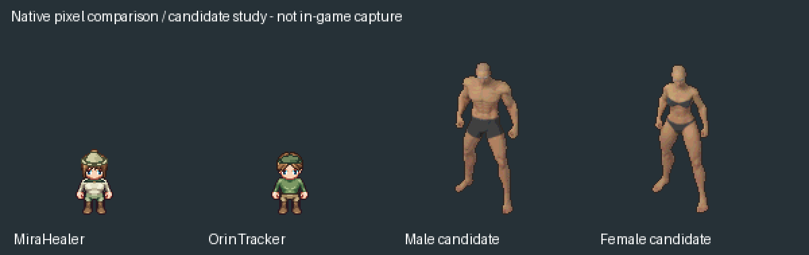
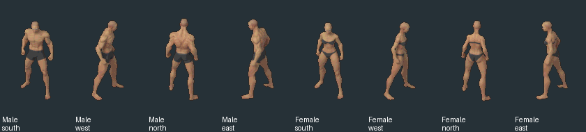

# Novo padrão humanoide — pesquisa e prova de escala

16/10/2026. **Caminhada do jogador aprovada; base Quaternius escolhida para continuidade. Migração de produção ainda não executada.**

[Aprovação, versão de referência e pendências](../Validation/HumanoidWalkApproval2026.md). A aprovação refere-se à caminhada testada após a correção lateral; roupas, combate e identidade final ainda precisam de aprimoramento.

## Decisão de direção

Durante o R4, o usuário considerou as roupas simples demais e depois pediu para priorizar corpos maiores, com proporções mais humanas. Determinou que a futura base seja padrão para **todos os humanoides, incluindo o protagonista**. Autorizou ampliar/retrabalhar o cenário em função dessa escala, mantendo pixel art com aparência mais moderna. Portanto, o mapa atual e a altura histórica de aproximadamente 48 px deixam de ser limites para a pesquisa.

Essa orientação amplia o R4 original. A versão pequena de Mira/Orin permanece como laboratório técnico; não recebe aprovação artística por passar nos testes. A aparência e os arquivos do Iron Knight oficial continuam intactos até existir uma substituição validada. A mudança de direção autorizou estudar sua substituição. Posteriormente, o usuário aprovou a caminhada da base Quaternius masculina e escolheu continuar com esse modelo; a substituição final de produção permanece pendente.

## Candidato principal: família Quaternius

Fontes oficiais: [Universal Base Characters](https://quaternius.itch.io/universal-base-characters), [Universal Animation Library](https://quaternius.itch.io/universal-animation-library), [Fantasy Outfits](https://quaternius.itch.io/modular-character-outfits-fantasy).

As páginas identificam esses assets como **CC0-1.0**. O pacote Standard de corpos é gratuito; a prancha oficial Standard mostra **dois corpos e cinco cabelos**. A oferta de seis corpos/vinte cabelos e arquivos `.blend` pertence à versão Source, paga; não confundir esse catálogo maior com a entrega gratuita. Nenhuma compra foi feita.

Foram obtidos os dois corpos gratuitos e a UAL1 Standard. A inspeção local confirmou:

| Item | Conteúdo efetivamente verificado |
|---|---|
| Corpo masculino | Superhero_Male_FullBody; malha com pele/pesos, olhos e sobrancelhas; 65 ossos |
| Corpo feminino | Superhero_Female_FullBody; mesma família de esqueleto, 65 ossos, proporções próprias |
| Altura da malha em repouso | Aproximadamente 1,820 m / 1,775 m no arquivo importado, sem incluir helpers do importador |
| Biblioteca gratuita | **43 animações**, listadas integralmente na inspeção |
| Ações encontradas | Idle_Loop, Walk_Loop, Sword_Attack, Sword_Idle, Roll, Hit_Chest, Hit_Head, Death01, entre outras |
| Correspondência de nomes | Os 65 ossos de cada corpo existem na biblioteca; os bind poses e comprimentos diferem e precisam ser respeitados |
| Prova em sprites | 52 quadros por corpo: um idle e 12 amostras de caminhada por direção, quatro direções, oito tags |
| Canvas / altura visível da prova | 128×160; masculino 102–121 px, feminino 99–118 px nas vistas/poses inspecionadas |

O catálogo completo de animações anuncia 120+, mas esse número **não** foi atribuído à edição gratuita. Só as 43 efetivamente obtidas estão disponíveis nesta prova. A existência de um clip de espada não demonstra que ataques básico/pesado, mãos, oclusão, cooldowns e estados B10/B11 já tenham sido migrados.

Esta é uma prancha de estudo, não uma captura de gameplay. Os corpos estão com a roupa base para permitir avaliação de anatomia. Cabelos, roupas de classe, rosto e identidade final não foram preparados. As variantes gratuitas são atléticas/estilizadas, e não uma representação de toda a diversidade corporal humana.

## Fontes 3D, jogo em pixel art

A proposta é usar a malha e os movimentos profissionais como fontes de autoria e exportar sprites 2D em resolução nativa maior. Isso permite desenhar/vestir uma peça em uma estrutura articulada e avaliá-la de todas as direções, em vez de corrigir manualmente centenas de poses independentes. Não exige transformar o jogo em um jogo 3D.

A prova foi feita com Blender local 5.2.2 para inspeção das fontes, câmera ortográfica e luz superior esquerda. As rotações dos ossos foram transferidas por constraints em espaço global; comprimentos e bind pose do corpo de destino foram mantidos. O deslocamento da pelve foi tratado como delta. Essa transferência é **experimental**, não um retarget final certificado. Não se copiariam simplesmente todas as translações da animação sobre outra anatomia.

O Aseprite 1.3.18.6 criou os editáveis RGBA e as tags, aplicou corte de alfa, quantização dos canais e contorno de inspeção em layer separado. Nenhuma pose corporal foi desenhada do zero. Python orquestrou leitura/exportação, comparações e pranchas. Os GIFs têm dois ciclos; a cadência vem dos 40 frames a 30 fps do clip fonte, com arredondamentos próprios de Aseprite/GIF. Não houve geração externa ou paga.

## Alternativas examinadas

| Fonte | Pontos úteis | Motivo da posição na seleção |
|---|---|---|
| [Hormelz Melee](https://hormelz.itch.io/8-directional-melee-character) e [Girl](https://hormelz.itch.io/8-directional-girl-character) | Sprites 2D existentes, CC0, oito direções. Biblioteca R2 já mede 72–83 px e 87–99 px de altura visível, respectivamente | Alternativa direta para sprites maiores; bases raster não possuem todas as peças separadas, e a roupa atual exige adaptação |
| [SKYZ0R BaseHumanMale](https://opengameart.org/content/isometric-basehumanmale-with-400-items) | CC-BY 4.0, corpos e muitos itens em camadas; oito direções e oito ações, canvas 148×130 anunciado | Perspectiva isométrica e família sem par feminino equivalente nessa oferta. Canvas não foi confundido com altura visível |
| [Blender Human Base Meshes](https://www.blender.org/download/demo-files/) / [MakeHuman](https://static.makehumancommunity.org/about/license.html) | Bases humanas CC0 com anatomia ajustável/realista | Não entregam por si sós o mesmo conjunto pronto de animações e sprites; exigem trabalho adicional de rig, materiais e animação |
| [Flare Hero/Heroine](https://opengameart.org/content/isometric-hero-and-heroine) | Corpos/equipamento modulares, fontes Blender e movimentos | O próprio autor descreve altura de cerca de 50 px apesar do canvas 128×128. Não resolve diretamente o ganho de detalhe; projeção também difere |

## Complexidade de vestuário

O usuário pediu referências de arqueiros de jogos renomados antes da mudança de prioridade. Foram consultados o [estudo de character art de Diablo IV](https://news.blizzard.com/en-gb/article/23665024/diablo-iv-quarterly-updatejune-2021) e a [galeria de concept art de Guild Wars 2](https://www.guildwars2.com/en/media/concept-art/). A prancha oficial da Rogue foi inspecionada: sobreposição de placas de ombro, roupa de tronco, faixas de cintura e materiais distintos são referências de construção, não arquivos a incorporar ao repositório.

A leitura derivada para Orin é trabalhar massas de tecido/couro, proteção assimétrica, correias conectadas e acessórios de função clara, preservando braços e rosto. Para Mira, tecido sálvia/marfim e elementos ligados a cura/investigação. A implementação desses novos conjuntos ficou posterior à escolha da base maior por orientação do usuário. **Não foram implementados novos primitivos complexos, capuz ou aljava neste checkpoint.**

O kit Fantasy Outfits do mesmo autor oferece peças sobre a família humanoide e CC0 na página oficial; a versão gratuita existe. Ainda não foi obtido nem auditado seu conteúdo local nesta etapa. A existência desse kit sugere uma rota para estudar montagem modular, mas não substitui o trabalho necessário para roupas próprias e regras de oclusão.

## Aplicação ao jogo inteiro

O padrão futuro deve definir, depois da prova visual: anatomia da família, resolução nativa, paleta/material, projeção/luz, cadência, escala entre atores e cenário, pivôs/pés, âncoras das mãos e separação da espada. Deve admitir alturas e corpos diferentes dentro da mesma direção de arte.

A primeira prova já dobra aproximadamente a altura disponível para detalhe. O valor final de PPU, resolução lógica da câmera e dimensões de portas/telhados/árvores ainda precisa de comparação no mundo. Não está decidido como um simples zoom ou aumento de escala de um sprite pequeno. O usuário autoriza aumentar e retrabalhar o cenário; não há migração global executada neste checkpoint.

Para migrar o protagonista será necessário preparar todo o conjunto de movimentos/estados exigido, validar empunhadura, espada, acertos, colisões e autoridade existentes e repetir QA de interação/save. Novos visuais não autorizam alterações em missões/progressão, nem perda de identidade ou dos dados pessoais. O checkpoint inicial foi realizado fora de Assets. A prova posterior dentro da Unity está registrada em [HumanoidScale2026](../Validation/HumanoidScale2026.md), sem migração de produção.

## Proveniência e reprodução

Fontes e editáveis: [Humanoid2026](../../ArtSource/Labs/Humanoid2026/README.md). [Verificação local](../../ArtSource/Labs/Humanoid2026/verification.json), [proveniência e hashes](../../ArtSource/Labs/Humanoid2026/provenance.json).

O download gratuito oficial não retornou arquivo local pelo navegador, e a tentativa HTTP recebeu 429. Foram adquiridos somente dados de modelo/textura/animação e os avisos de licença de um **mirror público com commit fixado**, mantendo URL oficial/autoria separadas da origem de transporte. Os blobs foram comparados aos hashes Git do mirror; não se afirmou uma comparação byte a byte com um ZIP oficial que não foi obtido. Não foram executados scripts desse repositório externo.

Próxima etapa concreta: revisar a prova de proporções, acabamento pixel art, identidade e caminhada; montar uma roupa de classe na família escolhida; então testar uma cena de escala e planejar a migração completa dos humanoides e cenário. A caminhada do jogador foi aprovada posteriormente; as demais áreas artísticas permanecem pendentes.

## Prova de escala dentro de Valdoria — 2026-10-16

`Assets/Mmorpg/Scenes/HumanoidScale2026.unity` é uma cópia experimental do mundo oficial com Female em Mira e Male em Orin, 52 sprites por corpo, canvas 128×160, Point, FullRect, 32 PPU e pivô (64,34) em coordenadas Unity. As bases estão sem as roupas finais. Iron Knight continua como referência histórica de escala. Não houve troca do protagonista nem remodelagem do cenário nesta prova. A maior altura evidencia a necessidade de adaptar portas, telhados e etiquetas antes da migração global. [Capturas e validação](../Validation/HumanoidScale2026.md).

## Figurino R5 aprovado

Após a caminhada, o usuário aprovou o figurino medieval da base masculina na cena `HumanoidOutfit2026.unity`. [Entrega, fontes, comparação de integridade e limites](../Validation/HumanoidOutfit2026.md). Mantidos os 52 quadros, direções corrigidas, tempos, pivô e corpo. A aprovação não promove o personagem à entrada oficial nem conclui espada/combate.
