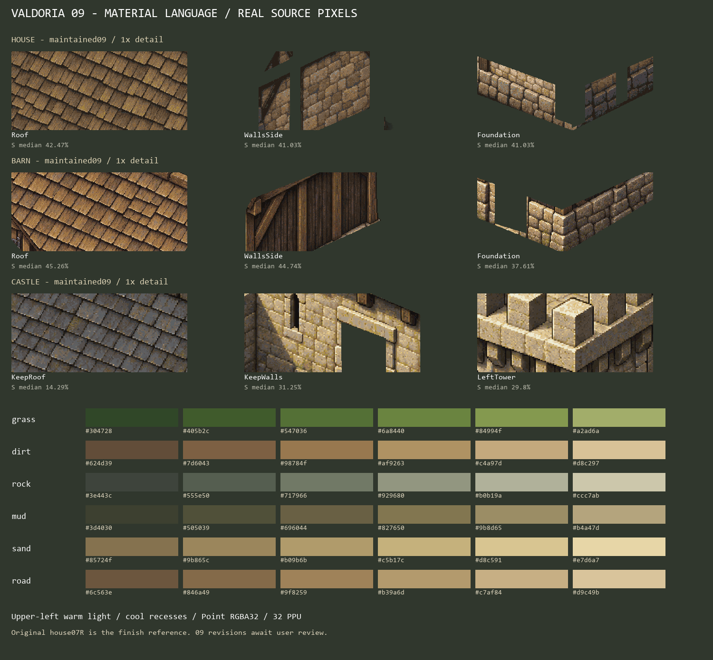
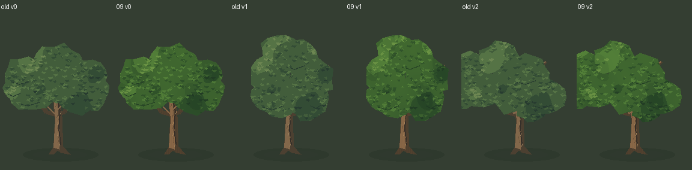

# Valdoria — linguagem visual v1

Direção de 18/10/2026. A casa07R é a referência de acabamento. Após a entrega09, o usuário aprovou as construções apresentadas e informou que **terreno e vegetação ainda precisam de qualidade**. [Avaliação registrada](../Validation/ValdoriaWorldStudio09/artistic-review.json). Preservar a arquitetura como referência; não considerar a revisão ambiental concluída. Estados de conservação não avaliados separadamente continuam candidatos. Testes não substituem aprovação artística.

Os recortes acima vêm dos exports Aseprite a 1×; não são desenhos conceituais. Alguns layers contêm fragmentos separados de uma mesma fachada. As estatísticas medem pixels opacos desses layers, não uma segmentação perfeita de cada material.

## Referências e leitura

- Principal: `ArtSource/Labs/World2026/WorldStudio07R/SourceV1/rural-reference.aseprite`.
- Madeira e cobertura agrícola: `WorldStudio08/Barn/SourceV1/barn-reference.aseprite`.
- Cantaria e cobertura mineral: `WorldStudio08/Castle/SourceV1/castle-reference.aseprite`.
- [Padrão arquitetônico](ArchitectureStyleGuide.md), [validação integrada09](../Validation/ValdoriaWorldStudio09-VisualUnification.md).
- [Medições dos pixels](../Validation/ValdoriaWorldStudio09/measured-style.json) e [paletas/receita](../../ArtSource/Labs/World2026/WorldStudio09/Recipes/terrain-A.json).

O protagonista é Quaternius. Não redesenhar suas poses nem modificar escala para fazer uma construção caber na comparação.

## Cor e contraste

Usar famílias distintas: verdes vegetais, ocres do solo/madeira, cinzas minerais e azuis esverdeados da água. Compartilhar temperatura, contraste e hierarquia; não pintar todas as superfícies com as mesmas cores.

| Família | Faixa de trabalho recomendada, S HSV | Organização de valor |
|---|---:|---|
| Madeira e telhas de madeira | 30–55% nas massas; exceções localizadas | Reentrâncias frias; fibra e arestas quentes |
| Pedra/alvenaria | 10–45% nas massas | Junta escura, plano médio dominante, aresta clara descontínua |
| Telhado de ardósia | 5–25% nas massas | Menos cromático que a madeira; separar planos por valor |
| Grama/folhagem | 30–65% | Sombra verde fria, meio verde rico, luz amarela controlada |
| Terra e caminho | 25–55% | Pigmento ocre, compactação e desgaste subordinados à rota |
| Água | Manter a família05 nesta revisão | Reflexos e profundidade preservados; sem forçar saturação terrestre |

São faixas de direção, não limites para cada pixel. A telha09 da casa tem S mediana **42,47%**, a do celeiro **45,26%**, a ardósia do castelo **14,29%**. Fundação da casa: luma RGB codificado P10/mediana/P90 **0,123/0,318/0,563**. Isso não é luminância física nem exposição de câmera.

Não usar um Color Tint, pós-processamento ou multiplicador de saturação global como substituto do trabalho por material. Manter separação entre planos grandes antes de acrescentar textura.

### Rampas terrestres candidatas09

| Família | Sombra → luz |
|---|---|
| Grama | `#304728 #405b2c #547036 #6a8440 #84994f #a2ad6a` |
| Terra | `#624d39 #7d6043 #98784f #af9263 #c4a97d #d8c297` |
| Rocha | `#3e443c #555e50 #717966 #929680 #b0b19a #ccc7ab` |
| Caminho | `#6c563e #846a49 #9f8259 #b39a6d #c7af84 #d9c49b` |

Lama e areia estão na receita. Rampas não obrigam ruído em toda a superfície. A variação deve ter causa: umidade, compactação, junta, orientação de plano ou desgaste.

## Luz, volume e detalhe

Luz principal superior esquerda, levemente quente. Lateral e recessos recebem sombras mais frias. Reservar os extremos para contato, juntas e pequenas arestas; evitar um contorno preto contínuo e uniforme.

1. Ler primeiro silhueta, massas e dois planos visíveis.
2. Depois ler estrutura: beiral, fundação, vigas, ramificações e grupos de folhagem.
3. Só então ler fibra, fragmentos de pedra, folhas, líquen e desgaste.

Não resolver uma parede plana com mais pontilhado. Não resolver uma copa plana aumentando apenas a quantidade de folhas. Grupos de luz e sombra precisam explicar a massa, com claros interrompidos e recessos entre volumes. Troncos têm luz lateral e sulcos irregulares; sombra no chão é independente da copa.

## Perspectiva, pixels e escala

O jogo continua 2D em perspectiva 3/4. Blender pode estudar volumes offline, mas não introduz um requisito de malha3D no runtime.

As guias de frente autoradas medem aproximadamente 20,08° na casa, 22,74° no celeiro e 16,87° no perímetro do castelo. São guias de chão, não medições exatas das bordas pintadas; o castelo possui volumes separados. Preservar a leitura visual consistente de frente/lateral, sem espelhar a iluminação ou deformar sprites para igualar numericamente essas guias.

Fontes ambientais: **32 PPU**, RGBA, Point, sem mipmaps/compressão. Não suavizar nem redimensionar para fabricar outra construção. Avaliar detalhe a 1 pixel de arte por pixel de Game View e depois no enquadramento de jogo. A galeria mostra os três modelos na mesma escala entre si, mas reduzida; seus close-ups são evidências distintas.

No frame de referência, Quaternius possui 117px visíveis, escala visual1,25: **4,5703u**. As portas de referência têm **4,8387u / 4,8794u / 4,8931u**, respectivamente. São cerca de 1,06–1,07 vezes a altura aparente do protagonista; não aplicar automaticamente uma porta de5u a todo modelo.

## Integração ambiental

Terreno e caminhos mantêm pigmento contínuo no espaço mundial. Não reiniciar textura nas células32×32. Detalhes precisam de distribuição e espaçamento, não de uma trama repetida que denuncie a grade. Validar em movimento.

Preservar topografia, fronteiras subcélula, água, vau e footprint durante uma revisão cromática. Sombras e vegetação não podem esconder divergência entre apresentação e colisão. Fundações precisam encontrar o chão; acesso visual não é autoridade física.

A vegetação respeita o habitat já calculado, mantém âncora, tronco físico pequeno e copa visual. Árvores, arbustos e juncos continuam indivíduos procedurais, não uma pintura única. Não plantar dentro de uma passagem só porque a copa é transparente.

O terreno e a vegetação09 ainda têm detalhe mais simples que a arquitetura. A comparação integrada deve orientar a próxima avaliação artística, sem afirmar equivalência perfeita de acabamento.

## Produção e aprovação

Novas fontes em nova revisão. Exportar os pixels efetivamente editados no Aseprite; não executar novamente um autor inicial sobre a fonte final. Registrar receita, seed, versão, entradas, direitos/proveniência e hashes. Arte original assistida por ImageGen mantém a proveniência dos marcos07R/08; a revisão09 usa Aseprite/Lua e composição Python, sem nova geração de imagem.

Uma alteração na biblioteca exige exportação e composição offline controladas. Play só carrega referências prontas. Documentar combinações que exigem nova arte e rejeitá-las. Testes técnicos, capturas e opinião do agente não substituem aprovação visual explícita do usuário.
