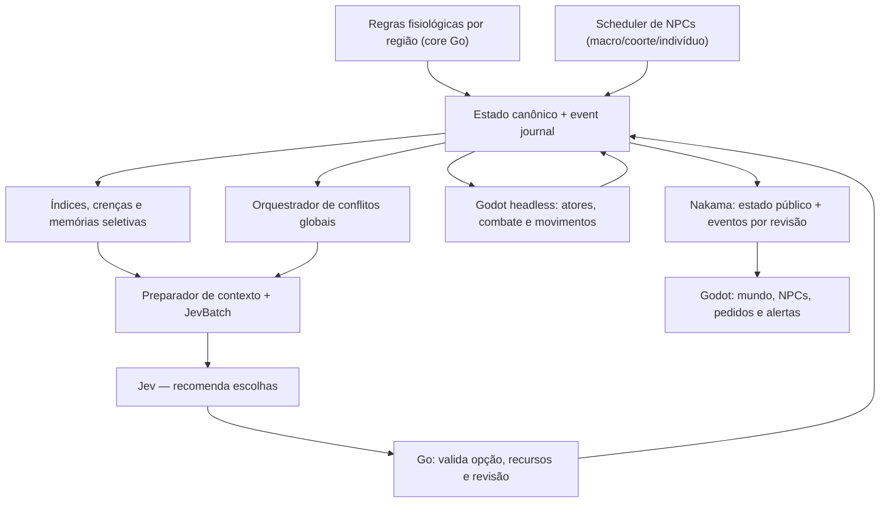

# PLANO MESTRE — Hospedeiro como organismo vivo e sociedade de agentes autônomos

> **Data:** 27/10/2026 · **Branch obrigatória:** `main` · **Status:** plano de implementação para Claude Code, NÃO implementação executada.  
> **Objetivo de entrega final:** múltiplos agentes celulares autônomos trabalham, percebem, lembram, cooperam, reagem e tomam decisões constantemente dentro de um organismo persistente, com ou sem jogadores; conflitos fisiológicos globais emergem, evoluem e se resolvem por causalidade, não por filas de quests ou dungeons privadas.

**Leia antes de executar:** [AGENTS.md](../../AGENTS.md), [Architecture.md](../Architecture.md), [GameVision.md](../GameVision.md), [LivingWorldConflicts.md](LivingWorldConflicts.md), [JevCognitiveArchitecture.md](JevCognitiveArchitecture.md), [Nakama.md](Nakama.md), [PersonalWorlds.md](PersonalWorlds.md), [GameStructure.md](GameStructure.md), [HostScience.md](HostScience.md), [ExplorationPlan.md](ExplorationPlan.md). O documento antigo GameStructure serve como referência técnica legada; conflito persistente substitui dungeon instanciada como loop central.

## 0. DEFINIÇÃO DE PRONTO — experiência observável

Ao entrar no Hospedeiro pela primeira vez:
1. Hemácias percorrem vias de transporte, células de suporte mantêm seus tecidos, plaquetas tentam selar ferimentos, neutrófilos patrulham e respondem a sinais, macrófagos removem material, dendríticas comunicam antígenos. Tudo isso acontece **sem input do jogador**.
2. NPCs têm identidade, posto, rotina, capacidade finita, estado interno resumido, memória relevante, crenças separadas dos fatos, relações e objetivos concorrentes. Mudam de planos diante de interrupções; não esperam eternamente o jogador.
3. Um conflito (infecção no pulmão, por exemplo) é criado a partir de condições materiais, torna-se visível a todos no mesmo mundo, escala ou regride com indicadores oficiais e só termina após estabilização sustentada.
4. Um NPC pede auxílio por necessidade observável, com fala contextual; um jogador pode auxiliar sem aceitar uma quest. A intervenção altera a simulação e pode ser lembrada e comunicada.
5. Diversos conflitos podem coexistir. Interface prioriza um acompanhado, mostra os demais num painel e usa alertas grandes somente em transições importantes, sem spam.
6. Ao desconectar e reconectar, a sociedade não reinicia: há histórico, progresso, consequência e continuidade. Sem jogadores, as células seguem executando tarefas; quando o serviço está desligado, **não alegar simulação contínua**: preservar estado e definir política explícita de retomada/catch-up.
7. Jev participa realmente em escala macro/meso/micro, em lotes de perguntas coerentes, de modo assíncrono, com contexto rico e rastreável; continua possível simular com Jev desligado.
8. Ações materiais só ocorrem por comando autorizado, com deduplicação, journal persistente e replay determinístico.
9. Os mundos pessoais permanecem separados do compartilhado; nenhuma visita P2P injeta fatos, dano ou recompensas no MMO.
10. As cinco masmorras legadas deixam de ser experiência visível após migração segura; seus locais, conteúdos e recompensas úteis se transformam em frentes abertas e descobertas do corpo.

**O resultado esperado não é 'um milhão de LLMs conversando sem parar'.** É uma população de muitos agentes eficientes, simulados em níveis de detalhe, com avaliações Jev seletivas e consequências sistêmicas duráveis.

## 1. Linha de base da main examinada em 27/10/2026

- `engine/core/tick.go`: tick avança agendamentos, regras, rotinas, boatos, diretor, decisões, `think` (NPC), quests e dungeons. Já não depende de jogadores conectados.
- `engine/core/def.go`: `Universe`, `RuleDef`, `AgentDef`, `GoalDef`, `Happening`, `QuestDef`; condições/fatos declarativos.
- `engine/core/state.go`: `State`, `Entity`, `Fact`, `Belief`, `Event`, `Decision`; `Digest`, `Clone`, `NewState`.
- `engine/core/compile.go`: validação e `Fingerprint()` do JSON inteiro do universo.
- `engine/core/mind.go`: saliência, observação, relações, boatos, `knowsOf`; NPCs não são oniscientes.
- `engine/core/quest.go`: ofertas por NPC com janela pessoal, recebimento, aceite, recusa e consequências.
- `engine/core/director.go`: `happenings` elegíveis, decisão global `world`, ritmo de tensão.
- `engine/core/dungeon.go`: runs por jogador, legado a migrar.
- `engine/sim/runner.go`: journal, replay, despacho assíncrono de decisões, `Run(ctx,every)`; `Runner` não reexecuta IA durante replay.
- `engine/store/filelog.go`: journal JSONL e identidade por fingerprint; modificações de universo não abrem automaticamente logs antigos.
- `engine/advisor/jev.go`: `typesafe/jev-1.13`, uma questão `choice` por chamada, contexto cortado, até 64 alternativas, resposta revalidada. Ver `JevCognitiveArchitecture.md` antes de qualquer alteração.
- `universes/hospedeiro/universe.json`: **3 agentes com goals**, **15 entidades de base**, **37 modelos de quest**, **5 acontecimentos**, **5 dungeons**, rotinas/regras/vitais. Números da inspeção atual, não totais de NPCs no cliente.
- `clients/hospedeiro/scripts/runtime/bio_game_server.gd`: servidor Godot de combate e snapshots; `bio_world.gd`: apresentação e população; `bio_engine_link.gd`: visões e comandos do motor; `bio_hud.gd`: avisos; `bio_dungeon_panel.gd`: UI legada.
- `Docs/Hospedeiro/Nakama.md`: mundo compartilhado autoritativo e presença até 64 convidados por sala **limite configurado, não escala comprovada**; mundo pessoal e visitas WebRTC separados.
- Testes e validações: `engine/scenarios/`, `engine/advisor/jev_test.go`, `engine/sim/runner_test.go`, `clients/hospedeiro/tests/run_tests.gd`, `clients/hospedeiro/tests/web/test_nakama_local.py`. Não supor ferramentas locais instaladas neste executor remoto.

### 1.1 Regras invioláveis
- **main sempre**; `git status`, `git pull --ff-only origin main`; nunca usar `master` implicitamente.
- Começar por testes locais isolados; não testar contra publicação e não resetar instância real.
- Go core é puro, determinístico, biblioteca padrão. Sem Java, socket, LLM, banco, relógio real ou aleatoriedade externa no `Step`.
- Motor é autoridade de progresso e conflitos; Godot headless confirma física/combate; Nakama autentica/transporta; cliente envia intenções, não fatos.
- Respostas de Jev nunca alteram recursos diretamente. É uma proposta de intenção entre ações validadas, que passa por revalidação.
- `Fingerprint` impede trocar universe.json em log existente sem migração; **não forçar recomeço**.
- Mundo pessoal e mundo compartilhado precisam conservar seus históricos/IDs separados e modo offline funcional.
- Execução contínua significa serviço em execução; se máquina desliga, estado persiste. Um processo parado **não executa agentes**.

## 2. Arquitetura de execução



Camadas:
- **Fisiologia**: metabolismo, transporte, infecção, reparação e condições de órgão, com limites e efeitos.
- **População**: coortes baratas e agentes nominados ricos (único ID, função, objetivos).
- **Conhecimento**: memória de eventos e crenças locais, compartilhamento filtrado por comunicação.
- **Conflitos**: estados persistentes, severidade, causas, frentes e contribuições confirmadas.
- **Deliberação**: Jev contextual, bateladas, fallback, validação e scheduler de orçamento.
- **Apresentação/rede**: NPCs visíveis, alertas, painéis, sincronia e reconexão.

### 2.1 Simulação multirresolução (a chave da escala)
- Nível 0 **Fisiologia agregada**: dezenas/milhares de células representadas em contadores por tecido e sub-região. Atualização por tick ou intervalos determinísticos, independente de câmera.
- Nível 1 **Coortes operacionais**: população por função, destino e tarefa; movimentação por nós e fluxos do grafo do corpo, sem física individual; calcula suprimentos, transportes e perdas.
- Nível 2 **Agentes nominados persistentes**: dezenas/centenas (limites aferidos, não prometidos) com identidade, memória, tarefas e relações. Mesmo fora de tela, existem no estado e continuam tomando decisões por intervalos.
- Nível 3 **Agentes encarnados próximos**: instâncias Godot só quando necessárias aos jogadores/conflitos observáveis, física e animação sob autoridade. Ao desaparecer da região observada, devolvem resultado ao agente canônico — não morrem nem perdem histórico.
- Nível 4 **Decisão consultiva Jev**: amostra de decisões relevantes de L2/L3, agrupada por conflito/região. Nunca por frame; nunca obrigatória para fazer N0-N3 progredir.

**Transições L2↔L3:** usar ID estável, tempo lógico, posição/região, tarefa, saúde e composição do grupo. Materializar do snapshot + eventos; desmaterializar só representação física. Nunca gerar novos NPCs/recursos por aproximação. Reconciliar rota física com progresso agregado sem teleporte incoerente ou resultados duplicados.

## 3. Modelo de domínio proposto (contratos versionados)

Criar contratos mínimos, fora do core de apresentação. Nomes são **propostos**, devem ser ajustados às convenções reais quando implementados:
- `PopulationDef` / `PopulationState`: `region, kind, headcount, reserves, production, consumption, transport_capacity`.
- `NPCProfileDef`: `id, lineage, home, route_graph, capabilities, physiological_role, baseline_goals, memory_policy`.
- `NPCState`: `id, region, route_node, task_id, phase, energy, health, available_resources, beliefs, memories_index, relations, last_decision_tick, next_due_tick`.
- `TaskDef` / `TaskState`: `id, role, location, required_capabilities, resources, timeout, progress, conflict_id, assigned_actor, state`. Reservar tarefa e recursos de forma exclusiva ou contada.
- `Need`: `subject, kind, urgency, cause_ref, created_tick, expires_or_revalidate_tick, allowed_actions`. Necessidade não equivale automaticamente a missão.
- `MemoryEpisode`: `event_id, subject, source, observed_tick, validity_tick, type, salience, visibility, superseded_by`. Mantém procedência; relação e crença são estados distintos.
- `ConflictDef`: `id, root_triggers, dedupe_scope, phases, thresholds, resolution_guard, recovery_policy, fronts, consequences`. Biologia fica no JSON do universo.
- `ConflictState`: `instance_id, def, root_cause, onset_tick, phase, phase_since, primary_region, affected_regions, metrics_snapshot, fronts, last_alert_revision, contributions, recovery`.
- `ContributionRecord`: `conflict_id, actor, server_evidence_id, kind, magnitude, applied_tick, award_receipt`.
- `HelpRequest`: `request_id, npc_id, need_id, conflict_id?, audience, eligible_actions, status, announced_tick, expiry_check_tick, resolved_by?`.
- `DecisionEnvelope`: `decision_id, cohort_key, world_revision, snapshot_digest, observed_at_tick, due_tick, choices[], fallback, outcome_metadata`.
- `AlertEvent`: `conflict_id, transition_revision, severity, audience, dedupe_key, title, summary`.

**Canon versus projeção:** dados materiais e resolução pertencem ao `State` replayável. Índices de consulta, caches e resumo de linguagem são reconstruíveis; não servem como fonte da verdade. Journal pode referir IDs e deltas compactos, não copiar listas completas em cada tick.

### 3.1 Coerência de dados e nomenclatura
- IDs estáveis `npc:<linhagem>:<região>:<ordinal>`, `conflict:<tipo>:<região>:<sequência>` (formatos a validar contra `validID`).
- Ticks inteiros para tempo lógico; carimbo real apenas em monitoramento externo.
- Regras e unidades declaradas explicitamente. Evitar misturar saturação de oxigênio (%) com escore de perfusão (0–100) sem converter.
- Cada transição de conflito cria `Event` público de **uma mudança semântica**; indicadores finos vão no snapshot, não como alertas repetitivos.
- Sem estado global mutável fora de `Step`. Collections ordenadas antes de desempate determinístico.
- Receipts/idempotência para confirmação de ação e recompensa; eventos duplicados não contam duas vezes.
- Compatibilidade com visões existentes: campos novos opcionais no início, `nil` aceito por clientes antigos; se alterar contrato de maneira incompatível, nova versão `/v2`.
- Não passar dados privados de outro jogador ou crenças secretas de NPC diretamente na visão pública ou prompt indiscriminado.
- Não registrar tokens de autenticação, API keys, texto bruto não filtrado dos jogadores ou PII desnecessária.

## 4. P0 — Auditoria e baseline antes de desenvolver

**Entrega P0-01:** registrar SHA exato da `main`, tabelar arquivos/módulos, configuração do runner, fluxos Godot headless, JEV e contratos de API, rotinas NPC e legado de dungeons. Marcar o que é testado versus somente documentado.

**P0-02:** criar fixture de mundo QA e cópia isolada do journal real **somente se autorizado e sem copiar segredos**. Rodar replay/digest em cópia; registrar tamanho do log, tick médio, universo fingerprint, número de NPCs, players, quests e dungeons. Não reexecutar nem resetar produção.

**P0-03:** adicionar benchmarks baseline de 1, 10, 100, 1.000 NPCs **sintéticos** no core; medir latência p50/p95/p99 do tick, alocações e tamanho do journal, CPU e memória. Identificar custos reais antes de otimizar.

**P0-04:** catalogar todas as dependências de `dungeon` em Go, Godot, testes, recompensas, codex, UI e saves. Criar matriz de migração sem excluir nada.

**Aceite:** baseline reproduzível e relatório em `Docs/Validation/`, com ambiente/commit/comandos/resultados e problemas conhecidos.

## 5. P1 — Fundação tipada da sociedade celular

**P1-01** Definir população/coorte e trabalhos fisiológicos como tipos genéricos do motor (conteúdo biológico configurado via universe.json). Não criar controlador NPC específico de hemácia no `core`.

**P1-02** Implementar `NPCState` persistente e migrável: local lógico, tarefa atual, capacidade, necessidades, último tick processado, próximo tick agendado, flags de ciclo de vida. Agentes antigos sem novo estado recebem defaults derivados da definição.

**P1-03** Persistir `PopulationState` por região e papel, com capacidade finita, estoque e metas. Células de fundo não são instâncias Godot por padrão.

**P1-04** Determinar funções de custo para trabalho: transportar consome capacidade por tick e acrescenta entrega ao destino; reparar consome materiais; combater/limpar retira carga somente com simulação autorizada; investigar fornece observação, não destrói inimigo imaginário.

**P1-05** Criar conservação de recursos: nenhuma ação duplica oxigênio, ferro, ATP, suprimentos; entradas/saídas exógenas como alimentação e respiração são regras explícitas.

**P1-06** Evitar simulação ingênua de todas as células: ciclo de vida, mortalidade e reposição por coorte; indivíduos nominados podem nascer, migrar, envelhecer, falhar, morrer e ser substituídos, preservando registro histórico, sem renascimento instantâneo de NPCs arbitrários.

**Testes:** work-consumption, conservação, limite de estoque, coorte sem jogador, um tick versus N ticks, clone/replay, NPC velho sem campos novos, spawn/despawn sem duplicar.

**Aceite:** o corpo se mantém num equilíbrio plausível com jogadores ausentes e sem Jev.

## 6. P2 — Rotina física/lógica dos agentes

**P2-01** Expandir `think(s)` de um goal simples por tick para um scheduler declarativo por função, tempo e urgência; não perder regras existentes de Valdoria. Preferir inserir componente genérico com compatibilidade.

**P2-02** Definir estados: `idle`, `patrol`, `travel`, `carry`, `inspect`, `defend`, `phagocytose`, `repair`, `signal`, `rest`, `blocked`, `seek_help`, `recover`. Cada estado tem transições e duração verificáveis; nem todos valem para todas as linhagens.

**P2-03** Mapa lógico em grafo (regiões, vasos, pontos de passagem, tempos de viagem). Reusar `spots`, `passages`, mapa físico já existente quando útil; distâncias e capacidade de fluxo não são inventadas pelo Jev.

**P2-04** Rotas como contratos de trabalho: objetivo, origem/destino, duração, carga, risco, bloqueio e nova rota. Replanejar em caso de obstrução ou nova prioridade.

**P2-05** Colisões/luta física perto do jogador no Godot; progresso lógico fora da região carregada. Reconciliar e impedir que uma hemácia entregue a mesma carga nos dois mundos.

**P2-06** Escalonar e distribuir processamento entre ticks por ID; urgências altas ganham prioridade, mas jobs de manutenção não ficam eternamente sem executar (anti-starvation).

**P2-07** NPCs interagem espontaneamente entre si: escoltas, sinalizações, informação, reparação, partilha limitada de recursos e tarefas, sem falar com player.

**Testes:** rotas, bloqueio e desvio, deslocamento fora de câmera, economia de CPU por LOD, custo justo, eventual starvation, transição offline/online.

**Aceite:** uma cena observada por 10 minutos mostra NPCs diferentes executando trabalhos, inclusive quando o jogador não participa; o resultado agregado é consistente com a encarnação.

## 7. P3 — Necessidades, tarefas e coordenação

**P3-01** Detectar `Need` baseado em fisiologia e resultado de tarefas: baixa oxigenação, obstrução, ferimento, antígeno desconhecido, insuficiência de vigilantes, excesso de resíduos, toxinas, etc.

**P3-02** Gerar `TaskState` apenas para necessidades ativas. Tasks possuem pré-condições, materiais, local, reserva, execução, confirmação e cancelamento. Limites de quantidade por área e por conflito.

**P3-03** Padrão deterministicamente sensato de seleção de tarefa: urgência + adequação biológica + tempo de viagem + recursos + risco + custo de trocar missão. Jev poderá depois alterar **prioridade**, não permissões.

**P3-04** Reserva transacional de recursos/ocupações: dois agentes não ocupam o mesmo único recurso; se falhar reserva, replanejar. Timeout e abandono da tarefa liberam vaga.

**P3-05** Realimentar a necessidade a partir do efeito da tarefa (laço fechado). Tarefa sem efeito deve ser reavaliada, não repetida indefinidamente.

**P3-06** Coordenador meso organiza frentes por capacidade real; tarefas em equipe podem reunir várias células, sem exigir jogadores ou co-op de dungeon.

**Testes:** duas células para um item, tarefas impossíveis, replanejamento, deadlock de recursos, preempção de emergência, progresso sem jogador.

**Aceite:** sociedade evita simultaneamente multidões paradas e multidões correndo atrás da mesma tarefa impossível.

## 8. P4 — Memória individual, coletiva e comunicação

**P4-01** Preservar `Fact` (verdade) versus `Belief` (crença) como fundamento. `MemoryEpisode` guarda vivência com evento original e procedência; não usar histórico de prompts como memória canônica.

**P4-02** Tipos de episódio: ajuda recebida, perigo encontrado, rota interrompida, resultado de tarefa, promessa atendida/falhada, antígeno observado, conflito contido, notícia transmitida.

**P4-03** Política de retenção: janela recente; episódios marcantes duradouros; sumarização determinística periódica; índices por entidade/conflito/região; expiração e correção por evidência nova. Crenças erradas podem continuar como crença, com `superseded`/data.

**P4-04** Comunicação por observação e encontro: alcance/posição, vizinhança, circulação, sinais químicos e redes especializadas; nunca compartilhar conhecimento global instantâneo sem mecanismo de transmissão.

**P4-05** Reputação por ações confirmadas: NPC conhecia jogador? que ajuda concreta recebeu? promessa executada? confiança muda gradualmente; relação não é recompensa arbitrária do modelo.

**P4-06** Memória coletiva local por órgão e por grupos; indexar sem transformar fatos privados em conhecimento público. Conflito global é público em seus indicadores, mas seu diagnóstico pode depender de descobertas.

**P4-07** Seleção de contexto de decisão: `TaskContext(revision, npc, conflict, facts, accessible_beliefs, top_memories, local_needs)`; limite por relevância/recência e referências de origem. Testar com memória antiga contraditória.

**Testes:** sem onisciência, erro herdado por boato, correção observada, relação após ajuda, privacidade, limite de memória e replay idêntico.

**Aceite:** Rubra reconhece corretamente o jogador que a ajudou, não sabe automaticamente o que aconteceu no rim, não repete um boato falso depois de corrigi-lo.

## 9. P5 — Pedido de ajuda dinâmico e interação

**P5-01** Criar `HelpRequest` emergente derivado de `Need` + falha/capacidade insuficiente + destinatário plausível; não transformar cada necessidade em pop-up.

**P5-02** Definir `request` com status `open/answered/withdrawn/resolved/expired`, alternativas válidas, alvo e condição de retirada. Pedido não é obrigação e não exige clicar em aceitar para ajudar.

**P5-03** NPC pode pedir assistência a outro NPC primeiro e a jogador presente/relacionado depois; emergências abertas podem ser divulgadas mesmo a desconhecidos.

**P5-04** Mensagens curtas por templates parametrizados por estado confirmado. Caso se queira prosa rica, usar outro gerador opcional como camada expressiva; Jev não é modelo de diálogo livre.

**P5-05** Fala e UI contextual: pedido ao se aproximar ou após uma ação útil, janela curta, opção `ajudar/agora não/saber mais`; nenhuma cadeia sem causa. Se a necessidade foi resolvida, cancelar pedido e atualizar fala imediatamente.

**P5-06** Contribuir sem aceitar: engine detecta ação confirmada relevante, atribui ao conflito e NPC reconhece quem realmente ajudou, inclusive quando o jogador não recebeu pedido.

**P5-07** Cooldowns por NPC/jogador/necessidade; anti-spam, não repetir diálogo por reconexão; per-player acknowledgement separado da existência global do pedido.

**Testes:** ajuda não solicitada, conhecido/desconhecido, pedido incoerente, pedido resgatado por NPC, objetivo expirado, dedupe/reconnect.

**Aceite:** jogadores observam e respondem a necessidades espontâneas sem lista de quests saturada.

## 10. P6 — Conflitos globais: contrato, estado e causalidade

**P6-01** Criar `ConflictDef` genérico no `Universe`, com validação em `core.Compile` e condições configuráveis. Não codificar `pulmao`, `bacteria` ou `febre` no engine genérico.

**P6-02** Criar `ConflictState` no `State`, `Clone`, `Digest` e `View`; manter ordem estável e IDs únicos. Sem conflito, mundos antigos continuam válidos.

**P6-03** Máquina de estados: `detected/active/critical/contained/recovering/resolved`; `expanding` pode ser transição ou atributo multi-frente, não introduzir combinações contraditórias. Perigo pode recrudescer (`contained->active`), mantendo `instance_id` se causa persistir.

**P6-04** Criar a partir de **gatilho material** (foco, lesão, queda de transporte) com chave de dedupe por causa/região e escopo definido. Diretor/IA escolhe **entre** acontecimentos fisiologicamente possíveis; não inventa crise sem gatilho.

**P6-05** Indicadores e thresholds: carga patogênica, oxigenação, integridade e inflamação; cruzar limiar com histerese e janela de sustentação. Resolver quando condições medidas são satisfeitas por período; não por última kill ou expiry.

**P6-06** Evolução por tick: progressão natural se não houver ação, contenção por coortes NPC e reação a tarefas/jogadores. Se problema aumenta, novas frentes alteram regiões mas compartilham causa, sem proliferar clones.

**P6-07** Evento público idempotente por transição semântica: `conflict-started`, `conflict-escalated`, `conflict-front-opened`, `conflict-contained`, `conflict-reopened`, `conflict-resolved`. Cada evento traz `conflict_id` e revisão.

**P6-08** Estado de recuperação produz trabalho real (limpeza, reconstrução, reabsorção, novas rotas), não desaparece com a celebração.

**P6-09** Múltiplos conflitos concorrentes: motor simula todos; HUD destaca 1 principal + até 2 secundários, painel completo dos demais. Diretor considera orçamento de conflitos, causalidade e qualidade narrativa; não apaga fenômenos reais para cumprir quota.

**Testes:** criação única, aumento/redução sem ajuda, reabertura, transição sem spam, duas frentes, múltiplos conflitos, estabilização sustentada, fallback sem Jev, replay.

**Aceite:** conflito permanece enquanto condição existe; jogadores diferentes veem mesmo ID/estado; nenhuma oferta pessoal encerra crise global.

## 11. P7 — Participação, consequências e reconhecimento

**P7-01** Servidor Godot confirma ações materiais (abate relevante, defesa, escolta, reparo, transportes, captura de antígeno, contenção). Nunca aceitar magnitude de contribuição enviada pelo cliente.

**P7-02** Evento de contribuição vincula `conflict_id`, ator, ação, região, prova, magnitude validada; dedupe por `evidence_id` com receipt idempotente.

**P7-03** Evitar exploits: cap por atividade, verificação de causalidade e disponibilidade, sem farm infinito de pequenas ações. Fracasso não dá recompensa de sucesso.

**P7-04** Registrar participação de NPCs e jogadores na mesma trilha causal, distinguindo contagem de crédito/recompensa. Reconhecer transporte, informação e reparo, não só dano e último golpe.

**P7-05** Recompensas coerentes com progressão sem XP e sem níveis: descoberta, genes obtidos, reputação, títulos, conhecimento e acesso a novos nichos. Rotear o que era recompensa de dungeon para conflito/descoberta/feitos comprovados. Recompensa concedida uma vez por elegibilidade, não por reconnect.

**Testes:** falso dano, replay de prova, dois jogadores, NPC contribui sozinho, rede cai entre operação e ACK, conclusão simultânea.

**Aceite:** todos podem contribuir sem missão; crédito não duplica e não pode ser falsificado.

## 12. P8 — JevBatch: aproveitar inteligência com custo controlado

**P8-01** Separar contrato genérico `Decision` por pergunta versus requisição à API. Criar `BatchQuestion`, `BatchContext`, `BatchAnswer` em `engine/advisor/` (ou pacote novo sem dependência em core); manter `Decide` legado.

**P8-02** Experimentar no contrato publicado as modalidades suportadas (choice, boolean/probabilidade e score) sem presumir suporte idêntico para ambos os modelos. Implementar adaptador com serialização e testes `httptest`.

**P8-03** Construir contexto baseado em instantâneo canônico (`world_revision` e `snapshot_digest`), compactado por região e necessidade. Prioridade ao que mudou desde última avaliação. IDs opacos para opções; não enviar segredos, perfis de terceiros indiscriminadamente ou instruções livres.

**P8-04** Agrupar perguntas por `(universe, conflict, region, revision, horizon)`; teste com 8/16/32/64 perguntas e limites estritos de bytes, alternativas e latência. Não somar perguntas desassociadas só para inflar throughput.

**P8-05** Conservar escolha, probabilidades por opção, confiança, latência, tokens/custo quando provedor fornecer, versão do modelo e identificador de chamada. Não interpretar alta confiança como verdade.

**P8-06** Mapear respostas para decisões já pendentes do motor, com commit de **cada decisão validada** no journal; nenhuma resolução em bloco escapa de idempotência e revalidação. Se duas escolhas disputam recursos, processar em ordem determinística com reserva e replanejar o perdedor.

**P8-07** Escolha `manter_rotina / nenhuma_acao / informacao_insuficiente` em questões ambíguas. Em erro, timeout, state stale ou sobrecarga, política local determinística toma decisão. IA nunca bloqueia tick.

**P8-08** Introduzir policy de seleção macro/meso/micro por saliência e importância de decisão. Baixa prioridade continua determinística; alta prioridade consulta Jev em lote e pode receber novo plano.

**P8-09** Configurar feature flags de cliente/mundo: `jev_batch_enabled`, `jev_model`, `npc_ai_budget`, `macro_ai`, `meso_ai`, `micro_ai` **no runtime/config conforme convenções**, sem colocar secrets em JSON público.

**P8-10** Experimento QA comparativo: Go puro, Jev 1.13 isolado, Jev 1.13 batch, Jev 1.14 batch. Medir precisão de decisões, coerência temporal, diversidade funcional, p95/p99, custo por decisão útil, taxa de falha/fallback. Só trocar o modelo em produção com ganho comprovado e rollback.

**Testes:** 64 opções, zero opção, resposta parcial/inválida, timeout, duplicação, conflito de recurso, interleavings, batch quebrado parcialmente, replay e falha do provedor.

**Aceite:** 100% das decisões aplicadas são válidas e replayáveis; melhoria sobre baseline em cenários rotulados; sem degradação da simulação offline.

## 13. P9 — Diretor celular macro, meso e micro

**Macro** — por mudança importante do corpo: balancear pressão, escolher entre conflitos candidatos válidos, recomendar alocação de atenção entre órgãos; resultado explica a causa sem predizer estado fictício.

**Meso** — por órgão/frente: coordenar coortes de defesa/transportes e ajuda; decidir que tarefa recebe células disponíveis. Sempre há limite de recursos, risco e custo de deslocamento.

**Micro** — por NPC importante: adaptar prioridade de comportamento a crenças, personalidade mecânica (não emoções simuladas ilimitadas), relacionamento, estado e histórico. NPC não precisa de decisão Jev para cada passo de animação.

**Scheduler cognitivo:**
- Queue por região e conflito, ordenada por `urgency + uncertainty + expected_impact + staleness`, com anti-starvation.
- Change-driven, não frame-driven; disparar em mudança de fase, bloqueio, observação nova, pedido falhado, chegada a ponto ou atualização de rotina.
- Rate-limit por mundo e por região, orçamento monetário e limite de concorrência; cache de decisões idempotentes por revisão.
- A avaliação Jev pode retornar tarde e ser descartada sem prejuízo; requer nova observação para replanejar.
- Nunca enviar 500 requisições de NPCs ao mesmo tempo por spawn inicial. L0/L1 funcionam sem Jev.

**Aceite:** numa hora simulada vários NPCs demonstram diversidade plausível, trabalho e cooperação, e o serviço Jev desligado preserva progresso do corpo.

## 14. P10 — Mundo vivo no Godot e no Nakama

**P10-01** Construir instância visual `BioNpcActor` (nome a confirmar) vinculada ao ID canônico, com corpo procedural e papel discernível. Renderizar trabalho: transporte visível, inspeção, limpeza, sinalização, reparo e defesa.

**P10-02** No `bio_game_server.gd`, servidor recebe/consulta visão pública dos NPCs e materializa somente na proximidade necessária; snapshot inclui IDs, região, posição/tarefa/ação e revisão. LOD para NPCs fora da tela.

**P10-03** Reutilizar `bio_world.gd` para população local, mas evitar spawn independente de NPC canônico. Diferenciar fauna/inimigos ambiente de agente nomeado.

**P10-04** Sincronia via Nakama sem entregar autoridade ao cliente. Sessões autenticadas podem `follow-conflict`, `respond-help`, `inspect-npc` e demais intenções permitidas; movimentos/dano continuam confirmados pelo headless.

**P10-05** Reconectar reidrata estado atual (conflitos, NPCs próximos, tarefa, diálogo contextual, revisão), não depende de replay de todos os eventos e evita nascer duplicado.

**P10-06** Tratar indisponibilidade do servidor: movimento local e redes conforme política atual, estado de conflito só muda quando confirmado. Nunca mentir que crise foi resolvida baseado em UI antiga.

**P10-07** Mundos pessoais: runtime Go/WASM compartilha fisiologia, tarefas, conflitos e fallback; JevBatch online opcional e não bloqueante, sem compartilhar journals com MMO. Modo visita mantém anfitrião como autoridade.

**Testes:** NPC não duplica ao cruzar região, 2 jogadores veem o mesmo NPC, desconectar, modo pessoal, visita, mobile e performance. Reusar `test_nakama_local.py` e `test_nakama_browser.py`.

**Aceite:** um observador vê os NPCs trabalhando de verdade e as consequências batem com o motor.

## 15. P11 — Interface: conflitos globais, alertas e ajuda

**P11-01** Contrato `ConflictView`: `revision, active[], focused_id?, recent_transitions[], recommended_help?`; toda visão pública tem os mesmos indicadores do estado canônico.

**P11-02** HUD com um conflito acompanhado; mostrar título, órgão, fase, efeito fisiológico, indicador relevante, próxima ação sugerida, opção de trocar foco. O jogador escolhe foco sem alterar a crise global.

**P11-03** Painel global com todas as crises reais, filtros `ativo/crítico/contido/recuperando`, região, explicação e contribuição; até dois conflitos secundários em resumo, sem esconder restantes no painel.

**P11-04** Alerta grande, visual biológico, não bloqueante. Transições de início, escalada e resolução geram avisos; atualização de percentual não. Deduplicação por `conflict_id+transition_revision`; fila por prioridade com TTL, não exibir aviso antigo como novo ao reconectar.

**P11-05** Popup contextual de NPC: apresenta necessidade, consequências possíveis e opção de ajuda; não compete com banner crítico. Sem perder controles em combate. Acesso a histórico de avisos.

**P11-06** Migrar missões legadas: exibir tutoriais/capítulos pessoais apenas quando pertinentes, sem listas concorrentes. O motor antigo pode continuar suportando quests internamente para Valdoria.

**P11-07** Acessibilidade: não depender somente de cor, som opcional, interface mobile retrátil, texto com escala, alertas de emergência sem flashes intensos, texto legível em combate.

**Testes:** duplicação, 3 crises simultâneas, reordenar eventos, conexões lentas, tela pequena, jogador não acompanha nada, NPC chega no meio de alerta.

**Aceite:** em qualquer momento jogador sabe "o que acontece, onde, por que importa, como posso contribuir", sem pop-ups incessantes.

## 16. P12 — Ecologia biológica em profundidade

Adicionar conteúdo em incrementos independentes:
- **Pulmão + sangue**: troca gasosa, hemácias, foco infeccioso, citocinas e febre; primeiro vertical slice.
- **Pele + plaquetas**: ferida, coagulação, risco de brecha, reparação.
- **Baço + medula**: reciclagem de hemácias, ferro, produção, reservas, efeitos de anemia abstrata de jogo.
- **Fígado + rim**: metabólitos, toxinas, ureia, depuração e insuficiência de recursos.
- **Intestino**: microbiota com estados aliados/neutros/ameaça; nutrientes e desequilíbrio.
- **Sistema imune e linfonodos**: reconhecimento, antígenos, células B e T, imunorregulação e perigo de reação excessiva.
- **Cérebro**: glia, sinais nervosos, recuperação e barreiras fisiológicas.
- **Tumores**: instâncias de crescimento e contenção que ocupam território físico compartilhado em vez de boss instanciado.

Cada cadeia precisa de: condições de surgimento, recurso consumido, trabalho NPC esperado, ações de jogador, propagação entre órgãos, sucesso, recidiva, recuperação, indicadores e testes científicos simplificados. Ciência dá coerência, fantasia dá jogo; números médicos não são parâmetros clínicos nem alegação de modelo do corpo real.

## 17. P13 — Migrar/remover dungeon com segurança

**Inventário legado:** cinco `dungeons` no universe.json; `engine/core/dungeon.go`, `bio_dungeon.gd`, `bio_dungeon_panel.gd`, `bio_game_server.gd`, scripts de teste, rewards e saves. NÃO apagar o motor genérico usado por outros universos.

**Rota:**
1. Feature flag mantém modo legado até conflito aberto funcionar.
2. Mapear recompensas de cada dungeon para novos conflitos, exploração e feitos equivalentes sem conceder arbitrariamente tudo aos antigos participantes.
3. Preparar migração determinística de personagens com runs abertas: marcar runs legadas como suspensas ou convertidas e avisar o jogador com efeitos/recompensas preservados; nunca teletransportar sem regra.
4. Não editar universo no ar enquanto o log antigo estiver vinculado ao fingerprint. Projetar `schemaVersion` de journal/universo e migração offline verificável, ou ponte versionada de eventos. Copiar e comparar replay antigo; preservar arquivo original.
5. Testes de migração em QA e rollback por backup. Cobrir saves em dungeon, genes, codex, quests, progresso e mundo pessoal.
6. Desativar portais/UI/run de dungeon no Hospedeiro **somente após** conflitos terem progressão equivalente. Remover código Godot morto com buscas e testes. Manter generic dungeon em engine se ainda necessário.
7. Registrar depreciações em docs de arquitetura e validação.

**Aceite:** contas antigas e mundos pessoais iniciam sem perda; novo personagem não encontra entrada de dungeon; conteúdo de granuloma/tumor/biofilme existe como frente persistente do mapa.

## 18. P14 — Operação 24/7, custo e confiabilidade

- **Sem jogadores:** motor Go continua avançando ticks, tarefas e conflitos; Godot pode reduzir apresentação/combate de proximidade vazia; Nakama continua sessões e transporte.
- **PC desligado:** nenhuma simulação está ocorrendo. Para serviço efetivamente contínuo, é necessário hospedar runner persistente em servidor ligado 24/7, com watchdog, healthcheck, monitoramento e persistência durável; plano de migração da máquina local sem trocar autoridade e sem expor segredos.
- **Paradas/retomada:** exigir política explícita: `pause-and-resume` fiel ao tick ou `bounded catch-up` com teto, determinístico, rastreável e proteção a avalanche de efeitos/alertas. Não usar avanço baseado em clock real dentro do core.
- **Logs:** journal crescente requer checkpoints/snapshots validados, replay incremental e compactação arquival sem romper auditabilidade nem criar double-apply. Segurança no armazenamento.
- **Economia de IA:** limite de requisições e custo por minuto/dia, cache por revisão, atenção para p95, cutoff em picos e degradar para políticas Go sem quebrar a simulação. Não gerar diálogos caros de NPC fora de tela.
- **Observabilidade:** tick duration, event backlog, jobs ativos/falhos, NPCs por LOD, número de conflitos/frentes, filas Jev, perguntas por lote, decisões aplicadas/descartadas, p50/p95/p99, custo real, replay divergiu?, duplicações, desconexões. Não coletar informações pessoais desnecessárias.
- **Failover:** após crash, restauração por journal + checkpoint consistente, sem inventar eventos perdidos. Testar sinalização de estado atual sem refazer alertas anteriores.

## 19. P15 — Experimentos, tuning, agentes numerosos e escala

**Testes de vivacidade (observação, sem jogadores)**: 10, 30, 60 e 180 minutos de tempo simulado. Ver tarefas executadas, suprimentos transportados, pedidos necessários, oscilações de indicadores, cadeias de conflito, relações e custo. Nenhum NPC fica parado sem explicação nem cria recursos infinitos.

**Carga escalonada QA:** populações agregadas representando muitas células; 10/100/500 NPCs nominados; 1/2/4/16/32/64 clientes simulados **na infraestrutura QA**. Os números são cenários de benchmark, não metas de capacidade garantida. Registrar em que patamar p95, memória ou banda falham, antes de promover.

**Diversidade com causalidade:** não basta cada NPC fazer gesto aleatório. Registrar distribuição de trabalho útil, tarefas concluídas, tentativas frustradas, cooperações, assistências a jogadores, novos conflitos e recuperações. Verificar que agentes mostram comportamentos distintos por papel/necessidade e que com Jev há ganho verificável contra baseline determinístico.

**Invariantes globais:** recursos conservados ou fontes/sumidouros explícitos; conflitos nunca se resolvem ao acaso; evento duplicado não remunera; NPC desconhecido não conhece segredo; todos no mesmo mundo observam estado coerente; decisões aplicadas seguem legalidade e replay.

**Promoção:** estabelecer gates mensurados (ver [AutonomousBodyQualityGates.md](AutonomousBodyQualityGates.md)) com rollback por fase. Não chamar um módulo "pronto" sem teste local executado.

## 20. P16 — Entrega final e documentação

- Revisar `AGENTS.md` e Docs atuais como fonte única. Marcar documentos legados e apagar somente orientações contraditórias após migrar.
- Criar guia de operação e monitoramento do corpo contínuo, configuração Jev, limites, backups, migração e troubleshooting.
- Fazer demonstração reproduzível: abrir cliente com dois jogadores, esperar conflito real; observar Rubra, Neva e Dendra trabalhando; ajuda voluntária; conflito agrava e depois é contido; outro conflito coexiste; jogadores desconectam; ticks e NPCs continuam; reconectam; alertas não repetem; replay tem mesmo digest.
- Separar claramente **concluído/validado/local**, **concluído/validado/e2e** e **pendente** no relatório final, com paths, commits e SHA. Não alegar testes que não executou.
- Não confundir "rodar eternamente" com processo imortal: a infraestrutura pode reiniciar, mas estado e comportamento devem ser duráveis enquanto serviço estiver operando.

## 21. Ordem e dependências (obrigatória)

```text
P0 baseline e auditoria
 ├─ P1 fisiologia/coortes ─ P2 rotinas ─ P3 necessidades/tarefas ─ P4 memória ─ P5 pedidos
 ├─ P6 conflito ─ P7 contribuição
 ├─ P8 JevBatch ─ P9 scheduler cognitivo (após P3/P4/P6)
 └─ P10 Godot/Nakama (após P2/P6/P7)
P11 UI (após P5/P6/P10)
P12 outros órgãos (após P1–P11 primeira fatia)
P13 migração dungeon (após P6/P7/P10/P11)
P14 operação contínua (iniciado cedo, validado com demais)
P15 QA/escala (contínuo, gate obrigatório)
P16 release e documentação final
```

**Primeira fatia vertical obrigatória:** P0 + P1/P2/P3 mínimos + P4 mínimo + P5 mínimo + P6/P7 infecção pulmonar + P8/P9 Jev consultivo + P10/P11 HUD simples. Sem isso, não iniciar uma limpeza destrutiva de dungeons ou expansão para todos os órgãos.

## 22. Modelo de trabalho para Claude Code

- Ler [ClaudeCodeAutonomousBodyRunbook.md](ClaudeCodeAutonomousBodyRunbook.md) para prompts, batches, checkpoints e tarefas numeradas; conferir [AutonomousBodyQualityGates.md](AutonomousBodyQualityGates.md) antes de cada commit.
- Cada etapa é commit isolável na **main**, com modificações pequenas, local/QA e rollback claro. Dependências sequenciais não devem ser feitas simultaneamente por múltiplos agentes de programação no mesmo path.
- Subagentes Claude Code podem trabalhar em paralelo **somente** em pesquisa/inventário/testes isolados sem conflito de arquivos; integrar um conjunto de mudanças por vez. Os “agentes autônomos” do produto final são os **NPCs**, não um processo Claude Code que precise ficar rodando.
- Ao final de cada etapa: `gofmt`, `go vet ./...`, `go test ./...` dentro de `engine/`, testes Godot afetados, validação/simulação do universo quando aplicável, documentação `Docs/Validation/`, diff e commit. Sempre registrar se o ambiente não permitiu rodar algo.

## 23. Critérios finais de aceitação irreduzíveis

1. **Vida autônoma:** sem jogadores o corpo processa transporte, vigilância, sinalização, defesa e reparo; é observável em estados e métricas, não apenas uma animação.
2. **Persistência:** NPCs e conflitos sobrevivem a reconexão/restart com snapshot/journal sem duplicação.
3. **Causalidade:** trabalho usa recursos reais, efeitos conferidos e consequências fisiológicas.
4. **Jev útil:** experimentos medem ganho de qualidade e custo; rejeitar respostas inválidas; fallback não altera regras do mundo.
5. **Muitos agentes:** LOD/coortes permitem população grande e agentes nominados diversos sem escalar linearmente chamadas de IA/render/física; capacidade demonstrada por benchmark.
6. **Participação livre:** pedidos NPC contextuais, contribuição sem missão, relações lembradas, nenhum spam.
7. **Conflitos globais:** várias frentes consistentes com mesmo corpo, um objetivo de HUD e alertas sem duplicação.
8. **Sem dungeons:** fluxo final do Hospedeiro não tem runs instanciadas, com progresso legado preservado.
9. **Segurança/justiça:** servidor confirma ações/recompensas; cliente não falsifica conflito, dano ou memória.
10. **Sem dependência de cliente:** servidor realmente executa simulação quando a sala está vazia; se servidor parar, retoma conforme política declarada.
11. **Escala verificada:** p95, CPU, uso de memória, custo Jev e carga são documentados antes de declarar produção pronta.
12. **Prova replicável:** teste local + replay/digest + demonstração em 2 clientes + documento de validação com evidências.
