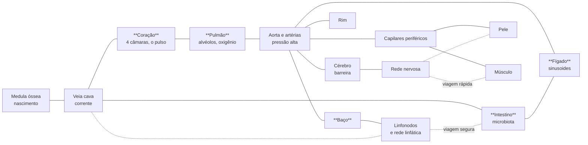

# Hospedeiro — plano de exploração e de mecânicas do corpo

Plano de 23/10/2026. Nada aqui está implementado, salvo o que a seção 1 diz que já existe. Complementa [GameStructure.md](GameStructure.md) (visão geral), [HostScience.md](HostScience.md) (dados científicos) e [Balance.md](Balance.md) (a régua de balanceamento, que passa a valer para todo conteúdo novo).

## 0. O que queremos

Hoje o Hospedeiro é um bom **combate com progressão**, em um mundo de dois salões. Falta o que faz um RPG: **ir a algum lugar para descobrir alguma coisa**. O plano tem três pedidos do usuário e um princípio:

1. **Exploração** como laço principal ao lado do combate: o jogador escolhe para onde ir, o mundo guarda segredos e o mapa se revela.
2. **Um mapa muito maior** (a meta é 10x; a seção 3 define o que isso quer dizer).
3. **Interação entre as partes do corpo**: o corpo é um sistema vivo, e o que acontece em um órgão chega aos outros (a febre do pulmão, a glicose do intestino, o sono do cérebro).
4. **Princípio:** o corpo humano é rico, então cada órgão ensina **uma mecânica própria** e conversa com os vizinhos. Um órgão novo não pode ser só "outra sala com inimigos".

## 1. Onde estamos

| Peça | Estado |
|---|---|
| Mundo | 2 regiões (medula r=14 u e sangue r=18 u, cerca de 1.600 u² no total), ligadas por uma sinusoide; o granuloma é uma câmara à parte (r≈9). |
| Motor (Go) | Universo `hospedeiro` com regiões como entidades, `spots`, `signs`, `rules` periódicas, `happenings` e diretor do Jev, missões, diferenciação, mutações, habilidades de classe, masmorras com decisão `dungeon`. |
| Cliente (Godot) | Combate, 6 classes, 48 mutações como organelas, forma de fantasma, o Granuloma, balanceamento medido. |
| O que falta | Geografia do corpo, descobrir lugares, sinais vitais que se afetam, órgãos com mecânicas próprias, viagem. |

Os limites técnicos de hoje: a geometria do corpo é **escrita à mão em código** (`BioBodyMap`) e o fluxo do sangue é uma fórmula, então um mapa grande exige primeiro **tornar o corpo dados**.

## 2. Princípios do projeto

- **O motor decide o estado do corpo; o cliente o apresenta.** Sinais vitais, regras de acoplamento, o que o jogador descobriu e as recompensas vivem no motor, determinísticos e reproduzíveis. A geometria e o combate ficam no cliente.
- **O corpo é um grafo, não um mapa-múndi.** A geografia é a do corpo (vasos, linfa, nervos ligando órgãos), desenhada como um mapa de metrô orgânico. Cada órgão tem identidade visual e mecânica.
- **Cada órgão = um verbo.** Se não dá para dizer em uma frase o que se faz só ali, o órgão não entra.
- **Causa e efeito visíveis.** Quando o pulmão inflama, o jogador vê (e sente) a febre chegar ao cérebro. Sistemas sem sinal na tela não existem para o jogador.
- **O Jev escolhe o que acontece; o corpo decide se é possível.** Como sempre: opções validadas, prazo, padrão determinístico, revalidação.
- **Toda coisa nova passa pela régua** de [Balance.md](Balance.md) e tem teste.

## 3. O que "10x maior" significa

Dez vezes a **área** são cerca de 16.000 u², isto é, só **3,2 vezes** mais comprimento: atravessar o corpo em linha reta levaria uns 30 s a 7 u/s, o que parece pouco. Recomendação:

| Marco | Área jogável | Comprimento (ponta a ponta) | Tempo em linha reta | Para que serve |
|---|---|---|---|---|
| E0 (prova) | ~10x (16.000 u²) | ~180 u | ~25 s | Prova a tecnologia de mapa grande com 5 regiões. |
| E3 | ~25x | ~300 u | ~45 s | Os órgãos principais existem. |
| E5 | ~40x ou mais | ~500 u | ~70 s | Com redes de viagem; **explorar tudo leva horas**. |

O ponto não é o tempo em linha reta (o jogador raramente vai em linha reta), e sim **quantos lugares há para descobrir e quanto separa um do outro**. Os vasos longos são uma parte da exploração: ficam apertados, têm correnteza e têm encontros.

**Decisão 1** (para o usuário): confirmar essa leitura (10x de área já em E0, crescendo em marcos). Alternativa: 10x de comprimento (cerca de 100x de área), que pede muito mais arte e conteúdo e eu não recomendo antes de E5.

## 4. A geografia do corpo

Um grafo de **regiões** (órgãos e redes) ligadas por **passagens**. As regiões de E0 a E3 estão em negrito; as demais vêm depois.

Cada região tem, no motor, um **nome, uma entidade de região, spots (lugares de interesse) e sinais vitais**; e, no cliente, uma **ficha de bioma** (paleta, partículas de ambiente, perigos, tabela de inimigos e recursos).

| Região | O verbo (o que se faz só ali) | Perigo principal | Recurso | Habita | Entrada |
|---|---|---|---|---|---|
| **Medula** (existe) | Nascer, diferenciar-se | Nenhum (berçário) | Células-tronco, fatores de crescimento | Osteia | Todos |
| **Veia cava** (existe como "sangue") | Surfar a correnteza | Vírus, turbilhões | Glicose, lipídios | Neva, Rubra, Dendra | Todos |
| **Coração** | **Pegar o pulso**: o fluxo acelera em ondas a cada batida; saber a hora de entrar numa câmara | Válvulas (portas que fecham), turbulência | Nenhum (é um corredor) | Cardiomiócitos (paredes vivas) | Todos |
| **Pulmão** | **Carregar oxigênio** nos alvéolos (gradiente de O2), respirar no ritmo | Bactérias inaladas, surfactante escorregadio | Oxigênio (buff de ATP) | Macrófagos alveolares | Todos |
| **Fígado** | **Desintoxicar e guardar**: converte nutrientes em glicogênio, filtra toxinas | Toxinas, bile ácida | Glicogênio (reserva), enzimas | Kupffer (macrófagos) | Todos |
| **Baço** | **Treinar**: provas de classe, cemitério de hemácias velhas | Hemácias mortas que bloqueiam | Fatores de ativação | Linfócitos em treino | Diferenciados |
| **Intestino** | **Cultivar e absorver**: o microbioma é um bioma aliado ou hostil | Bactérias fora do lugar, peristaltismo (ondas) | Nutrientes variados | Microbiota, células de Paneth | Todos |
| **Rim** | **Atravessar o filtro** (tamanho e carga decidem quem passa) | pH e sal, glomérulo | Íons, balanço de pH | Podócitos | Pelo tamanho |
| **Linfonodos** | **Reunir informação**: onde as dendríticas apresentam antígenos, centro germinativo (mini-masmorra) | Células tumorais, tempestades | Antígenos, memória | Linfócitos B e T | Todos |
| **Pele** | **Defender a borda**: portal para fora, feridas e invasões | Bactérias externas, UV | Colágeno, queratina | Langerhans | Todos |
| **Músculo** | **Gastar energia**: demanda explode quando o corpo corre | Lactato (pH cai), hipóxia | ATP em abundância | Miócitos | Todos |
| **Cérebro** | **Passar pela barreira** e fazer a limpeza do sono | Barreira hematoencefálica, microglia | Neurotransmissores | Neurônios, glia | Gene ou linhagem específica |
| **Rede nervosa** | **Viagem rápida** com custo | Nós congestionados | — | Axônios | Gene de adesão |
| **Dentro da célula** | **Profundidade infinita** (instanciado) | Escala | Genes raros | Organelas | Por convite |

## 5. A exploração

### 5.1 Descobrir o mapa

- **Névoa e atlas ("Carta Química").** O corpo é revelado conforme o jogador passa; o atlas mostra regiões visitadas, passagens conhecidas e **o que se sabe de cada região** (sinais vitais, residentes, segredos achados).
- **Quimiotaxia como bússola.** Cada objetivo (uma missão, um nicho, uma infecção) emite um **gradiente químico** que o jogador sente como um fio de partículas e uma seta suave. Não há marcador de mapa: segue-se o cheiro. O motor já planeja "rastro químico" (`signs`).
- **Códice do corpo.** Células, patógenos, órgãos e organelas viram entradas que se preenchem ao encontrar e ao interagir (observar, atacar, ouvir uma célula). Preencher o códice dá conhecimento e, às vezes, um gene.
- **Pontos de interesse.** Cada região tem: o **nicho** (esconderijo com recompensa), a **glândula** (fonte de hormônio, buff temporário), o **gânglio/nó** (informação e viagem), o **leito** (descanso e salvação) e **segredos** que dependem do estado do corpo (só no sono, só em febre, só após uma infecção).

### 5.2 Mover-se (travessia)

Cada passagem tem um **tipo** e, às vezes, uma **chave**:

| Passagem | Como é | Chave |
|---|---|---|
| Vaso aberto | Correnteza; dá para surfar ou lutar contra | Nenhuma |
| Parede do vaso | Atravessar o endotélio (diapedese) | Gene de diapedese / classe neutrófilo e macrófago |
| Capilar estreito | Espremer-se (amebóide) | Tamanho ou gene |
| Válvula do coração | Abre e fecha no ritmo do pulso | Tempo |
| Barreira hematoencefálica | Só passa quem tem a chave | Gene ou linhagem específica |
| Rede linfática | Lenta e segura, com válvulas | Nenhuma |
| Rede nervosa | Rápida e cara (gasta ATP) | Gene de adesão |
| Carona | Pegar uma hemácia ou plaqueta | Aliança com Rubra |

As **habilidades e mutações viram chaves de exploração**: o jogador volta a lugares antigos com poderes novos. Isso dá motivo às mutações de classe além do combate e liga o plano ao que já existe (6 classes, 48 mutações).

### 5.3 Recompensas de explorar

- **Genes em nichos** (únicos por mundo ou por jogador) e **marcas epigenéticas**: viver numa região por muito tempo adapta o corpo (tags que o Jev lê para o visual e para as ofertas de mutação).
- **Atalhos**: abrir uma passagem nova (por exemplo, forçar uma válvula) fica no corpo para todos.
- **Missões de exploração**, escolhidas pelo Jev a partir do que o jogador ainda não viu e do estado do corpo ("a dendrítica quer saber o que há no linfonodo da virilha").
- **Cenários únicos** (o primeiro a chegar no cérebro, o primeiro a selar o granuloma, como já fazemos).

## 6. Mecânicas dentro do hospedeiro

### 6.1 Os sinais vitais (o estado do corpo)

No motor, cada região tem números e o corpo tem ciclos. Tudo isso é a **verdade do mundo**; o cliente o desenha.

| Sinal | Por região | Efeito no jogador |
|---|---|---|
| Temperatura | sim | Velocidade e gasto de ATP (a febre acelera os inimigos e cansa o jogador) |
| Glicose | sim | Rendimento de nutrientes, ATP de base |
| Oxigênio | sim | Regeneração de ATP (a hipóxia nos tecidos fundos ou doentes) |
| pH | sim | Dano contínuo se for extremo (rim, estômago, músculo cansado) |
| Inflamação | sim | Atrai células imunes, muda os inimigos e as ofertas |
| Carga de patógenos | sim | Frequência de surtos e de focos |
| Hormônios (insulina, cortisol, adrenalina) | no corpo | Buffs globais: adrenalina acelera, cortisol suprime a imunidade, insulina rende nutrientes |
| Pulso (batimento) | no corpo | Ondas de fluxo em todas as veias, no ritmo do coração |
| Respiração | no corpo | Ondas no pulmão; muda o oxigênio |
| Ciclo dia/noite e sono | no corpo | Ritmo do mundo; o sono abre passagens e repara |
| Digestão | no corpo | Pulsos de nutrientes saindo do intestino |

### 6.2 As cadeias de causa e efeito entre órgãos

Cada cadeia é um conjunto de **regras do motor** (`rules` periódicas e `happenings`) e dá algo para ver, fazer e decidir.

| Cadeia | Passos | O que o jogador vive |
|---|---|---|
| **Refeição** | Intestino absorve -> glicose sobe no sangue -> pâncreas libera insulina -> fígado guarda glicogênio -> glicose cai -> fome | Chuvas de nutrientes ao largo da veia porta; o fígado vira ponto de reserva |
| **Infecção** | Bactérias entram (pulmão ou pele) -> inflamação local -> citocinas viajam no sangue -> baço e linfonodos ativam linfócitos -> o cérebro sobe a temperatura (febre) | Surtos locais, a febre chega a todos (inimigos mais lentos, jogador gasta mais), as células imunes marcham |
| **Exercício** | O corpo corre -> músculo gasta O2 e glicose -> coração acelera (fluxo sobe) -> lactato derruba o pH -> o fígado fornece glicose | O fluxo vira rio rápido; o músculo fica ácido; é janela de risco e de pressa |
| **Estresse** | Cortisol e adrenalina -> fluxo sobe e a imunidade cai -> patógenos oportunistas -> o fígado libera glicose | O jogador sente tudo mais rápido e mais perigoso (e mais valioso) |
| **Sono** | O cérebro limpa -> medula produz mais -> a imunidade repara -> certas passagens se abrem | O mundo fica calmo e escuro; há segredos que só aparecem agora |
| **Ferimento** | Pele rompe -> plaquetas coagulam -> bactérias entram -> neutrófilos migram | Um evento de borda com tampão (coágulo) como terreno |
| **Desidratação** | Rim concentra a urina -> pressão cai -> fluxo mais lento e viscoso | Mais difícil se mover; o rim vira região-chave |

### 6.3 Mecânicas locais (o que o jogador faz em cada órgão)

- **Fluxo e pressão.** O fluxo passa a ser um campo vetorial real (splines dos vasos), com **pulso** do coração, turbilhões nas curvas, calmaria no remanso. Dá para **surfar**, **remar contra**, **aderir à parede** (gasta ATP, fica parado) e **rolar**.
- **Gradientes.** Oxigênio no pulmão, glicose no intestino, pH no rim: o jogador "lê" o gradiente e o usa (para curar, para ganhar ATP ou para evitar dano).
- **Terreno vivo.** Coágulos que bloqueiam, muco que gruda, matriz que empurra, peristaltismo (ondas no intestino), alvéolos que inflam.
- **Ecologia local.** Populações (microbiota, patógenos) com regras de crescimento e limiar (quórum), como já temos no granuloma.
- **Falha que muda o mundo.** Se ninguém age, o granuloma rompe, a infecção avança, o tumor cresce e **a região muda** (novas passagens, novos inimigos, novas missões). O jogo não trava.

### 6.4 O papel do Jev

O Jev deixa de ser só "qual missão" e passa a ser o **maestro do corpo**:
- `world`: qual acontecimento do corpo ocorre (mantém a coerência com a cadeia: nada de febre sem infecção).
- `dungeon`: modificadores atrelados ao estado do corpo (granuloma "em febre" só quando há febre).
- **`rota` (nova)**: qual lugar novo apontar para esse jogador agora, pelo que já viu, pela classe e pelo estado do corpo.
- `evolution` e `appearance`: passam a ler a **região onde o jogador vive** (adaptação epigenética).
Sempre dentro do contrato: opções já válidas, prazo, padrão determinístico, revalidação, e **o jogo é bom com o Jev desligado**.

## 7. Arquitetura necessária

### 7.1 Motor (Go, `engine/`)

1. **Passagens** (`passages` no universo): `{de, para, tipo, chave (condição), fluxo}`. A travessia vira regra do mundo e deixa de ser geometria só do cliente.
2. **Sinais vitais** como números de região e do corpo, mais **regras de acoplamento** (as cadeias da seção 6.2), usando `rules` e `happenings` que já existem. Novidade: regras que leem e escrevem vizinhos pelo grafo.
3. **Descoberta por jogador**: estado `Discovered` (regiões, passagens, spots, entradas do códice) e o verbo `descobrir` confirmado pelo servidor de jogo (`adapter`).
4. **Decisão `rota`** do Jev e geração de missões de exploração.
5. **Ecologia** por região (populações e limiares) como números e regras.
6. **Particionamento por região** (já está nos próximos passos do motor): é o que viabiliza o MMO e o mapa enorme.
Todos com testes em `engine/scenarios` e universos reais.

### 7.2 Cliente (Godot)

1. **Anatomia como dados** (`BioAnatomy`): o grafo de regiões, polígonos orgânicos (ruído sobre um esqueleto), splines de vasos, campos de fluxo, tudo gerado a partir de definições e de uma semente. Substitui `BioBodyMap`.
2. **Streaming por trechos** (chunks de 64 u): só vive o que está perto; o resto é descarregado (nutrientes, inimigos, partículas). Pool de objetos. Orçamento: **60 quadros por segundo** com o mapa inteiro carregado como grafo.
3. **Campo de fluxo** por região (amostrado das splines + pulso) no lugar da fórmula atual.
4. **Interface**: atlas/minimapa com névoa, códice, sinais vitais do corpo (um painel que mostra a causa e o efeito), bússola química.
5. **Biomas** orientados a dados: paleta, partículas de ambiente, tabela de inimigos, recursos, perigos, por região. **Um órgão novo = uma ficha de bioma + o seu verbo implementado.**
6. **Câmera de dois níveis**: zoom normal e uma visão ampla do corpo (o mapa de metrô) para planejar a viagem.
7. Mantém: modo offline (sem motor, o corpo é só cenário), os testes headless e as capturas.

### 7.3 Conteúdo e arte

Cada região exige: ficha de bioma, 3 a 5 inimigos novos (com os dados de `BioDungeonPlan`), 2 a 3 recursos, 4 a 6 spots, 1 mecânica local, 3 a 5 missões ou arcos, e as entradas do códice. Estimativa: um órgão é cerca de uma sessão de trabalho focada depois que a base existe.

## 8. Roteiro por marcos

Cada marco entrega algo **jogável e testado** e termina com a régua de balanceamento e com capturas ou GIFs.

### E0 — Corpo como dados, mapa 10x (a base) — ENTREGUE em 23/10/2026

> **Como ficou (ajuste pedido pelo usuário):** na escala microscópica não há órgãos para ver. O corpo é **uma única membrana orgânica**: câmaras (nicho da medula, vênula, endocárdio, alvéolos, artéria) e vasos sinuosos são fundidos num campo suave com ruído, e a parede é o contorno desse campo (marching squares), com núcleos de células endoteliais atrás dela. Área ≈ 15 mil u² (≈ 9–10x). Atlas (M) mostra a membrana inteira e acende o que foi visitado. Ver `Docs/Validation/e0_crossing.gif`.
- `BioAnatomy`: grafo e geração; refatorar `BioBodyMap`; campos de fluxo; streaming; atlas simples.
- Regiões: **Medula, Veia cava, Coração, Pulmão** e **Aorta/artérias** (cinco, cerca de 16.000 u²).
- **Pronto quando:** dá para atravessar medula -> veia -> coração -> pulmão -> aorta jogando; 60 fps medidos; testes de geração determinística (mesma semente, mesmo mapa); o que existe hoje (granuloma, missões) continua funcionando.

### E1 — Corpo vivo — ENTREGUE em 23/10/2026

> **Como ficou:** o motor expõe `vitals` (números públicos do universo) em toda visão; o universo ganhou a entidade `corpo` (temperatura, inflamação, adrenalina, cortisol, insulina), a cadeia da infecção pulmonar (bactérias → inflamação → citocinas → febre → hipóxia → cura) e hormônios que aceleram o coração. No cliente, `BioBodyState` transforma os números em efeitos (febre e hipóxia reduzem a regeneração de ATP, adrenalina acelera, insulina valoriza nutrientes), o pulso do mundo segue a frequência cardíaca e **Tab** abre o painel de sinais vitais com a explicação de causa e efeito. Ainda não feito: refeição/sono ligados a mais órgãos (virão com E3) e o ciclo dia/noite.
- Motor: sinais vitais e ciclos (pulso, respiração, ciclo dia/noite), 3 cadeias (refeição, infecção, sono), painel de sinais.
- Cliente: pulso nas veias, febre que muda a velocidade, hipóxia, hormônios como buffs.
- **Pronto quando:** uma infecção no pulmão provoca febre visível em todo o corpo e passa; testes de determinismo e de replay do log.

### E2 — Exploração — ENTREGUE em 23/10/2026 (partes 1 e 2)

> **Entregue:** o motor ganhou `passages` (passagens que exigem um gene como chave) e `niches` (nichos escondidos que dão um gene, por jogador ou únicos por mundo), a visão `explore`, o verbo `achar-nicho` (só o adaptador confirma) e a memória de regiões visitadas (`visitou`) que alimenta o atlas; o `move` do motor recusa a travessia sem a chave. No cliente: membrana na passagem fechada, nichos que cintilam ao perto, bússola química (seta + distância) até o nicho mais próximo que a célula consegue alcançar sem cruzar passagem fechada, e o atlas que lembra o que o motor lembra. Mundo atual: o pulmão só abre com o Citoesqueleto Elástico, que está num nicho na vênula; há 5 nichos (3 únicos). 
>
> **Parte 2:** o **códice** (13 entradas que se desbloqueiam ao visitar, fazer ou ver; as trancadas mostram só `???`), **nichos-segredo** que só existem num estado do corpo (a câmara do sono só com o corpo dormindo, o alvéolo em brasa só na febre), **adaptação regional** (viver 30 ticks numa região adapta a célula: regenera energia mais depressa lá, e o Jev lê isso no contexto) e a decisão **`rota`** (o Jev escolhe, entre os lugares ocultos alcançáveis, para onde apontar este jogador; revalidada, com a opção mais próxima como padrão no prazo). **Ainda não feito:** chaves de diapedese/adesão (só há chave de gene por enquanto) e missões de exploração geradas a partir da rota.
- Névoa e atlas, bússola química, códice, spots e segredos por estado do corpo, travessias com chave (diapedese, adesão, espremer), recompensas (genes em nichos, adaptação regional), missões de exploração e a decisão `rota`.
- **Pronto quando:** um jogador novo é conduzido por gradientes até um nicho e volta com um gene; as chaves bloqueiam e liberam de verdade.

### E3 — Mais órgãos: fígado, baço/linfonodos, intestino, rim
- Cada um com seu verbo, bioma, inimigos e uma **mini-masmorra** (centro germinativo nos linfonodos; cripta no intestino).
- Área cresce para cerca de 25x.
- **Pronto quando:** cada órgão é jogável por si e entrega um recurso que outro órgão consome.

### E4 — Interações entre órgãos
- Todas as cadeias da 6.2 ligadas ao diretor e ao Jev, eventos de mundo visíveis e participáveis, **falha que muda o mapa** (a ruptura do granuloma, coágulos, tumor que cresce).
- **Pronto quando:** uma sessão de 30 minutos mostra pelo menos três cadeias completas disparando umas às outras.

### E5 — Redes de viagem, pele e músculo
- Linfa (lenta e segura), nervos (rápida e cara), carona, **mapa 40x**; pele (portal para o exterior) e músculo (demanda de energia).
- **Pronto quando:** é possível planejar uma rota no atlas e as escolhas de rota importam.

### E6 — Cérebro e o arco da Reescrita
- Barreira hematoencefálica, neurônios e glia, a limpeza do sono, a telepatia entre jogadores, e os capítulos de "A Reescrita" espalhados pelos órgãos.
- **Pronto quando:** o primeiro jogador a atravessar a barreira recebe o cenário único e muda o corpo para todos.

### E7 — Dentro da célula e o MMO
- Interior da célula (instanciado, profundidade infinita) e **visibilidade de outros jogadores por região**, com o motor particionado.
- **Pronto quando:** dois clientes em regiões diferentes recebem notícias com atraso de circulação.

### Por que esta ordem
E0 destrava tudo (sem corpo-como-dados e sem streaming, mapa grande é impossível). E1 antes da exploração porque **os segredos dependem do estado do corpo**. E2 entrega o "RPG de explorar" cedo. E3 e E4 dão a riqueza; E5 a escala; E6 o fim de jogo; E7 o MMO.

## 9. Riscos e como tratá-los

| Risco | Tratamento |
|---|---|
| Desempenho com o mapa grande | Orçamento fixo de 60 fps desde E0; streaming e pool; o mapa inteiro é só um grafo na memória. |
| Volume de arte e de conteúdo | Biomas e inimigos orientados a dados; geração procedural com esqueleto à mão; um órgão por vez. |
| Acoplamentos que viram caos | Cada cadeia tem teste de cenário no motor e um painel que mostra causa e efeito; mudanças pela régua de balanceamento. |
| Latência do Jev | Tudo continua assíncrono, com padrão determinístico; as decisões novas (`rota`) não bloqueiam. |
| Perder o foco de combate | O combate continua sendo o laço de segundo a segundo; a exploração só decide **para onde**. |
| Determinismo e compatibilidade de salvamentos | O log de comandos continua sendo a verdade; mudança de regra exige novo mundo ("novo mundo ao mudar o universo", como já fazemos). |

## 10. O que falta decidir (e o que eu recomendo)

1. **A leitura de "10x"**: área em E0 e crescimento por marcos (recomendado) ou comprimento. Ver a seção 3.
2. **Ordem**: E0 -> E1 -> E2 (recomendado) ou antecipar um órgão novo (fígado) antes das cadeias, para ter conteúdo cedo.
3. **Realismo**: as passagens e a geografia seguem a **anatomia real simplificada** (recomendado: o corpo humano é a graça) ou um mapa fantasioso inspirado nela.
4. **Modo offline**: manter o corpo grande também sem o motor (recomendado: sem sinais vitais, só cenário e combate) ou exigir o motor para a exploração.

## 11. Próximo passo

Aprovando este plano, o primeiro trabalho é **E0**: transformar o corpo em dados, o campo de fluxo e o streaming, com as cinco regiões, e entregar um GIF de uma travessia da medula à aorta. Eu proponho começar por aí na próxima sessão.
