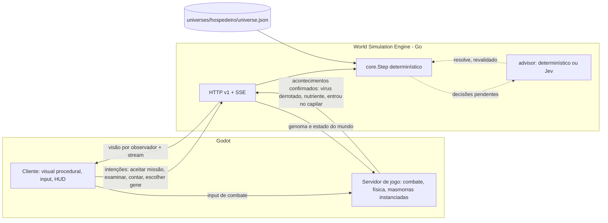
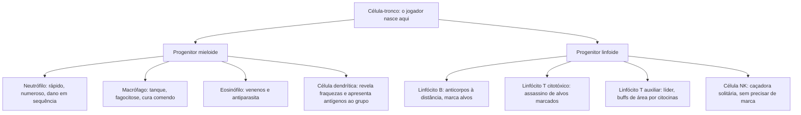

# Hospedeiro — estrutura do jogo: do RPG ao MMORPG

> **DECISÃO MAIS RECENTE — 26/10/2026:** o ciclo de jogo do Hospedeiro passa a ser **NPCs vivos + conflitos globais persistentes**, sem masmorras instanciadas como experiência final. Missões tradicionais deixam de ocupar o centro da interface; pedidos de ajuda são contextuais e objetivos pertencem aos conflitos. A especificação vigente é [LivingWorldConflicts.md](LivingWorldConflicts.md), que **substitui as diretrizes antigas de dungeons, conteúdo instanciado, fases de entrega e apresentação de missões** deste documento. As partes abaixo permanecem como histórico e descrição do legado implementado; **essa mudança ainda não foi migrada para o código nem para o servidor real**.

Plano de 22/10/2026. Nada aqui está implementado, exceto o que está marcado como **feito**. Complementa [BiologicalVersion.md](BiologicalVersion.md) (visão) e [HostScience.md](HostScience.md) (dados científicos).

> **Exploração, mapa 10x e mecânicas do corpo:** o plano detalhado está em [ExplorationPlan.md](ExplorationPlan.md) (marcos E0 a E7).

> **Progressão revisada em 25/10/2026:** ritmo mais espaçado, genes que transformam habilidades, recompensas permanentes e comparação antes de expressar estão descritos em [Progression.md](Progression.md). Esse documento registra os valores e o comportamento atual dessa revisão.

## Resumo

**Direção adicional em 25/10/2026:** [mundos pessoais](PersonalWorlds.md) executam o jogo localmente e salvam na nuvem em segundo plano. Visitas para dois jogadores usam WebRTC, permitem evolução do visitante e PvP em todo o mapa junto dos monstros, sem recompensas por abates de jogadores. O modo MMORPG anterior continua separado e selecionável.

**Decisão de 24/10/2026:** adotar Nakama para entrada de convidados e transporte em tempo real. Godot headless continua sendo a autoridade de combate, reutilizando as regras do cliente; o motor Go mantém mundo e progressão. A primeira entrega compartilha o mundo aberto e usa masmorras pessoais isoladas no servidor. Grupos e masmorras cooperativas ainda fazem parte do destino F2, e a partição por órgão continua futura. Implementação e limites em [Nakama.md](Nakama.md).

1. O Hospedeiro vira **um universo do World Simulation Engine** deste repositório (`engine/`, Go). O motor guarda a verdade do mundo, as crenças, as missões, a história, as habilidades e as decisões do Jev. Não vamos construir outro backend.
2. O **Godot** faz dois papéis com o mesmo código: o **cliente** (o visual orgânico procedural que já temos) e o **servidor de jogo** (o combate em tempo real que já roda no protótipo). O servidor confirma acontecimentos ao motor (`adapter`); o motor nunca recebe dano.
3. **Progressão sem níveis**, em cinco eixos ancorados em biologia: diferenciação (linhagem celular), genoma (DNA), epigenética (quais genes estão ligados), memória (conhecimento dos inimigos) e linhagem (morrer e renascer herdando).
4. **Build** = linhagem + genes com custo + organelas (equipamento) + vias metabólicas (sinergias entre genes). Os genes mudam o corpo procedural: a build fica visível no corpo.
5. **Missões** usam o modelo do motor: ofertas proativas e coerentes, uma por vez, ranks, estágios, falha e cenários únicos. O rastro é químico (quimiotaxia).
6. **Masmorras** são estruturas biológicas reais: granuloma, centro germinativo, tumor, biofilme, barreira hematoencefálica e o interior da célula até o DNA (profundidade infinita).
7. **O mundo reage** por camadas: sinais vitais do Hospedeiro, diretor de acontecimentos (Jev), ecologia simulada, notícias que viajam pelo sangue e pelos nervos, cenários únicos e temporadas de 90 dias.
8. **Escala**: um único corpo compartilhado (estilo *EVE Online*), particionado por órgãos. A corrente sanguínea é o barramento entre partições, e a latência da rede vira tempo de circulação.

## 1. Princípios

Herdados da visão do motor ([GameVision.md](../GameVision.md)) e ajustados ao Hospedeiro:

- **O motor decide, o cliente apresenta.** Regras do jogo ficam no universo JSON, não no código do motor.
- **Combate é do servidor de jogo.** O motor recebe "o jogador derrotou o vírus", nunca "causou 14 de dano".
- **O Jev é consultivo e assíncrono.** Escolhe entre opções já validadas, com prazo e padrão determinístico. Nunca bloqueia movimento, combate ou interação. O jogo é divertido com o Jev desligado.
- **Sem níveis nem XP.** Progresso vem de diferenciação, genes, conhecimento, títulos, reputação, organelas e capítulos.
- **Coerência, não distância.** Ofertas nascem do que aconteceu e do que o jogador sabe.
- **Biologia como base, não como lei.** A ciência dá estrutura e escala; a fantasia vence quando deixa o jogo melhor.
- **Um só laço central em todo o jogo.** Ação em tempo real + evolução. Lição de *Spore*: fazer "cinco jogos em um" deixou cada estágio raso. Cada região muda o cenário e os inimigos, nunca o gênero.

## 2. Arquitetura alvo

| Peça | Hoje | Destino |
|---|---|---|
| Combate em tempo real | **Feito** no protótipo Godot (`clients/hospedeiro/`, autoridade offline) | O mesmo código roda em modo headless como servidor de jogo |
| Genoma e mutações | **Feito** localmente (`BioGenome`, `BioMutationTracker`, JSON em disco) | A verdade passa para o motor (habilidades e fatos do jogador); o Godot só lê |
| Missões, história, NPCs, diretor | No motor (`main`), para Valdoria | Universo `hospedeiro` com regiões, células, arcos e acontecimentos biológicos |
| Jev | No motor (`engine/advisor/jev.go`), decisões `offer`, `world`, `story` | Mais duas decisões propostas: `evolution` e `dungeon` (seção 9) |

**Modo offline continua existindo:** sem motor, o Godot roda o laço de combate e mutação local (como hoje). Com motor, o jogo ganha missões, história e mundo compartilhado.

## 3. Do RPG ao MMORPG: fases de produto

| Fase | O que é | Entrega | Critério de pronto |
|---|---|---|---|
| **F1 — RPG solo** | Um jogador no Hospedeiro, motor local | Universo `hospedeiro` com Medula e Sangue; cliente Godot conectado ao motor; missões, linhagem mieloide/linfoide, 1 masmorra (granuloma) | Uma sessão de 30 min com missões vindas do mundo, uma diferenciação e um chefe, com o Jev ligado e desligado |
| **F2 — Cooperativo** | 2 a 4 jogadores, servidor de jogo Godot headless | Combate autoritativo no servidor, masmorras instanciadas para o grupo, cenários únicos disputados | Quatro clientes no mesmo granuloma; o servidor recusa dano declarado pelo cliente |
| **F3 — MMO por órgãos** | Dezenas a centenas por região | Um servidor de jogo por órgão; o motor particionado por região; viagem pelo sangue entre órgãos | Jogadores em órgãos diferentes recebem notícias com atraso de circulação |
| **F4 — Um só Hospedeiro** | Mundo único persistente | Temporadas de 90 dias, eventos globais (febre, sono), economia de genes | Uma temporada completa com o corpo renovado no fim |

## 4. Evoluções (progressão sem níveis)

### 4.1 Diferenciação: a linhagem celular (substitui classes)

Base real: na medula, as células-tronco do sangue se ramificam em progenitores cada vez mais comprometidos, e a primeira grande divisão é **mieloide × linfoide**. Diferenciar é ganhar especialidade e **perder potência**: a célula não volta atrás sozinha.

- Cada linhagem define 3 ou 4 **habilidades ativas** e um estilo de combate, como armas em *Hades*.
- Ramos fora do sangue chegam com as regiões: **neurônio** (telepatia, Cérebro), **osteoblasto** (construção, Ossos), **hepatócito** (alquimia, Fígado).
- **Reprogramação** é o renascimento raro. Em 2006, Takahashi e Yamanaka mostraram que **quatro fatores** (Oct3/4, Sox2, Klf4, Myc) devolvem uma célula especializada à pluripotência. No jogo, reunir os quatro fatores é uma missão lendária que volta o jogador a célula-tronco **mantendo uma "memória epigenética"** (um bônus da linhagem anterior), como acontece de verdade.

### 4.2 Genoma: o DNA (**feito** no B3)

Genes com benefício e custo, três espaços, pressão evolutiva por acontecimentos confirmados, oferta de até três, aceitar, recusar ou ignorar. Próximos passos:

- **Raridades do motor** (comum a absurda). Genes lendários funcionam como *keystones* de *Path of Exile*: mudam regras, com custo grande. Exemplo: "Fagocitose Total" (engolir inimigos pequenos cura, mas perde o projétil).
- **Fontes de genes**: pressão evolutiva, descoberta por hábito (o motor já conta `deeds`: atravessar 50 capilares ensina "Diapedese"), masmorras, recompensas de missão e **transferência horizontal** (seção 5.4).
- **Espaços crescem com a diferenciação**, não com nível.

### 4.3 Epigenética: o que está ligado

O jogador **possui** muitos genes e **expressa** poucos. Trocar o conjunto ligado só é possível em **nichos** (lugares seguros como a medula e os gânglios) e custa tempo. É o "loadout" do jogo, sem descartar nada.

### 4.4 Memória: conhecer o inimigo

Base real: linfócitos de memória respondem mais rápido a um inimigo já visto. No jogo, cada tipo de inimigo estudado (examinado, derrotado, apresentado a um gânglio) vira **conhecimento permanente**: mostra fraquezas e dá bônus contra ele. Usa as crenças com procedência do motor. É o herdeiro da "Leitura de Fraquezas" da v1.

### 4.5 Linhagem: morrer e renascer

Base real: 50 a 70 bilhões de células morrem por apoptose por dia num adulto. No jogo, morrer é normal: a **célula-filha** renasce na medula e herda parte do genoma, os títulos, a fama e a memória. O que se perde é a diferenciação mais recente e as organelas equipadas, o que dá peso à morte sem apagar o progresso.

### 4.6 Temporadas

A população celular do corpo se renova em cerca de 90 dias. A cada **temporada de 90 dias**, regiões são redesenhadas, NPCs trocados e o diretor ganha acontecimentos novos. O progresso permanente (genes, memória, títulos) continua.

## 5. Construção de build

| Camada | Exemplo | Origem |
|---|---|---|
| **Linhagem** (classe) | Macrófago | Diferenciação (4.1) |
| **Genes ligados** (passivos com custo) | Membrana Espessa, Cauda Longa | Genoma (4.2), epigenética (4.3) |
| **Organelas** (equipamento) | Mitocôndria extra (energia), Lisossomo (dano corrosivo), Vacúolo (estoque), Cílios (manobra) | Masmorras, craft no Fígado, missões |
| **Vias metabólicas** (sinergias) | Enzima Voraz + Mitocôndria Ávida = "Glicólise Acelerada" | Combinação de dois genes de vias diferentes |
| **Vias de dano** (elementos) | Ácido, Oxidação, Eletricidade, Calor, Toxina, Lise | Habilidades e organelas |

Decisões de design, com base na pesquisa:

- **Sinergias tipo *Hades***: as "duo boons" de *Hades* exigem uma bênção de cada um de dois deuses e trazem mecânicas novas, não só números. As vias metabólicas seguem o mesmo princípio: aparecem raramente e mudam como a célula luta.
- **Poucas escolhas que importam, não 1.300 nós**: a árvore de *Path of Exile* tem mais de 1.300 nós, e até os guias recomendam pensar em 5 a 10 notáveis. Aqui o espaço de decisão é pequeno e denso: uma linhagem, 3 a 6 genes, 4 organelas.
- **A build aparece no corpo.** Em *Spore*, o editor de células foi o que mais funcionou, porque a posição de cada flagelo e cílio mudava o jogo. Nosso corpo é procedural: cada gene e organela altera a forma (espinhos, cauda mais longa, membrana mais grossa, brilho de outra cor). Outro jogador lê a sua build olhando para você.

### 5.4 Transferência horizontal: a economia de genes

Base real: bactérias trocam genes por conjugação (plasmídeos), transformação (pegando DNA solto) e transdução (vírus que carregam DNA). O intestino, denso de bactérias, é um lugar ideal para isso. No jogo:

- **Plasmídeos** são itens que carregam uma cópia de um gene. Jogadores trocam e vendem plasmídeos, e o **Intestino** é o grande mercado.
- **Transdução** é arriscada: um vírus pode trazer um gene raro, mas também uma desvantagem escondida.
- Genes copiados podem perder força (cópia imperfeita), o que mantém valor no gene original conquistado.

## 6. Missões

O modelo do motor serve como está: ofertas proativas e coerentes, uma ativa e uma pendente, ranks F a SSS, estágios, falha, recusa com consequência, missões ocultas raras e NPCs que só pedem ajuda a quem conhecem.

**Tradução biológica:**

- **Quem chama** são células que conhecem você (viram você agir por perto). Notícias correm por boato só quando duas células se encontram.
- **O rastro é químico:** quimiotaxia. A missão aparece como um gradiente que você pode seguir, como os neutrófilos seguem sinais. Na tela, um brilho difuso no fluido, não uma seta.
- **Contar o que sabe** (verbo `contar` do motor) vira **apresentar antígeno**: levar ao gânglio linfático o que você aprendeu sobre um inimigo arma a defesa de todos.

**Modelos de missão de exemplo** (Medula e Sangue, F1):

| Missão | Elegível quando | Objetivo | Quem chama |
|---|---|---|---|
| Sinal de citocina | Há inflamação num capilar que você conhece | Chegar ao capilar e limpar a infecção | Neutrófilo veterano |
| Escolta de oxigênio | Pulmão com pouco oxigênio entregue | Proteger um comboio de hemácias até o pulmão | Hemácia anciã |
| Fugitivos | Bactérias escaparam de um granuloma | Fagocitar 5 fugitivas antes que se multipliquem | Sistema |
| O rosto do inimigo | Você examinou um vírus novo | Apresentar o antígeno ao Gânglio Cervical | Célula dendrítica |
| A cicatriz | Ferimento aberto na pele (acontecimento) | Fechar a brecha antes da invasão | Plaqueta líder |

**Cenários únicos** (estilo *Shangri-La Frontier* e *Overgeared*, já suportados pelo motor): o primeiro a cumprir muda o corpo para todos, e os outros recebem continuações próprias. Exemplos: "a primeira célula a atravessar a barreira hematoencefálica", "quem descobre a origem da Reescrita", "quem desperta o primeiro neurônio telepata".

**Arco principal: A Reescrita.** Algo está reescrevendo o código do corpo, e o sistema imune já não distingue o que é próprio. Capítulos: os primeiros sinais na medula → o primeiro tumor → a febre que não passa → a barreira do cérebro → o código no núcleo. Cada capítulo único ramifica a história, e o Jev escolhe a continuação pelo contexto.

## 7. Masmorras

Geração no estilo *Spelunky*: o nível é uma grade preenchida com **pedaços feitos à mão**, depois uma segunda passada adiciona variação, inimigos e itens. Aleatoriedade sozinha não é interessante. No Hospedeiro, os pedaços são desenhados à mão e **deformados organicamente** pelo mesmo sistema procedural das células. A semente vem do motor, então todo o grupo vê a mesma masmorra, e o resultado volta ao motor como acontecimento confirmado.

| Masmorra | Base real | Como joga |
|---|---|---|
| **Granuloma** | Macrófagos formam camadas concêntricas ao redor de um núcleo necrótico onde as bactérias se concentram, com um anel de linfócitos por fora. Pode falhar e liberar bactérias | Fortaleza em anéis: atravessar a guarda de linfócitos, as paredes de macrófagos, até o núcleo e o chefe bacilo. Se nenhum grupo agir, ele **rompe** e vira evento de mundo |
| **Centro germinativo** | Linfócitos B passam por rodadas de hipermutação e seleção (zona escura e zona clara) e só os melhores sobrevivem | Masmorra de mutação: cada sala é uma rodada; o jogador sofre mutações aleatórias e é testado. Sai com um gene raro ou com nada. Alto risco, alta recompensa |
| **Tumor** | Células que crescem sem controle | Masmorra que **cresce no mundo** se ninguém intervém, mudando a região ao redor. Chefe que se divide |
| **Biofilme** | Bactérias coordenam comportamento quando o sinal químico passa de um limiar (quorum sensing); interromper o sinal desarma a virulência sem matá-las | Cidade bacteriana: inimigos ficam mais fortes quando muitos estão juntos. Estratégia: destruir os emissores de sinal (*quorum quenching*) antes de lutar |
| **Barreira hematoencefálica** | Junções apertadas que quase nada atravessa | Portão do Cérebro: só passa quem tem um gene ou linhagem específica. Cenário único: o primeiro a atravessar |
| **Interior da célula → Núcleo → DNA** | ~2 m de DNA por célula, a maior parte não codificante | **Profundidade infinita**: cada célula de órgão é uma caverna; dentro, o núcleo; dentro, 23 pares de cromossomos como andares. Mais fundo, genes mais raros. É o conteúdo vertical sem fim |

## 8. O mundo reagindo

Camadas, da mais lenta para a mais rápida:

1. **Temporada (90 dias):** o corpo se renova.
2. **Sinais vitais do Hospedeiro** (fatos numéricos do motor): temperatura, glicose, cortisol, sono e inflamação por região. Mudam o que é elegível para todos.
3. **Diretor de acontecimentos** (o Jev escolhe entre os válidos, alternando tensão e alívio):

| Acontecimento | Efeito no mundo |
|---|---|
| Febre | Vírus perdem força e velocidade, a facção imune ganha força, todos gastam mais ATP |
| Refeição | Glicose sobe: nutrientes abundantes, bactérias do intestino se multiplicam |
| Sono | Ritmo baixo, o Cérebro faz limpeza e abre passagens que de dia ficam fechadas |
| Estresse | Adrenalina: tudo acelera, combate mais perigoso, recompensas maiores |
| Ferimento na pele | Portal para o mundo externo: invasão de bactérias |
| Antibiótico | Mata bactérias, inclusive o microbioma aliado: dilema para quem depende dele |
| Tempestade de citocinas | Evento extremo: o sistema imune ataca tudo, inclusive jogadores |

4. **Ecologia simulada:** populações de bactérias e vírus por região, com regras periódicas. Quando passam do limiar (quorum), vira acontecimento de virulência.
5. **Falhar muda o mundo, não trava.** Lição de *Guild Wars 2*: eventos dinâmicos não têm sucesso ou fracasso definitivo; o resultado muda a área ao redor e pode disparar outros eventos. Se a infecção não for contida, o tecido inflama e abre novas missões, em vez de "game over".
6. **Notícias com velocidade biológica:** boatos lentos pelo sangue (uma volta completa leva cerca de 1 minuto) e rápidos pela rede nervosa (até 120 m/s em fibras mielinizadas). No motor, isso é o `gossip` com chances e alcances diferentes por região.
7. **Cenários únicos** mudam o corpo para todos, com monumento para quem conquistou.

## 9. Integração com o motor e o Jev

### 9.1 Do Hospedeiro para os blocos do universo

| Conceito do Hospedeiro | Bloco do universo ([Universes.md](../Universes.md)) |
|---|---|
| Órgãos e sistemas | `regionKinds` + `entities` de região; `spots` (capilar, nicho, gânglio) |
| Células NPC (hemácias, neutrófilos, glia) | `entities` + `agents` com objetivos sobre crenças (`knows`) + `routines` (ciclo dia/noite) |
| Sinais vitais do corpo | Fatos numéricos (`num`) com `rules` periódicas |
| Febre, sono, ferimento | `happenings` + `director` |
| A Reescrita | `arcs` com capítulos únicos e compartilhados |
| Missões biológicas | `quests` com `giver`, `stages`, `fail`, `rank` |
| Genes descobertos por hábito | `skills` com `learn` por `deeds` e raridade |
| Rastro químico, inflamação visível | `signs` (vestígios que mostram o efeito, não a causa) com `farFrom` |
| Marcado por anticorpo | `visibleMarks` (outros veem a marca e reagem) |
| Células que já viram você | `acquaintance` (`met`) |
| Notícia pelo sangue e pelos nervos | `gossip` com `slow` por predicado |
| Vitória contra vírus, entrada no capilar | Ações `adapter` enviadas pelo servidor de jogo Godot |

### 9.2 Decisões do Jev

Já existem: `offer` (qual missão oferecer), `world` (qual acontecimento ocorre) e `story` (como a história continua). Propostas novas, no mesmo contrato (opções validadas, prazo, padrão determinístico, revalidação):

| Decisão nova | O Jev escolhe | Padrão sem o Jev |
|---|---|---|
| `evolution` | Quais 3 genes, entre os válidos, oferecer a este jogador agora (pelo estilo, região e momento da história) | Sorteio determinístico com semente, como o B3 faz hoje |
| `dungeon` | Quais modificadores aplicar à próxima masmorra (ex.: "granuloma em febre") | O primeiro modificador válido por saliência |

O Jev **nunca** decide números de combate, nunca bloqueia o combate e nunca inventa genes fora do catálogo.

### 9.3 Mudanças necessárias no motor (a fazer na `main`)

1. Tipos de decisão `evolution` e `dungeon` em `core` e `advisor` (instruções do Jev e padrão determinístico).
2. Genoma como verdade do motor: genes do jogador como habilidades e fatos privados; ações `adapter` para "gene expresso" e "mutação aceita".
3. Semente determinística de masmorra por instância, exposta na visão.
4. Particionamento por região e snapshots (já estão nos "próximos passos" do motor).

### 9.4 Mudanças no Godot

1. Cliente HTTP/SSE (o `clients/godot` (Valdoria) já tem um `world_client.gd` para reaproveitar).
2. Modo servidor headless: o combate atual, com o motor como fonte do genoma.
3. Modo offline preservado.

## 10. Escala de MMO

- **Um só Hospedeiro** (decisão do usuário), como o *EVE Online*: a CCP defende um único mundo e aponta a **densidade de avatares** como o motivo real para dividir populações.
- **Partição por órgão:** cada órgão é uma zona com seu servidor de jogo. O corpo já é dividido em sistemas, então a partição é natural e não aparece como "servidor 3".
- **O sangue é o barramento:** eventos entre órgãos viajam com atraso. A consistência eventual do sistema distribuído vira tempo de circulação, que é diegético.
- **Lotação vira inflamação:** quando uma região passa da densidade suportada, ela "incha" (edema). Fica mais lenta e mais cara de entrar, como a dilatação de tempo do *EVE*, mas com explicação biológica.
- **Masmorras são instâncias** por grupo, com semente do motor.

## 11. Riscos e como evitar

| Risco | Mitigação |
|---|---|
| Ciência demais vira dever de casa | Fantasia primeiro: o nome científico aparece no exame, não no combate |
| *Spore*: estágios rasos e gêneros diferentes | Um laço só (ação + evolução) do início ao fim |
| Procedural preguiçoso | Pedaços autorais deformados (*Spelunky*) |
| Acontecimentos sem consequência | Todo acontecimento cria algo a fazer (lição do motor) |
| Motor atual suporta dezenas de jogadores, não milhares | Partição por órgão e snapshots antes da F3 |
| Duas bases separadas | Resolvido no H0: o protótipo vive em `clients/hospedeiro/`, ao lado do motor |

## 12. Roteiro revisado

| Marco | Entrega |
|---|---|
| **H0** | **Feito**: protótipo trazido para a `main` em `clients/hospedeiro/`, modo offline preservado |
| **H1** | Universo `hospedeiro` mínimo: Medula + Sangue, 10 células NPC, 6 missões, 4 acontecimentos, o arco A Reescrita (capítulo 1); o cliente Godot conectado |
| **H2** | **Feito (parte 1)**: esfera indiferenciada → progenitor → 6 classes (macrófago, neutrófilo, dendrítica, linfócito B, T citotóxico, T auxiliar), formas procedurais, mutações de classe e o Jev guiando a escolha. Falta: habilidades ativas por classe e epigenética nos nichos |
| **H3** | Primeira masmorra: granuloma, com geração por pedaços e semente do motor |
| **H4** | **Parte feita**: decisão `evolution` no motor e no Jev, medida ao vivo (o Jev lê como o jogador vive e escolhe para onde o corpo pende). Falta `dungeon` |
| **H5** | Cooperativo: servidor de jogo Godot headless para 4 jogadores |
| **H6** | Cérebro: neurônios, telepatia, barreira hematoencefálica como cenário único |
| **H7** | Partição por órgãos e temporadas |

## Fontes da pesquisa de design e biologia

Biologia (além de [HostScience.md](HostScience.md)):

- Reprogramação e potência: [Takahashi & Yamanaka, revisão (PMC)](https://www.ncbi.nlm.nih.gov/pmc/articles/PMC3960864/), [resposta aos fatores de Yamanaka (PMC)](https://www.ncbi.nlm.nih.gov/pmc/articles/PMC7246695/), [Gladstone — uma década de iPSC](https://gladstone.org/news/reflecting-discovery-decade-induced-pluripotent-stem-cells).
- Centro germinativo: [análise da seleção de células B (arXiv)](https://arxiv.org/pdf/q-bio/0611046), [NECSI — evolução somática no sistema imune](https://necsi.edu/somatic-evolution-in-the-immune-system), [PMC1782902](https://pmc.ncbi.nlm.nih.gov/articles/PMC1782902).
- Quorum sensing: [Wikipedia — autoindutor](https://Www.wikipedia.org/wiki/Autoinducer), [CCBC — quorum sensing](https://cwoer.ccbcmd.edu/science/microbiology/lecture/unit3/bacpath/quorum_sensing.html), [IntechOpen](https://www.intechopen.com/chapters/88459), [arXiv 2412.20445](https://arxiv.org/pdf/2412.20445).
- Transferência horizontal: [revisão no trato gastrointestinal (PMC)](https://pmc.ncbi.nlm.nih.gov/articles/PMC4073975), [Dovepress](https://www.dovepress.com/horizontal-gene-transfer-in-the-human-gastrointestinal-tract-potential-peer-reviewed-article-IDR).
- Granuloma: [Frontiers in Immunology 2022](https://frontiersin.org/articles/10.3389/fimmu.2022.820134/full), [PMC8934850](https://pmc.ncbi.nlm.nih.gov/articles/PMC8934850).
- Barreira hematoencefálica: [Wikipedia](https://en.wikipedia.org/wiki/Blood%E2%80%93brain_barrier), [editorial (PMC)](https://www.ncbi.nlm.nih.gov/pmc/articles/PMC8674868/).

Design de jogos:

- *Guild Wars 2*: [wiki de eventos dinâmicos](https://wiki.guildwars2.com/wiki/Event), [artigo de Colin Johanson (AFJV)](https://jeuvideo.afjv.com/news/450_guild_wars_2.htm), [Kill Ten Rats — espaço para falha](https://www.killtenrats.com/2011/10/18/gw2-space-for-failure).
- *Path of Exile*: [wiki — passivas](https://pathofexile.fandom.com/wiki/Passive_skill), [PoE2 wiki — árvore](https://poe2wiki.net/wiki/Passive_skill_tree), [Mobalytics](https://mobalytics.gg/poe-2/guides/passive-skill-tree). Fontes secundárias.
- *Hades*: fontes encontradas são de baixa qualidade; usado só o princípio das "duo boons" (exigem dois deuses e trazem mecânicas novas), que deve ser conferido na wiki oficial.
- *EVE Online*: [Engadget — arquitetura de shard único](https://www.engadget.com/2010-08-10-a-look-into-the-nuts-and-bolts-of-eve-onlines-single-shard-arch.html), [Game Developer — CCP](https://gamedeveloper.com/game-platforms/feature-ccp-outlines-single-shard-mmo-development), [GDC Vault](https://gdcvault.com/play/1014031/contactUs), [Game-Ace — topologias (blog de fornecedor)](https://game-ace.com/blog/mmorpg-games-and-how-to-develop-them/).
- *Spore*: [Soren Johnson — My View of the Elephant](https://www.designer-notes.com/spore-my-view-of-the-elephant/), [bit-tech — 10 anos](https://bit-tech.net/features/gaming/pc/10-years-on-spore/1/).
- *Spelunky*: [Kill Screen — Spelunky em 3D](https://www.killscreen.com/bring-magic-spelunky-3d-architecture/), [Game Maker's Toolkit (legendas)](https://amara.org/videos/p6MHlmreohsY/en-gb/3101319).
- Motor: [Architecture.md](../Architecture.md), [GameVision.md](../GameVision.md), [Universes.md](../Universes.md), [ApiV1.md](../Contracts/ApiV1.md).
