# Marco 03 — Mira, Jev e serviço Go local

Unity permanece **6000.6.5f1**. Cenas, assets de exemplo, combate, caminhos A/B e regras de Leitura de Fraquezas foram preservados. A integração seleciona somente a reação de Mira depois de uma entrega válida. Não adiciona recompensas, habilidades, itens, progressão, acontecimentos arbitrários ou diálogos livres.

## Arquitetura

```mermaid
flowchart LR
 A[Interação validada offline] --> B[JourneyEngine: entrega, rotas e técnica]
 B --> C[Contexto e IDs elegíveis]
 C --> D[Orquestrador Runtime assíncrono]
 D --> E[Go em 127.0.0.1]
 E --> F[Jev ou provedor determinístico]
 F --> G[Validar e persistir decisão Go]
 G --> H[Domain: revalidar revisão e elegibilidade]
 H --> I[Memória, save, diálogo e diário]
```



`IConsequencePolicy.Select()` permanece síncrona e sem HTTP; continua resolvendo as rotas existentes. `PendingMiraDecision()` retorna candidatos somente após entrega validada, conhecimento da evidência por Mira e conclusão da rota A. As quatro reações são igualmente elegíveis nesse ponto; o conteúdo anterior não possuía restrições específicas entre reações.

| ID autorizado | Reação predefinida |
|---|---|
| mira-scientific | Curiosidade científica |
| mira-concern | Preocupação com a corrupção |
| mira-suspicion | Cautela sobre a origem da resina, reconhecendo a validade da amostra |
| mira-neutral | Recebimento neutro |

O fallback usa `DeterministicPolicy`: primeiro candidato na ordem acima. A reação não altera confiança, posse, recompensas ou desbloqueio. Os textos ficam em `MiraReactions`; o domínio já fornecia diálogos por `JourneyEngine.Dialogue()`.

`LocalDecisionClient` usa UnityWebRequest por corrotina, timeout e redirecionamentos desabilitados. Aceita somente HTTP no host literal `127.0.0.1`, caminho `/v1/decisions/evaluate`, sem credenciais, query ou fragmento. `MiraDecisionOrchestrator` aplica a resposta pela autoridade offline. Domain contém somente valores e regras C#, sem HTTP, Unity, Newtonsoft ou SDKs.

## Modos e execução no Windows

Use Go 1.23 ou superior. A entrega foi validada com Go 1.27.2 portátil, fora do repositório.

Neste computador a distribuição portátil está em `$env:TEMP/mmorpg-go-tools/go/bin`. Para usar os comandos abaixo sem instalar Go globalmente, adicione esse diretório somente ao PATH da sessão PowerShell:

```powershell
$env:PATH = "$env:TEMP\mmorpg-go-tools\go\bin;$env:PATH"
```

```powershell
Set-Location D:\unity\Mmorpg\backend\decisions
go test ./...
go vet ./...
go run ./cmd/server -mode Deterministic
```

Ou execute `./Start-Decisions.ps1`, que lê `config.example.json`. O exemplo não contém credenciais. Para personalizar, copie-o e passe `-ConfigPath`.

| Opção | Padrão | Uso |
|---|---|---|
| -mode | Deterministic | Deterministic ou OpenRouter |
| -listen | 127.0.0.1:8091 | Host obrigatório 127.0.0.1 |
| -timeout | 5s | Timeout do provedor; maior que zero, até 30s |
| -minimum-confidence | 0 | Zero desabilita o gate; intervalo 0 a 1 |
| -data-dir | data | Diretório de decisões persistidas |
| -env-file | .env | Arquivo local opcional de segredo, relativo ao diretório de execução |

Deterministic não consulta a API e não precisa de chave nem lê o arquivo de segredo. Em OpenRouter, o processo Go usa **OPENROUTER_API_KEY** do ambiente; se ela estiver vazia, lê a entrada com esse nome em **backend/decisions/.env**. O arquivo local foi autorizado no acompanhamento deste marco e fica ignorado pelo Git, fora de Assets. O exemplo versionável .env.example contém somente o nome da variável, sem valor. Nunca versione o .env preenchido. Unity não lê esse arquivo nem recebe a chave por contrato, Inspector ou assets.

Abra backend/decisions/.env e preencha o valor de OPENROUTER_API_KEY localmente. Se o arquivo ainda não existir, copie .env.example para .env. O parser aceita linhas vazias, comentários, CRLF/BOM e valores literais com ou sem aspas; não executa shell nem expande variáveis. Uma variável de ambiente já configurada tem prioridade sobre o arquivo. Reinicie o serviço depois de alterar a chave.

Se preferir usar o ambiente, configure-o apenas na sessão exclusiva do backend; não o configure globalmente e não inicie Unity nessa sessão. Use -env-file com caminho vazio para desabilitar a leitura do arquivo. O arquivo JSON de configuração continua destinado a modo, endereço, timeout e demais opções sem credenciais.

```powershell
go run ./cmd/server -mode OpenRouter -timeout 5s
```

Sem chave, erro, timeout, indisponibilidade ou escolha inválida, o Go persiste a reação determinística. Se o Go estiver desligado ou falhar ao gravar, a Unity escolhe e salva o fallback local.

No Inspector **ForestStory / JourneySession**, `Decision Mode = Deterministic` evita todo HTTP. `OpenRouter` solicita ao serviço Go local; o modo do provedor é configurado no Go. Unity OpenRouter + Go Deterministic permite validar o transporte sem custo. Endpoint padrão: `http://127.0.0.1:8091/v1/decisions/evaluate`. Timeout Unity padrão: 8s; mantenha-o maior que o timeout do backend. Alterações durante Play são provisórias.

## Contrato local v1

`GET /healthz` responde `{"version":1,"status":"ok"}`: saúde do processo, não garantia de saldo/chave/acesso ao OpenRouter.

`POST /v1/decisions/evaluate` exige Content-Type application/json, corpo até 32 KiB, versão/política conhecidas e IDs elegíveis autorizados. Rejeita campos desconhecidos, JSON extra e requisições com Origin. Não habilita CORS.

Exemplos completos: [request](../backend/decisions/examples/mira-request.json) e [response ilustrativa](../backend/decisions/examples/mira-response.json). A response é sintética, não evidência de chamada paga.

```powershell
$request = Get-Content ./examples/mira-request.json -Raw
Invoke-RestMethod -Method Post -Uri http://127.0.0.1:8091/v1/decisions/evaluate -ContentType application/json -Body $request
```

Request: versão, acontecimento/ator/mundo, revisão, política, fatos do personagem, conhecimento de Mira, estado regional e IDs elegíveis. A autoridade offline produz essas informações; o Go local verifica consistência, mas **não autentica fatos fornecidos pelo cliente**.

Response: identidade/revisão/política, decisionId, selectedConsequence, model, provider, fallback, fallbackReason, latencyMs e, quando disponíveis, confidence, probabilities e usage. `attempt` preserva os metadados válidos de uma tentativa Jev rejeitada ou de baixa confiança; opções desconhecidas são removidas desse registro. A auditoria nunca aplica a escolha da tentativa.

Retornos: 200 com decisão ou lista vazia (sem chamada ao provedor); 400 para contrato inválido; 409 para mesmo acontecimento com contexto diferente; 503 para falha de armazenamento. Falha do OpenRouter produz 200 com fallback persistido.

## Jev e confiança

O executável fixa **POST https://openrouter.ai/api/alpha/decisions**, modelo **typesafe/jev-1.13**. A URL injetável da biblioteca existe para servidores simulados; não há flag para enviar a chave a outro provedor.

O payload usa model, state e `questions.mira_reaction`: type choice, instruções fixas e criteria associando somente IDs elegíveis a descrições fixas. A resposta vem de `answers.mira_reaction`, sem interpretação de texto livre. Valida tipo, escolha, probabilidades, confiança, identidade do provedor/modelo e métricas numéricas. Aceita o nome datado da versão 1.13.

O gate de confiança fica **desabilitado por padrão**. Qualquer minimum-confidence diferente de zero é experimental e exige calibração com contextos rotulados, distribuição das alternativas e custo dos erros. Não constitui regra permanente nem substitui elegibilidade. Os testes usam 0.5 apenas para exercitar a contingência.

Referências consultadas em 13/10/2026: [tutorial oficial Jev](https://openrouter.ai/docs/guides/community/jev-tutorial) e a referência Decisions API vinculada pelo tutorial.

## Persistência, idempotência e obsolescência

Go grava um JSON por chave SHA-256 de (ator, mundo, acontecimento, política), contendo request, fingerprint, response e checksum. Escreve temporário, executa Sync, fecha e renomeia. O mutex protege concorrência em **um único processo**. Repetição idêntica lê a decisão salva sem consultar o modelo; contexto diferente, inclusive revisão, retorna 409. Corrupção/falha de escrita não é reportada como sucesso. data e executáveis são ignorados pelo Git.

Unity revalida identidade, revisão e candidatos. StateVersion conta inputs aceitos e decisões aplicadas; no-ops semânticos não incrementam. Mudança de revisão descarta a resposta pendente e pode produzir uma **nova decisão determinística com contexto atual**. Troca de JourneyEngine ou encerramento da sessão descarta a resposta sem aplicação.

Snapshot v2 acrescenta decisions e preserva inputs. Cada decisão contém revisão de aplicação, identidade, escolha, modelo, métricas e motivo de fallback. Replay intercala decisões/inputs nas revisões salvas, valida os registros e confere caches, incluindo conhecimento da reação por Mira. Não consulta Jev nem reseleciona a reação ao carregar.

Saves v1 sem decisões continuam aceitos; entregas antigas podem receber uma reação na continuação. IJourneyPersistence, envelope/checksum/backup e nome journey-v1.json foram mantidos. Conversas repetidas reutilizam a reação; o diário mostra a mesma memória.

## Teste manual real

Com a chave preenchida no .env local ou configurada apenas no shell do backend:

```powershell
Set-Location D:\unity\Mmorpg\backend\decisions
$env:JEV_MANUAL_TEST = '1'
go test -count=1 -run '^TestManualOpenRouter$' -v
Remove-Item Env:/JEV_MANUAL_TEST
```

Esse teste é opt-in e pode ser cobrado pelo OpenRouter. Sem opt-in ou chave, é ignorado. Registra somente ID, modelo, opção, confiança/probabilidades, latência e uso/custo; nunca headers, credencial ou corpo bruto. Falhas são códigos sanitizados.

No Editor, Go e Unity em OpenRouter: N para nova jornada; derrota real do lobo; E para coletar; converse com Mira e pressione E novamente para entregar. Aguarde a reação, abra Tab, repita a conversa e recarregue com R. A reação deve permanecer igual no diálogo e diário. Rotas e habilidade continuam independentes dessa escolha.

AgentScripts/ValidateJevPlay.cs permite validação repetível com memória isolada via Pipeline. Em Play: ReloadIsolated, Prepare, Attack três vezes com intervalos maiores que 0.4s, Deliver e, após a resposta, Inspect. Exemplo:

```powershell
unity command run_script --caller plugin --skill unity-pipeline -- --file AgentScripts/ValidateJevPlay.cs --entry ValidateJevPlay.ReloadIsolated
unity command run_script --caller plugin --skill unity-pipeline -- --file AgentScripts/ValidateJevPlay.cs --entry ValidateJevPlay.Prepare
```

O método Prepare aceita opcionalmente outro endpoint loopback. Inspect compara UI com memória salva, ambas as rotas e habilidade única. Testes PlayMode verificam também recarga/backend desligado; EditMode verifica JSON em disco.

## Limites e migração Go/Nakama

**Esta interface local não deverá ser exposta diretamente aos jogadores no multiplayer de produção.** Loopback/Origin não constituem autenticação. Não há Nakama integrado, autoridade multiplayer ou proteção de save contra adversários.

O futuro servidor autenticado reconstruirá o contexto do estado autoritativo, calculará elegibilidade e validará movimento, colisão, interação, posse, hits, cooldowns, dano e saúde independentemente. Identidades virão da sessão/mundo; o cliente não fornecerá fatos verdadeiros, dano ou inventário. Jev continuará selecionando IDs permitidos. A autoridade revalidará revisão e aplicará fato/decisão/consequência em transação com índices únicos. Jogadores receberão snapshots/eventos, sem acesso direto ao Decisions endpoint.

O armazenamento atual é provisório: uma instância, fila serial, histórico pequeno, sem quotas/compactação ou recuperação de arquivos Go corrompidos. Falha entre cobrança e gravação pode repetir uma chamada paga após reinício, embora a aplicação de consequências continue idempotente. Fallback persistido é definitivo para aquele acontecimento. Checksum detecta corrupção acidental, não autentica save offline.

Na entrega inicial não houve chamada real porque a chave ainda não estava configurada. Após o usuário preencher o .env, as chamadas reais e o fluxo completo no Editor foram executados com sucesso, incluindo save JSON, recarga e repetição sem reseleção. Veja [validação real](Validation/Marco03Real.md); o histórico da entrega inicial permanece em [Marco03](Validation/Marco03.md).
