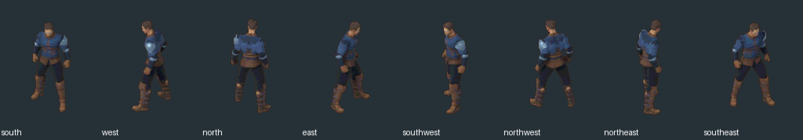
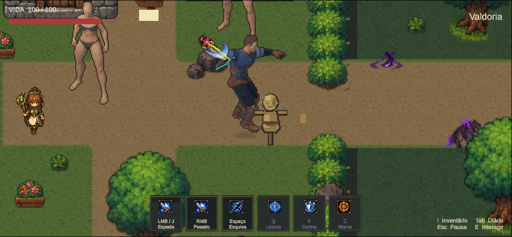

# Marco 06B.13 R6 — oito direções; combate pendente após gate real

16/10/2026. **Entrega parcial prevista no pedido: Etapa A concluída tecnicamente. Espada/combate completo não concluídos.** Caminhada e figurino R5 aprovados estão preservados; diagonais novas e estudos de combate não receberam aprovação artística. Nada foi promovido ao mundo oficial.

## A. Oito direções de locomoção

Cena jogável: `Assets/Mmorpg/Scenes/HumanoidCombat8Dir2026.unity`, cópia do R5. Ao concluir ela usa **Valdoria8Dir.asset**, com espada oculta e locomoção validada. O nome da cena foi mantido conforme solicitado; não significa que o combate passou. Mecânicas herdadas ainda existem, mas fallback de idle em ações ausentes não constitui animação concluída.

104 sprites de locomoção: **96 de caminhada e oito idles**, 16 clips. Os 52 quadros cardinais vêm diretamente dos cels R5; os 52 novos são renderizações intermediárias do mesmo .blend vestido. Um idle por direção, sem fabricar idle animado por repetição. As diagonais usam a mesma fase de Walk_Loop, 12 amostras em 0–40 frames a 30 fps. Walk exportado a 111 ms/quadro (1,332 s/ciclo); GIF a 110 ms por limite do formato.

Mantidos canvas 128×160, 32 PPU, pivô Unity (64,34), pivô superior esquerdo (64,126), chão de referência (64,144), malhas, pesos, cabelo, materiais, proporções, câmera ortográfica de escala 2,4, iluminação e trajetória corporal. As oito vistas são renderizadas; nenhuma é PNG girado, cardinal selecionada por proximidade ou diagonal espelhada.

| Unity | Vista visual | Ângulo da câmera Blender | Origem cardinal R5 |
|---|---|---:|---|
| 0 | Sul | 0° | south |
| 1 | Oeste | +90° | east na nomenclatura antiga |
| 2 | Norte | 180° | north |
| 3 | Leste | −90° | west na nomenclatura antiga |
| 4 | Sudoeste | +45° | nova renderização |
| 5 | Noroeste | +135° | nova renderização |
| 6 | Nordeste | −135° | nova renderização |
| 7 | Sudeste | −45° | nova renderização |

A correção lateral `dc36f56` foi preservada. Índices cardinais antigos não foram reinterpretados. [Contrato das vistas](../../ArtSource/Labs/Humanoid2026/R6/views.json).

O CharacterSet recebeu `eightDirectionPresentation`, falso por padrão. Só R6 opta por oito vistas. `ProductionDirections` quantiza a apresentação em setores de 45° com 3° adicionais de histerese; sem timer de atraso. O caminho legado de quatro vistas continua no animador. Vetores físicos/aim não foram quantizados. Caminhada segue velocidade, idle retém a última diagonal, ataque segue intenção confirmada. A seleção de esquiva em ProductionCharacterStates usa a conversão do animador, preservando o modo legado; Hurt e Death já congelavam a orientação do animador e passam a admitir seus índices diagonais quando houver clips.

### Integridade, roupa e pés

[QA de sprites](../../ArtSource/Labs/Humanoid2026/R6/Locomotion/qa.json): 104 quadros, 52 cardinais idênticos pixel a pixel, zero recortes pelo canvas. [Comparação corporal](HumanoidCombat8Dir2026/locomotion-pose-integrity.json): **zero diferença nas matrizes mundiais dos 65 ossos** entre cada pose diagonal e o instante correspondente no R5. A roupa não foi reconstruída ou simplificada.

Foram inspecionadas pranchas das quatro diagonais: ombreira assimétrica, braços/mãos, quadris, joelhos, botas, cabelo e contornos mantêm a leitura. Nenhum membro foi removido para corrigir clipping. O loop usa o mesmo intervalo de fase entre último quadro e primeiro. Há quantização de sombras de 1 px como no R5; isso não equivale a certificação de ausência absoluta de flicker.

[Contato dos pés](../../ArtSource/Labs/Humanoid2026/R6/Locomotion/foot-contact.json): projeções de foot/ball esquerdo e direito por pose, alturas mundiais e fases. O movimento corporal coincide exatamente com R5; a projeção muda com a vista. Não foi aplicado foot-lock, deslocamento de pivô, root motion ou ajuste de velocidade para esconder deslize. A referência aprovada é mantida; não se afirmou medição de pressão de sola nem contato físico 3D definitivo.

### Gate Unity executado

[QA real](HumanoidCombat8Dir2026/locomotion-gameplay/qa.json), frames **6721→10095**: W/S/A/D e as quatro combinações diagonais selecionaram as vistas corretas; sprites avançaram; parada preservou direção e velocidade zero; retomada e trocas rápidas passaram. Histerese exercitada perto de fronteira angular. [Colisão e mudança de direção após bloqueio na rocha](HumanoidCombat8Dir2026/locomotion-gameplay/collision-turn.json) passaram. Uma primeira retomada ficou bloqueada ao se aproximar do dummy; o teste de retomada foi reposicionado na rua livre, sem mexer em obstáculos.

Movimento perto de casas/árvores, contato e sorting frente/costas com árvore e Mira, câmera/HUD e F5 passaram. ActorMotor/Collider serializados coincidem com a referência; velocidade de 3,5 u/s confirmada nas regressões, sem alteração do motor, aceleração, controle ou física. A cena usa perfil isolado em Temp/HumanoidR6; saves pessoais não foram usados.

## B. Espada e empunhadura — estudo não liberado

O candidato separado `ValdoriaCombatCandidate.asset` adicionou âncoras derivadas da mão anatômica direita hand_r: ponto ao longo da palma, projeção do eixo, ângulo e depth pela profundidade da mão. Não copiou pontos do Iron Knight. A arma continuou um SpriteRenderer separado, sem segunda espada nos PNGs. Não houve alteração de escala da arma, dano, alcance, cooldown ou SwordSwing.

[Traços de sincronização](HumanoidCombat8Dir2026/combat-candidate/synchronization.json) registraram erro matemático zero entre a âncora e o pivô da arma; três fases e corpo attack-cut durante a janela ativa foram observados. O comprimento visual medido ficou em aproximadamente 1,02149 u, inalterado. Isso prova encaixe de coordenadas, **não prova alinhamento artístico ou acerto de gameplay**.

O teste autoritativo do alvo próximo falhou. Uma segunda prova com o Sweep real instrumentado confirmou **zero HitConfirmed e zero dano**, onde a fixture existente espera um acerto/20 de dano. [Resultado medido](HumanoidCombat8Dir2026/combat-candidate/near-sweep-failure.json), [resumo do gate](HumanoidCombat8Dir2026/combat-gate.json) e [altura da âncora observada](HumanoidCombat8Dir2026/combat-candidate/sweep-height.json).

Ciano é o Sweep recebido do loop de overlaps, amarelo é a arma renderizada e magenta é a empunhadura. O problema é o acoplamento já existente: SwordSwing usa `ProductionFrame.hand` tanto para visual quanto para origem física. A mão do humanoide maior projeta altura/deslocamento muito diferentes das âncoras antigas sobre o plano de colisão. Atribuir coordenadas corretas da luva mudou a cobertura efetiva do golpe; acertar a imagem não manteve o teste físico.

**O candidato foi retirado da cena principal**, em vez de aumentar alcance/dano, deslocar colisores ou declarar sucesso. Os casos posteriores de alvo fora de alcance, parede e ausência de dano duplicado do candidato não foram concluídos, porque a fixture interrompeu no primeiro acerto próximo inválido. Esses testes não são apresentados como passados.

Próximo trabalho necessário: resolver explicitamente o contrato entre empunhadura projetada e geometria autoritativa no plano do mundo. Uma possível proposta futura é distinguir âncora visual de origem física validada, mas isso exigiria rever o contrato de SwordSwing; **não foi implementado neste marco**, que mandava preservá-lo. Alternativas artísticas também precisam de prova de alcance/parede. A discrepância visual de arma curta em relação ao corpo maior permanece documentada, sem escala arbitrária.

## C. Combate e estados — cobertura real

As ações foram novamente conferidas no .blend local. [Auditoria](../../ArtSource/Labs/Humanoid2026/R6/animation-audit.json): Sword_Attack 46 frames de fonte / 1,533 s; Sword_Idle 50 / 1,667 s; Roll 44 / 1,467 s; Hit_Chest 10 / 0,333 s; Hit_Head 13 / 0,433 s; Death01 72 / 2,4 s.

| Ação | Estudo produzido | Estado entregue |
|---|---|---|
| Básico | Preparação 4, corte 4 e recuperação 5 quadros por vista, oito direções | Candidato renderizado/testado, gate físico reprovado, não ativo |
| Pesado | Mesmos desenhos do básico, usando preparação física de 0,38 s | Candidato testado em oito vistas; não é animação profissional distinta; não liberado |
| Hurt | Hit_Chest, sete quadros em oito vistas | Candidato; dano confirmado e reação única exercitados; não ativo na cena final |
| Dodge | Probes de Roll nas vistas de inspeção | Rejeitado por clipping; zero direções integradas |
| Death | Probes de começo/meio/final de Death01 | Rejeitado por clipping; zero direções integradas |

São **160 sprites / 32 clips de estudo de combate**, separados dos 104 de locomoção. [QA do atlas](../../ArtSource/Labs/Humanoid2026/R6/CombatCandidate/qa.json) confirmou nenhum corte nesse atlas de ataque/Hurt. Texturas de locomoção 1024×2080 e de combate 1024×3200 são importadas com limite 4096, sem reamostragem por limite 2048.

As fases de Sword_Attack foram normalizadas ao relógio do SwordSwing: preparação .06 básico/.38 pesado, corte .14 e recuperação .16 s. Fonte 0–9/10–16/18–46 foi amostrada para as três fases; a maior velocidade de mão medida na fonte ocorre em torno de frame 12. Não há eventos de animação aplicando dano. Os traços confirmam alinhamento de fase/estado; a falha de acerto impede declarar sincronização de combate completa.

O estudo de Hurt confirmou dano aceito, recusa por imunidade/amigo e exatamente uma notificação. Cobertura renderizada é oito vistas, mas a fixture de dano confirmou a reação em uma orientação, sem alegar teste de oito impactos independentes. Não houve knockback novo.

### Por que Roll/Death ficaram pendentes

A prova de fonte já cortava corpo nas bordas. Foi tentada conversão no lugar para essas duas ações: removido o deslocamento planar global da pelve apenas no render experimental de combate, mantendo movimento local e sem mover Rigidbody. **Ainda assim**, nove probes in-place contêm quatro imagens que atingem as bordas; morte terminal toca x=128 e y=160, e um quadro de rolamento toca x=128. São membros recortados, não um acessório a diminuir.

[Dados dos probes](HumanoidCombat8Dir2026/rejected-clips.json) e [prancha Blender rejeitada](HumanoidCombat8Dir2026/previews/rejected-roll-death-blender-probes.png). Roll de 1,467 s exigiria aproximadamente **6,67×** de aceleração para caber em 0,22 s. Não foi alterada esquiva, invulnerabilidade, raiz física ou câmera para acomodá-lo. Não se entregou morte interrompida nem rolamento recortado com rótulo de pronto.

Uma revisão futura pode medir margens transparentes específicas para ações horizontais, mantendo densidade de pixels e pivô lógico, ou escolher outra solução visual. Isso precisa de contrato explícito; resolução/enquadramento aprovados não foram silenciosamente alterados. Nenhum fallback de idle foi tratado como Dodge/Death concluído.

## D. Testes Unity, regressões e preservação

Unity 6000.6.5f1 conectada via CLI, autotick e recompilação concluída sem erros. Apenas inspeções focadas; nenhuma suíte extensa. [Snapshot final](HumanoidCombat8Dir2026/editor-final.json) registra cena parada/limpa, perfil override removido, timeScale 1 e zero dispositivos sintéticos, com teclado nativo habilitado.

- **Locomoção R6:** gate descrito em A; captura real de [nordeste](HumanoidCombat8Dir2026/locomotion-gameplay/walk-6.png), quatro cardinais e demais diagonais na pasta de evidência.
- **Candidato:** frames 15199→22199, amostras de básico/pesado em oito vistas, ataque com deslocamento e mira opostos, Hurt e recusas. Dados completos em combat-candidate; esses traços são estudo e não suplantam o gate de acerto reprovado.
- **Iron Knight oficial:** quatro caminhadas a 3,5 u/s, básicos e pesado nas fases esperadas, erro de empunhadura zero. [Regressão](HumanoidCombat8Dir2026/legacy-official/regression.json).
- **Estados B11 oficiais:** esquiva nas quatro orientações, nove cels observados, 9 u/s, 0,22 s e recusa por cooldown; morte sul com 23 cels, terminal mantido, ações mortas recusadas e restauração. [Dodge](HumanoidCombat8Dir2026/legacy-states/dodge-results-0.json), [Death](HumanoidCombat8Dir2026/legacy-states/death-results-0.json). Não se afirmou teste de morte nas quatro orientações.
- **Cena B10 histórica:** caminhada/ataques/pesado e empunhadura passaram. [Regressão](HumanoidCombat8Dir2026/legacy-b10/regression.json). Como a cena não pertence à lista ativa do build, foi carregada pela API Editor LoadSceneInPlayMode; a tentativa anterior com SceneManager gerou um erro de fixture, registrado antes da limpeza do console.
- **R5:** quatro vistas e retorno a idle passaram, todas a 3,5 u/s; opt-in de oito direções permanece falso. [Dados](HumanoidCombat8Dir2026/legacy-r5.json).

[Preservação final](HumanoidCombat8Dir2026/preservation.json): **452 arquivos congelados e cinco saves pessoais intactos**, incluindo R5 .blend/.aseprite/atlases/CharacterSet/cena, fontes antigas, Iron Knight e código físico protegido. SwordSwing, ActorMotor, PlayerController, OfflineAuthority, ActionCombat e Domain não mudaram. Runtime compartilhado alterado apenas para opção de apresentação e conversão de direção; helper novo separado. A primeira cena continua MmorpgWorld; só a nova cena R6 foi acrescentada.

O console histórico do conector inclui warnings obsoletos CS0618 já existentes nos testes e o erro de carregamento da fixture B10. Após a correção dessa carga, foi feita nova execução limpa do R6 de locomoção; [console final](HumanoidCombat8Dir2026/console-final.json) distingue histórico do conector de groundTruth atual. Não chamar o histórico inteiro de zero erros. Inputs/opções foram restaurados; não há saves pessoais nas fixtures publicadas. Os hashes pessoais ficam somente em Temp.

## Prévias e reprodução

| Evidência | Link |
|---|---|
| Caminhada oito vistas / diagonais | [Oito](../../ArtSource/Labs/Humanoid2026/R6/Locomotion/walk-eight-directions.gif), [diagonais](../../ArtSource/Labs/Humanoid2026/R6/Locomotion/walk-diagonals.gif) |
| Cardinais idênticas R5/R6 | [Comparação](../../ArtSource/Labs/Humanoid2026/R6/Locomotion/r5-vs-r6-cardinals.png) |
| 96 poses / oito idles | [96 poses](../../ArtSource/Labs/Humanoid2026/R6/Locomotion/all-96-walk-poses.png), [idles](../../ArtSource/Labs/Humanoid2026/R6/Locomotion/eight-idles.png) |
| Arma caminhando — estudo Unity reprovado para combate | [GIF](HumanoidCombat8Dir2026/previews/weapon-walk-eight-unity-study.gif) |
| Básico/pesado — estudo Unity | [Básico oito](HumanoidCombat8Dir2026/previews/basic-eight-unity-study.gif), [pesado oito](HumanoidCombat8Dir2026/previews/heavy-eight-unity-study.gif) |
| Hurt — estudo Unity | [GIF](HumanoidCombat8Dir2026/previews/hurt-unity-study.gif) |
| Rolamento/morte — probes Blender rejeitados | [Roll](HumanoidCombat8Dir2026/previews/rejected-dodge-blender.gif), [Death](HumanoidCombat8Dir2026/previews/rejected-death-blender.gif) |
| Empunhadura / Sweep reais | [Arma](HumanoidCombat8Dir2026/previews/weapon-grip-unity-study.png), [Sweep reprovado](HumanoidCombat8Dir2026/previews/near-sweep-unity-failure.png) |

GIFs Unity são montados de screenshots reais, com recorte de tela e amostras de tempo de jogo; não são renders Blender apresentados como gameplay. Os renders Aseprite/Blender têm rótulos próprios. Capturas intermediárias ficam em Temp; previews e traços são evidências versionadas. [Cobertura explícita](HumanoidCombat8Dir2026/coverage.json) e [README das fontes/ferramentas](../../ArtSource/Labs/Humanoid2026/R6/README.md).

A cena nova ficou aberta e parada para o usuário testar a locomoção. A aprovação artística das diagonais está pendente. O objetivo completo de combate permanece em aberto; esta entrega usa a possibilidade de Etapa A válida e combate pendente prevista no pedido, porque os testes encontraram bloqueios reais de geometria e recorte.
