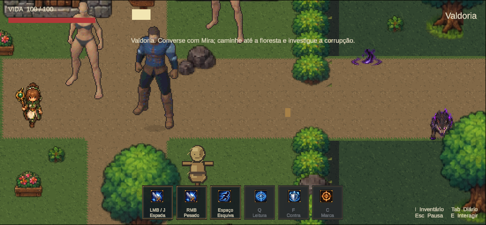

# Marco 06B.13 R5 — figurino do humanoide Quaternius

16/10/2026. **Figurino aprovado pelo usuário:** “Ficou boa a roupa, aprovado”. A aprovação chegou após a apresentação do candidato e o teste em Valdoria, durante a finalização da documentação. [Registro da aprovação](HumanoidOutfit2026/artistic-approval.json). Caminhada aprovada anteriormente permanece a referência; não houve promoção ao mundo oficial nem aprovação de combate.

## Identidade e peças

Espadachim aventureiro de Valdoria: túnica índigo, couro marrom, ombreira assimétrica de aço azulado, antebraços protegidos, dois cintos com fechos, calças escuras, botas estruturadas, luvas e cabelo castanho repartido. O rosto usa a anatomia, olhos e sobrancelhas originais. Detalhe facial continua limitado à resolução nativa; não foi produzido retrato diferente do sprite.

| Componente | Origem e preparação |
|---|---|
| Corpo | Superhero_Male_FullBody Quaternius aprovado, completo e inalterado |
| Tronco, dois cintos, proteção de braços, pernas, botas, ombreira | Malhas profissionais Ranger gratuitas Quaternius; ajustadas ao bind pose Superhero e vestidas sobre o corpo |
| Cabelo | Hair_SimpleParted profissional do material Standard auditado, ligado ao mesmo rig |
| Mangas, forro sob a armadura e luvas | Superfícies extraídas de uma cópia da topologia do corpo, expandidas e com pesos herdados; o corpo original permanece completo |
| Paleta e acabamentos | Tecido índigo por máscara no material texturizado; couro/costuras/cintos da textura profissional; aço próprio na ombreira e faixas dos antebraços |
| Capa | Omitida neste candidato para manter quadris e pernas legíveis; sem simulação física |

A silhueta muda por malhas reais, principalmente ombreira, botas e túnica; não é somente recolorir o corpo. O acabamento pixel art usa quantização e contorno nativo de 1 px pelo Aseprite. Não foram desenhadas pessoas arbitrárias ou geradas novas poses.

## Recursos gratuitos e licença

A [página oficial Fantasy Outfits](https://quaternius.itch.io/modular-character-outfits-fantasy) oferece Standard gratuito e Source pago, identifica CC0 e compatibilidade com Universal Base Characters/Animation Library. O catálogo de 12 outfits/62 partes não foi atribuído à entrega gratuita.

O índice Standard do mirror auditado contém **20 peças modulares e quatro outfits completos**, Peasant e Ranger em versões masculina/feminina. Foram obtidas somente cinco peças masculinas Ranger, que incluem dois objetos de cinto, suas dependências e o aviso CC0 original. As peças escolhidas possuem skin weights e 65 grupos de osso; materiais/texturas são editáveis. A anatomia de repouso do rig Regular difere da Superhero, por isso compatibilidade nominal não foi tratada como encaixe automático.

Cabelo: o índice Standard auditado oferece SimpleParted, Long, Buzzed, BuzzedFemale, Buns e Beard, além de sobrancelhas. Só SimpleParted foi incorporado. Não foi comprado kit pago nem presumida a obtenção de todas as opções anunciadas.

O acesso web ao download oficial não retornou o ZIP. Foram usados mirrors públicos com commits fixados, apenas arquivos de dados, validados por hash de blob Git. Aviso local: `ArtSource/Labs/Humanoid2026/R5/Sources/Outfits/License_Standard.txt`. [Proveniência de roupas](../../ArtSource/Labs/Humanoid2026/R5/outfit-provenance.json), [cabelo](../../ArtSource/Labs/Humanoid2026/R5/hair-provenance.json) e [dependências](../../ArtSource/Labs/Humanoid2026/R5/dependency-provenance.json). São permitidos edição e compartilhamento das fontes CC0; origem/autoria mantidas. Não se afirmou equivalência com ZIP oficial não obtido.

## Skinning e preservação da caminhada

As peças foram ajustadas do bind pose de origem para o destino pela soma ponderada das transformações dos ossos correspondentes. Mantidos os pesos profissionais e Armature Modifiers, agora apontando para o rig aprovado. Vértices que penetravam o corpo no repouso foram deslocados para fora, com folga local de 0,013 m; isso altera a roupa, não a anatomia. Mangas/forro/luvas herdam os pesos da superfície corporal correspondente. A túnica não está presa inteira a um único osso.

A superfície de pele duplicada dentro do arquivo Ranger Arms foi retirada **somente daquela peça importada**, para não desenhar dois braços sobrepostos. Nenhum braço ou parte do corpo original foi removido. Foi acrescentado um forro para cobrir uma abertura identificada atrás do ombro.

Congelamento anterior: [530 hashes protegidos](HumanoidOutfit2026/protected-files.json), [contrato Unity e posição](HumanoidOutfit2026/frozen-reference.json), hashes pessoais somente em Temp. [Contrato explícito de render](../../ArtSource/Labs/Humanoid2026/R5/render-contract.json) registra luz, câmera, amostragem e escala.

O renderer conserva a rotina original de rig, Copy Rotation, delta de pelve, câmera ortográfica de escala 2,4, luz e amostragem. A prova mais forte: **os 52 renders sem roupa do R5, após o mesmo acabamento Aseprite, são idênticos pixel a pixel aos 52 sprites aprovados**, zero diferenças. O modelo vestido mantém 48 poses de caminhada (12 por direção) e quatro idles. Duração de caminhada 111 ms/quadro, 1,332 s/ciclo; mesmo referenceSpeed, pivô e PPU. Canvas 128×160, Point, FullRect, alfa binário, sem blur/compressão/mipmap. Nenhum recorte pelo canvas nos 52 quadros.

Direção esquerda usa a fonte `east` e direita usa `west`, preservando `dc36f56`. As quatro pranchas de 12 poses foram inspecionadas para pés, joelhos, mãos, cotovelos, quadris, silhueta e sequência do loop. A roupa segue os movimentos existentes; não houve alteração de frequência, pelve ou poses para ocultar problemas. GIFs têm dois ciclos e 110 ms pela precisão do formato; não substituem os timings de 111 ms do asset.

## Editáveis e evidências

Fonte: [ValdoriaSwordsman.blend](../../ArtSource/Labs/Humanoid2026/R5/ValdoriaSwordsman.blend), com coleções Body/Clothing/Armor/Accessories/Hair/Rig/Rendering. Texturas externas relativas ficam versionadas junto às fontes; arquivos/cache de render intermediários ficam em Temp.

[Aseprite editável](../../ArtSource/Labs/Humanoid2026/R5/Results/ValdoriaSwordsman.aseprite): 52 quadros, oito tags e cinco camadas. Render vestido composto, contorno separado, referência corporal oculta, guias ocultas e camada vazia reservada para correções localizadas. Não houve retoque manual de pixels por pose; a revisão artística usou as pranchas e o jogo.

- [Corpo original × vestido](../../ArtSource/Labs/Humanoid2026/R5/Results/original-vs-outfit.png).
- [Quatro direções](../../ArtSource/Labs/Humanoid2026/R5/Results/four-directions.png).
- [Caminhada original × vestida](../../ArtSource/Labs/Humanoid2026/R5/Results/walk-original-vs-outfit.gif).
- [Caminhada sul](../../ArtSource/Labs/Humanoid2026/R5/Results/walk_south.gif) e [quatro direções animadas](../../ArtSource/Labs/Humanoid2026/R5/Results/walk-four-directions.gif).
- [Detalhes nearest](../../ArtSource/Labs/Humanoid2026/R5/Results/outfit-details-nearest.png).
- [Revisão frontal](../../ArtSource/Labs/Humanoid2026/R5/Results/pose-review-south.png), [costas](../../ArtSource/Labs/Humanoid2026/R5/Results/pose-review-north.png), [esquerda](../../ArtSource/Labs/Humanoid2026/R5/Results/pose-review-left.png), [direita](../../ArtSource/Labs/Humanoid2026/R5/Results/pose-review-right.png).
- [Gameplay ao lado dos NPCs](HumanoidOutfit2026/gameplay/beside-npcs.png), [árvore ocultando o jogador](HumanoidOutfit2026/gameplay/tree-behind.png) e [jogador à frente da árvore](HumanoidOutfit2026/gameplay/tree-front.png).
- [Integridade e roundtrip Aseprite](HumanoidOutfit2026/integrity.json), [QA de sprites](../../ArtSource/Labs/Humanoid2026/R5/Results/qa.json) e [auditoria de malhas](../../ArtSource/Labs/Humanoid2026/R5/parts-audit.json).

## Unity — execução real

Nova cena `Assets/Mmorpg/Scenes/HumanoidOutfit2026.unity`, copiada da referência aprovada. CharacterSet novo em `Assets/Mmorpg/Art/Experimental/HumanoidOutfit2026/ValdoriaSwordsman.asset`, clips clonados com sprites novos. Cena/atlas existentes são recusados pelo autor. Mundo oficial e índice zero mantidos; apenas a cena nova foi acrescentada ao build.

Testes curtos via CLI conectada com `--caller plugin --skill unity-pipeline`, autotick habilitado, recompilação concluída sem erros. [QA real](HumanoidOutfit2026/gameplay/qa.json): frames **17057→18875**, caminhada W/A/S/D com avanço de sprites e direção visual correta, diagonal W+D, parada/retomada, movimento na rua diante de casas e perto de TreeWest, sorting frente/costas com árvore e Mira, câmera/HUD equivalentes e F5 mantendo aparência e identidade do perfil isolado. Componentes físicos ActorMotor/Collider comparados serializados com a referência, sem mudanças. Não foram executados testes de espada/combate ou suítes extensas.

Durante a preparação houve uma referência de CharacterSet não persistida na cena nova, corrigida por recarregamento do asset persistente antes de salvar; não foi alterado o animador. As tentativas de QA também ajustaram uma rota bloqueada pela pedra existente e passaram a comparar o renderer real ProvidedTree, em vez do proxy vazio. A execução completa posterior passou. Console atual da Unity: zero erros/avisos; o histórico do conector ainda inclui as duas exceções anteriores à correção, portanto esses registros não foram tratados como erros novos.

[Preservação](HumanoidOutfit2026/preservation.json): 530 arquivos congelados intactos, cinco saves pessoais intactos, clips/durações/pivôs/PPU iguais, só uma cena acrescentada. O guard Editor foi estendido para selecionar `Temp/HumanoidR5/ManualPlayerProfile` ao iniciar esta cena e restaurar o override ao sair. Após QA, dispositivos de teste removidos, teclado/mouse nativos e opções do Editor restaurados. Cena nova aberta e parada para revisão; a referência original continua acessível.

## Mãos, limites e próximos passos

[Metadados por frame](../../ArtSource/Labs/Humanoid2026/R5/Results/pose-metadata.json): 65 matrizes ósseas por pose, projeções de pés/joelhos/braços, centro de pelve, chão, pivô e mão direita anatômica `hand_r`, eixo da mão, ângulo projetado e profundidade relativa à pelve. São **pontos de preparação**, não empunhaduras certificadas: o eixo do osso não é o ângulo final da lâmina e a profundidade relativa não substitui revisão de oclusão da espada. Coordenadas do Iron Knight não foram copiadas.

Espada continua oculta. Faltam calibrar contato da luva com empunhadura, ângulos/depth por pose, preparar ataques/esquiva/dano/morte e validá-los separadamente. SwordSwing, dano, geometria física, missões e progressão permaneceram intactos. Ausência desses clips ainda usa o fallback existente de idle; não interpretar a roupa aprovada como combate concluído.

Limites artísticos: superfície da túnica/forro é justa em algumas poses; não há prova matemática de ausência de todas as interpenetrações. A revisão dos 48 quadros não mostrou perda de membros ou clipping excessivo; folgas finas em axilas/quadris podem ser refinadas conforme nova avaliação. Detalhes pequenos e brilho da ombreira podem variar na quantização de 1 px; não há simulação de tecido nem garantia para animações ainda não vestidas. Rosto permanece discreto na escala nativa. O mundo ainda usa a escala anterior de portas/etiquetas. A aprovação explícita recebida é do figurino apresentado; não se presumiu aprovação isolada de retratos, outras roupas ou ações futuras.

O figurino aprovado e a caminhada ficam como referência para próximos pedidos. Não avançar automaticamente para ataques/morte ou promover ao mundo oficial neste marco.
