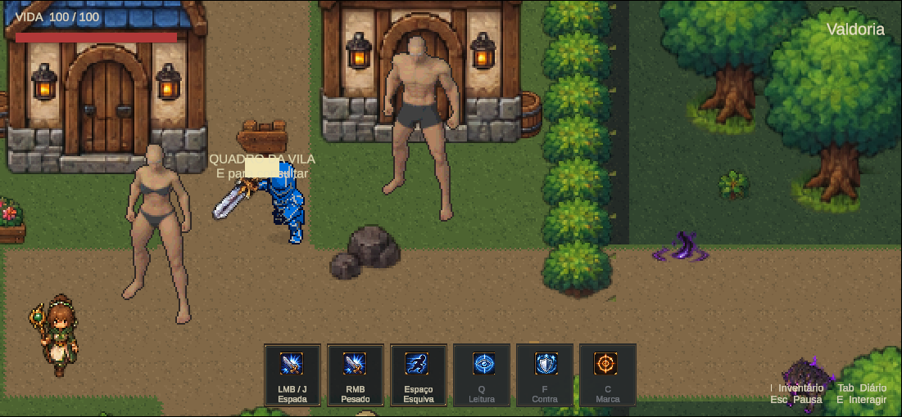
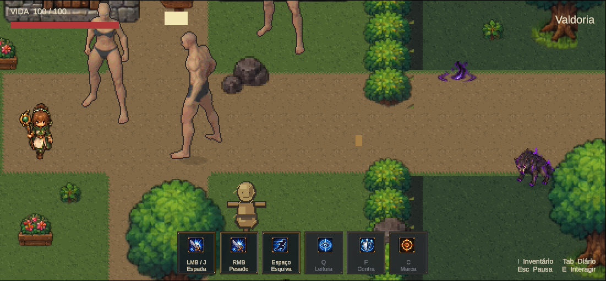

# Corpos maiores dentro de Valdoria — 2026-10-16

Pedido: visualizar a família Quaternius dentro do jogo antes de escolher a direção artística.

Cena: `Assets/Mmorpg/Scenes/HumanoidScale2026.unity`, cópia experimental do mundo oficial. Female representa Mira; Male representa Orin. Iron Knight permanece como comparação. As bases ainda estão sem roupas finais. Nenhum desenho foi refeito nesta integração.

## Importação e limites visuais

Dois atlas originais copiados para `Assets/Mmorpg/Art/Experimental/HumanoidScale2026/`: 52 sprites por corpo, oito clips demonstrados (idle/walk nas quatro direções), canvas 128×160, 32 PPU, Point, FullRect, sem compressão/mipmaps, pivô Unity (64,34). Fonte CC0 e hashes em `ArtSource/Labs/Humanoid2026/provenance.json`. A resolução nativa maior está preservada.

O mundo não foi ampliado nesta comparação: corpos ficam visivelmente maiores que os NPCs anteriores e portas/etiquetas ainda usam a escala antiga. Pivô único é uma calibração inicial, não certificação de contato de pés durante toda a animação. Protagonista, combate e roupas complexas ainda não foram migrados. A apresentação não constitui aprovação artística.

## Verificação executada

Unity 6000.6.5f1 conectada via CLI Pipeline; autotick habilitado; recompilação up_to_date sem erros. Play real avançou de 9321 a 17690 frames na execução completa. Capturas são Game View real, sem composição.

- Mira e Orin: quatro idles e 12 frames de caminhada por direção, dois ciclos demonstrados em cada direção, trocando sprites somente durante inspeção em Play. Os NPCs continuam estáticos na cena salva.
- Input real de teclado: diálogos E de ambos, contato frontal caminhando, contato traseiro e oclusão frente/costas equivalentes ao mundo oficial. Posicionamento de inspeção usa Rigidbody; não foi validada navegação ao redor dos NPCs. A primeira tentativa dessa rota encontrou obstáculo e foi substituída por posicionamento explícito para o teste de oclusão.
- HUD e zoom da câmera mantidos; F5 recarregou a cena experimental, preservando identidade e fatos do perfil isolado. Herói vivo após recarga.
- Console final: zero erros e zero avisos. Input e opções do Editor restaurados ao sair de Play; override de perfil removido.
- 232 arquivos protegidos inalterados, cinco arquivos pessoais de save inalterados, colliders/identidades/interações dos dois NPCs preservados. Entrada oficial continua no índice zero; apenas esta cena foi acrescentada ao build.

Evidências: [QA](HumanoidScale2026/gameplay/qa.json), [preservação](HumanoidScale2026/preservation.json), capturas de cada direção/diálogo/oclusão na pasta `HumanoidScale2026/gameplay/`. O registro captures.jsonl inclui as duas tentativas.

## Reprodução

Criação única: abrir mundo oficial limpo, executar `BuildHumanoidScale2026.Preflight`, depois `ImportAndCreate` via run_script. Recusa sobrescrever cena/atlas existentes.

Inspeção: abrir cena experimental limpa; `InspectHumanoidScale2026.Prepare`, editor_play, `InspectIronKnight06B11.Setup`, `InspectHumanoidScale2026.Inspect`, opcional `Present`, editor_stop, `InspectIronKnight06B11.Cleanup`, `BuildHumanoidScale2026.Verify`. Todos os comandos usam `--caller plugin --skill unity-pipeline`. A cena ficou aberta e parada, pronta para revisão no Editor.

## Personagem controlável — atualização após pedido do usuário

A cena experimental agora inicia com a base Male no jogador. `MalePlayer.asset` usa as 52 poses e oito clips idle/walk originais, consumidos pelo `ProductionSpriteAnimator` existente. Motor, velocidade, collider, autoridade e controles permanecem os mesmos. A espada foi ocultada nesta cena porque as âncoras antigas não correspondem ao corpo maior. Não foram criadas animações de combate/esquiva/dano/morte; ações sem clip ainda usam o fallback de idle. Esta é uma prova de movimentação, não a promoção final do protagonista.

`HumanoidScalePreviewProfile` é uma ferramenta somente Editor: antes do Play nesta cena direciona a persistência para `Temp/HumanoidScale2026/ManualPlayerProfile`, reaplica após domain reload e restaura o override anterior ao sair de Play. Isso também permite testar manualmente com perfil separado. O mundo oficial não foi alterado.

QA com input real na rua livre (-5.5,0): quatro direções moveram cerca de 1.198 unidades por amostra, cada caminhada avançou sprites, soltar a tecla retornou a idle com velocidade zero; diagonal W+D aceita. Frames 5881→6655; console zero erros/avisos. Tentativas iniciais em (0,-2) encontraram bloqueio do mundo; o teste passou na rua livre, sem modificar colisões. [QA do jogador](HumanoidScale2026/player/qa.json).

Autor: `BuildHumanoidPlayerPreview.Build` recusa sobrescrever o CharacterSet e altera somente a cena experimental. Verificação: Prepare/Setup do laboratório, `InspectHumanoidPlayerPreview.Inspect`, Stop/Cleanup. Ao concluir, Play foi reaberto com dispositivos nativos habilitados para o usuário testar WASD/setas.

## Correção das direções laterais

O teste anterior validava direção lógica e avanço de frames, mas não detectava que os rótulos west/east do estudo nomeavam o lado da câmera. A prancha revelou west olhando à direita e east olhando à esquerda. Corrigidos os clips idle e walk do CharacterSet: direção Unity 1 usa a sequência fonte east (idle 39 / walk 40–51), direção 3 usa west (idle 13 / walk 14–25). Sul e norte mantidos; nenhum pixel, timing ou controle alterado. O autor foi corrigido e a operação CorrectLateralDirections é idempotente.

Repetido teste real de input, quatro direções/diagonal/parada, agora verificando também a sequência fonte correspondente. Frames 967→1827, console zero erros e avisos. Capturas A e D inspecionadas visualmente: corpo olha na direção do deslocamento. [QA corrigido](HumanoidScale2026/player-direction-fix/qa.json). Evidência anterior mantida como histórico. Play reaberto para teste manual com teclado nativo e perfil separado.
