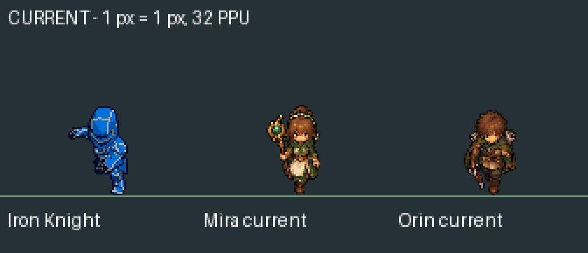
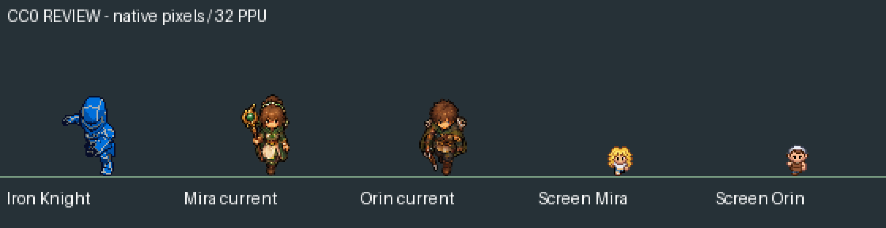
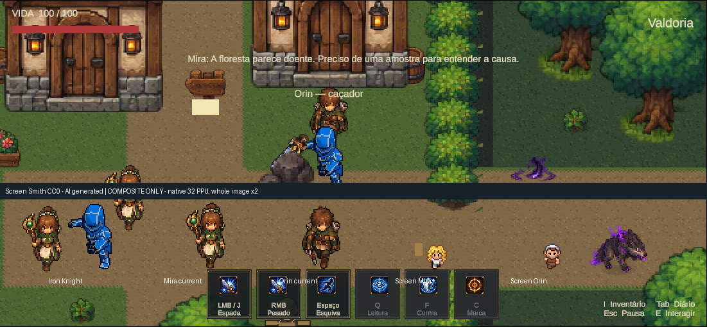
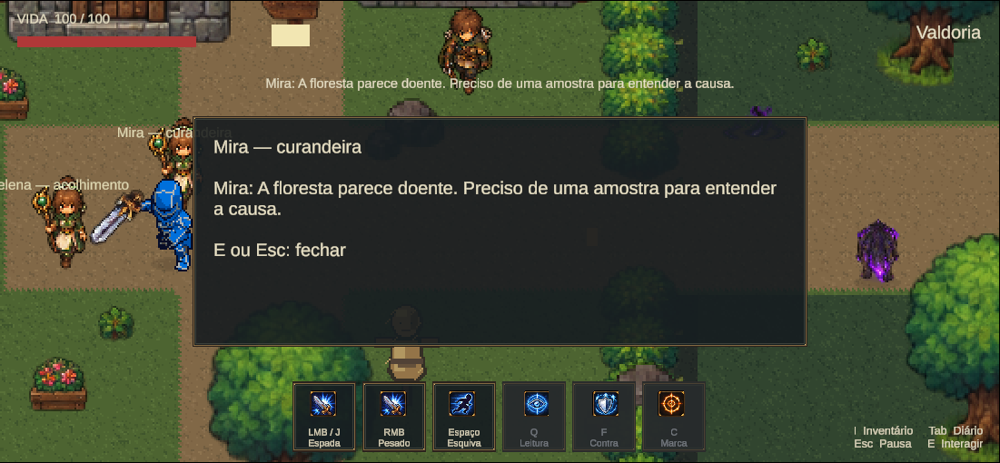
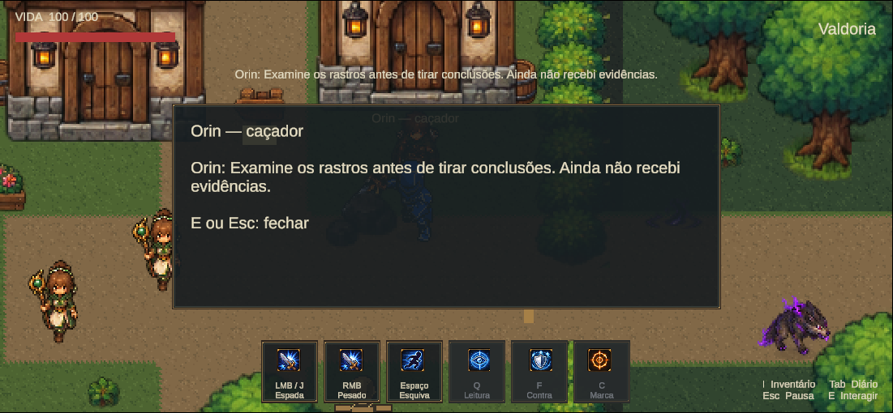

# Marco 06B.13 — pesquisa de NPCs e estudo de adaptação no Aseprite

Data: 16/10/2026. Projeto Unity 6000.6.5f1, branch `main`.

**Leitura histórica:** este relatório registra a primeira etapa. As ampliações posteriores solicitadas pelo usuário estão no [R2 — bases redistribuíveis e roupas por camadas](Marco06B13R2.md), no [R3 — geometria de roupas e teste no jogo](Marco06B13R3.md) e no [registro atual de capacidades e limites](../Art/ProceduralWardrobe.md). A afirmação abaixo sobre ausência de cena experimental refere-se à primeira etapa; o R3 criou sua própria cena, mantendo a oficial intacta.

**Resultado: nenhum candidato aprovado para integração.** Mira e Orin oficiais continuam intactos. A pesquisa produziu comparações, inspeção real da cena e um estudo local de adaptação de paleta no Aseprite. A aprovação artística permanece pendente. Não foi criada uma cena experimental sem candidatos que cumprissem o gate.

## Direção de trabalho após a orientação do usuário

O usuário esclareceu que podemos editar personagens profissionais no Aseprite para obter outra aparência, aproveitando movimentos existentes. Essa abordagem é válida: roupa, cabelo, acessórios e paleta podem ser adaptados, desde que a licença permita e as alterações mantenham continuidade entre os quadros. Não há obrigação de reproduzir o desenho atual.

Foi preparado um **estudo inicial de cores**, sem redesenhar anatomia ou gerar movimentos: cleric para a função de Mira, archer para a função de Orin. Isso demonstra o processo; não representa uma adaptação completa de vestimenta nem resolve, por si só, licença, idles ausentes ou compatibilidade artística. Alterações de desenho mais profundas precisam de revisão quadro a quadro no Aseprite e de nova avaliação do conjunto.

## Estado existente e identidade narrativa

Auditoria da cena oficial pela Unity: [existing-npcs.json](Marco06B13/existing-npcs.json). Foram inspecionados Mira, Orin, Brann, Tessa e Soren; somente os dois primeiros são candidatos à substituição.

| NPC / GameObject | Função e representação atual | Posição | Interação |
|---|---|---|---|
| Mira — curandeira | Cura e investigação da corrupção; `Healer_idle_S_0` | −8, 1 | `JourneyInteractable`, kind Mira, ID narrativo `mira` |
| Orin — caçador | Interpretação de rastros e evidências; `Hunter_idle_S_0` | −3, 3 | `JourneyInteractable`, kind Orin, ID narrativo `orin` |
| Brann — forja | Referência futura de equipamentos; `Smith_idle_S_0` | −3, −5 | `ExplorationNode`, `brann`; diálogo não consome materiais |
| Tessa — arquivo | Pesquisa de marcas, Kharum e Asterion; `Scholar_idle_S_0` | −6, 28 | `ExplorationNode`, `tessa` |
| Soren — historiador | Contexto do Farol de Asterion; `Scholar_idle_S_0` | 29, 25,8 | `ExplorationNode`, `soren`; não cria outra ativação mundial |

Mira e Orin usam um SpriteRenderer ativo na raiz, escala 1, canvas 80×80, 32 PPU, pivô Unity (40,26), equivalente a (40,54) na origem superior esquerda. Os PNGs estão em `Assets/Mmorpg/Art/Processed/Healer` e `Hunter`. Ambos têm BoxCollider2D de 0,5×0,6, sem offset, e alcance de interação 1,4. Não foram alterados colliders, raiz, LOS ou posições.

O `WorldArtSorting` usa a âncora de posição: `100 - round(y * 16)` durante Play. Brann, Tessa e Soren possuem renderer antigo desabilitado e filho `PreparedNpcVisual` ativo; escala X da raiz 0,8 compensada pelo filho 1,25. Esse padrão existente foi apenas inspecionado.

`JourneySession` solicita interações ao domínio, mantém fatos narrativos e persiste o snapshot; `ExplorationWorld` apresenta o diálogo e bloqueia movimento enquanto aberto. Mira permanece ligada à amostra e às decisões existentes, Orin aos rastros, evidências e briefing. Nenhum evento, ID ou texto foi criado para corresponder a um asset externo. O perfil oficial continua em `DevelopmentJourneys/marco06b4`; a fixture usou override em `Temp/Marco06B13/<id>`.

## Fontes e licenças

Somente downloads gratuitos disponibilizados pelos autores foram obtidos. Não houve compra, geração de arte ou contato com autores. ZIPs, páginas de download e URLs temporárias ficaram fora do repositório. Datas abaixo são as datas explícitas das páginas, não datas inferidas de comentários. Proveniência e hashes dos arquivos locais: [sources.json](Marco06B13/sources.json).

| Fonte primária | Evidência de 2026 | Licença / decisão de publicação |
|---|---|---|
| [Screen Smith — Townspeople 2](https://screensmith.itch.io/pokemon-style-characters-townspeople-2) | Atualizado 20/09, 16:40 UTC | CC0. Autor declara origem por IA/Retro Diffusion e solicita essa divulgação. Somente recortes e prévias deste pacote foram publicados neste marco. |
| [GegX — Emberglen Villagers](https://gegx.itch.io/emberglen-villagers) | Atualizado 27/09, 19:59 UTC | Uso comercial permitido, redistribuição como assets proibida. LICENSE.txt também proíbe avaliação por IA: análise encerrada na licença, sem avaliação das imagens ou derivados. |
| [Laphkal — Pixel Fantasy Character Sprites Pack](https://laphkal.itch.io/pixel-fantasy-character-sprites-pack) | Publicado 29/09, 05:47 UTC; atualizado 14:54 UTC | Permite uso comercial e modificação, exige crédito, restringe redistribuição do pacote, inclusive parcial. Permissão para PNGs brutos no GitHub público não demonstrada. Fontes, editáveis e prévias ficaram locais. Página identifica assistência de IA, apesar da descrição de autoria manual. |
| [Hormelz — Girl Character](https://hormelz.itch.io/8-directional-girl-character) | Data de publicação/atualização em 2026 não confirmada | Autor declara CC0 e derivação de Mari/Styloo. Proveniência anterior não foi completada; pesquisa adicional mantida local. |

O pacote Emberglen tem descrições divergentes de quantidade/direções na página; não foi escolhido com base nessas alegações. O README local descreve quatro direções animadas, seis quadros walk e quatro idle, com poses adicionais. Não foi medida sua altura visual: dimensões de canvas não substituem essa medida.

Também foram consultados [Tiny Questers — Paladin](https://bobddadoo.itch.io/tiny-questers-paladin), publicado em 01/10/2026: pacote pago, não baixado, identidade de paladino e licença de redistribuição inadequadas à seleção direta; e [5yvalia — NPCs 12×16](https://5yvalia.itch.io/rpg-type-retro-top-down-npc-sprites), CC0, mas dimensão e estética retro incompatíveis, sem data de 2026 confirmada nesta revisão. Não são substitutos aprovados.

Editar, recolorir ou converter para `.aseprite` **não elimina as condições da licença original**. Para publicar uma adaptação restrita seria necessária autorização explícita que cubra os sprites e derivados no repositório público, ou outra fonte compatível. Nenhum material restrito foi incluído no commit.

## Comparação em escala nativa

Medição do bounding box alfa, sem confundir canvas com altura. Os números incluem todos os pixels não transparentes; limites sólidos alfa ≥128 também estão no [registro de medidas](Marco06B13/pixel-measurements.json).

| Personagem / amostra | Canvas | Altura visual nativa | Animações verificadas |
|---|---|---|---|
| Iron Knight, idle sul oficial | 256×256 | 51 px | Referência oficial inalterada |
| Mira atual | 80×80 | 52 px | Uma pose sul; não é idle com respiração |
| Orin atual | 80×80 | 50 px | Uma pose sul; sem caminhada atual |
| Screen Smith, seleção para comparação Mira | 18×26 por célula | 19 px | Três desenhos × quatro direções; sem sequência idle distinta |
| Screen Smith, seleção para comparação Orin | 18×26 por célula | 20 px | Três desenhos × quatro direções; sem sequência idle distinta |
| Laphkal cleric | 64×64 | 59–62 px | Quatro desenhos walk × quatro direções; sem idle próprio |
| Laphkal archer | 64×64 | 52–53 px | Quatro desenhos walk × quatro direções; sem idle próprio |
| Hormelz Girl, direções cardinais | 256×256 | Walk 87–99 px; idle 93–98 px | Walk: 36 quadros/direção; idle: 23, com duração no JSON |

As pranchas possuem uma versão nativa e outra com ampliação **do conjunto inteiro** em nearest 3×. Nenhum candidato foi aumentado isoladamente para alcançar o herói. A linha comum das pranchas alinha o limite alfa inferior para comparação visual; não é uma declaração de pivô de produção aprovado.

Essa imagem é uma composição Pillow identificada na própria imagem. Personagens usam a mesma densidade de exibição 2× da captura; não é uma captura de candidatos integrados, não substitui QA de sorting e não demonstra oclusão correta. A captura real sem montagem está em [Orin-current.png](Marco06B13/baseline/Orin-current.png).

## Gate artístico e possibilidades de adaptação

- **Screen Smith:** as figuras ficam muito menores, com proporção de cabeça e linguagem de outro jogo. Adaptar apenas cores e roupa não corrige esse descompasso. Ampliá-las arbitrariamente não é a solução. Seleções de comparação não foram nomeadas como novas identidades narrativas. A paleta é legível em seu próprio estilo, mas a silhueta não sustenta a escala de Valdoria.
- **Laphkal:** o arqueiro já comunica a função de Orin e tem altura próxima; o cleric comunica cura, mas é maior e não estabelece sozinho a identidade de Mira. Contornos, rosto simplificado, proporções e amplitude dos passos ainda diferem bastante do conjunto. A prancha lateral do cleric mostra grande variação da silhueta entre contato e passagem. Não houve aprovação dessa caminhada apenas pela existência de quatro PNGs.
- **Hormelz Girl:** tem movimentos reais e estrutura exportável útil como base, mas exige adaptação extensa de vestimenta, proporção e altura; não foi escolhida como Mira apenas por ser do mesmo autor do herói. Data elegível e proveniência anterior também ficaram pendentes.
- **Emberglen:** descartado no gate de licença; não há conclusão artística sobre suas imagens.

Nas amostras Laphkal há muitos tons e alfa parcial; isso já ocorre também nos NPCs atuais. Contar cores não comprova qualidade nem superioridade. A revisão observa a leitura do conjunto: sálvia/creme para a função de cura e verde/marrom para caça são direções possíveis, mantendo contraste com o herói azul. Não foi feita redução destrutiva de paleta ou interpolação.

### Estudo local realizado no Aseprite

Local: `D:/unity/ExternalArt/NpcResearch/Marco06B13/review/adaptation/`.

- `cleric.aseprite` e `archer.aseprite`: RGBA 64×64, 16 quadros, quatro tags walk. Camada original intacta oculta e camada de estudo visível.
- Mira: tecido neutro convertido para sálvia/creme, preservando acabamento dourado e pixels fora do filtro.
- Orin: verdes da capa/capuz menos saturados, mantendo couro e equipamento.
- Nenhum desenho ou pose foi inventado; nenhum pixel mudou de posição. Alfa idêntico em todos os 32 quadros. Foram alteradas cores em 6.924 pixels de Mira e 5.724 de Orin, somados nos quadros.
- Duração do estudo: 125 ms por desenho, conforme recomendação aproximada de 8 FPS do README. O PNG não traz timing autoral por quadro; isso não é apresentado como preservação de uma timeline original inexistente.
- Pranchas de direções, comparação antes/depois, composição em Valdoria e GIFs de dois ciclos estão **somente nesse diretório local**. Metadados sem imagens: [adaptation-checks.json](Marco06B13/adaptation-checks.json).

O script Lua aplica somente transformação de cores aos quadros fornecidos. Não desenha pernas, roupas novas, anatomia ou caminhada procedural. A leitura dos PNGs, criação do documento editável e exportação foram executadas no **Aseprite 1.3.18.6**. Um roundtrip separado do PNG CC0 confirmou pixels idênticos: [aseprite-check.json](Marco06B13/aseprite-check.json).

Ainda faltam: escolha de direção visual pelo usuário, eventual redesenho manual consistente de roupas/acessórios, idle real nas quatro direções, avaliação da continuidade e autorização de publicação. Este estudo não passou no gate completo e não foi importado.

### Pés, pivôs e animações

Pivôs existentes foram preservados. Nas fontes aprovadas do herói, o primeiro frame usa pivô (128,114) e referência de pés (128,132). Os NPCs atuais usam (40,54) e pés (40,72). Nenhuma âncora foi movida.

Screen Smith tem limite alfa inferior y25 nas amostras; cleric varia entre y61–63 e archer entre y58–59. São limites observados, não pontos de apoio anotados pelo artista. O estudo Aseprite conserva exatamente esses limites. Falta revisão de contato real dos pés e de uma âncora estável antes de importar.

Os GIFs de Screen Smith usam os três quadros fornecidos, duas sequências, sem loop infinito nem cópias para inventar fases. Os 100 ms são somente velocidade declarada de inspeção porque o download PNG não trouxe timing. Não foi ajustada velocidade para disfarçar defeitos. GIFs Laphkal locais seguem 125 ms. **Não foi fabricado GIF de idle** para pacotes que não o fornecem. PNGs distintos não bastam para aprovar a animação.

## QA real na Unity e limites

Execução pela skill unity-pipeline, sempre com `--caller plugin --skill unity-pipeline`. `set_autotick` ativo; `recompile` e `recompile_status` retornaram `up_to_date`, sem falha. Os scripts de auditoria e fixture foram compilados por `run_script`.

Resultado de Play: [baseline/qa.json](Marco06B13/baseline/qa.json).

| Verificação executada | Resultado |
|---|---|
| Perfil isolado antes de entrar em Play | Override em Temp, sem abrir o perfil pessoal |
| Mira e Orin em seus locais atuais | Confirmado, capturas reais separadas |
| E abre/fecha diálogo | Confirmado nos dois; mensagens correspondem ao NPC correto |
| Fatos e identidade após save/load + F5 | Preservados; mesma cena oficial, sem fatos duplicados no reload |
| Mundo, câmera, HUD e protagonista presentes | Confirmados nas capturas; frames avançaram de 2422 para 3054 durante a fixture |
| Console durante e após esse Play | Zero erros e zero warnings após limpeza anterior ao teste |
| Saída e restauração | Play parado; dispositivos de teste removidos, dispositivos nativos reabilitados, opções do Editor/input e override restaurados |

Houve antes do Play um erro de comando de descoberta da ferramenta (`list` inexistente); foi corrigido e o Console limpo antes da janela medida. Isso não foi um erro de gameplay. Não foram executadas suítes extensas nem serviços externos.

**Não executados:** integração dos candidatos, patrulha, testes de colisão/LOS/sorting frente e atrás com novos visuais, nova passagem por obstáculos, regressão dinâmica completa de ataques/esquiva/Hurt/Death. Como não houve mudança de Runtime, Domain, assets importados ou cenas, não se atribui a esse marco uma validação de integração inexistente. As capturas são da versão oficial atual. Não há “depois” real da Unity; apenas montagens explicitamente identificadas.

## Preservação verificada

[preservation.json](Marco06B13/preservation.json): 61 arquivos oficiais comparados ao snapshot inicial, nenhuma mudança; 264 PNGs-fonte do herói conferidos contra os hashes aprovados, nenhuma mudança. CharacterSet mantém **36 clips, 324 entradas de frames e 264 referências únicas de sprites**. O manifesto-fonte possui 24 sequências; o importador desdobra fases em 36 clips de produção — esses números não são intercambiáveis.

Cena oficial, prefab visual, folhas, metadados de mãos/timings, espada e Build Settings permaneceram byte a byte iguais. Nenhuma alteração em Runtime, Domain, controle, combate, missões ou progressão. Cinco arquivos pessoais existentes foram comparados por hash, todos intactos; seus caminhos completos e hashes permaneceram somente em Temp. Alterações alheias de B6/PixelLab e caches foram preservadas e excluídas do commit.

Não foram criados `Marco06B13Npcs.unity`, adaptador de animação, fontes de produção ou dependências experimentais no mundo. Essas etapas dependem do gate visual e de licença. A cena inicial continua `MmorpgWorld`.

## Reprodução e próximos passos

Scripts novos: `AgentScripts/AuditValdoria06B13.cs` (inventário e snapshot inicial sem sobrescrever snapshots existentes), `InspectNpcs06B13.cs` (Prepare/Baseline), `Tools/ArtPipeline/review_npcs_b13.py`, `verify_npcs_b13.py` e `Aseprite/review_npc_palette_b13.lua`.

Para a fixture: cena oficial limpa e parada → Prepare B13 → Play → Setup B11 → Baseline B13 → Stop → Cleanup B11, inclusive após falha. Nunca usar o Prepare B11 na cena oficial. Os scripts não geram nem salvam cenas.

Para refazer pranchas, fornecer ao Python um diretório de fontes **fora do repositório**; a ferramenta recusa diretório restrito dentro do projeto. Os arquivos devem ser obtidos legitimamente nas páginas dos autores; o script não baixa material. O Lua recebe `source`, `output` e `role` (`cleric`/`archer`), recusa sobrescrever editáveis e deve receber saídas locais fora do projeto. O verificador de preservação depende do snapshot pessoal local em Temp e não deve ser executado sem ele como se tivesse passado.

Caminhos possíveis para continuar:

1. Usar as prévias locais para escolher a direção de roupa/proporção e avaliar se vale obter autorização explícita de Laphkal para a publicação de derivados no GitHub. A autorização não foi solicitada ao autor nesta tarefa.
2. Buscar outra base CC0 com idle/walk reais e altura compatível, ou encomendar uma adaptação manual com contrato que permita publicar fontes/derivados. Aproveitar movimentos é desejável; a base ainda precisa suportar a qualidade final.
3. Só depois preparar editáveis finais permitidos, pivôs por quadro, importer leve e cena B13 separada; executar o QA de integração e apresentar para aprovação artística do usuário. Não promover automaticamente para a cena oficial.

O estudo termina como **pesquisa e adaptação local inicial, sem substituição aprovada**, conforme a prioridade de qualidade e de licença do pedido.
