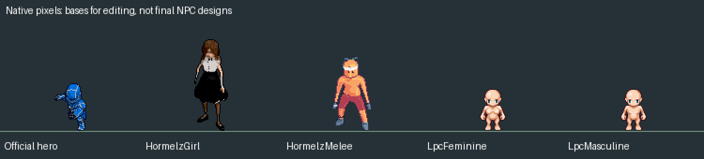
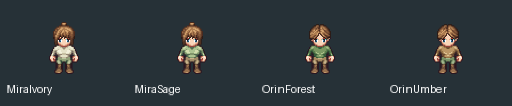
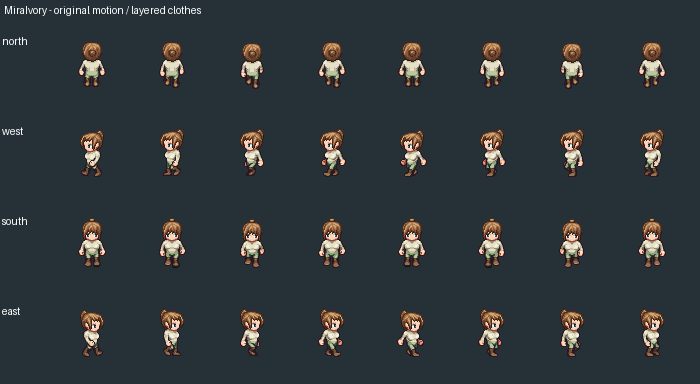
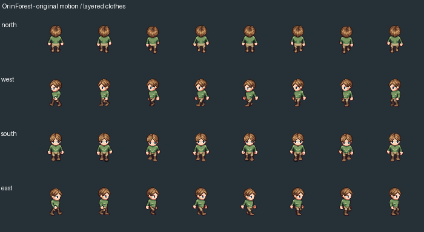

# Marco 06B.13 R2 — bases redistribuíveis e roupas por camadas

16/10/2026. Pesquisa e laboratório fora de Assets, sem integração na Unity.

## Resultado

Foram encontradas fontes que permitem publicar PNGs e derivados no GitHub, preparadas quatro bases editáveis e uma biblioteca de efeitos. Após a orientação adicional do usuário, foi montada uma prova de roupas por combinação de peças e transformação de paletas no Aseprite. Não há aprovação artística nem promoção para o mundo oficial.

O critério agora prioriza anatomia, movimento, estrutura de edição e redistribuição; roupa e aparência podem ser adaptadas. As fontes abaixo não foram anunciadas como lançamentos de 2026 quando essa data não foi comprovada. Materiais antigos continuam identificados como referências complementares; o ano não foi inventado para justificar seleção.

## Fontes verificadas

| Fonte | Publicação dos arquivos e adaptações | Utilidade / limitações |
|---|---|---|
| [Hormelz Girl](https://hormelz.itch.io/8-directional-girl-character) e original [Mari / Styloo](https://styloo.itch.io/mari) | Ambas as páginas declaram CC0-1.0 | 16 ações anunciadas, oito direções, cabelo/saia animados, PNG/JSON. Boa base para estudo corporal e movimento; grande para o alvo atual. Roupa moderna não é mais descarte automático. |
| [Hormelz Melee](https://hormelz.itch.io/8-directional-melee-character) | CC0-1.0 declarado pelo autor | 38 ações anunciadas, oito direções, base masculina útil para vestir. JSONs do download vazios; tempos cardinais requerem revisão. |
| [LPC Revised / ElizaWy](https://github.com/ElizaWy/LPC) | Peças selecionadas sob OGA-BY 3.0, com crédito e indicação das mudanças | Corpo, cabeça, roupa e cabelo modulares. É a base usada na prova de roupas. Não confundir com as várias licenças de outras coleções LPC. |
| [Pixel Magic Effects / Foozle](https://foozlecc.itch.io/pixel-magic-sprite-effects) | CC0-1.0 no site e README; arte encomendada a lordfitoi | Dez efeitos e 100 quadros selecionados; fogo, água, terra, vento, portal e explosão. Material separado dos personagens. |

[CC0](https://creativecommons.org/publicdomain/zero/1.0/) permite modificar e redistribuir, inclusive comercialmente. Para LPC, foram preservados o [texto OGA-BY](../../ArtSource/Labs/NpcResearch/Marco06B13R2/Licenses/OGA-BY-3.0.txt), créditos específicos e fontes anteriores. Nenhuma licença restrita foi substituída por CC0. A atribuição acompanha a biblioteca; uma futura integração deve expor os créditos adequados ao usuário do jogo.

Foram descartados da seleção redistribuível Leapopen, LumenLorePixels e a versão completa Town Guards: suas páginas restringem arquivos brutos/derivados, mesmo permitindo uso em jogos e edição. Não foram comprados ou copiados para o laboratório. O sample CC0 de Town Guards não libera a versão completa. Nenhum ZIP, URL temporária, HTML de download ou pacote restrito foi publicado.

## Biblioteca efetivamente preparada

Local: `ArtSource/Labs/NpcResearch/Marco06B13R2/`. Créditos e condições detalhados no [README da biblioteca](../../ArtSource/Labs/NpcResearch/Marco06B13R2/README.md).

| Documento Aseprite | Quadros / clips preparados | Canvas | Altura visual |
|---|---|---|---|
| HormelzGirl | 236 / 8 — idle e walk cardinais | 256×256 | 87–99 px |
| HormelzMelee | 220 / 8 — idle e walk cardinais | 126×132 | 72–83 px |
| LpcFeminine | 44 / 8 — três idle e oito walk por direção | 64×64 | 44–46 px, sem cabelo |
| LpcMasculine | 44 / 8, mesmo conjunto | 64×64 | 44–46 px, sem cabelo |
| MagicEffects | 100 / 10 | 64×64 no download individual | Variável por efeito |

A comparação alinha limites visuais para leitura; não define pivôs físicos. Nenhuma base foi reescalada para parecer pronta. A relação de escala e adaptação de corpo/vestimenta dos Hormelz continua sendo trabalho artístico. A anatomia LPC é mais estilizada; sua modularidade e tamanho favorecem o primeiro teste de roupas.

Todos os 644 quadros exportados dos cinco documentos foram comparados com os recortes/composições esperados: pixels visíveis e alfa coincidem. Valores RGB ocultos sob alfa zero são ignorados nessa comparação; os arquivos originais permanecem byte a byte intactos. Registro: [checks.json](Marco06B13R2/checks.json). SHA-256 dos originais: `original-hashes.json` na biblioteca.

Os documentos não são os fontes em camadas originais do autor: foram montados no Aseprite a partir de PNGs fornecidos. LPC mantém corpo/cabeça separados; Hormelz é um layer raster, portanto roupa não pode ser removida como se já estivesse separada. Isso afeta o custo de adaptação.

Tempos: a base feminina conserva segundos do JSON no manifesto; Aseprite arredonda sua timeline para milissegundos. A masculina usa 40 ms do GIF lateral como referência, inferidos para as outras direções, com contagem de quadros conferida. LPC usa 125 ms de inspeção; efeitos usam 100 ms. Estes dois últimos não são apresentados como tempos autorais. GIFs usam precisão de centésimos, própria do formato. Os previews preservam a posição relativa dos frames por uma janela fixa, sem recentralizar o personagem em cada pose.

Pranchas de caminhada nas quatro direções e GIFs de dois ciclos constam da pasta de evidências. Os efeitos podem ser avaliados separadamente, sem vincular novas habilidades ou eventos ao jogo.

## Roupas procedurais: prova concreta

Método implementado: peças de roupa **já desenhadas e animadas** + receitas de combinação + mapas de cor determinísticos. A mesma peça conserva as mesmas cores em todos os quadros. Alfa, recortes e offsets do desenho profissional são mantidos; o procedimento não inventa anatomia, pernas, poses ou caminhada.

- MiraIvory: blusa marfim, calça verde e couro castanho.
- MiraSage: blusa sálvia, calça terra e couro castanho.
- OrinForest: blusa verde floresta, calça e botas em tons de couro.
- OrinUmber: blusa terra e calça verde.

Cada proposta tem **44 quadros, 8 clips e seis layers editáveis**: Body, Pants, Boots, Shirt, Head, Hair. Inclui idle e walk nas quatro direções. Altura visual: Mira 45–50 px, Orin 45–48 px. Não houve aumento arbitrário nem compensação por collider.

Os quatro `.aseprite` estão em `Wardrobe/`, com receitas JSON e fontes imutáveis separadas. A montagem e a transformação de cores foram executadas no Aseprite 1.3.18.6 por Lua. Os **176 quadros** resultantes foram exportados e conferidos contra a composição esperada, preservando alfa, geometria das roupas e corpo/cabeça sem recoloração: [Wardrobe/checks.json](Marco06B13R2/Wardrobe/checks.json).

Créditos adicionais: roupa por Eliza Wyatt, baseada na anatomia/animações LPC creditadas; cabelo Bangs & Bun por BlueCarrot16 e Eliza Wyatt; cabelo Parted por Eliza Wyatt. Tudo selecionado sob OGA-BY 3.0, com originais e créditos específicos preservados. Alterações do projeto em 16/10/2026: combinação de peças e novas paletas, sem endosso dos autores originais.

São vestimentas de campo iniciais. Ainda faltam elementos de silhueta e acessórios que comuniquem melhor cura/investigação e caça. Não foram inventados poderes, profissões ou eventos. Os nomes das receitas não mudam os IDs `mira` e `orin`.

O método pode variar tecido/couro/cabelo e trocar módulos sem perder a animação. **Uma capa, vestido ou manga com desenho novo precisa de um módulo próprio**, feito/revisado nas poses adequadas; uma transformação de cor não cria essas formas. Não foram simuladas capas físicas nem geradas caminhadas para preencher lacunas. Este é um ponto de partida editável, não a aprovação final de NPCs profissionais.

## Preservação e reprodução

Nenhum arquivo em Assets, Runtime, Domain, cenas, Build Settings ou fontes oficiais do Iron Knight foi modificado. Os 61 arquivos do snapshot oficial B13 continuam idênticos; cena inicial, 36 clips, sprites, arma e timings mantidos. Não houve Play ou escrita de saves nesta pesquisa. A comparação pessoal B13 era de uma etapa anterior: dois arquivos já divergiam daquele estado quando a comparação R2 foi feita. Não foram revertidos nem tratados como baseline inicial desta tarefa. Registro restrito à contagem em [preservation.json](Marco06B13R2/preservation.json), sem publicar caminhos/hashes pessoais.

Não foi executado QA de integração Unity, colisão, sorting ou diálogo de novos visuais; não houve integração. A aceitação no cenário, pivôs e contatos dos pés continua pendente. Não promover automaticamente para MmorpgWorld.

Ferramentas reproduzíveis: `prepare_npc_b13r2.py` monta as fontes de pesquisa; `build_npc_wardrobe_b13r2.py` monta as receitas de roupas; ambos acionam `Aseprite/assemble_npc_research_b13r2.lua`. Fontes devem ser obtidas legitimamente pelos links dos autores. Os comandos recebem os caminhos locais dos pacotes extraídos e do Aseprite; não fazem downloads ou compras. Recusam saídas existentes por padrão, e `--resume` verifica sem sobrescrever editáveis. Antes de editar manualmente, salvar uma cópia nova para preservar o baseline.

As peças não são assets de gameplay. Aprovação artística, adaptação de roupas mais distintas e eventual cena experimental são as próximas etapas.
