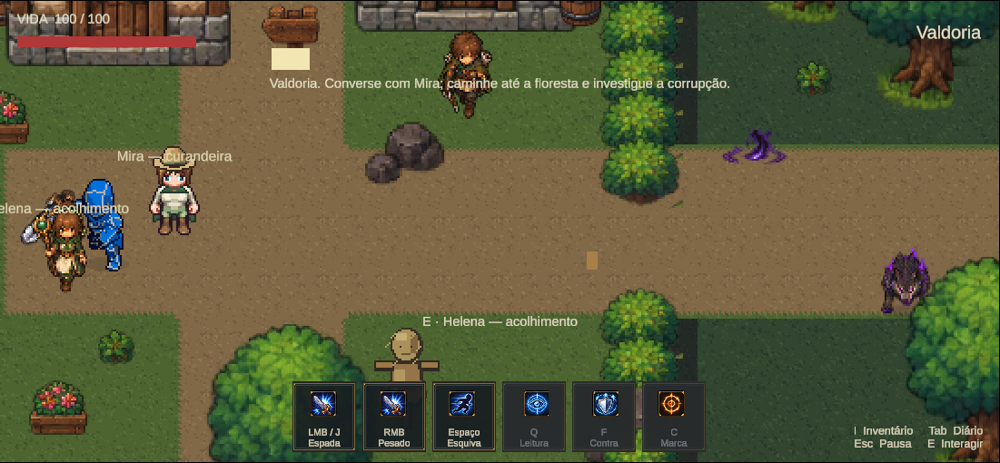
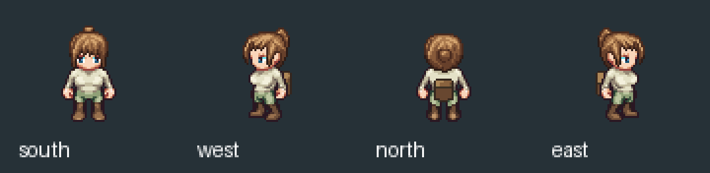
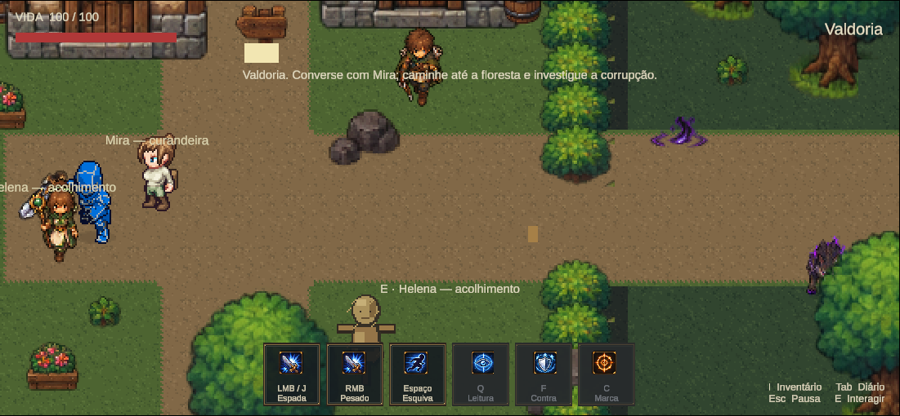

# Marco 06B.13 R3 — geometria procedural de roupas

16/10/2026. **Código implementado, prova gerada e testada dentro do jogo em cena experimental. Aprovação artística pendente.**

## Ampliação do escopo e capacidades adquiridas

O B13 inicial tratava da pesquisa/adaptação de NPCs profissionais. As orientações adicionais do usuário levaram à biblioteca redistribuível R2, à combinação de peças e, neste R3, a um gerador próprio de geometria de roupas, com receitas, âncoras por pose e oclusão de acessórios. A criação de capa/chapéu/mochila por parâmetros e a regressão do braço são entregas além daquela pesquisa inicial. Foram autorizadas durante o trabalho; não representam promoção artística automática dos NPCs.

O [registro permanente de capacidades](../Art/ProceduralWardrobe.md) compara o escopo inicial com essas extensões, explica como reutilizar o código e distingue recursos comprovados, adaptações possíveis e itens ainda não implementados. Em particular, gerar a forma da roupa e acompanhá-la nas poses existentes já funciona na base de Mira; criar qualquer roupa por descrição livre, simular tecido e equipar roupas em runtime continuam fora da implementação atual.

## Resultado

O laboratório deixou de apenas combinar/recolorir peças: agora cria geometria de capa, gola, fecho, chapéu e mochila a partir de receitas JSON. O corpo e suas poses profissionais permanecem intactos. A orientação posterior do usuário foi começar pelas roupas; animação secundária do tecido ficou adiada.

Cena: `Assets/Mmorpg/Scenes/Marco06B13R3Wardrobe.unity`. Cópia do mundo oficial, com somente a representação visual de Mira substituída e o cache de sprite atualizado pela Unity. A cena foi acrescentada ao final do Build Settings para permitir retorno por F5. Todos os índices anteriores foram preservados; `MmorpgWorld` continua como entrada oficial.

## Pesquisa e implementação

O [GarmentCode, de Korosteleva e Sorkine-Hornung](https://igl.ethz.ch/projects/garmentcode/), demonstra composição hierárquica e parametrização de padrões de roupa. Esse princípio orientou a separação de componentes/receitas deste trabalho; o projeto não incorpora o código do pesquisador nem implementa o seu sistema completo de costura 3D.

Foram consultados também [Position Based Dynamics](https://matthias-research.github.io/pages/publications/posBasedDyn.pdf) e [XPBD](https://matthias-research.github.io/pages/publications/XPBD.pdf), como referências para uma futura etapa de restrições e movimento de tecido. **Nenhum solver físico foi implementado nesta etapa.** O trabalho atual gera a forma estática relativa a cada pose existente.

A autoria foi executada no Aseprite 1.3.18.6 por Lua, usando a [API de imagens](https://aseprite.org/api/image) e [sprites/layers](https://aseprite.org/api/sprite). Python mede os landmarks originais, orquestra o batch e monta pranchas; não desenha os novos pixels das roupas.

Código:

- `Tools/ArtPipeline/Aseprite/garment_geometry.lua`: biblioteca de superfícies e rasterização.
- `Aseprite/generate_garments_b13r3.lua`: ligação das poses, camadas e documentos Aseprite.
- `generate_garments_b13r3.py`: medição, execução, exportação e QA.
- `garment_recipes/{mira_traveller,mira_backpack}.json`: projetos parametrizados de roupa.
- `validate_garments_b13r3.py`: testes dos resultados e da regressão de oclusão.

O modelo possui dois primitivos extensíveis: **painel** e **volume por revolução**. Um painel define largura/profundidade ao longo do comprimento, pregas, barra e fenda; o volume define raio/altura e inclinação. Ambos podem ser combinados e ancorados em cabeça, ombros ou cintura. A capa usa painel; gola e fecho são componentes independentes; aba e copa do chapéu usam perfis separados; a mochila reutiliza o volume.

As superfícies são trianguladas, projetadas em perspectiva ortográfica aproximada compatível com os sprites, sombreadas por normais/luz fixa e quantizadas para paletas curtas. Contorno, acabamento e faixas usam coordenadas do padrão. Um buffer de profundidade resolve sobreposição entre as partes. A rasterização é nativa, sem blur ou interpolação do personagem.

São 44 poses e oito clips por documento, canvas 64×64, 32 PPU. O pivô importado é (32,44), com referência de chão (32,62), mantendo os pés 18 px abaixo da origem física anterior. Não se alterou raiz ou collider para compensar padding. Altura visual da roupa de viagem: 48–51 px; mochila sobre a base: 45–50 px. Seis layers originais foram conferidos por digest antes/depois da geração e preservados.

Documentos: `ArtSource/Labs/NpcResearch/Marco06B13R3/MiraTravellerCorrected/MiraTraveller.aseprite` e `MiraBackpackFinal/MiraBackpack.aseprite`. O [README da biblioteca](../../ArtSource/Labs/NpcResearch/Marco06B13R3/README.md) documenta o esquema e a reprodução.

## Correção do braço da mochila

O usuário identificou corretamente que a primeira aproximação de profundidade desenhava parte da mochila sobre o braço lateral. A peça não foi removida para esconder a falha: passou a ter a regra semântica `back_mounted`. Nos perfis, braço/tronco ficam à frente; o volume continua aparecendo fora da silhueta. De costas, a mochila aparece sobre as costas; de frente, fica oculta pelo corpo.

Teste de regressão: **22 poses laterais**, verificando todos os **17.758 pixels opacos** da base, incluindo braços/roupa. Nenhum foi alterado pela mochila. Na primeira pose idle de cada direção, a mochila altera zero pixels visíveis no sul, 112 no norte e 36 em cada perfil. Portanto, respeita a oclusão e continua presente de lado. Registro: [generator-checks.json](Marco06B13R3/generator-checks.json).

A capa principal usa a mesma regra de montagem traseira. Gola/fecho são peças próprias, opcionais, e não uma tentativa de obrigar o tecido traseiro a aparecer na frente. A regra trabalha com sprites 2D e prioridades semânticas; não é uma reconstrução de profundidade exata de todos os membros. Novos tipos de equipamento podem exigir máscaras/regras adicionais e revisão visual.

## Verificação do gerador

- Geração repetida: os 44 frames renderizados são idênticos.
- Mudança de comprimento/largura/inclinação: altera a geometria em **44 frames**, sem depender de troca de cor.
- Recusa de sobrescrever editável existente: confirmada.
- Quatro receitas inválidas (perfil, raio, tesselação, tipo): rejeitadas.
- Recorte pelo canvas: zero fragmentos nas duas receitas finais.
- Arquivo-fonte MiraIvory e layers corporais: preservados.
- Roupas seguem âncoras medidas nas poses originais; não foi inventada caminhada ou simulação secundária.

Os tempos de 125 ms são os tempos de inspeção herdados do laboratório. Não foram apresentados como cadência autoral aprovada. A geração foi testada com estas duas famílias de componentes, não com todas as roupas possíveis. Outros corpos precisam de calibração; cortes/topologias fora dos primitivos atuais exigem novas receitas ou extensão do código. Não há promessa de traduzir qualquer descrição livre em roupa profissional pronta.

## Teste real na Unity

Unity CLI, `--caller plugin --skill unity-pipeline`, autotick habilitado, recompile/recompile_status sem falha. [Estado final](Marco06B13R3/unity-final.json).

Execução com perfil isolado configurado **antes** de Play. Controles de teste usaram teclado/mouse próprios. Foram executados:

| Verificação | Resultado |
|---|---|
| Capturas do mundo oficial e experimental | Mesma posição de câmera/jogador para comparação, sem montagem de personagens |
| Capa/chapéu e mochila em quatro direções | Inspecionados em Play; capturas reais |
| Oito poses de caminhada existentes | Inspeção temporária em Play, sem patrulha ou novo comportamento |
| E e diálogo de Mira | Correto, abre/fecha; identidade mantida |
| E e diálogo de Orin | Correto, visual oficial preservado |
| Aproximação física e passagem pela frente/atrás | NPC bloqueia; ordenação acompanha a posição |
| Save/load e F5 | Retorna à cena experimental, mesma identidade e fatos, sem duplicação |
| Avanço de frames | 894 → 3232 na execução completa final |
| Console | Zero erros e zero warnings durante a execução final |
| Limpeza | Play parado; dispositivos, opções do Editor, input, timeScale e override de perfil restaurados |

[QA de gameplay](Marco06B13R3/gameplay/qa.json), [Console em Play](Marco06B13R3/console-play.json). A rodada posterior de capturas posicionou o herói fora da frente de Mira para a própria espada não esconder a roupa/braço.

A primeira assertiva de contato exigia `isOverlapped=false`, mas a Unity mantém aproximadamente −0,005 unidade de contato também no mundo oficial. O teste foi corrigido comparando a aproximação com a cena oficial: frente −0,005000055 em ambas, trás −0,00500023365, dentro da tolerância de comparação de 0,001. Nenhum parâmetro de física foi alterado.

A Unity também atualizou o cache serializado de sprite do BoxCollider2D ao trocar canvas/pivô visual. Auto-tiling permanece desligado; todos os campos de física foram comparados e mantidos, incluindo tamanho (0,5;0,6), offset zero, layers e flags. O [registro do cache](Marco06B13R3/sprite-collider-cache.json) distingue essa atualização visual de uma alteração de collider físico.

Não houve suíte extensa, serviços externos, novo controlador de NPC ou alteração de autoridade. A cena guarda Mira estática em idle sul, como no comportamento anterior. Outros frames e a mochila são inspeções de apresentação em Play, não uma nova IA ou animação automática permanente.

## Preservação e entrega

[Preservação](Marco06B13R3/preservation.json): 60 arquivos oficiais comparados e intactos, incluindo cena oficial e pacote do Iron Knight; cinco arquivos pessoais intactos, hashes/caminhos privados mantidos somente em Temp. Os 36 clips/264 sprites, âncoras e espada oficiais permanecem os mesmos. Nenhuma alteração em Runtime, Domain, progressão, missões ou diálogos.

Build Settings recebeu somente a nova cena ao final. Uma reserialização incidental de TimeManager pela Unity foi revertida aos bytes anteriores. Estudos intermediários/rejeitados ficaram em Temp, fora do commit; somente os dois resultados corrigidos acompanham as fontes. Alterações alheias de B6/PixelLab foram preservadas.

Licença dos sprites compostos: **OGA-BY 3.0**, com geometria gerada pelo projeto e base LPC creditada. Créditos, fontes e indicação de mudanças estão nos READMEs B13 R3/R2; o material não é anunciado como CC0. A cena oficial não foi promovida para esses visuais. A aprovação artística segue pendente do usuário.
