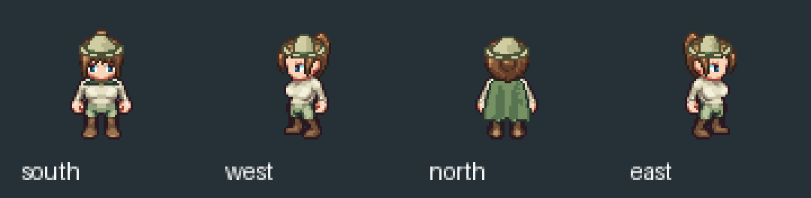
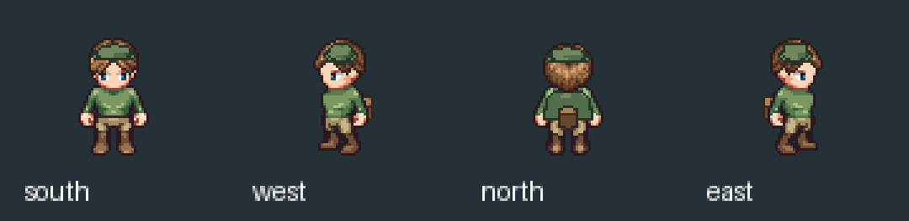
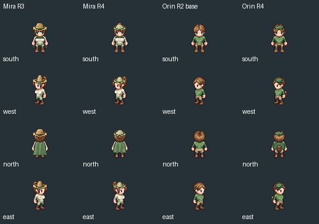
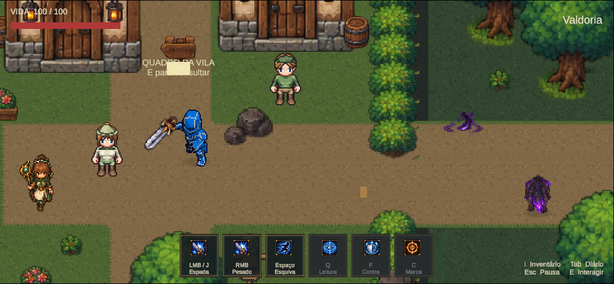

# Marco 06B.13 R4 — calibração reutilizável e mudança de direção visual

16/10/2026. **Generalização técnica entregue e testada. Propostas pequenas não aprovadas; prioridade redirecionada pelo usuário para uma base humana maior. Nenhuma promoção para o mundo oficial.**

## Resultado técnico do vestuário

O orquestrador R3 foi estendido com `--character-config`, mantendo o comportamento legado quando a opção é omitida. A configuração explícita define documento Aseprite, manifesto de poses, identidade, canvas, pivô/pés, layers anatômicos e arquivo de âncoras. A fonte binária tem hash; o manifesto usa hash semântico para não depender de CRLF/LF. O backend continua o mesmo, com `panel`, `revolve`, materiais e `back_mounted`; não houve reimplementação da geometria.

Mira e Orin foram medidos sobre suas próprias fontes R2. Mira mantém os landmarks R3 revisados; Orin mede ombros na blusa e cintura na calça de OrinForest. As dimensões externas são próximas, mas as fontes/corpos são diferentes e as âncoras diferem nas 44 poses. Canvas 64×64, pivô superior (32,44), referência de pés (32,62), 32 PPU. O limite inferior visível das botas originais varia de 61 a 64 conforme a pose; isso foi registrado separadamente da referência fixa, sem reposicionar ou redesenhar pés.

Laboratório: `ArtSource/Labs/NpcResearch/Marco06B13R4/`, com calibrações, receitas e resultados separados. Fontes R2 continuam nos caminhos imutáveis, referenciadas e verificadas por hash. Foi preparada **uma proposta completa por personagem**: MiraHealer (capa/chapéu menores, sálvia/marfim) e OrinTracker (capa curta, chapéu baixo, mochila, cinto). Foram acrescentadas direções opcionais por componente para gola/fecho/cinto, sem alterar receitas R3.





Cada resultado contém 44 quadros, oito clips, documento Aseprite com seis layers originais preservados e três layers gerados, atlas, manifesto/âncoras, GIFs de dois ciclos e pranchas. Nenhuma animação corporal foi inventada. A capa de Mira foi encurtada de 22 para 18 px, a copa de 9 para 6,5 px e a aba reduzida; a melhora pretendida é abrir rosto/pés e controlar a silhueta. Orin passa a se distinguir pela roupa escura curta e equipamento traseiro. Isso não resolve a avaliação artística abaixo.



## Regressões executadas

[R3 antes](Marco06B13R4/r3-regression-before.json) e [R3 depois](Marco06B13R4/r3-regression-after.json): os mesmos 44 quadros, alteração geométrica real, recusa de sobrescrita e quatro casos inválidos rejeitados. Resultados históricos R2/R3 não foram alterados.

[QA R4 do gerador](Marco06B13R4/generator-checks.json):

| Verificação | Mira | Orin |
|---|---:|---:|
| Frames / clips | 44 / 8 | 44 / 8 |
| Repetição idêntica | 44 | 44 |
| Silhuetas alteradas no teste de parâmetros | 44 | 44 |
| Poses de perfil protegidas | 22 | 22 |
| Pixels opacos do corpo abaixo da cabeça preservados na roupa completa de perfil | 8.716 | 8.636 |
| Pixels opacos de toda a base preservados com mochila isolada nos perfis | 17.758 | 16.120 |
| Pixels de pés preservados nos 44 frames (faixa y≥59) | 1.498 | 1.498 |
| Fragmentos de roupa recortados | 0 | 0 |

As roupas completas podem cobrir cabelo/parte da cabeça com o chapéu; por isso o teste da roupa completa delimita a região corporal abaixo da cabeça. A mochila isolada verifica a base inteira nos perfis. Não confundir cobertura visual intencional por roupa com edição destrutiva das camadas corporais. Destinos existentes e pivô impossível foram rejeitados. As duas receitas históricas R3, agora usando a calibração explícita de Mira, também reproduziram todos os seus 44 frames exatos.

## Unity real — laboratório pequeno

Cena nova: `Assets/Mmorpg/Scenes/Marco06B13R4NpcWardrobe.unity`, cópia limpa de MmorpgWorld, com somente os sprites de Mira/Orin substituídos e o cache visual de collider atualizado pela Unity. Os campos físicos foram mantidos e comparados, excluindo somente `m_SpriteTilingProperty`, como no R3. Os 88 sprites foram importados Point, RGBA, FullRect, sem compressão/mipmap, com pivô explícito. A cena foi acrescentada ao final do build; entrada oficial e todos os índices anteriores preservados.

[QA real](Marco06B13R4/gameplay/qa.json): perfil isolado antes de Play; frames 1014→7075; quatro direções idle e quatro walk por NPC, 32 poses walk por personagem em dois ciclos; diálogo correto de Mira e Orin por E; colisão comparada à cena oficial; sorting frente/trás; HUD/câmera; save/load e F5 mantendo identidade/fatos, sem duplicação. Não foi adicionado controlador ou patrulha. A cena salva mantém os dois NPCs estáticos no idle sul.



As primeiras rotas de QA encontraram obstáculos que já existiam: Helena era a interação mais próxima à esquerda de Mira; RockWest bloqueava a esquerda de Orin e OrinHouse inicia em y=4. A fixture foi corrigida para abordar diálogos pela direita e usar a passagem estreita atrás de Orin em y≈3,8. Não se mudou cenário, collider ou regra de interação para fazer o teste passar. A execução completa final passou. Input, opções do Editor, timeScale e override de perfil foram restaurados após Play.

[Preservação](Marco06B13R4/preservation.json): 232 arquivos protegidos, 244 arquivos de resultados históricos e cinco arquivos pessoais intactos. Hero oficial, cena oficial, Runtime/Domain, IDs e colliders dos dois NPCs preservados. Nenhuma mudança de progressão, missão ou autoridade.

## Avaliação artística e nova prioridade

O usuário julgou a roupa ainda muito simples e pediu complexidade inspirada em arqueiros de jogos renomados. Em seguida pediu **antes disso** bases maiores, com proporções humanas, como futuro padrão inclusive do protagonista, autorizando também aumentar/retrabalhar o cenário. Assim, as propostas pequenas não são declaradas concluídas artisticamente e não foram promovidas.

O ganho R4 é calibração reutilizável e QA em duas bases reais. O limite visual persiste: LPC ainda possui cabeça grande e aproximadamente 45–50 px de altura, reduzindo a leitura de couro, tiras e camadas. Não foram acrescentados capuz, aljava, novos primitivos complexos ou acabamento final nessa base após a mudança de prioridade.

A pesquisa e a prova concreta da família maior estão no [novo padrão humanoide](../Art/HumanoidStandard.md). Foram preparados dois corpos CC0 compatíveis com 65 ossos, biblioteca gratuita com 43 animações e dois documentos Aseprite de 52 quadros, com cerca de 100–120 px visíveis. **Essa prova maior está fora da Unity**; seus testes de fonte/roundtrip não equivalem ao QA de gameplay da cena pequena.

## Licença e reprodução

As composições pequenas usam a base LPC selecionada sob **OGA-BY 3.0**, mantendo [créditos R2](../../ArtSource/Labs/NpcResearch/Marco06B13R2/README.md) e [licenças](../../ArtSource/Labs/NpcResearch/Marco06B13R2/Licenses/). Capa, chapéu, mochila e ajustes são alterações do projeto sobre essa base; não são anunciados como CC0. O estudo Quaternius tem proveniência/licença CC0 separada e não altera a atribuição LPC.

```powershell
# Medição: somente em laboratório novo; recusa arquivos de calibração existentes.
python Tools/ArtPipeline/calibrate_wardrobe_b13r4.py
# Gerar outra saída; não sobrescrever editáveis.
python Tools/ArtPipeline/generate_garments_b13r3.py --character-config ArtSource/Labs/NpcResearch/Marco06B13R4/Calibrations/Orin.json --recipe ArtSource/Labs/NpcResearch/Marco06B13R4/Recipes/orin_tracker.json --output ArtSource/Labs/NpcResearch/NovoEstudoOrin
python Tools/ArtPipeline/validate_garments_b13r3.py
python Tools/ArtPipeline/validate_garments_b13r4.py
```

Os scripts Unity `BuildGarmentLab06B13R4` e `InspectGarmentLab06B13R4` registram autoria e testes; a criação inicial recusa cena existente. A fixture reutiliza Setup/Cleanup B11. Não reexecutar Preflight para substituir o snapshot histórico. A decisão seguinte é a família maior e sua direção visual, não uma migração automática dos NPCs/protagonista.
