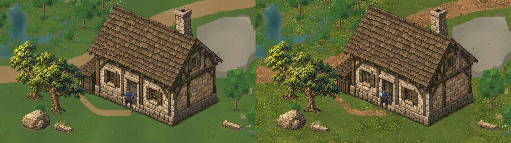
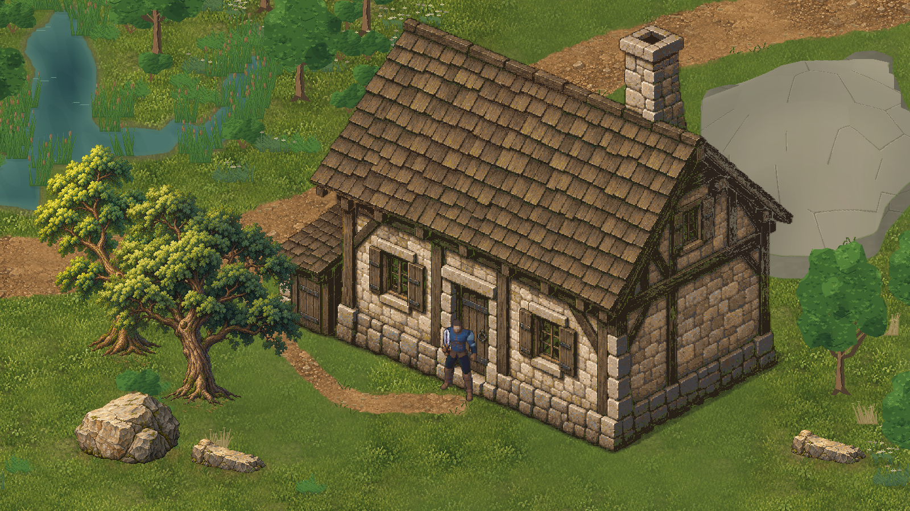
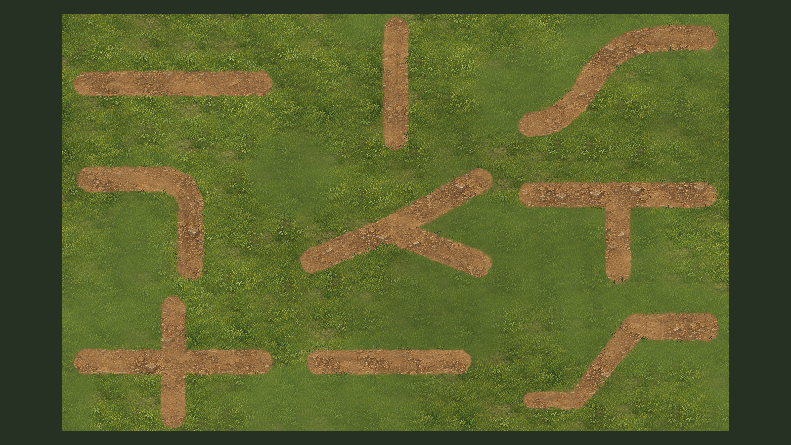
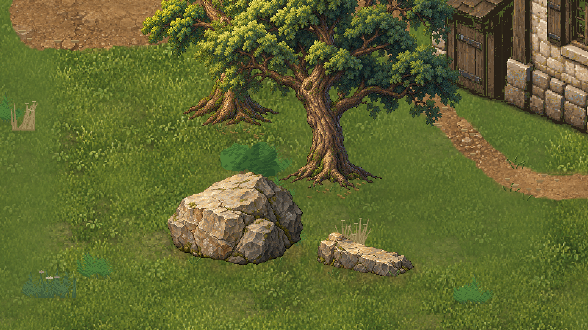
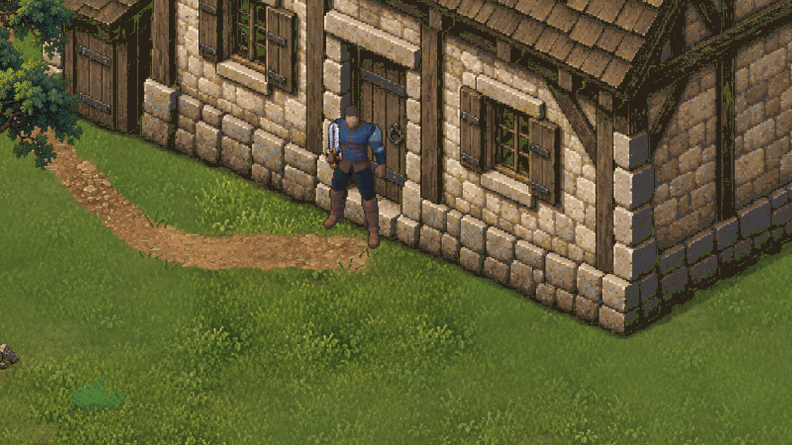
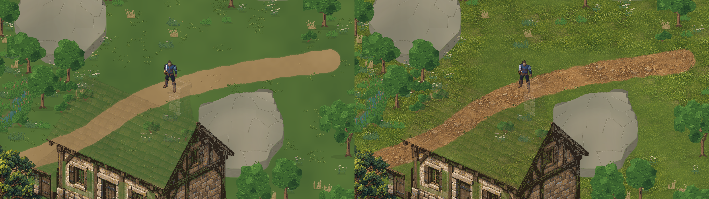

# JEV — Ground11: terreno, estradas e integração

18/10/2026 · `D:\unity\Mmorpg` · Unity6000.6.5f1 · `main` · baseline `c78d81c208d366b2addb6aa798560ff5280d2950`.

**Terreno e estradas continuam candidatos, NÃO APROVADOS.** O feedback durante a produção foi “Ta fincando bom”; ele orientou manter a direção, sem substituir a avaliação final. Construções, as duas árvores novas e as duas formas de rocha Nature10 são referências **aprovadas** e não foram redesenhadas. [Aprovação formal Nature10 e hashes](../Art/Approvals/Nature10-2026-10-18.json), registrada também na linguagem visual central.

## Candidata na Unity

Cena jogável de avaliação: `Assets/Mmorpg/Scenes/ValdoriaGroundFinishLab.unity`. Bancada visual de conexões: `Assets/Mmorpg/Scenes/ValdoriaSurfaceGrammarLab.unity`. Cena oficial preservada. Teclas1–4 mostram anterior, base, transições e final. Não há geração por Play.

Originais1×: [anterior](ValdoriaGround11/Play/00-before.png), [base](ValdoriaGround11/Play/01-base.png), [transições](ValdoriaGround11/Play/02-transitions.png), [final](ValdoriaGround11/Play/03-final.png). Mesmo ator na entrada, câmera `(28,5;14,25;-10)`, ortográfica14,0625,1600×900,32PPU. A montagem apenas concatena imagens; não reenquadra, reescala ou altera cores. A escala visual1,25 de Quaternius permanece a anterior.

## Diagnóstico observado, não presumido

Antes da autoria, o Editor conectado foi conferido em cena limpa, compilação concluída e Play parado. Aseprite1.3.18.6 localizado e validado; Unity CLI1.0.0-beta.13 confirmado atualizado. Worktree conferido e pull `--ff-only origin main` executado: já atualizado. Quatro itens locais não relacionados foram preservados.

Novas capturas da cena existente: [composição](ValdoriaGround11/Before/composition.png), [estrada/acesso](ValdoriaGround11/Before/road-connection.png), [solo aberto](ValdoriaGround11/Before/open-ground.png), [contatos](ValdoriaGround11/Before/contacts.png). Comparação direta com casa, árvore e pedra aprovadas mostrou:

|Aspecto|Observação real|Camada tratada|
|---|---|---|
|Terra/estrada|Grandes superfícies quase uniformes, poucos sinais internos de compactação/fragmentos; leitura de faixa aplicada|Pintura de terra, desgaste por percurso e agregado subordinado|
|Grama|Base lisa sustentada por pequenos tufos; pouca estrutura média entre pigmento macro e microdetalhe|Fonte pintada com swards, espaços curtos desgastados e massas intermediárias|
|Borda|Separação direta e simples entre grama e terra; pouco material de transição|Distância à união, franja limitada, ombro irregular e contatos interrompidos|
|Acesso da casa|Tratamento separado do caminho principal; encontro dependente de sobreposição de renderers|União das coberturas e composição única do material de chão|
|Contato de objetos|Solo com pouco diálogo com raízes, faces baixas das pedras e fundação|Influência visual local derivada de âncoras/footprints existentes|
|Grade/repetição|Não foi vista uma grade32×32 dominante nesse enquadramento; o pipeline já usava UV global|Preservar continuidade; não inventar um defeito de tile para justificar ruído|
|Distribuição anterior|Já existiam seeds e clusters; o problema não era ausência total de determinismo|Substituir o miolo artístico, mantendo distribuição subordinada/contextual|

O platô e a vegetação antiga continuam pendências conhecidas. Não foi tentada sua reformulação. A diferença das novas árvores/rochas aprovadas vinha de silhuetas, planos, suporte e sobreposição; recoloração do chão não transferiria esse acabamento.

## Decisões artísticas e fontes

Skills: `terrain-materials`, `terrain-generation`, `aseprite-pixel-art`, `imagegen`, `unity-cli`. Duas pinturas assistidas por ImageGen: grama baixa e terra compactada, **materiais**, não uma cena pronta. [Masters retidos](../../ArtSource/Labs/World2026/Ground11/Masters/), [prompts integrais](../../ArtSource/Labs/World2026/Ground11/prompts.json). Blender não foi usado: estas superfícies planas e seus contatos não exigiam novo estudo volumétrico3D; não foi forçada a técnica das casas.

Fontes finais Aseprite:

|Fonte|Dimensão / camadas|Função|
|---|---|---|
|[meadow.aseprite](../../ArtSource/Labs/World2026/Ground11/SourceV2/meadow.aseprite)|384² /4|Massas de grama, folhas baixas, recessos e áreas curtas desgastadas|
|[earth.aseprite](../../ArtSource/Labs/World2026/Ground11/SourceV2/earth.aseprite)|384² /4|Solo exposto, fragmentos embutidos, pequenos planos e juntas|
|[edge-grammar.aseprite](../../ArtSource/Labs/World2026/Ground11/SourceV2/edge-grammar.aseprite)|512×128 /4|Oito ritmos de lâminas curtas, fragmentos e folhas caídas|

A primeira interpretação de material completo ficou granulada demais no gameplay. [Primeiro rascunho em Play](ValdoriaGround11/FirstDraft/composition.png). A revisão seleciona um recorte512² das pinturas e interpreta a384², aumentando o tamanho real dos agrupamentos. Paleta limitada a96cores na fonte, nearest e sem dithering automático. As camadas são propriedade dos pixels exteriores por função/valor; não se alega pintura manual integral nem reconstrução de geometria oculta. O bootstrap inicial não deve sobrescrever as fontes revisadas.

O compositor usa janelas transladadas sobrepostas dentro das pinturas, sem wrap de bordas incompatíveis e sem reiniciar fase por célula. A pintura fornece formas; campos grandes/médios definem intensidade e áreas de descanso. O desgaste acompanha arco/tangente do percurso. Orientações concorrentes reduzem trilhas em junções, evitando sobrepor sulcos em forma de símbolo. Margens recebem pequenas irregularidades, lábios de luz interrompidos e agregados, sem um contorno pesado contínuo.

As influências de raízes, rochas e fundação usam posições/polígonos autorados, não o retângulo do sprite. Mesclam terra pintada e contatos curtos; folhas caídas ficam próximas às árvores. A luz segue alto/esquerda, com detalhe do solo subordinado aos objetos. Essas pequenas profundidades são arte, sem novos ressaltos físicos.

## Estradas e conexões

[Capturas individuais antes/depois](ValdoriaGround11/Court/) e [trace da bancada](ValdoriaGround11/Court/capture-qa.json): horizontal, vertical, curva Catmull–Rom suave, canto, bifurcação, T, cruzamento, ponta e largura variável. Close-ups usam2×inteiros. A visão geral reduz a folha completa para inspeção de composição; não substitui os detalhes nativos.

A bancada é **não canônica e somente visual**: uma máscara de teste e um renderer, sem jogador, colisores ou navegação de mundo. Ela testa o mesmo material em conexões menos favoráveis, sem mudar estradas oficiais. As capturas são Game View em Play; não são renders Blender ou editor de imagem. O fundo plano da comparação da bancada é um baseline diagnóstico sintetizado sobre as mesmas formas, e **não** uma captura histórica de uma estrada do mundo.

Na região real, a estrada Organic Roads e o acesso original da casa são compostos juntos. [Junção real isolada, antes/depois](ValdoriaGround11/junction-before-after-diagnostic.png): árvores ficam temporariamente ocultas **somente nesse diagnóstico**, para não encobrir a conexão; colisores/âncoras não são alterados e a visibilidade foi restaurada. As imagens normais de gameplay mantêm os objetos aprovados. As primeiras imagens `junction-*-isolated` ocultavam apenas a camada de copa e ainda exibiam galhos; ficam retidas como diagnóstico, não como nova arte da árvore.

O núcleo navegável do produtor é protegido explicitamente. A primeira verificação encontrou87 pixels de franja visual sobre ele; a correção se deu na máscara de apresentação, sem editar cobertura de entrada, caminhos, larguras funcionais, colliders ou nav. [Teste inicial preservado](ValdoriaGround11/python-tests-first.txt), [resultado final](ValdoriaGround11/python-tests.txt).

## Contatos e segunda composição

[Contato antes/depois na mesma câmera2×](ValdoriaGround11/contacts-before-after.png).

[Trecho principal em detalhe](ValdoriaGround11/Details/main-road.png). Casa, duas árvores e duas formas de rocha preservam pixels, escala, pivôs, sombras próprias e representação física. O trabalho foi feito no chão e nas interfaces.

Segunda composição na própria região, câmera `(39;24;-10)`, ortográfica14,0625, mesmo ator/escala/resolução: [antes](ValdoriaGround11/Play/15-second-area-before.png), [depois](ValdoriaGround11/Play/15-second-area-after.png). Mostra trecho aberto e percurso fora do jardim da casa, com a mesma geração global e sem decoração manual adicional. Não é um segundo mundo com física diferente.

[Vinte frames originais em movimento](ValdoriaGround11/Play/Motion/), [GIF desses frames](ValdoriaGround11/camera-motion.gif). PNG é autoridade de cor; o GIF usa indexação própria. A câmera acompanha input real ao longo de uma área de estrada, respeitando os bounds anteriores. A inspeção não revelou emendas32×32 na área avaliada; não é uma certificação universal de ausência de repetição em todo o mundo.

## Engenharia e validação executada

`ground_finish11.py`: prepare de fonte, export real Aseprite, composição de mundo, bancada, bounds/patches, recipe/seed e manifests. `GroundFinish11Importer`: cria os dois laboratórios em destinos ausentes,28 meshes de chão compartilhados, import Point/RGBA32/sem mips/compressão. `GroundFinishLab`: troca apenas materiais e o renderer visual antigo do acesso. Não há GameObject por tufo, pacote novo ou geração em Play. [Contrato](../WorldGen/GroundFinishContract.md), [pipeline reutilizável](../Art/GroundAndRoadProduction.md).

O PNG2048×1536 contém **somente material do chão** derivado de semântica/máscaras. Não contém casas, árvores ou pedras e não fornece colisão/altura. O renderer usa a malha/UV anterior, sem transformar uma ilustração de cenário em geometria. O relevo de fundo e seus materiais retidos não são apresentados como remodelados ou escaláveis fisicamente.

- [Sete testes Python](ValdoriaGround11/python-tests.txt) passaram: fontes aprovadas/nav imutáveis, reexport Aseprite byte a byte, manifests e pixels integrados, seed/repetição/patch igual ao full render, núcleo do caminho/acesso contínuo, conexões/supressão no cruzamento e rejeição de receitas incompatíveis. A pintura IA inicial não é prometida como determinística.
- [Reconstrução com biblioteca/receita explícitas](ValdoriaGround11/reusable-pipeline-qa.json): nova exportação Aseprite para Temp, CLI `--library`/`--recipe` sobre essa exportação e patch384×200; base/transições/final iguais ao recorte canônico. Não houve reconstrução manual da arte para essa segunda composição de dados.
- [Play real](ValdoriaGround11/Play/play-qa.json): **25 controles passaram**,40,21s,7.871frames avançados. WASD/diagonal/esquiva, estrada→porta, tronco, passagem sob copa, pedra, profundidade, cutaway da casa, vau/margem,20 frames de câmera e comparação da segunda área. Teclado sintético alimentou o Input System real; poses teletransportadas entre testes não são alegadas como caminhada. A sequência em movimento usa deslocamento efetivo por input.
- [Bancada em Play](ValdoriaGround11/Court/capture-qa.json):9 casos,20 capturas incluindo visão geral,5.285frames avançados,1renderer e2draw calls observadas. Sem afirmação de gameplay nessa máscara de teste.
- [QA do Editor](ValdoriaGround11/editor-qa.json): **49.152 amostras por estado**,0 divergências física/nav nos quatro estados, mesmos36 colisores e mesmos bytes de navegação do laboratório anterior. [Comparação integral de geometria](ValdoriaGround11/physical-geometry-comparison.json). A assinatura inicial era sensível à ordem de vários PolygonCollider2D no mesmo objeto; ordenar pela geometria canônica mostrou equivalência, sem tocar na cena para forçar o resultado. O diagnóstico inicial foi retido em `editor-qa-before-canonical-order.json`.
- [Compilação](ValdoriaGround11/compile-final.json) concluída sem erros. [Console incremental](ValdoriaGround11/console-final.json) comparado ao cursor inicial; erros históricos de transporte/avisos de obsolescência não foram atribuídos à nova arte. O build assíncrono do Editor possui recibo real, retido na entrega.
- Perfil isolado `Temp/ValdoriaGround11/IsolatedProfile`, um jogador/uma câmera, dispositivos sintéticos removidos, teclados reabilitados, timeScale1, Play parado e resolução temporária removida. A cena oficial não foi alterada.

A revisão de Play anterior (`PlayReview1/`) salvou19 dos20 frames previstos porque a janela de captura era curta para o custo de gravação. A janela foi ampliada e o teste de movimento repetido na revisão final. Esses arquivos e o primeiro rascunho ficaram salvos; não são apresentados como todos aprovados.

## Desempenho observado

Mesmo enquadramento1600×900, Editor real, sem promessa de benchmark de build/hardware alvo:

|Medida|Anterior Nature10|Candidato Ground11|
|---|---:|---:|
|Renderers ativos|250|249|
|Visíveis|137|136|
|Draw calls|138|137|
|Texturas ativas únicas|16|15|
|Memória das texturas ativas|189.199.220B|188.239.504B|

A diferença vem da retirada da sobreposição visual separada do acesso no estado novo. O laboratório mantém apresentações comparativas residentes: a inspeção mediu≈411,5MB de dependências de texturas. Isso não é consumo total do processo nem orçamento final de produção; os estados de comparação precisam ser descartados de uma entrega de jogo. Os detalhes novos são pré-compostos offline, sem novos renderers por fragmento.

## Arquivos, preservação e pendências

Arte/fontes/receitas: `ArtSource/Labs/World2026/Ground11/`. Integração: `Assets/Mmorpg/Art/Experimental/ValdoriaGround11/`, `GroundFinish11Importer`, `GroundFinishLab` e as duas cenas. Ferramentas/QA: `Tools/ArtPipeline/WorldGen/ground_finish11.py`, `test_ground_finish11.py`, `AgentScripts/*Ground11*.cs`. Evidências completas: `Docs/Validation/ValdoriaGround11/`. [Inventário com hashes](ValdoriaGround11/delivery-inventory.json) lista os arquivos versionados desta rodada, exceto ele próprio.

[Inputs preservados](ValdoriaGround11/preserved-inputs.json): fontes/arte Nature10, arquitetura07R/08/09, estradas e hidrologia anteriores, cena oficial e laboratório Nature10 comparados ao commit avaliado. Os relatórios históricos receberam somente a anotação da nova aprovação; inventários antigos continuam retratos do commit em que foram criados. Nenhuma árvore, pedra ou casa foi repintada nesta rodada.

Limitações: vegetação antiga, água e platô continuam no acabamento anterior. A bancada demonstra conexões de material, não planejamento automático de redes ramificadas sobre qualquer geografia. O adaptador `world=True` está calibrado para esta região; novos mundos precisam de contexto/footprints próprios. Sombras de solo são pintadas, sem sol dinâmico, novos degraus físicos ou desgaste por gameplay. Há pintura assistida por IA e interpretação artística, não promessa de gerar infinitos materiais aprovados por seed.

O conjunto está pronto para **avaliação visual**, sem promoção ao mundo oficial e sem declaração de aprovação de terreno/estradas. Próxima expansão depende dessa avaliação. Commit/push em `main` são confirmados na resposta após execução; SHA recuperável por `git log -- Docs/Validation/ValdoriaGround11-TerrainAndRoads.md`.
