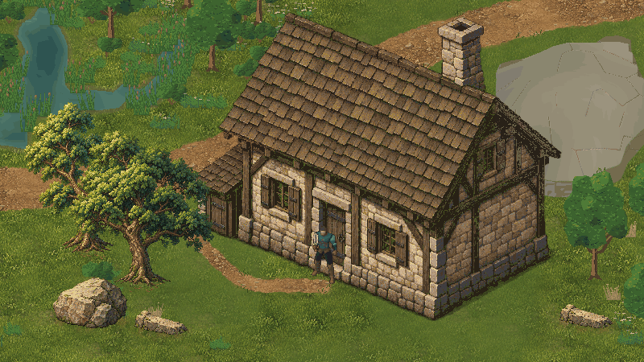
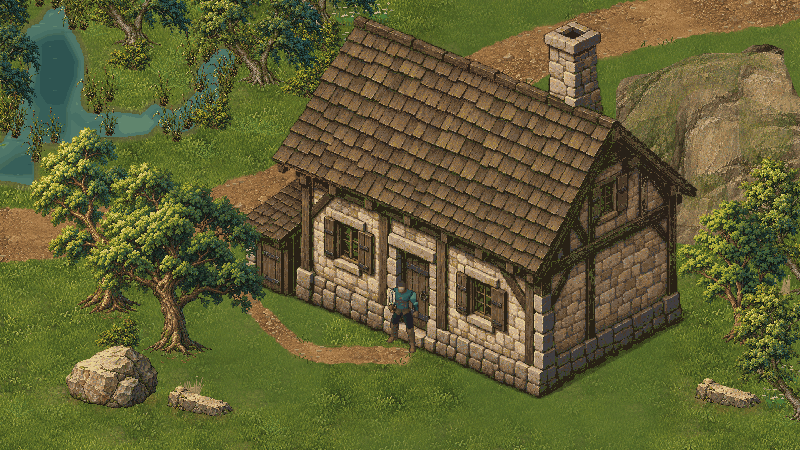
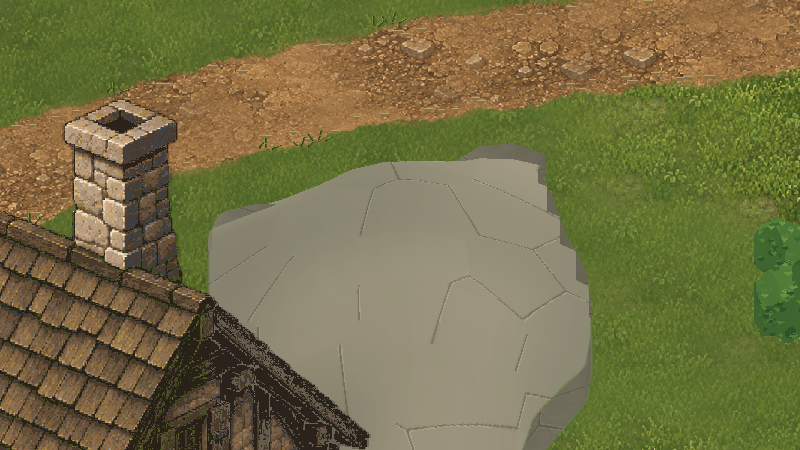
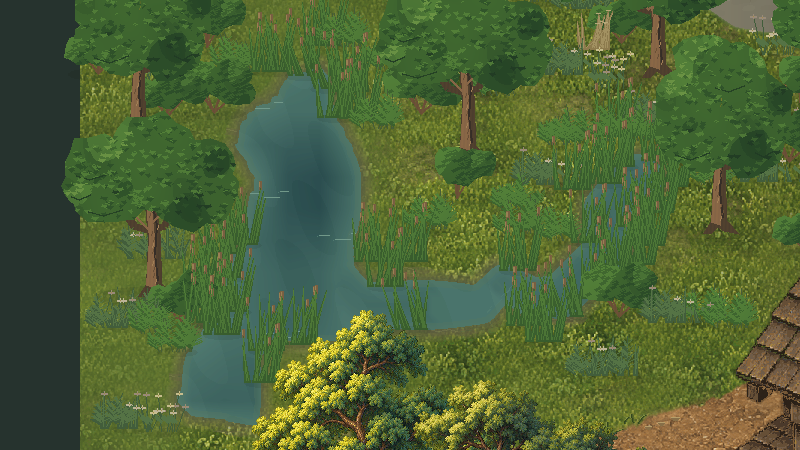
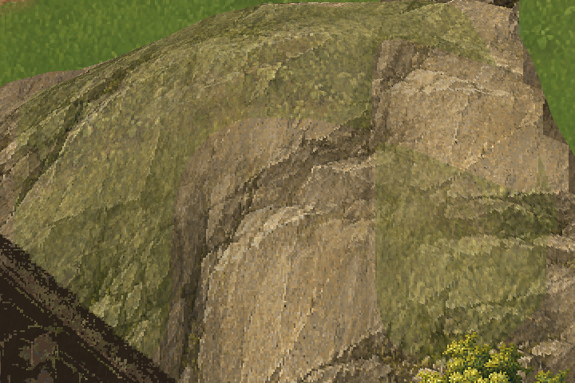
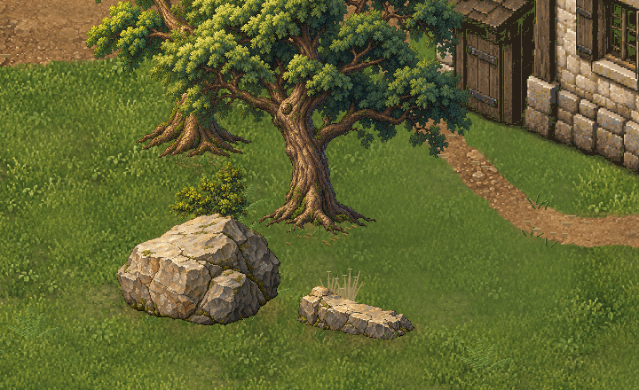

# JEV — Ground12: consolidação ambiental e revisão visual

18/10/2026 · `D:\unity\Mmorpg` · Unity6000.6.5f1 · `main` · baseline técnico `3b6d11ce9e0d9512c1915980a045e131405a2f1c`; arte Ground11 avaliada em `37555798710a6202fe8fdd5c3d14833c4a9e9bce`.

**Aprovação posterior à entrega:** o usuário respondeu “Ficou bom” ao resultado do commit `05d842d4050aa35f5b73c4e30314f4f5bb65d39f`, aprovando a composição Ground12 apresentada. [Registro formal e hashes](../Art/Approvals/Ground12-2026-10-18.json). Não houve promoção à cena oficial. Os testes, inventários e estados de candidatura abaixo são o retrato histórico da entrega; o acabamento aquático permanece parcial e as pendências técnicas continuam válidas. Construções07R/08/09, duas árvores e duas rochas Nature10, terreno e estradas/transições Ground11 permanecem aprovados. [Registro consolidado](../Art/Approvals/Ground12-References-2026-10-18.json). A confirmação da inspeção Ground11 no GitHub veio do usuário; a recuperação remota desta entrega é registrada separadamente abaixo.

## Composição e diagnóstico real

Cena nova: `Assets/Mmorpg/Scenes/ValdoriaEnvironmentFinishLab.unity`. Tecla1=Ground11 anterior; tecla2=Ground12 candidato. Usa a mesma região64×48, casa, personagem, navegação e geometria. Perfil de teste isolado em `Temp/ValdoriaGround12/IsolatedProfile`. Nada é gerado a cada Play. `MmorpgWorld.unity` não foi alterada.

Antes e final: mesmo ator diante da porta, câmera `(28.5,14.25,-10)`, ortográfica14,0625, captura1600×900,32PPU e visual do ator1,25. As cópias abaixo são ReviewLite800×450, nearest1/2, com paleta compartilhada de256cores quando necessária. Os originais permanecem integrais e sem perdas.

[Original anterior](ValdoriaGround12/Original/composition-before.png) · [Original final](ValdoriaGround12/Original/composition-final.png) · [Manifesto das64 imagens](ValdoriaGround12/QA/image-manifest.json).

O Editor conectado foi confirmado no projeto/versão solicitados, cena Ground11 limpa, Play parado e compilação concluída; `pull --ff-only origin main` já atualizado. Aseprite1.3.18.6 validou Lua e roundtrip sem modificar fontes aprovadas. Inventário inicial:216 âncoras ativas; a apresentação continha árvores com copas de planos geométricos repetidos, arbustos simplificados e juncos quase paralelos. O material do platô apresentava grandes planos lisos com linhas finas; a água tinha profundidade legível mas contato muito uniforme e vegetação de margem repetitiva. [Inventário real](ValdoriaGround12/QA/initial-scene.json).

Classificação A/B/C, decisões e método completo em [EnvironmentConsolidation12](../Art/EnvironmentConsolidation12.md). Compatíveis: referências aprovadas, flores e vegetação seca pequena. Refináveis: samambaias, agrupamentos, materiais do relevo e interfaces aquáticas. Incompatíveis nesta composição: copas antigas, manchas de arbusto e painéis de junco.

## Relevo: material e limitação estrutural

[Original anterior](ValdoriaGround12/Original/plateau-before.png) · [Original final](ValdoriaGround12/Original/plateau-final.png) · [Faces superiores de outra área](ValdoriaGround12/ReviewLite/relief-upper-final.png).

Separados material do topo, mineral lateral e chão/margem. A interpretação usa massa mineral, planos iluminados, fraturas e bolsões de vegetação; as faces conservam a modulação direcional original. O primeiro ensaio `*-after.png` misturava grama sobre os planos e achatava sua leitura; a revisão `*-final.png` restringe essa mistura. Fontes e builds das duas interpretações estão preservados.

**Limitação:** a silhueta histórica arredondada e as extrusões baixas permanecem. A textura não produz ledges físicos ou rocha escalável. Há locais onde a leitura geológica ainda pode precisar de direção artística adicional; não afirmamos que todo o relevo atingiu a qualidade Nature10. Alterar silhueta, altura ou footprint exigirá diagnóstico e autorização específica, fora desta revisão visual.

## Vegetação e margens

[Original anterior](ValdoriaGround12/Original/water-bank-before.png) · [Original final](ValdoriaGround12/Original/water-bank-final.png) · [Árvore histórica antes](ValdoriaGround12/ReviewLite/historical-tree-before.png) · [Substituto candidato](ValdoriaGround12/ReviewLite/historical-tree-final.png).

23 árvores antigas recebem duas novas silhuetas de suporte/folhagem; as duas Nature10 permanecem intactas. Arbustos ganham ramos, abertura e volumes; samambaias/agrupamentos recebem duas formas de fronde;39 pontos de junco passam a ter tufos abertos e alturas internas variadas. São148 substituições de apresentação e66 plantas reutilizadas, além das duas árvores aprovadas preservadas. IDs, pontos, espécies semânticas, variantes e raios físicos permanecem iguais. Não há geração ecológica nova ou substituição por cópias Nature10.

As famílias têm seis prefabs visuais reutilizáveis, sem colisores próprios; o host mantém a autoridade física. [Verificação dos prefabs](ValdoriaGround12/QA/prefabs.json). Arbusto/junco possuem uma nova silhueta cada; variação adicional ainda é trabalho futuro. As duas novas árvores repetem-se na região e não representam uma biblioteca florestal completa.

A água conserva seis meshes recortados e quatro frames por chunk. Uma escala **artística** explícita `.012` interpreta a profundidade normalizada real; não muda a profundidade ambiental nem o limiar bloqueante. Raso/deep recebem planos de cor e acentos Aseprite leves. Alpha de todos os24 frames permanece idêntico ao produtor. O solo úmido usa até18px além da superfície, sem tocar a cobertura da estrada. Sem refração, física nova, natação ou simulação hidráulica. **Água e margens continuam candidatas e o acabamento aquático é parcial.**

## Detalhes e reutilização

Os arquivos `Details/` são recortes **identificados**, sem ampliação, derivados dos originais indicados no manifesto. Não são capturas integrais. [Margem1:1](ValdoriaGround12/ReviewLite/wet-bank-final.png), [vegetação1:1](ValdoriaGround12/ReviewLite/old-tree-volume-final.png).

Segunda composição, mesmos componentes/receita: [anterior](ValdoriaGround12/ReviewLite/second-area-before.png), [final](ValdoriaGround12/ReviewLite/second-area-final.png); outra câmera em Play: [anterior](ValdoriaGround12/ReviewLite/15-second-area-before.png), [final](ValdoriaGround12/ReviewLite/15-second-area-after.png). Não há pintura ou posicionamento exclusivo por câmera.

Fontes: `ArtSource/Labs/World2026/Ground12/SourceV1/` — duas árvores, arbusto, junco, duas samambaias, mineral e acentos aquáticos em camadas. Masters assistidos por ImageGen e prompts retidos; Aseprite é a autoridade final. Não foi executado Blender nesta rodada. `ExportV1/` é reconstruído a partir das fontes; `BuildV2/` usa seed910212, receita e produtores imutáveis. [Pipeline de produção e comandos](../Art/EnvironmentConsolidation12.md).

## QA executado

- Python: **6 testes ambientais** aprovados — manifests, proteção do chão/estrada fora da interface, alpha e fases aquáticas, recortes globais, seed, reconstrução de exports Aseprite e determinismo dos PNGs finais. [Log](ValdoriaGround12/QA/python-environment.txt).
- ReviewLite: **9 testes** aprovados — roundtrip/originais, recusa de sobrescrita, transformação pareada, adulteração/ausência, câmera, path traversal, limite explícito, imagens do relatório e preservação da paleta PNG. [Log](ValdoriaGround12/QA/python-review-lite.txt).
- Compilação Unity concluída, sem erro do projeto: [status](ValdoriaGround12/QA/compile-final.json).
- Geometria: **36 colisores iguais**, navegação igual,216 âncoras iguais, mesmos meshes/vértices/triângulos/UVs do relevo.49.152 amostras por estado, zero divergência física/navegação. [Comparação](ValdoriaGround12/QA/editor-qa.json), [baseline](ValdoriaGround12/QA/physics-baseline.json).
- Play real: **27 verificações aprovadas**,41,27s e8.649frames. WASD/diagonal/esquiva, troncos aprovados e refinados, frente/trás, rochas, acesso da estrada à porta, cutaway, vau, circulação na margem, animação de água e20 capturas com câmera em movimento. [Resultados e trace por frame](ValdoriaGround12/Original/Gameplay/play-qa.json).
- [1.134 arquivos de referência preservados](ValdoriaGround12/QA/preserved-inputs.json), incluindo fontes aprovadas, produtores e cena oficial. Os quatro itens locais não relacionados encontrados no preflight permaneceram fora da entrega.

Capturas reais de gameplay: [colisão no tronco refinado](ValdoriaGround12/ReviewLite/legacy-trunk-contact.png), [atrás](ValdoriaGround12/ReviewLite/legacy-tree-behind.png), [à frente](ValdoriaGround12/ReviewLite/legacy-tree-front.png), [casa preservada](ValdoriaGround12/ReviewLite/08-house-preserved.png). Sequência móvel: `Original/Gameplay/Motion/` e versões correspondentes em `ReviewLite/frame-00.png` a `frame-19.png`.

No enquadramento principal, medido após renderizar:

|Métrica|Ground11 anterior|Ground12 candidato|
|---|---:|---:|
|Renderers ativos|249|309|
|Renderers visíveis|136|174|
|Draw calls|137|175|
|Texturas ativas únicas|15|24|
|Bytes de texturas ativas|188.239.504|217.038.496|

O aumento de28.798.992bytes vem principalmente dos materiais separados do relevo e do conjunto comparativo residente. Batching por textura/família adiciona chamadas; requer consolidação de atlas antes de aplicação ampla. Estes números não são memória total do processo nem medição de FPS em hardware alvo. Nenhum fragmento mineral gera renderer individual.

Console: advertências históricas CS0618 continuam. Um erro novo de infraestrutura foi gerado pelo probe de refresh executado diretamente por `eval`: timeout de5s da operação principal. Os27 PNGs derivados foram depois conferidos contraBuildV2, todos iguais. O fluxo permanente usa callback enfileirado. Erros de compilação dos scripts temporários de captura/QA foram corrigidos antes da execução; não são defeitos do runtime. [Console por cursor](ValdoriaGround12/QA/console-final.json). Play foi parado, teclado/dispositivos, timeScale e seleção de resolução restaurados; perfil real não foi usado.

## ReviewLite e publicação

64 PNGs indexados: originais integrais, ensaio intermediário, finais, gameplay/movimento e recortes. **Máximo765.844bytes**, abaixo de750KiB. Oito recortes permanecem1:1;56 capturas usam nearest1/2. Destas,37 precisaram de paleta comum256cores sem dithering, respeitando erro médio por canal≤3 e percentil95≤9;19 mantêm cores exatas após a redução. Originais nunca são quantizados ou redimensionados. As versões reduzidas não permitem julgar cada pixel; usar os originais e recortes para isso.

Relação completa, câmeras, dimensões, hashes, bytes, transformações e revisão de fidelidade: [manifesto](ValdoriaGround12/QA/image-manifest.json). [Verificação executável](../Art/VisualReviewEvidence.md). A recuperação real após push e a inspeção remota ficam em `QA/github-accessibility.json`; não inferir sucesso a partir da existência local do arquivo.

## Pendências e escopo final

No encerramento técnico original, foi entregue uma candidata integrada e reutilizável, com preservação técnica comprovada. A aprovação posterior está registrada acima; não abrange a vegetação histórica inteira ou toda a água. Permanecem: avaliação da leitura mineral/silhueta do platô, diversidade maior de arbustos/juncos, repetição das duas árvores novas, refinamento aquático completo e redução do custo de batching/memória antes de expansão. Nenhum novo bioma, mundo oficial, traçado ou mecânica física foi introduzido.

Arquivos novos/modificados são listados no inventário da entrega. Commit/push para`main` e SHA são confirmados somente após execução; o registro remoto complementar identifica o commit de arte/evidências recuperado pelo conector.
