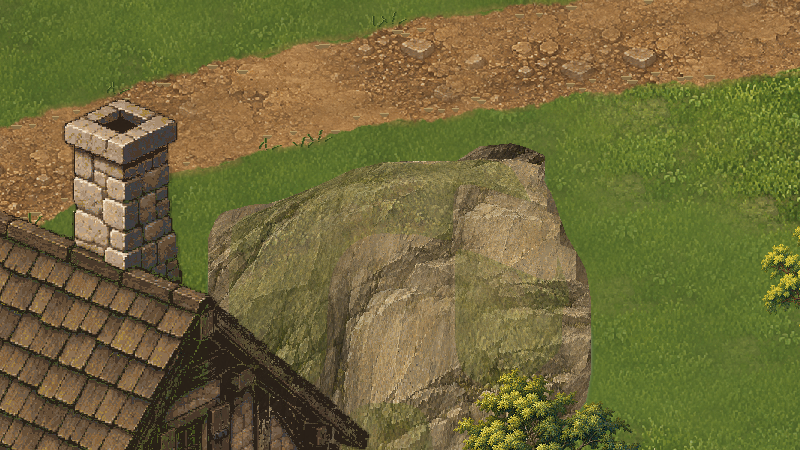
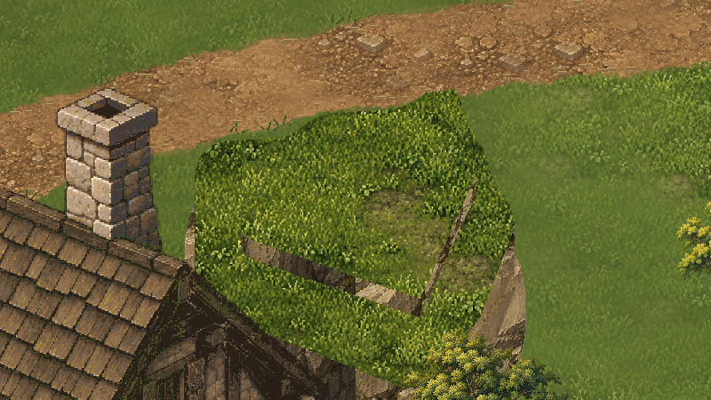
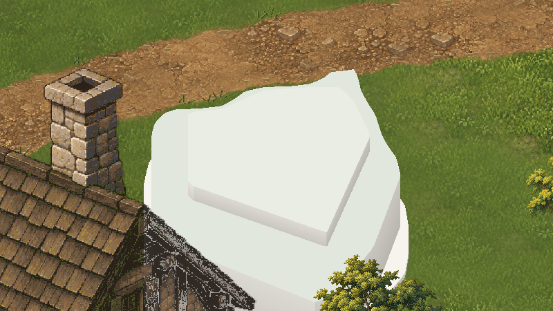
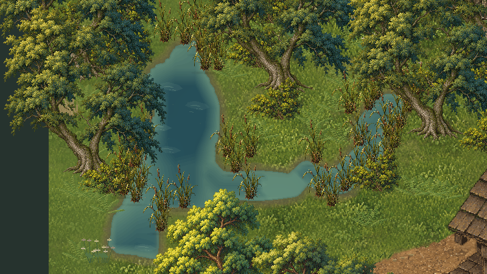
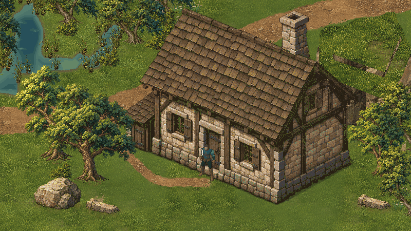
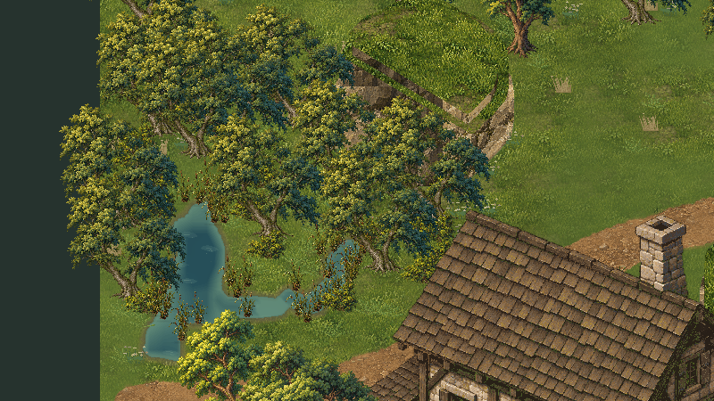

# Valdoria Ground13 — relevo, água e renderização

**Candidata para avaliação do usuário.** Nenhuma promoção à cena oficial ou aprovação artística automática. Direção e execução em 18/10/2026, Unity 6000.6.5f1, projeto `D:\unity\Mmorpg`, branch `main`.

Ground12 de referência: `05d842d4050aa35f5b73c4e30314f4f5bb65d39f`. HEAD inicial desta rodada: `a011fb047d2d970705ad83ffd0d4e50486b97348`; worktree conferido e `git pull --ff-only origin main` executado, atualizado. Quatro arquivos/diretórios locais não relacionados foram preservados e excluídos da entrega.

Construções 07R/08/09, árvores/rochas Nature10 e terreno/estradas Ground11 continuam aprovados. A instrução Ground13 delimita o parecer Ground12: vegetação com avaliação muito positiva, preservada; platô/água candidatos com ressalvas; aprovação geral não presumida. [Registro da direção vigente](../Art/Approvals/Ground13-Direction-2026-10-18.json).

## 1. Diagnóstico e escolha estrutural

A inspeção da Game View confirmou uma massa mineral contínua e arredondada em Ground12. O acabamento mineral melhorou, mas topo e lateral compartilham uma leitura de grande rocha. Duas texturas RGBA32 de 2048×1536 representam as superfícies completas; a textura não cria patamares nem separa os planos.

| Alternativa | Avaliação | Decisão |
|---|---|---|
| A: material/sombra sobre o mesmo desenho | Corrige pigmento e orientação, mantém a silhueta arredondada e a continuidade excessiva | Insuficiente como solução principal |
| B: representação visual nova, mesmo limite físico | Permite ombro, topo recuado e faces distintas dentro do obstáculo existente | Implementada como candidata |
| C: nova topografia/colisão | Permitiria redesenhar também a implantação e criar níveis acessíveis | Não implementada; exigiria autorização específica |

V3 deriva três faixas do campo escalar histórico de .25 u, com recortes de planos na receita. Os deslocamentos `.20 / 2.45 / 3.10` são exclusivamente de apresentação. O contorno zero e os pés continuam associados às fronteiras físicas existentes. O topo **não é acessível nem escalável**. Não foram acrescentadas plataformas navegáveis.

A primeira interpretação ficou concêntrica demais. A segunda ainda desenhava paredes posteriores sobre o topo. Essas versões estão identificadas como estudos em `after`/`final`; **a entrega vigente usa `candidate`, ReliefV3 e a cena RefinementLab**. O descarte de faces posteriores elimina o falso anel sem apagar limites usados na validação. O estudo sem textura torna explícita a mudança de forma.

Antes — Ground12:

Candidata — mesmo enquadramento:

Forma sem textura, capturada em Play:

O pé externo ainda herda curvas históricas. Há patamares deliberadamente mais angulares; sua naturalidade e a frequência visual da grama superior são pontos de avaliação, não problemas declarados resolvidos por testes. Se a implantação continuar parecendo isolada, a próxima decisão deve discutir C separadamente, em vez de acumular textura.

## 2. Água e contatos

A superfície anterior tem áreas extensas de valor quase constante. Ground13 usa a profundidade existente para uma rampa rasa/profunda em 18 níveis, massas de luminosidade de baixa frequência, largura variável de contato e grupos desenhados de reflexos/ripples. Mantém áreas calmas. A margem terrestre recebe uma influência restrita a 18 pixels, excluindo a cobertura das estradas.

Fonte editável `SourceV2/water-material.aseprite`: cinco layers, quatro frames de 180 ms. Os motivos oscilam poucos pixels e variam valor suavemente; não há brilho aleatório por frame. A composição ocorre em coordenadas globais antes de recortar os seis chunks, evitando reiniciar padrões na emenda. Os 24 alphas são idênticos aos da hidrologia original. Máscaras funcionais, profundidade real, vazão semântica, vau e física permanecem intactos.

Antes:

Candidata:

[Quatro fases comparáveis e oito capturas de replay ativo](ValdoriaGround13/QA/water-captures.json). O replay real observou avanço e retorno pelos índices dos quatro frames. Capturas temporais podem pular fases entre solicitações; o conjunto separado com fase fixa permite comparar cada fase. Dois chunks pequenos/de margem têm áreas sem mudanças entre fases, preservadas como descanso visual. Testes medem também a transição 3→0.

Este acabamento representa superfície estilizada, não simulação hidráulica, advecção física ou reflexos dinâmicos dos objetos. Não há natação. A animação é discreta de quatro frames; repetição residual e intensidade dos reflexos permanecem sob avaliação visual. Não declarar todo o sistema aquático aprovado.

## 3. Origem do custo e otimização

[Inventário real de renderers/materiais](ValdoriaGround13/QA/renderer-diagnosis.json): a vegetação baixa Ground12 usa **163 MeshRenderers** — 59 do atlas anterior e 104 divididos entre hazel, dois ferns e reeds — mais **23 SpriteRenderers de sombras** das novas árvores. As quatro texturas de plantas separadas fragmentam faixas que antes podiam compartilhar material. As copas novas e as sombras também adicionam conteúdo real. O diagnóstico não atribui toda a regressão aos sprites: há 54 renderers de relevo, seis chunks de água, sorting, materiais e conteúdo distinto no mesmo enquadramento.

O atlas UV explícito 1024² conserva os pixels, os retângulos legados usados e a escala. Dos 186 renderers de plantas/sombras examinados, 16 com sobreposição de cores no mesmo order permanecem originais; os outros 170 viram 100 grupos por layer/order. Nada é agrupado através de SortingGroups vivos. São materiais compartilhados por grupo, sem criar material por instância de planta. [Proteção de ordenação](ValdoriaGround13/QA/packing-order-protection.json).

A tentativa de agrupamento irrestrito alterou oito pixels de sobreposição. Foi descartada. A solução final tem **zero pixels diferentes** nos pares Ground12 original↔agrupado e Ground13 sem↔com agrupamento, na câmera de referência e pose/fase fixas. [Prova de pixels](ValdoriaGround13/QA/packing-pixel-proof.json). Isso comprova os enquadramentos registrados; a política conservadora e a sequência em movimento complementam a verificação, sem alegar prova de todas as câmeras possíveis.

O relevo novo reutiliza duas amostras 384² com UVs, em vez das duas texturas completas. Nenhum shader novo, pacote ou sistema de culling foi adicionado. As cópias comparativas estão desativadas no estado final; não desenham simultaneamente.

### Medição comparável final

[Dados completos](ValdoriaGround13/QA/performance-candidate.json), [auditoria das texturas](ValdoriaGround13/QA/texture-audit.json). Mesmo conteúdo, câmera `(28.5,14.25,-10)`, ortográfica 14.0625, 1600×900, Ultra, VSync 1, targetFrameRate -1, D3D12, Radeon RX 5700 XT. Editor Play sem foco com autotick; .75 s de estabilização e 2.5 s de amostra por estado. Água ativa durante timing; ator fixo para comparação. Não é benchmark de standalone ou escala MMORPG.

| Estado | Draw calls | Ativos / visíveis | Texturas únicas | Memória de texturas ativas |
|---|---:|---:|---:|---:|
| 0: Ground12 original | 175 | 309 / 174 | 24 | 217.04 MB |
| 1: mesma arte Ground12 agrupada | 143 | 239 / 142 | 23 | 223.76 MB |
| 3: candidata Ground13 agrupada | 143 | 238 / 142 | 23 | 175.79 MB |
| 4: mesma candidata sem agrupamento | 175 | 308 / 174 | 24 | 169.07 MB |

Economia comprovada do agrupamento: **32 chamadas, 18,3%**, sem remoção de conteúdo. A troca da representação mineral reduz a memória; o atlas por si **aumenta** aproximadamente 6,72 MB. Redução líquida contra Ground12: 41,25 MB, 19,0%. Valores em MB decimais, via `Profiler.GetRuntimeMemorySizeLong` das texturas referidas por renderers ativos; não representam VRAM total, residência completa do laboratório ou tamanho de build. O cálculo usa texturas dos sprites/sharedMaterials; os frames via property block têm as mesmas dimensões/formato, mas o número não soma todos os frames residentes.

A meta preferencial de 137 não foi atingida: restam seis chamadas. Manter os 16 renderers protegidos evita regressão de sobreposição. A primeira tentativa chegava a 131, mas falhava na fidelidade. Não a escolher apenas pelo número.

Na amostra final, mediana de frame: 3,753 ms→3,525 ms; p95: 5,731→5,078 ms. FPS observado: 249,5→269,5. Outra rodada variou substancialmente; portanto **não afirmamos ganho sustentado de FPS**. FrameTiming disponível: CPU 3,447→3,327 ms e GPU .445→.422 ms são leituras pontuais, não uma distribuição estatística. Arquivos `performance.json` e `performance-final.json` preservam medições das iterações anteriores.

## 4. Integração, QA e preservação

Cena final: `Assets/Mmorpg/Scenes/ValdoriaGround13RefinementLab.unity`. A cena `ValdoriaGround13Lab.unity` conserva apenas a primeira interpretação de estudo; não é a candidata atual. Teclas 1–5: original, prova de agrupamento, forma sem textura, candidata, candidata sem agrupamento.

- Python Ground13: **6 testes passaram**, incluindo reconstrução em destino temporário, manifests, hashes, pixels do atlas, pés/contornos, alphas, margens/estradas e loop 3→0. [Log](ValdoriaGround13/QA/python-tests.txt).
- ReviewLite compartilhado: **10 testes passaram**, incluindo nomes explícitos seguros para basenames repetidos. [Log](ValdoriaGround13/QA/python-review-lite.txt).
- Unity: compilação concluída sem falha. [Resultado](ValdoriaGround13/QA/compile-final.json).
- Play final: **27 verificações passaram**, Input System real WASD/diagonal/esquiva, troncos, rochas, frente/atrás, acesso/cutaway da casa, vau, circulação na margem, avanço da água e câmera em movimento. [Trace e resultados](ValdoriaGround13/Original/GameplayCandidate/play-qa.json). Vinte PNGs de movimento, com trace de câmera; sem vídeo contínuo declarado.
- Relevo: **dois testes adicionais passaram**, aproximação norte interrompida em y=12.7628 junto ao pé físico y≈13.0056; passagem lateral x45→49.838 sem bloqueio indevido. [Trace](ValdoriaGround13/Original/CliffQA/play-qa.json).
- Os cinco estados mantêm hashes iguais de colisores, navegação, âncoras e malhas físicas históricas: **36 colisores; 49.152 amostras de navegação por estado, zero divergências**. [Comparação](ValdoriaGround13/QA/physics-candidate.json).
- **1.465 arquivos de referência preservados**, incluindo fontes/arte aprovadas, Ground12, hidrologia, dados físicos e cena oficial. [Hashes contra HEAD inicial](ValdoriaGround13/QA/preserved-inputs.json).
- Play encerrado; teclado sintético removido, teclado físico habilitado, Input System e Game View restaurados, timeScale 1, cena limpa. Importador recusou destino existente. [Estado final](ValdoriaGround13/QA/restored-editor.json).

Console: houve erro de compilação introduzido nesta rodada pelo uso de `GetInstanceID` obsoleto, corrigido antes da validação; houve também uma consulta CLI `help` inválida do agente. Não atribuir esses eventos a gameplay. Warnings de APIs obsoletas já existentes são separados das falhas novas. [Atribuição e cursor](ValdoriaGround13/QA/console-attribution.json).

## 5. Evidências, fontes e reprodução

Originais integrais: `ValdoriaGround13/Original/`. Recortes 1:1: `Details/`. Todos os 147 PNGs originais/recortes têm versão ReviewLite pelo pipeline existente e manifesto com dimensões, bytes, SHA-256, câmera, estado e transformação. As versões reduzidas não substituem os originais. [Manifesto](ValdoriaGround13/QA/image-manifest.json), [índice](ValdoriaGround13/QA/capture-index.json), [verificação](ValdoriaGround13/QA/review-lite-verify.json).

Comparativos principais usam câmeras, resolução, iluminação e posição do ator equivalentes; a animação da água é viva nos seis enquadramentos gerais. Para igualdade de fase/pose, usar `OptimizationCandidate` e `Water`. `after`/`final` são estudos arquivados, não aprovação ou resultado vigente.

Fontes: `ArtSource/Labs/World2026/Ground13/SourceV2/`; exportação final `ExportV2`, atlas `AtlasV1`, relevo `ReliefV3`, água `WaterV2`, receita `recipe.json`. Fontes anteriores/iterações permanecem identificadas. Aseprite 1.3.18.6 e Python/Pillow/NumPy/SciPy existentes; nenhum pacote novo. Não foi usado ImageGen ou Blender nesta rodada.

[Pipeline de reprodução](../Art/Ground13PresentationPipeline.md), [contrato de apresentação](../WorldGen/Ground13PresentationContract.md). As fontes finais são autoridade dos pixels; geração/exportação não redesenha arte aprovada. A segunda área usa os mesmos produtores e componentes.

Publicação e recuperação real pelo GitHub são registradas separadamente em [acessibilidade](ValdoriaGround13/QA/github-accessibility.json). O arquivo diferencia tamanho publicado, recuperação Base64, assinatura/hash e inspeção visual, sem presumir que o limite garante leitura pelo conector. O SHA de publicação é confirmado na entrega e nesse registro, evitando autorreferência impossível do commit no próprio conteúdo.

## 6. Pendências e decisão seguinte

Platô e água continuam candidatos. O pé histórico ainda limita a implantação, os patamares precisam de avaliação de naturalidade e a grama superior pode exigir ajuste localizado de frequência/contraste. A representação visual não cria níveis de gameplay. A superfície aquática ainda usa quatro frames discretos e não representa interação física com raízes/personagens. A composição experimental carrega assets comparativos; o orçamento de residência de uma região de produção maior precisa de medição própria. A meta de 137 chamadas permanece pendente, sem justificar quebra de sorting.

Não expandir para outro bioma, não promover à cena oficial e não redesenhar referências aprovadas antes da avaliação desta candidata. Se for necessário mudar a topografia jogável, apresentar proposta C e obter autorização específica.
