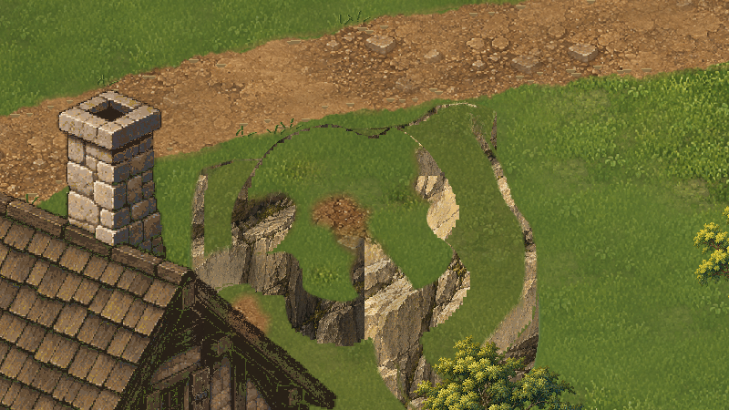
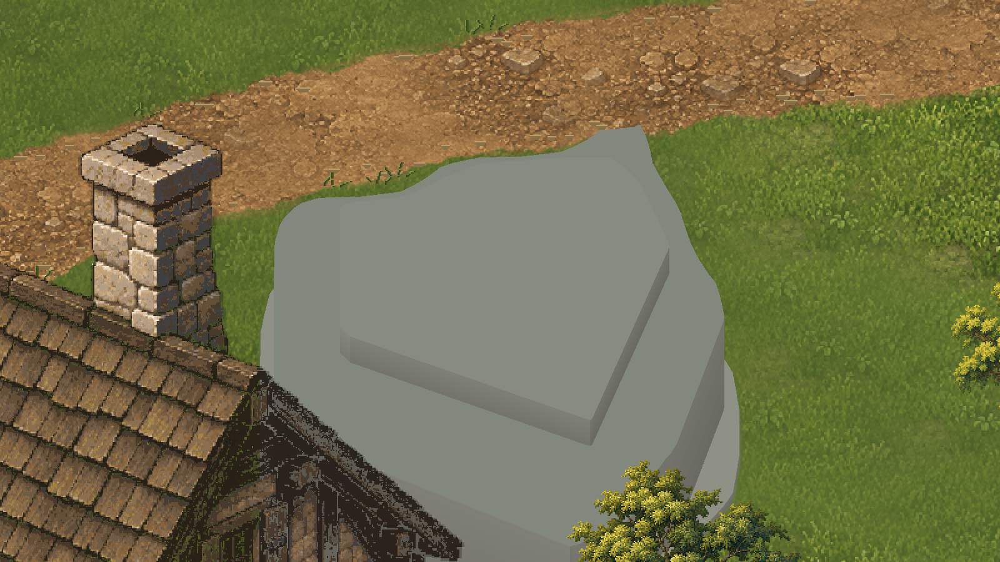
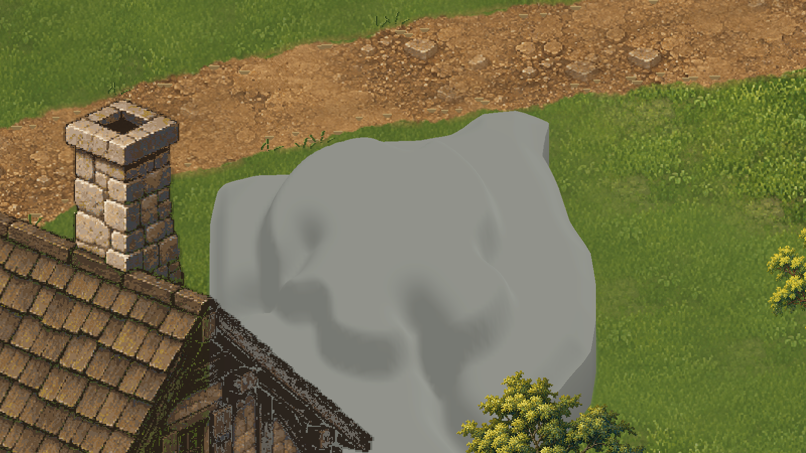
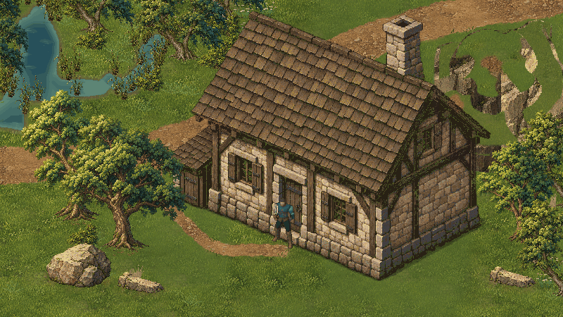
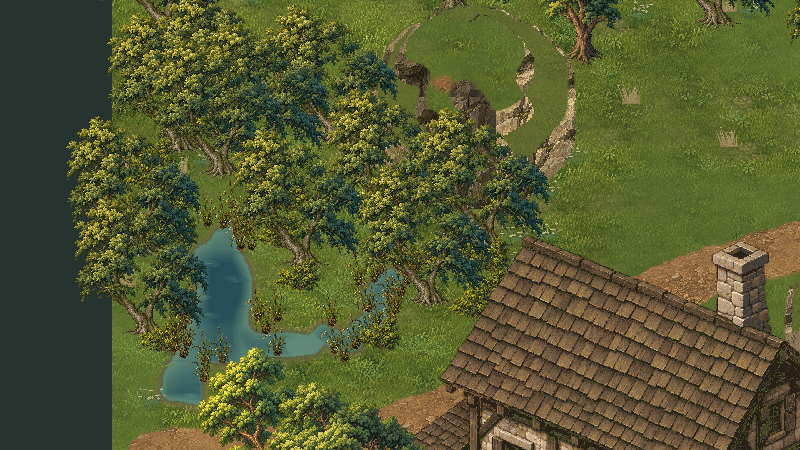

# Valdoria Ground13R — relevo e validação temporal da água

**Candidata à inspeção do usuário, sem aprovação artística automática.** Baseline: `a2b695895895922f782c6b36b0d7f4c944e1e100`, branch `main`. Worktree conferido e `git pull --ff-only origin main` executado: atualizado. Unity 6000.6.5f1, projeto `D:\unity\Mmorpg`, 18/10/2026.

O [feedback oficial](../Art/Approvals/Ground13R-Direction-2026-10-18.json) mantém o platô Ground13 **não aprovado**, considera promissora a separação de planos e pede preservação da água e do agrupamento conservador. Não reinterpretar esse parecer como aprovação geral de Ground13 ou Ground13R.

**Resultado vigente:** `Original/Delivery`, fonte Aseprite **SourceV4**, **ExportV4**, geometria **ShapeV6**, cena `Assets/Mmorpg/Scenes/ValdoriaGround13RLab.unity`. Diretórios `ShapeStudy`, `ShapeFine`, `Final`, `Refined` e `Candidate` são estudos internos anteriores, conservados para diagnóstico; o nome histórico `Final` não identifica a versão entregue. A compactação ShapeV5→V6 mantém todos os atributos de cada canto em float32 e a ordem dos triângulos: as capturas Delivery conservam a mesma geometria rasterizável.

## Diagnóstico e decisões

Ground13 usa limiares de altura constantes e interseções de planos: isso cria perímetros longos, cantos duros e patamares com altura uniforme. A mesma pintura detalhada se repete no topo, com pouca diferenciação entre superfície estável, borda e recessos. A linha entre pigmentos não explica a estrutura mineral.

Ground13R substitui essas extrusões por uma superfície contínua de apresentação. Os contornos superiores são curvas autoradas; fraturas entram pela borda e recuam para dentro da massa, criando saliências e depressões de profundidades distintas. Estratos amplos mantêm uma inclinação discreta. A silhueta não é decidida por ruído aleatório.

Primeiro avaliamos a forma neutra. O primeiro estudo revelou degraus de iluminação por célula; a amostragem visual foi refinada para .125 u e a luz passou a ser interpolada por vértice. A interpolação do **escalar físico** conserva os triângulos e a diagonal originais de .25 u. A fronteira zero permanece a mesma.

O primeiro estudo pintado mostrou estiramento do mineral nas superfícies íngremes. Corrigimos a projeção dos UVs; a separação por materiais também podia sobrepor faces dentro da mesma faixa. Um material unlit local de duas fontes reúne os triângulos na ordem correta, usando projeção horizontal para o atlas superior e projeção vertical para o mineral. Não há shader novo de água, pacote, simulação ou alteração do batching de plantas.

A superfície superior combina pintura Ground11 com áreas de contraste calmo, bolsões definidos de folhagem, clareiras, terra nos recessos e substrato exposto. A última revisão amplia línguas minerais até o topo e liga a clareira aos recessos, sem acrescentar objetos decorativos ou pintar o mapa inteiro. Fontes de arquitetura, Nature10, Ground11, Ground12 e água Ground13 permanecem intactas.

## Comparativos reais em Play

[Índice navegável, originais, detalhes e sequência aquática](ValdoriaGround13R/Index.md). Todas as vistas abaixo usam câmera, ator, escala, resolução e fase aquática equivalentes dentro de cada grupo. Capturas integrais são 1600×900; ReviewLite registra qualquer transformação.

**B — Ground13:**

**C — Ground13R:**

**Neutros, antes e depois — mesmo material de estudo:**

**Composição completa:**

**Segunda câmera deslocada:**

O jogo mantém câmera 2D/3⁄4; a segunda câmera muda posição/enquadramento, não introduz rotação 3D. O estado A reutiliza **o relevo Ground12**, com o restante do ambiente e água Ground13 comuns aos estados, para isolar a comparação. Não é uma alegação de reconstrução integral do mundo Ground12.

Na cena: 1=A/relevo12; 2=B/Ground13; 3=C/Ground13R; 4=D/neutro novo; 5=neutro anterior. Os modos sem agrupamento são ferramentas internas de QA. Não há interiores, vilas novas ou promoção à cena oficial.

## Água: replay observado, não fases fabricadas

A arte, os 24 PNGs, o animador, os materiais de água, os limites funcionais e as margens Ground13 **não foram redesenhados**.

Uma sonda temporária de Editor aguardou `WaitForEndOfFrame`, leu `FrameIndex` e as texturas dos property blocks e capturou a tela real. Não forçou fases. Foram observadas doze mudanças:

`3 → 0 → 1 → 2 → 3 → 0 → 1 → 2 → 3 → 0 → 1 → 2`.

Os seis chunks apresentaram o mesmo índice em cada captura, com os PNGs Ground13 correspondentes. Os frames Unity e tempos são crescentes. Capturas de uma mesma fase ficaram pixel a pixel iguais entre ciclos, sem deriva ou cintilação inesperada no cenário estático. O material continua discreto, com áreas calmas; isso não prova ausência de qualquer artefato em todas as câmeras possíveis.

- [Doze PNGs e tempos/frames observados](ValdoriaGround13R/QA/water-live.json).
- [Verificação do replay e hashes](ValdoriaGround13R/QA/water-temporal-validation.json).
- [GIF integral reduzido](ValdoriaGround13R/Animations/water-live-full.gif).
- [GIF de detalhe 1:1, identificado como recorte](ValdoriaGround13R/Animations/water-live-detail.gif).

Os GIFs derivam exclusivamente dos PNGs temporais em sua ordem observada. Usam tempos medidos, paleta compartilhada, nearest na cópia reduzida e nenhum frame interpolado. O primeiro intervalo é parcial porque a observação começou no meio da fase 3. Os PNGs integrais são a autoridade; GIFs não substituem a evidência nem precisam satisfazer o limite PNG ReviewLite. A animação permanece de quatro frames/180 ms, sem simulação hidráulica, natação ou reflexos dinâmicos novos.

## Desempenho e fidelidade

[Medição final compactada](ValdoriaGround13R/QA/performance-compact.json), [amostra temporal separada](ValdoriaGround13R/QA/benchmark.json), [prova de pixels](ValdoriaGround13R/QA/packing-pixel-proof.json).

Mesmo conteúdo semântico, câmera `(28.5,14.25,-10)`, ortográfica 14.0625, 1600×900, Ultra, VSync 1, targetFrameRate -1, D3D12/Radeon RX 5700 XT, Editor Play com autotick16 ms. Nenhuma árvore, construção ou água foi retirada para reduzir chamadas. Água ativa durante medição; ator mantido. A geometria visual do relevo é justamente o objeto comparado, mantendo o mesmo footprint físico.

| Estado | Draw calls | Renderers ativos/visíveis | Texturas ativas | Memória de texturas | Memória de meshes |
|---|---:|---:|---:|---:|---:|
| Ground13 agrupado | 143 | 238 / 142 | 23 | 175,79 MB | 3,92 MB |
| Ground13R agrupado | **131** | 212 / 130 | 23 | 178,21 MB | 5,75 MB |
| Ground13R sem agrupamento | 163 | 282 / 162 | 24 | 171,49 MB | 5,81 MB |

A meta preferencial de 137 chamadas foi alcançada neste enquadramento. O relevo passa de 53 para **27 renderers**, um por faixa compartilhada; o sistema conservador de plantas continua idêntico. O benefício do agrupamento de plantas permanece de 32 chamadas. Os dois pares de arte idêntica, com/sem agrupamento, registraram **zero pixels diferentes**; a prova final é da versão compactada.

O refinamento tem custo de memória explícito: +2,42 MB de texturas, +1,83 MB de meshes contra Ground13. Somadas apenas essas categorias medidas: +4,25 MB. A pintura contextual 800×544 substitui a amostra superior 384²; a malha fina acrescenta cantos/índices e um canal de seleção. Ainda se mantém a maior parte da economia em relação aos aproximadamente 217 MB de texturas Ground12. Não afirmar redução geral de memória contra Ground13.

A compactação recuperou aproximadamente **4,79 MB de meshes** da primeira implementação fina. O relevo passa de 101.997 para 25.753 vértices armazenados, conservando os atributos float32 de todos os cantos e a ordem dos triângulos. Os meshes ativos completos da cena têm 37.189 vértices, contra 47.147 em Ground13, embora o buffer adicional e a quantidade de índices elevem sua memória.

Orçamento via `Profiler.GetRuntimeMemorySizeLong` de texturas/meshes referidos por renderers ativos. O seletor mineral também é contado. O método não soma todos os frames animados residentes nem todos os assets comparativos inativos e não representa VRAM total ou tamanho de build. Os assets antigos são compartilhados, não clonados em outra biblioteca. 57 rascunhos novos sem consumidores foram removidos após auditoria de GUIDs; fontes e evidências permaneceram.

Para frame time, uma amostra separada não executou captura, reconstrução ou compressão durante a janela: mediana 3,368→3,145 ms; p95 4,758→4,110 ms; FPS observado 284,1→306,2, três segundos por estado após aquecimento. É um ensaio curto no Editor, não um ganho de FPS comprovado em standalone ou escala MMORPG. As sequências de orçamento também conservam amostras de trabalho, algumas com reconstrução offline paralela; não usá-las como benchmark limpo de CPU.

## QA executado e preservação

- **7 testes Python passaram:** manifests, hashes, reconstrução determinística, reexportação Aseprite, transparência dos texels amostrados, fronteiras físicas e equivalência de todos os cantos GPU antes/depois da compactação. [Log](ValdoriaGround13R/QA/python-tests.txt).
- **10 testes do pipeline ReviewLite passaram.** [Log](ValdoriaGround13R/QA/python-review-lite.txt).
- **27 verificações em Play passaram**, com Input System real: WASD, diagonal, esquiva, troncos/rochas, oclusão frente/atrás, caminho até a casa, cutaway, vau, margem e câmera em movimento. [Trace](ValdoriaGround13R/Original/Gameplay/play-qa.json).
- **Dois testes adicionais do platô passaram:** bloqueio na aproximação norte em `(48.0001,12.7628)` e passagem lateral x45→49,838. [Trace](ValdoriaGround13R/Original/CliffQA/play-qa.json). O último ajuste de pigmento não alterou física ou forma; capturas e proteção de pixels foram repetidas. A compactação final preserva todos os cantos rasterizáveis.
- **Sete estados:** 36 colisores e hashes físicos/âncoras iguais; 49.152 amostras de navegação por estado, zero divergências. [Resultado](ValdoriaGround13R/QA/physics-candidate.json).
- **6.050 arquivos existentes preservados**, incluindo assets aprovados, água/batching Ground13, fontes, dados de navegação e cena oficial. [Verificação contra baseline](ValdoriaGround13R/QA/preserved-inputs.json).
- Compilação real concluída, shader suportado, Console sem erros novos no intervalo verificado; warnings legados são identificados. [Compilação](ValdoriaGround13R/QA/compile-final.json), [Console](ValdoriaGround13R/QA/console-final.json).
- Play parado, câmera/resolução temporárias removidas, teclado físico habilitado, input/timeScale restaurados, cena limpa e importador recusando destino existente. [Estado final](ValdoriaGround13R/QA/restored-editor.json).

## Fontes, reprodução e publicação

- `ArtSource/Labs/World2026/Ground13R/SourceV4/upland-contacts.aseprite`: fonte final, seis layers, um frame, 800×544. [Inspeção real](ValdoriaGround13R/QA/aseprite-inspect-final.txt).
- `ExportV4/`, `ShapeV6/`, `recipe.json` e receitas de contato: saídas e decisões versionadas, com inputs por hash. Fontes/estudos anteriores identificados e preservados.
- `Ground13RLab`, `Ground13RImporter`, material de geologia local e ferramentas em `Tools/ArtPipeline/WorldGen/ground13r*.py`.
- [Pipeline artístico](../Art/Ground13RRefinementPipeline.md) e [contrato](../WorldGen/Ground13RPresentationContract.md). Sem Blender ou ImageGen nesta rodada; Aseprite 1.3.18.6 e dependências Python já existentes.
- Originais `ValdoriaGround13R/Original/`; recortes `Details/`; cópias `ReviewLite/`; GIFs `Animations/`. [Manifesto](ValdoriaGround13R/QA/image-manifest.json), [índice técnico](ValdoriaGround13R/QA/capture-index.json), [verificação](ValdoriaGround13R/QA/review-lite-verify.json).
- Publicação, tamanho, assinatura PNG, SHA-256 e recuperação Base64 real são registrados separadamente em [acessibilidade GitHub](ValdoriaGround13R/QA/github-accessibility.json). Não presumir leitura remota pelo limite de tamanho. O SHA final é confirmado na entrega; a evidência publicada é identificada no registro, evitando autorreferência do commit em seu próprio arquivo.

## Pendências honestas

O platô continua candidato. O perímetro externo herda a implantação histórica; bordas posteriores possuem faces minerais estreitas/escuras que devem ser avaliadas no enquadramento real. A composição não cria acessos, patamares transitáveis ou escalada. Se a integração geológica maior exigir mudar esse footprint, será necessária proposta física separada e autorização.

A água recebeu validação temporal amostrada, não aprovação automática de todo o sistema. Os custos medidos são de uma região experimental; residência, streaming e orçamento de um mundo grande continuam trabalhos próprios. Pequenos tufos históricos e a faixa escura fora do limite da região na segunda câmera permanecem identificados, sem redesenhar vegetação ou alterar o mapa.

Não promover esta cena ou a nova arte a `MmorpgWorld.unity` antes da avaliação do usuário.
