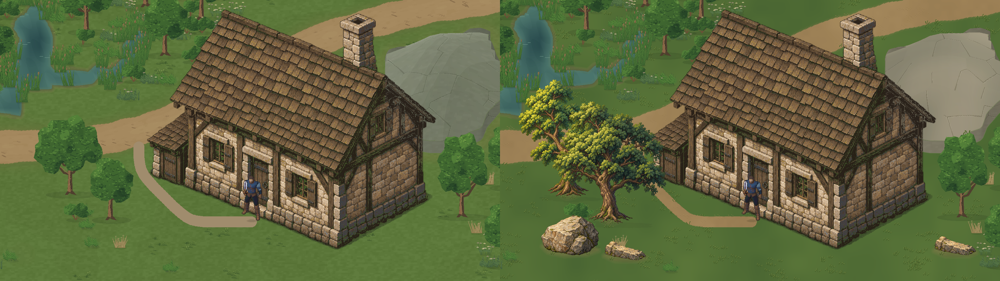
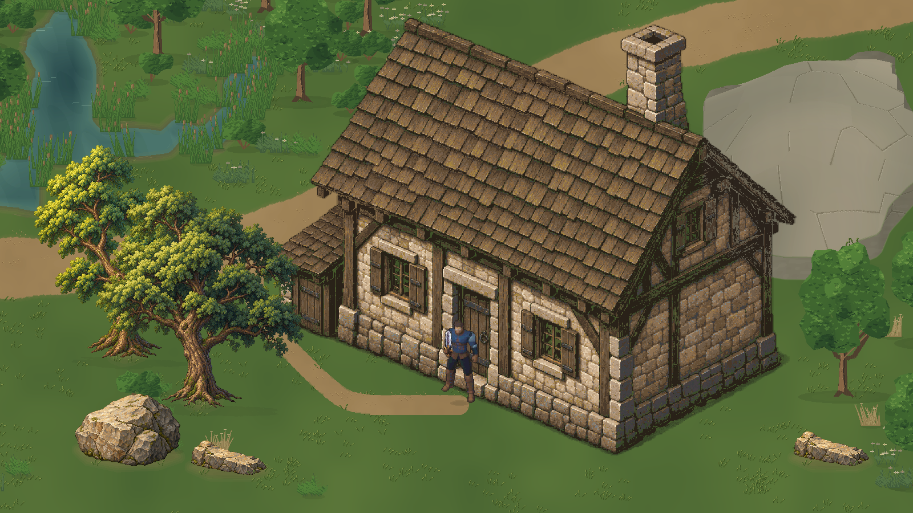
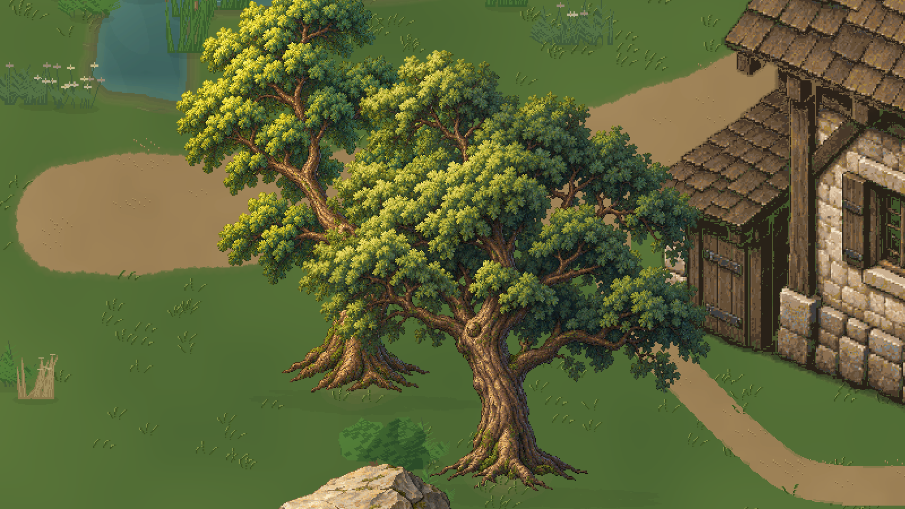
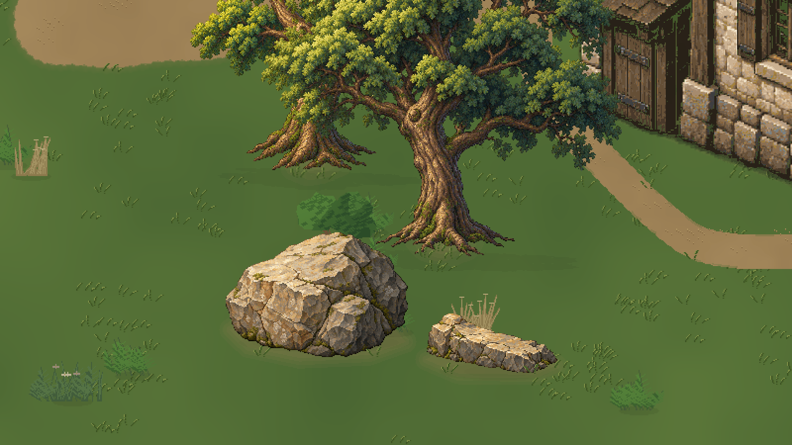
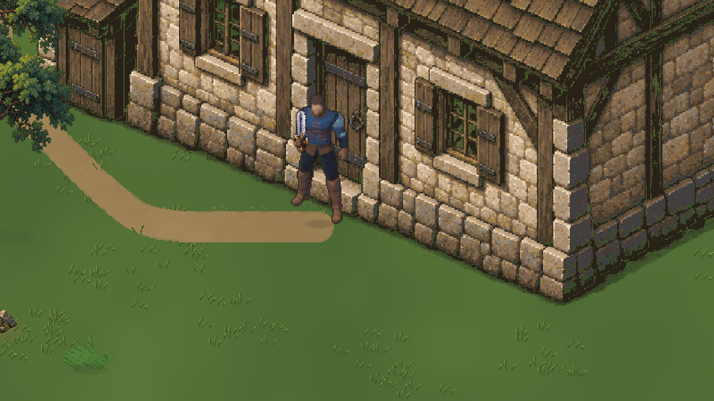

# JEV — Valdoria: composição natural de referência

**Avaliação posterior da entrega `c78d81c208d366b2addb6aa798560ff5280d2950`: árvores novas e rochas novas APROVADAS pelo usuário. Terreno e estradas NÃO APROVADOS.** [Registro formal](../Art/Approvals/Nature10-2026-10-18.json). O relatório abaixo registra a entrega e o estado candidato no momento de sua produção; não estende a aprovação aos elementos antigos ou ao solo.

18/10/2026 · Unity6000.6.5f1 · `main` · baseline/feedback `046c4389df465eaaf1ed0fb795a3b1dd87fd95c6`.

**Entrega candidata à avaliação visual. Terreno e vegetação não estão aprovados.** O estudo está em `Assets/Mmorpg/Scenes/ValdoriaNatureRefinementLab.unity`; cena oficial e construções aprovadas foram preservadas. Worktree conferido e `git pull --ff-only origin main` executado antes da tarefa, já atualizado. Quatro itens locais não relacionados permaneceram fora da entrega.

## Comparação real

Esquerda: anterior09. Direita: candidato Nature10. Ambos são capturas **Play Mode**, 1600×900, câmera `(28,5;14,25;-10)`, ortográfica14,0625, Quaternius no mesmo ponto da entrada, escala1,25. Arte32PPU, **1px da arte/1px da Game View**. A montagem abaixo somente concatena os PNGs originais, sem reenquadrar, recolorir ou reescalar.

Originais: [antes](ValdoriaNature10/Play/00-before.png), [base](ValdoriaNature10/Play/01-base.png), [transições](ValdoriaNature10/Play/02-transitions.png), [final](ValdoriaNature10/Play/03-final.png). Teclas1–4 selecionam esses estados no laboratório; os dados físicos/nav correspondentes também alternam. Não há regeneração por Play.

## Diagnóstico e padrão escolhido

A casa07R, o celeiro08 e o castelo08 compartilham lateral substancial, encontros estruturais com sombra, planos orientados, volumes que se sobrepõem e detalhe subordinado à construção. A casa usa alvenaria irregular e madeira; o celeiro diferencia vãos/estrutura e cobertura; a fortificação preserva peso de cantaria e planos de ardósia. Não era simplesmente a mesma paleta aplicada a três caixas. Referências inspecionadas: relatório07R, fontes/metadados e imports07R/08/09, guia arquitetônico e capturas reais09 dos três modelos.

No ambiente anterior, a copa era uma soma de lobos com preenchimento repetido; o tronco fino tinha pouco afunilamento e integração com galhos. A superfície rochosa privilegiava fraturas gráficas sobre grandes faces pouco diferenciadas. O solo tinha detalhe procedural, mas não estabelecia o mesmo diálogo de contato, massa e riqueza localizada das construções. O feedback046c438 registra que a revisão de cores não resolveu essas diferenças.

O refino muda **formas e estrutura**: dois carvalhos com bifurcações diferentes, massas sobrepostas e vazios; raízes e casca com luz por face; bloco rochoso com plano superior, frente fraturada e lateral recuada; segunda forma baixa de laje partida. Luz quente alto/esquerda e recuos frios acompanham as referências. O solo recebe pigmento contínuo discreto, clusters pequenos de lâminas, grãos de caminho e contatos por footprint. A casa não foi redesenhada.

O platô grande e as outras árvores visíveis ao fundo ainda são formas anteriores. Foram mantidos para não confundir esta prova de **uma pequena família natural** com uma revisão inteira do relevo/ecossistema. Sua diferença de acabamento continua uma limitação explícita; não se declara que todo o ambiente alcançou o padrão final.

## Autoria realmente executada

Skills usadas: `environment-vegetation`, `terrain-materials`, `aseprite-pixel-art`, `imagegen` e `unity-cli`. Aseprite1.3.18.6 localizado/validado; Blender5.2.2 LTS e Editor conectado confirmados.

Quatro pinturas iniciais ImageGen, uma por asset; a segunda árvore usa a primeira como referência e muda estrutura, não apenas cor. [Prompts integrais](../../ArtSource/Labs/World2026/Nature10/prompts.json) e [masters RGBA](../../ArtSource/Labs/World2026/Nature10/Masters/) retidos. Redução nearest, paleta limitada a144 cores sem dithering automático, interpretação em camadas Aseprite, limpeza de alpha e correção explícita de uma linha branca isolada da rocha. Não se alega pintura manual integral nem que o prompt sozinho reproduza os pixels.

Blender foi executado para análise auxiliar de suporte dos galhos, sete massas de copa e faces rochosas. [Fonte .blend](../../ArtSource/Labs/World2026/Nature10/VolumeStudy/nature-volume-study.blend), [parâmetros](../../ArtSource/Labs/World2026/Nature10/VolumeStudy/study.json) e [render auxiliar](../../ArtSource/Labs/World2026/Nature10/VolumeStudy/clay-support-and-planes.png). Esse estudo é independente da pintura, não uma conversão automática para sprite, não aparece em runtime e não é evidência de gameplay.

| Fonte editável Aseprite | Canvas | Uso |
|---|---:|---|
| [oak-reference](../../ArtSource/Labs/World2026/Nature10/SourceV2/oak-reference.aseprite) |448²|Árvore principal, tronco/galhos sustentando massas assimétricas|
| [oak-forked](../../ArtSource/Labs/World2026/Nature10/SourceV2/oak-forked.aseprite) |448²|Bifurcação e distribuição de copa diferentes|
| [fieldstone](../../ArtSource/Labs/World2026/Nature10/SourceV2/fieldstone.aseprite) |256×192|Bloco principal com faces e juntas|
| [broken-slab](../../ArtSource/Labs/World2026/Nature10/SourceV2/broken-slab.aseprite) |192×128|Laje baixa; duas instâncias compartilham a mesma arte|
| [ground-brushes](../../ArtSource/Labs/World2026/Nature10/SourceV2/ground-brushes.aseprite) |192×96|Seis grupos de lâminas, terra e pequenos planos minerais|

Árvores e pedras têm seis camadas; pincéis têm quatro. São pixels exteriores organizados por função, sem faces ocultas inventadas. `SourceV2` é a autoridade final. O bootstrap inicial não deve sobrescrevê-la. `ExportV3` lê essas camadas; atlas1024², recortes/offsets sem reamostragem. A camada de sombra das árvores usa a silhueta projetada da copa e fica editável separadamente.

Altura aparente útil do Quaternius:117px×1,25/32≈4,57u. Árvores adultas: desenho preparado com400px de altura≈12,5u; escalaTransform1. Os canvas/offsets, âncoras e footprints estão em [source.json](../../ArtSource/Labs/World2026/Nature10/SourceV2/source.json). Fonte de arquitetura e proporção da porta permanecem as aprovadas.

## Integração e mudanças físicas declaradas

`nature_reference10.py` separa fonte, export, composição e ocupação. [Receita](../../ArtSource/Labs/World2026/Nature10/recipe.json), seed **910210**. `NatureReference10Importer` clona o laboratório09 da casa para destino novo e recusa sobrescrita. Dois carvalhos substituem os IDs `A/oak/26/00026` e `A/elm/15/00015` na amostra; as216 posições ecológicas existentes são mantidas. Não foi alterado nenhum produtor de terreno, estrada, hidrologia ou arquitetura.

Mudança física **somente no estudo**: raio dos dois troncos0,3/0,4→0,5u e três polígonos de pedras novos. A metadata é compartilhada por contato de solo, colisão e ocupação; rochas usam envelope frontal para sorting. Não há collider do retângulo da copa ou telhado. O círculo de tronco continua uma aproximação explícita. A navegação `.25u` é recalculada sobre a mesma base, com clearance até a porta. Uma colocação de laje foi recusada por proximidade da estrada e mudou para `(49;45)` em coordenadas da receita. Nenhum curso d'água/rota foi desviado para acomodá-la.

Terreno: malha e UV anteriores, pigmento em coordenadas de mundo a32px/u, sem tile por célula. Máscaras das estradas continuam as existentes; contato de fundação/tronco/rocha é local. Não há pintura gigante da região inteira usada como substituto de geometria. As texturas contínuas são materiais da malha semântica existente; a navegação continua separada da cor.

Sprites Point,32PPU, RGBA32 sem compressão/mips; texturas de solo usam UV e não Sprite PPU. Mesmos input, protagonista, autoridade e casa. `NaturePropDepth` é o único componente novo de profundidade natural; `NatureReferenceLab` troca quatro estados. Prefabs por âncora, todos compartilhando atlas/material. [Demonstração real de instanciação](ValdoriaNature10/Play/15-prefab-instantiation.png): probe temporário, removido ao final, sem repintar ou reconstruir a arte.

## Inspeção visual e movimento

Frente/trás: [árvore e colisão](ValdoriaNature10/Play/04-tree-front-collision.png), [sob a copa](ValdoriaNature10/Play/05-tree-behind.png), [pedra à frente](ValdoriaNature10/Play/06-rock-front.png), [pedra atrás](ValdoriaNature10/Play/07-rock-behind.png), [lateral da casa](ValdoriaNature10/Play/09-house-side.png), [cutaway preservado](ValdoriaNature10/Play/10-house-behind.png).

[Vinte frames Game View originais](ValdoriaNature10/Play/Motion/) e [GIF montado desses frames](ValdoriaNature10/camera-motion.gif). O GIF usa paleta de indexação própria do formato; PNGs são a autoridade das cores. A inspeção não mostrou emendas32×32 na área de prova, mas a aprovação artística, inclusive leitura em movimento, permanece do usuário. Não se afirma ausência universal de padrões em todo o mapa.

## QA executado

- [Seis testes Python dirigidos](ValdoriaNature10/python-tests.txt): manifests/inputs por hash, atlas lossless e remoção da linha residual, pixels integrados iguais às exportações autoritativas, repetição de ocupação/clearance, reexport real Aseprite byte a byte e patch em coordenadas globais igual ao mesmo recorte da composição completa (base/transições/final/cliff). Fontes retidas → exports determinísticos. Não são testes de aprovação estética.
- [Play real](ValdoriaNature10/Play/play-qa.json): **24 controles passaram**,37,63s, Input System real alimentado por teclado sintético. WASD, diagonal, esquiva observada, estrada→porta, colisão do tronco, passagem sob a copa, profundidade da árvore/pedra, footprint da pedra, casa/cutaway, vau, circulação da margem,20 capturas em movimento e instanciação dos prefabs. Teleportes entre poses são preparação de teste, não prova de caminhar essas distâncias; deslocamentos validados têm input/trace.
- [Inspeção Editor](ValdoriaNature10/editor-qa.json): **49.152 amostras por estado**,0 divergências navegação/OverlapPoint antes e depois; uma câmera, um controlador de jogador, casa com6 vértices e1 grupo de profundidade, textura `house-maintained.png` preservada. Sem teclado sintético ao terminar, teclados habilitados, timeScale1, Play parado, resolução temporária removida.
- [Compilação](ValdoriaNature10/compile-final.json) concluída sem falha. [Console incremental](ValdoriaNature10/console-final.json) separado do histórico; avisos de obsolescência anteriores não foram tratados como defeitos desta arte. Duas chamadas síncronas de importação excederam o orçamento de5s do transporte CLI; a operação do Editor continuou e o estado final foi verificado. Isso não é um erro de gameplay. Wrapper de build usa atualização do Editor para recibo assíncrono.
- [Preservação verificada por bytes/hash](ValdoriaNature10/preserved-inputs.json): cena oficial e fontes/arte de arquitetura07R/08/09 não alteradas. Perfil de Play isolado em `Temp/ValdoriaNature10/IsolatedProfile`.

A primeira revisão está em `PlayFirstReview/`: mostrava solo uniforme demais e o teste chamado “Water bank retained” tinha expectativa incorreta sobre um ponto transitável do vau/margem. A prova corrigida verifica circulação dessa mesma margem e passagem pelo vau; não se alterou a água para obter resultado positivo. Os detalhes iniciais próximos à borda inferior incluíam a área fora do mundo por câmera manual; `Details/` contém novos enquadramentos2× dentro do mundo. PNGs antigos foram retidos, não apresentados como a revisão final.

## Desempenho medido

Mesmo enquadramento, no Editor real, sem benchmark de build:

|Medida|Anterior|Candidato|
|---|---:|---:|
|Renderers ativos|232|250|
|Renderers visíveis|119|137|
|Draw calls observadas|120|138|
|Texturas ativas únicas|15|16|
|Memória das texturas ativas|180.809.684B|189.199.220B|

Incremento≈8MiB,18renderers/draw calls nesta composição. O laboratório mantém os quatro estados e a composição antiga residentes: dependências de texturas totalizam **437.606.643B** na inspeção do Editor. Não é consumo final de um mapa publicado nem prova de desempenho em hardware alvo. A comparação prioriza inspeção; remover estados antigos e otimizar contatos/batching é trabalho posterior à escolha visual, sem multiplicar imagens por instância.

## Pipeline e pendências

[NaturalEnvironmentProduction](../Art/NaturalEnvironmentProduction.md) descreve nova árvore, variações, pedra, transições, organização de camadas, importação e divisão entre decisões artísticas e parametrização. Skills de vegetação/materiais apontam para esse fluxo. Contratos produtores não foram alterados; o suplemento [NatureReferenceContract](../WorldGen/NatureReferenceContract.md) documenta o consumidor experimental.

Limitações: somente duas silhuetas de árvore e duas formas rochosas refinadas; plantas antigas, água e platô de fundo mantêm o acabamento anterior. Não há vento, crescimento, destruição, escalada, física3D ou luz dinâmica nova. As sombras são pintadas/projetadas de autoria, não simulação solar. Detalhe das copas ainda exige julgamento do usuário quanto a densidade e contraste. O solo permanece deliberadamente mais calmo que a arquitetura; não foi preenchido com ruído para competir com ela.

Nenhuma promoção ao mundo oficial, aprovação automática, expansão para biomas ou biblioteca numerosa. Próximo passo depende da avaliação destas evidências, antes de converter o padrão candidato em cobertura ampla.

Versionamento: commit desta entrega publica fontes, cena, ferramentas, documentação e evidências. SHA e confirmação do push são informados na resposta e podem ser recuperados por `git log -- Docs/Validation/ValdoriaNature10-ArtRefinement.md`.

O [inventário da entrega](ValdoriaNature10/delivery-inventory.json) lista os arquivos desta rodada com SHA256 do conteúdo versionado. Exclui apenas o próprio inventário para evitar referência circular. Artefatos de fonte, exportação, integração e evidência têm bytes preservados no Git, além dos manifests funcionais de geração.
