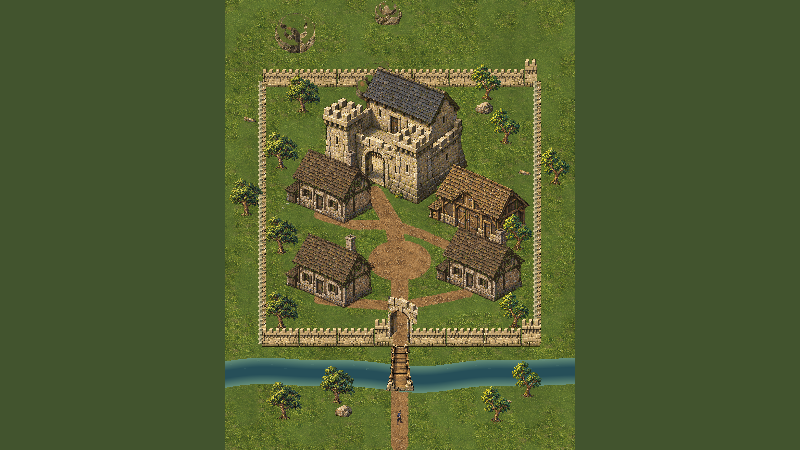

# Valdoria Playable Village 01

Candidata jogável; aprovação artística pendente. Base de trabalho `d482b650d095eb95424d4dcb235d586a31db291e`, com referências até Ground13R `e2b743388ad37890d6677e7161e9e3664fea8a6c`.

## Abrir e explorar

`Assets/Mmorpg/Scenes/ValdoriaPlayableVillage01.unity` é a primeira cena habilitada do Build Settings após o QA. Spawn `(56,8)`, WASD e esquiva existentes. Exterior → rio → ponte → portão → praça/ramais → castelo e pátio → retorno. Três casas, um celeiro e a fortificação aprovada, sem interiores, NPCs ou novos sistemas de combate. `MmorpgWorld.unity` foi preservada; a lista anterior está em [build-settings-before.txt](ValdoriaPlayableVillage01/QA/build-settings-before.txt).

[Índice de todas as capturas](ValdoriaPlayableVillage01/Index.md) · [ponte e portão](ValdoriaPlayableVillage01/Original/final-bridge-gate-front.png) · [rua em gameplay](ValdoriaPlayableVillage01/Original/04-main-street.png) · [aproximação do castelo](ValdoriaPlayableVillage01/Original/06-castle-approach.png) · [câmera em movimento](ValdoriaPlayableVillage01/Animations/exploration-live.gif).

## Decisões novas

Região `112 × 144 u`, seed `1202601`, receita revisão 2. Envelope defensivo fechado, rio de margem a margem, vão útil da ponte de aproximadamente 4 u e portão alinhado. Casas/celeiro têm acessos próprios; a revisão de lote afastou o celeiro do castelo, eliminando sobreposição física. A praça é aberta para circulação e leitura do protagonista.

Piso e bordas reutilizam Ground11 em coordenadas globais. Árvores/rochas Nature10, plantas Ground12, arquitetura e relevo Ground13R reutilizam os pixels existentes. Corrigida a ordem estática das árvores pela nova âncora; contornos do castelo permanecem independentes. O relevo ao norte é inacessível. Não há geração pesada ao entrar em Play.

Novas peças de muralha e ponte têm fonte Aseprite de cinco camadas em `ArtSource/World/PlayableVillage01/StructuresV1/village-structures-v2.aseprite`, masters e proveniência de autoria assistida por ImageGen. O portão reutiliza arco e madeira do castelo aprovado. São candidatos novos, não assets automaticamente aprovados. Exportações e composição são reproduzíveis a partir das fontes, sem promessa de repetir ImageGen por seed.

O canal é um traçado autorado para esta vila, com paleta/motivos e playback de quatro fases Ground13. Não é uma nova simulação hidrológica. A física deriva dos polígonos semânticos, não de pixels, e bloqueia água fora da ponte. Prefabs visuais não transportam automaticamente a navegação: editar a receita e regenerar os consumidores.

Detalhes de produção: [pipeline](../Art/PlayableVillage01Pipeline.md) e [contrato v1](../WorldGen/PlayableVillage01Contract.md). Esta versão tem envelope fixo; não é um gerador universal de vilas.

## Validação executada

- **Python:** 10 testes passaram, incluindo determinismo, footprints, acessos, ausência de sobreposição, necessidade da ponte, cobertura de chunks, fases aquáticas e reexportação Aseprite pixel a pixel. [Registro](ValdoriaPlayableVillage01/QA/python-tests.txt).
- **Unity Play:** percurso contínuo de 157,24 s, 37.777 frames avançados, 20 verificações; visita às entradas e pátio do castelo e retorno ao spawn. Input System com teclado sintético emitindo intenções WASD, sem escrever posições do ator. [Trace integral](ValdoriaPlayableVillage01/QA/play-qa.json).
- **Entrada única:** 64.512 amostras de ocupação física, malha de 0,5 u e clearance de 0,625 u. Fechamento virtual da ponte desconecta exterior/interior; rio, muralhas e limites impedem contornos nessa discretização. Essa prova amostrada complementa o percurso real; não é uma prova analítica para qualquer tamanho de ator.
- **Colisão/oclusão:** 13 verificações dirigidas passaram: guarda-corpo, muralha, água, casa, árvore, rocha, limite, diagonal, esquiva e profundidade à frente/atrás. As fixtures reposicionam o ator e estão separadas do percurso contínuo. [Resultados](ValdoriaPlayableVillage01/QA/collision-qa.json). Um probe inicial de árvore falhou; o diagnóstico e os estados intermediários estão preservados, sem apresentá-los como defeitos atuais.
- **Integridade de cena:** 46 polígonos ambientais, nenhuma divergência da fonte, 47 colliders incluindo jogador, um Player, uma câmera ativa, um ActorHealth e nenhum controlador comparativo. Importador recusa destino existente. [Inspeção](ValdoriaPlayableVillage01/QA/scene-integrity.json).
- **Compilação:** recompile concluído sem erros de C#. O build Windows64 Development foi produzido e executado; o resumo marcou `Succeeded`, 14 avisos e uma exceção no pós-processamento interno `UnityEditor.BuildEventsHandlerPostProcess.ReportBuildPackageIds`. Não é uma falha de gameplay, mas permanece uma pendência da ferramenta; não declaramos Console limpo. Os avisos incluem APIs legadas e a diretiva `DEVELOPMENT_BUILD`, inclusive no probe novo. [Console](ValdoriaPlayableVillage01/QA/console-final.json) e [build](ValdoriaPlayableVillage01/QA/standalone-build.json).
- **Standalone:** smoke passou com saída 0: spawn `(56,8)`, W até `(56,11,756)`, S até `(56,7,93)` e perfil isolado. A janela oculta não forneceu framebuffer capturável; não há screenshots standalone nem alegação de percurso integral nesse executável. O probe registra a indisponibilidade sem interromper o teste de input. O log também registrou descarte de ComputeBuffer/recurso D3D12 no encerramento. [Resultado](ValdoriaPlayableVillage01/Standalone/QA/standalone.json) e [limitações](ValdoriaPlayableVillage01/QA/standalone-runtime-notes.json).
- **Encerramento:** Play parado, timeScale 1, teclado físico habilitado, nenhum probe temporário, seleção original de Game View restaurada. [Estado](ValdoriaPlayableVillage01/QA/editor-restored.json).

## Custo de renderização

Windows/D3D12, Editor Unity 6000.6.5f1, Ultra, 1600×900. Janelas de 2 s após 0,6 s de acomodação, antes da compressão dos screenshots. São tempos de frame observados no Editor, sem medição isolada de GPU e sem garantia de FPS em outra máquina.

| Enquadramento | Ortho | Draw calls/visíveis | Mediana / p95 (ms) |
|---|---:|---:|---:|
| Ponte/portão | 14,0625 | 46 | 3,37 / 4,40 |
| Rio | 14,0625 | 40 | 3,86 / 5,20 |
| Muralha oeste | 14,0625 | 56 | 3,67 / 4,98 |
| Área natural | 14,0625 | 28 | 3,65 / 4,73 |
| Vila, inspeção | 24 | 129 | 3,76 / 5,06 |
| Castelo, inspeção | 24 | 119 | 3,85 / 7,26 |
| Região inteira, inspeção | 72 | 285 | 3,60 / 4,39 |

285 renderers ativos; 108 texturas referenciadas, 341.375.580 bytes (~325,6 MiB), meshes 3.164.480 bytes. A região completa custa mais que o laboratório de 131 chamadas e não tem conteúdo/câmera equivalentes. Não alegamos otimização percentual entre esses cenários. Não há streaming de texturas; memória e batching de uma região maior permanecem trabalho futuro. [Medições e câmeras](ValdoriaPlayableVillage01/QA/final-performance.json).

## Evidências e limitações

PNGs integrais de Play são a autoridade, em `Original/`; `ReviewLite/` contém derivados de até 750 KiB. `Details/` identifica recortes 1:1. Manifesto em `QA/image-manifest.json` registra dimensões, transformação, bytes e SHA-256. GIFs são auxiliares com nearest e paleta compartilhada sem dithering; não substituem os PNGs. A sequência aquática observou as quatro fases e o loop 3→0, mas a codificação de PNG perdeu uma fase em uma passagem; o manifesto temporal registra esse intervalo, sem inventar frames.

Sem natação, escalada, interiores ou povoamento. A ponte é fixa e o portão permanece aberto; não há mecânica de cerco. Fachadas e muros laterais ainda dependem da avaliação artística do usuário. O enquadramento geral usa câmera de inspeção: o gameplay conserva escala 32 pixels de tela/u, câmera ortográfica 14,0625 e visual Quaternius 1,25.

Os 10 testes do pipeline ReviewLite passaram; 65 pares foram verificados, sem quantização, com máximo de 765.977 bytes (abaixo de 750 KiB). A visão geral foi recuperada de `main` pelo conector GitHub em Base64, decodificada, aberta visualmente e conferida contra o SHA-256 do manifesto. [Registro da recuperação](ValdoriaPlayableVillage01/QA/github-accessibility.json). Apenas essa imagem foi aberta pelo conector; as demais não recebem essa alegação.

O resultado técnico habilita exploração e inicialização, não representa aprovação artística. As fontes anteriores permanecem preservadas. Implementação publicada em `5638a9b9715e5b2c8d070d739ca315d0585070db`; a verificação remota é registrada em commit posterior, sem alterar os pixels publicados.
