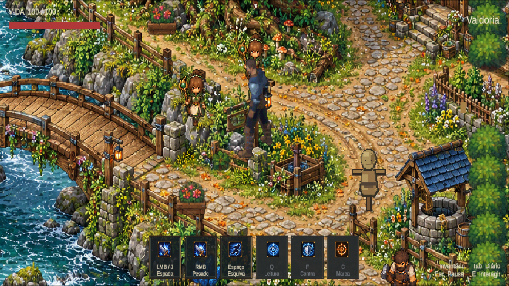

# Proporção do protagonista — R10

17/10/2026. A pedido do usuário, o Quaternius ativo em `MmorpgWorld` passou a 75% da escala visual anterior. O ajuste fica em `VisualRoot`, incluindo corpo, espada, dedos e sombra. Fontes, sprites e timings não foram redesenhados. A raiz física permanece em escala 1; collider, velocidade e parâmetros de alcance não foram editados. A política LegacyGrip existente continua calculando a origem pela mão apresentada: este ajuste não certifica equivalência de acertos entre escalas.

Ferramenta repetível: `AgentScripts/ScaleValdoriaProtagonistR10.cs`, entrada `ScaleValdoriaProtagonistR10.Apply`. O cenário detalhado foi reativado após a recarga da cena. O bloqueio anterior do Pipeline era o diálogo de alteração externa da cena; resolvido pela interface do Editor, sem reiniciá-lo.

QA executado no Editor Unity 6000.6.5f1: recompile/recompile_status up_to_date, autotick ativo, Play na entrada oficial, perfil temporário isolado, input D com deslocamento de 0.778 unidades, walk `pose_112` e retorno a idle. Frames avançaram. Console atual: zero erros/avisos, sem falha de compilação; o buffer histórico do Pipeline ainda continha falhas das tentativas anteriores. Play encerrado e input/configurações restaurados. Não foi executada regressão de ataques nesta revisão.

A proporção está preparada para avaliação do usuário. NPCs ainda usam a família anterior; a imagem do cenário é um backdrop e não fornece colisão nem camadas individuais de profundidade.
