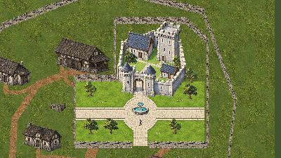
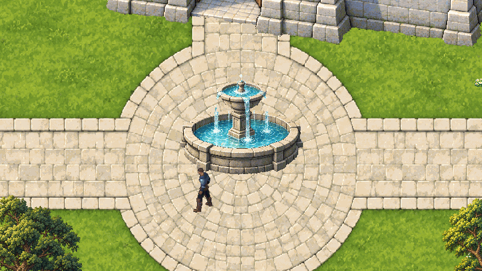

# Valdoria — jardins reais ampliados e cena inicial

19/10/2026. O usuário considerou pequenos o pátio rico e o chafariz, e depois autorizou “Pode aplicar cena principal dai”. A cena **ValdoriaVillage02Anime.unity** foi ampliada e definida como primeira habilitada no EditorBuildSettings. Village01 e MmorpgWorld permanecem disponíveis como rollback. Não foi produzido um novo executável standalone.

O recinto real agora envolve7797u², aproximadamente5,42× a envoltória convexa de1438,13u² das antigas fundações do castelo. Esse indicador compara envelopes, não área caminhável líquida. O castelo permanece ao fundo, à mesma escala; à frente há um jardim formal96×48u, praça circular e avenidas largas. O chafariz passou de3,2 para12,8u de diâmetro, quatro vezes maior, reautorando o master retido em649×432px a32PPU. As Transforms continuam1. O conjunto tem oito árvores e34 pequenos grupos de flores.

## Autoria e geometria

Fontes e exportações: `ArtSource/World/PlayableVillage02/RoyalGardensV1/Source` e `Export`. O piso novo foi gerado pelo **image_gen integrado**, convertido em fonte Aseprite editável com duas camadas e exportado sem redesenho. O chafariz reutiliza o master anterior em nova resolução nativa; não é um sprite pequeno ampliado por Transform. Prompt integral e referência estão em `generation-provenance.json`. A operação Aseprite usa nearest uniforme e paleta de até192 cores sem dithering. Fonte e export têm pixels iguais. As árvores e a pintura do castelo foram preservadas.

São172 polígonos explícitos. Os120 arquitetônicos e os dois troncos anteriores permanecem idênticos. O chafariz muda de local e de volume; seis troncos e43 segmentos de limite são adicionados. A entrada sul tem12u. Flores não bloqueiam o caminho. O piso é apresentação; colliders não foram inferidos de pixels. Personagem Quaternius, escala visual1,25, câmera de gameplay, terreno externo, rio e combate permanecem no contrato anterior.

## Verificação executada

Unity6000.6.5f1, Editor conectado, Play real e teclado sintético no Input System: **136/136 resultados passaram**, sem exclusões, erro ou penetração observada. O teste avançou21616 frames em364,45s. Os172 polígonos reais coincidem com a receita. O percurso contínuo passou pela entrada da vila, entrada real, quatro lados do chafariz, dois gramados, pátio interno e retorno ao exterior, sem teleporte entre destinos. Colocar fixtures individuais para contatos é registrado separadamente do percurso contínuo.

Foram122 contatos dirigidos:86 nas duas faces longas dos43 novos segmentos, mais chafariz/troncos e esquivas cardinais. Frente e trás do chafariz também receberam verificação de profundidade opaca e capturas após renderização. Os volumes anteriores inalterados conservam a evidência da rodada Anime/Integration; não foram todos novamente pressionados nesta rodada. Não se afirma garantia de toda trajetória possível.

Cinco testes Python passaram: dimensões nativas; conservação da física anterior; conectividade com ponte obrigatória; fechamento negativo da entrada real; hashes e igualdade fonte/export. A documentação oficial [PolygonCollider2D.SetPath](https://docs.unity3d.com/6000.0/Documentation/ScriptReference/PolygonCollider2D.SetPath.html) foi consultada para o contrato de contornos. A URL6000.6 reorganizada estava indisponível; a integração efetiva foi compilada e executada no Editor6000.6.5f1.

Após promoção, a primeira cena habilitada foi reaberta e iniciou outro Play:172 colliders, um protagonista,237 frames avançados e3,546u de movimento por input real em cerca de1s. Teclado físico reabilitado, dispositivo sintético removido, perfil isolado em Temp. Play terminou; Game View, opções de input e FPS foram restaurados. A cena principal ficou aberta, limpa, timeScale1 e FPS−1. Console final: zero erros e avisos; compilação sem falhas. Detalhes em `ValdoriaRoyalGardens/QA/{play-qa,promotion,startup-play,input-restored,editor-restored}.json`.

## Evidências e limites

16 imagens verificadas, dez grupos comparativos; ReviewLite máximo665928 bytes, sem alteração dos originais. Overview anterior e atual compartilham câmera e transformação; o original anterior foi copiado sem modificar seus pixels. O recorte `Details/fountain-native.png` conserva1:1. Capturas de preview são Play; imagens geradas/Aseprite são fontes offline e não se confundem com evidência de jogo. Manifesto de dimensões, bytes e SHA256: `ValdoriaRoyalGardens/QA/image-manifest.json`. As vistas principais, chafariz e cópias ReviewLite correspondentes foram inspecionados visualmente; as demais receberam verificação de integridade, não aprovação estética individual.

Água do chafariz é pintada e estática. O jardim tem manutenção e luz próprias no desenho; não há novo sistema dinâmico de iluminação nem simulação de riqueza/corrupção. O recinto inclui áreas externas ao núcleo compacto anterior, sem ampliar o edifício nem suas portas. A autorização de promoção foi cumprida; a avaliação artística final continua pertencendo ao usuário.
