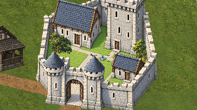
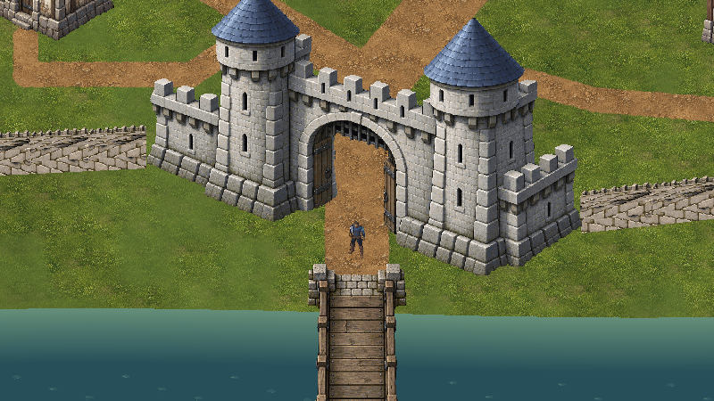

# Village02 — direção da adaptação animada

19/10/2026. Cena candidata: `Assets/Mmorpg/Scenes/ValdoriaVillage02Anime.unity`. A cena inicial continua Village01; esta versão não foi promovida nem aprovada artisticamente.

As 14 famílias arquitetônicas foram repintadas a partir da direção autorizada pelo usuário: anime **Release That Witch**, vila pobre e desgastada contrastando com o interior cuidado do castelo. Cinco das sete moradias receberam revisão explícita de pobreza; H2 e H5 permanecem mais conservadas. Pedra clara, ardósia, gramado interno, uma fonte, duas árvores e 14 pequenos canteiros formam o jardim. A fonte tem água pintada estática. O terreno Ground11 e o rio permanecem iguais, portanto o exterior ainda tem bastante grama verde; o contraste sombrio do mundo inteiro ainda não está concluído.

Referências: [trailer oficial Crunchyroll](https://www.youtube.com/watch?v=S4P2Mr_Cwys), rua 00:13, praça 00:21 e jardim 00:29; detalhes em `../Art/ReleaseThatWitchReference.md`. O manhua foi excluído da direção. Prints são estudo visual, não texturas do jogo. A premissa de precariedade e corrupção foi registrada em GameVision; sistemas narrativos de corrupção não foram implementados.

## Autoria e integração

Fontes em `ArtSource/World/PlayableVillage02/AnimeRebuildV1`: Masters preserva as imagens geradas; `selected-prompts.json` registra os 16 prompts selecionados. SourceV2 contém 15 fontes Aseprite e GardenSourceV1 a fonte das flores. ExportV2 e GardenExportV1 são exportações verificadas. As duas árvores reutilizam Nature10 aprovado. Nenhum personagem foi regenerado.

O registro usa escala uniforme nearest e translação para manter os apoios existentes. IoU de silhueta inferior é diagnóstico de encaixe visual, não prova física. As anotações herdadas `doorMaster`, `spanMaster`, `scaleFromPaintedMaster` e `doorHeightUnits` nos metadados são referências históricas do desenho anterior; não são medições das portas recém-pintadas. O importador verifica canvas e frame único para impedir a interpretação automática de H1/H2/etc. como sequência de animação pelo Aseprite. Uma tentativa inicial inválida foi retirada para Temp; SourceV2 é a autoridade selecionada.

Os 120 polígonos anteriores foram preservados exatamente; fonte e dois troncos acrescentam três volumes explícitos, totalizando 123. Flores baixas são atravessáveis. Arte não determina o collider. Personagem Quaternius, escala visual 1,25, física e terreno permanecem no contrato existente; sprites usam 32 PPU, Point, sem compressão nem mipmaps.

## Verificação executada

Unity 6000.6.5f1, Editor conectado, Play real e Input System: **291/291 resultados executados passaram**, 42.634 frames em 722,38 s. Onze destinos foram percorridos continuamente, sem teleporte entre destinos. Contatos dirigidos, esquiva cardinal, cantos disponíveis, novos volumes do jardim e frente/trás das sete moradias foram verificados. Os 123 polígonos Unity coincidem com a receita. Há **69 exclusões explícitas** de fixtures cobertas por vizinhos ou sem aproximação disponível; não são testes aprovados. Os 158 contatos nas duas faces das 79 muralhas são evidência herdada da integração anterior, cujos volumes não mudaram. Não se afirma cobertura de toda trajetória possível.

O primeiro Play encontrou parte de duas novas coberturas cônicas na antiga camada de piso. IntegrationV2 corrigiu a propriedade desses pixels sem alterar RGB, alpha ou os 123 polígonos. Recomposição das partes é idêntica ao desenho original. A revisão foi aplicada no Editor e recebeu novo Play: as duas torres ficam opacas e à frente do ator no fixture do jardim. Capturas finais repetem câmera e posição das capturas iniciais. O percurso físico anterior permanece válido porque a revisão alterou somente apresentação.

Sete testes Python passaram: hashes/fontes/frame único, silhuetas registradas, recomposição, propriedade opaca das coberturas, geometria original e jardim, conectividade e ponte, flores. Evidências detalhadas: `ValdoriaVillage02-Anime/QA/play-qa.json`, `QA/opaque-revision.json`, `FinalDepthV2/QA/tower-depth.json` e `QA/image-manifest.json`. Os PNG integrais são autoridade; ReviewLite registra redução e hashes. Capturas InitialViews e contatos precedem a correção visual; FinalDepthV2 é a apresentação final.

Ao terminar, Play foi parado; teclado físico e opções de input foram restaurados, câmera temporária removida ao sair de Play, Game View original restaurada e Village01 reaberta limpa, timeScale 1 e FPS -1. Aprovação estética continua pendente de feedback do usuário.

