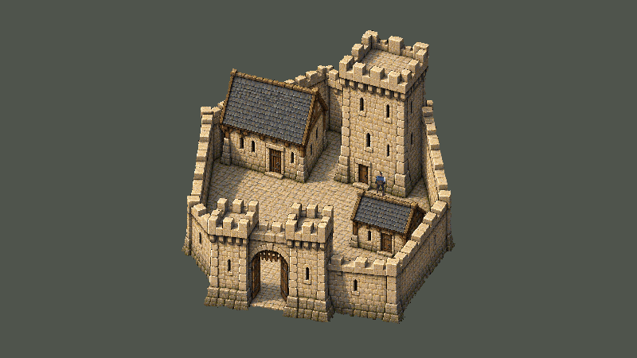
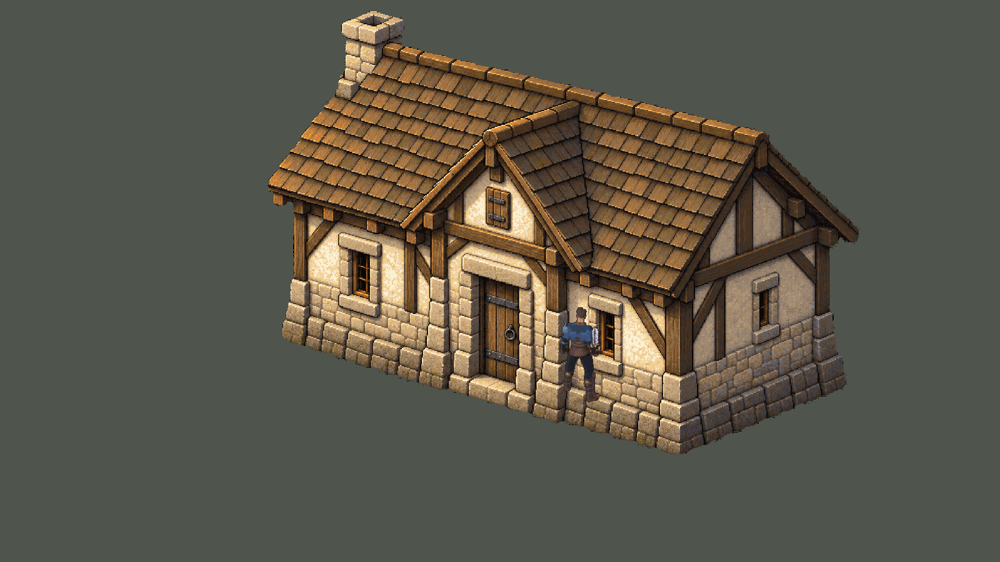
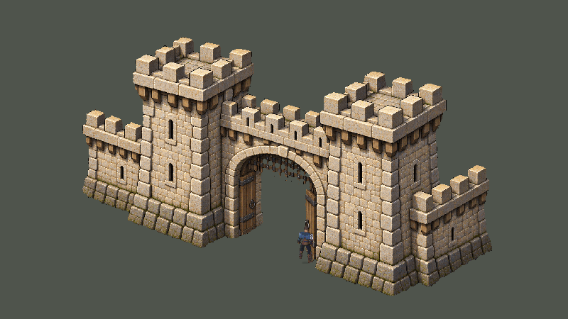
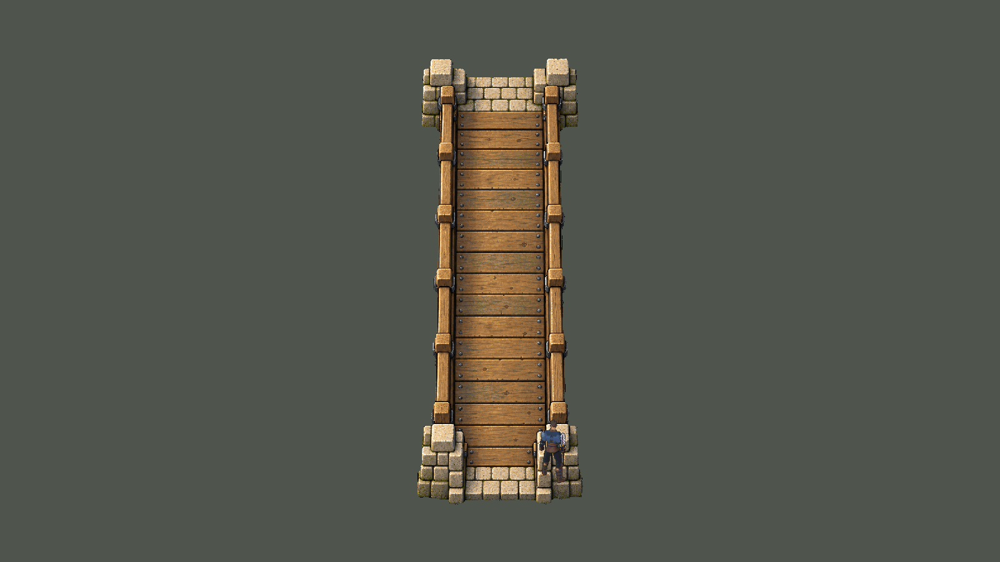

# Valdoria Village02 — fase E, biblioteca arquitetônica candidata

Após a aprovação do layout/blockout em `e0dcc7d`, foram produzidas **14 fontes Aseprite, 67 camadas editáveis e respectivos exports**. Esta entrega conclui a biblioteca arquitetônica da fase E. A integração da vila, correspondência física, oclusão e QA espacial continuam nas fases F/G. Não houve promoção ao Build Settings nem aprovação automática dos novos pixels.

| Grupo | Entrega |
|---|---|
| Habitação | H1 pequena com abrigo de lenha; H2 telhado de quatro águas; H3 oficina com anexo; H4 fachada com empena; H5 casa longa; H6 casa com volume lateral |
| Serviço | B1 celeiro com porta humana, portal duplo e abrigo aberto |
| Fortificação | Castelo composto com torre, salão, serviço, pátio e portão; portão independente; cortina reta e canto |
| Circulação e limites | Ponte longitudinal de lados paralelos; cerca com porteira; muro baixo |

As imagens usam fundo neutro para inspeção. O ator é reposicionado em cada fixture; pode coincidir com uma fachada/base porque **não existem colisores ambientais na galeria**. Isso não representa contato correto dos pés, profundidade resolvida, entrada em construções ou circulação pelo mundo. Nas vistas nativas o edifício pode ultrapassar o enquadramento; a vista `whole` correspondente conserva a silhueta completa. Todas as 14 vistas completas foram abertas e inspecionadas localmente; detalhes H1/H2/H3/H4 também foram abertos em câmera nativa. A avaliação estética pertence ao usuário.

## Autoria e fontes

Diretório: `ArtSource/World/PlayableVillage02/ArtProductionV1/`. `Masters/` contém os originais gerados; `SourceV1/<id>/<id>.aseprite` é a autoridade editável; `ExportV1/` contém composite, camadas integrais/trim e offsets. [Catálogo com hashes, pivôs e dimensões](../../ArtSource/World/PlayableVillage02/ArtProductionV1/ExportV1/catalog.json). [Prompts](../../ArtSource/World/PlayableVillage02/ArtProductionV1/prompts.json) e [proveniência](../../ArtSource/World/PlayableVillage02/ArtProductionV1/provenance.json).

Foi usado o **ImageGen integrado** com referências arquitetônicas do próprio projeto, seguido de Aseprite 1.3.18.6. Blender não foi utilizado. Não foram copiados pixels de anime/jogos e o protagonista aprovado não foi gerado nem alterado. A primeira ponte foi rejeitada por afunilamento e está preservada como `Masters/bridge-v1.png`; `bridge.png` é a seleção paralela.

No Aseprite: recorte de alfa gerado abaixo de250, demais pixels opacos; resize nearest uniforme; octree de até192 cores sem dithering; restauração do alfa não nulo para255 após conversão de paleta. A última operação evita o alfa intermediário introduzido pelo quantizador. Os scripts `bootstrap.lua` registram a execução exata. Tentativas intermediárias ficaram em `Temp/`, sem publicação. Os masters não foram repintados por Python. Exportar lê os pixels Aseprite atuais; não reconstrói a imagem a partir do master.

Portas humanas foram anotadas manualmente e normalizadas para aproximadamente4,85u, 32PPU. O pivô é explícito por peça; não foi inferido do bounding box. As máscaras de camadas são divisões semânticas amplas de **pixels visíveis**, sem reconstrução de superfícies ocultas. O castelo tem12 grupos editáveis, mas ainda não é um kit de volumes intercambiáveis com footprints finais. Todos os itens declaram `worldReady:false`.

## Verificação executada

- Export e recomposição das14 fontes sem alteração dos pixels de `native-authority.png`; hashes de fontes, metadata, masters e exports conferidos; alfa binário em todas as peças. [Recibo](ValdoriaVillage02-ArtProduction/QA/source-verification.json). Recusa de destinos existentes testada para autoria e export: [recibo](ValdoriaVillage02-ArtProduction/QA/overwrite-guards.json).
- Unity6000.6.5f1 recompilou sem erros C#. Galeria real em `Assets/Mmorpg/Scenes/ValdoriaVillage02ArtGallery.unity`,14 sprites, um jogador e uma câmera,32PPU/Point, mipmaps e compressão desligados. [Construção](ValdoriaVillage02-ArtProduction/QA/gallery-build.json).
- Play avançou **2.037frames em10,31s** durante a captura, movimento por teclaW do Input System confirmado, perfil isolado em `Temp/Village02ArtGallery/IsolatedProfile`. Não foram testados combate, colisões ambientais ou percurso da vila nesta etapa. [Resultado](ValdoriaVillage02-ArtProduction/QA/play-review.json).
-24 originais integrais1600×900 capturados após `WaitForEndOfFrame`;24 ReviewLite, máximo756.378bytes,15 integrais e9 reduzidos nearest1/2. Nenhuma quantização nas cópias de revisão. [Manifesto](ValdoriaVillage02-ArtProduction/QA/image-manifest.json). Câmeras `whole` variam para mostrar cada peça; `native` usa ortho14,0625,32px/u; ator1,25. Não são pares antes/depois com câmera equivalente.
- Console sem entradas novas após cursor40019 e sem erros/avisos atuais no encerramento. Os contadores acumulados anteriores não são atribuídos a esta entrega. [Console](ValdoriaVillage02-ArtProduction/QA/console-since-baseline.json).
- Play parado; teclado físico e opções de input restaurados, dispositivo sintético removido, timeScale1, resolução anterior restaurada e cena01 aberta limpa. [Input](ValdoriaVillage02-ArtProduction/QA/input-restored.json), [Editor](ValdoriaVillage02-ArtProduction/QA/editor-restored.json).

Reprodução: `python Tools/ArtPipeline/WorldGen/village02_art.py verify --output ArtSource/World/PlayableVillage02/ArtProductionV1/ExportV1`. Para editar, salvar a fonte Aseprite e executar `export` com **um destino novo**, usando `--source .../SourceV1`. `author` é bootstrap de nova fonte, não comando de atualização. O construtor Unity também recusa sobrescrever galeria existente.

## Revisão local e próxima integração

`layout-recipe.json` é uma candidata separada: H6 deslocada3u a leste e B1 deslocado2u a oeste, com lotes e início do acesso acompanhando a mudança. O bake offline mantém todos os destinos ligados e a ponte necessária: [prova](../../ArtSource/World/PlayableVillage02/ArtProductionV1/LayoutBuild/navigation-proof.json). Isso **não comprova** que as11 fixtures indisponíveis do blockout foram resolvidas em Unity. A receita aprovada e a cena blockout anterior permanecem intactas.

Fase F deve adaptar volumes artísticos aos lotes, revisar projeção/escala de portões e muralhas, produzir conexões/orientações adicionais quando necessárias, definir footprints físicos independentes e separar apresentação/oclusão. O contato dos pés mostrado na galeria não pode ser reaproveitado como validação espacial. A vista de castelo é arte composta candidata; sua projeção também exige conciliação com a planta aprovada. Materiais de terreno, vegetação e estruturas aprovadas só serão compostos nessa integração, sem substituição silenciosa.

Fase G deve repetir percurso contínuo e contatos de todas as construções, inclusive H6/B1, visibilidade atrás de volumes e performance. Somente após essas evidências e revisão artística documentada considerar promoção da cena candidata. Cena01 e `MmorpgWorld` continuam como entradas/rollback existentes.

Publicação e recuperação remota de ReviewLite são registradas separadamente após o push; ver recibo `ValdoriaVillage02-ArtProduction/QA/github-accessibility.json` quando disponível.
