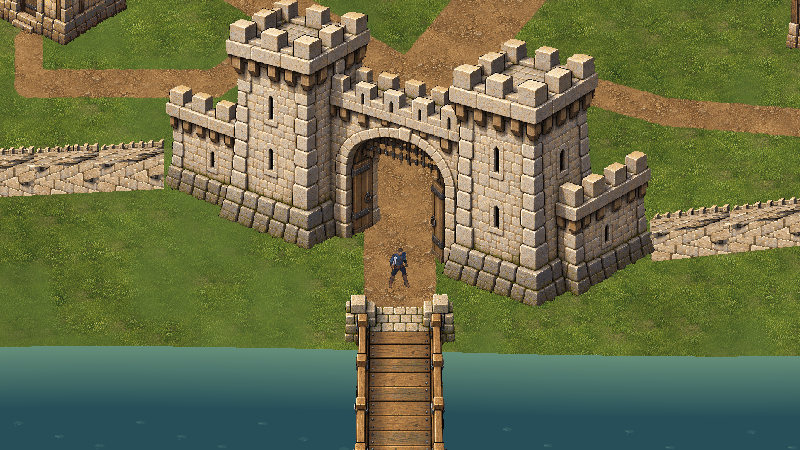
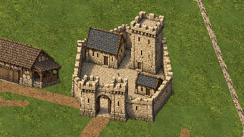

# Valdoria Village02 — integração F e QA dirigido

19/10/2026. A biblioteca aprovada da fase E foi integrada em **`Assets/Mmorpg/Scenes/ValdoriaVillage02Integrated.unity`**, com fundações físicas independentes, profundidade opaca e caminhos jogáveis. É uma candidata: não foi promovida ao Build Settings e a composição completa ainda precisa de revisão artística. A entrada Village01 permanece intacta.

## Implementação

O mundo mede282×335u. Distâncias do blockout foram ampliadas2,2× para acomodar as portas na escala nativa; sprites continuam32PPU e o protagonista conserva escala visual1,25. São7 casas/celeiro,3 conjuntos de acessórios de pátio, castelo, portão e ponte;79 segmentos de muralha;378 chunks de chão e4 frames de água. A superfície da muralha em malha é uma nova montagem candidata, incluindo capeamento para não desaparecer de perfil.

Existem120 `PolygonCollider2D`:27 volumes de construção,6 de acessórios,79 de muralha,2 guardas da ponte,2 de água e4 limites. A revisão V2 acrescenta4 planos físicos das folhas de madeira abertas dos portões, preservando o vão de passagem e os116 polígonos anteriores. Nenhuma colisão é inferida do telhado ou do padding do sprite.

`OpaqueStructureDepth` ordena por plano de chão e pé físico, depois da sincronização do protagonista. As construções conservam alpha1; o ator pode ficar completamente oculto atrás do telhado. Os grupos do castelo, portão e ponte recompõem exatamente os pixels aprovados. As14 fontes/composites da fase E continuam com os mesmos hashes.

Contrato e comandos reproduzíveis: [Village02IntegrationContract](../WorldGen/Village02IntegrationContract.md). Receitas/fontes: `ArtSource/World/PlayableVillage02/IntegrationV1/` e `IntegrationV2/`.

## Validação executada

Unity6000.6.5f1, Editor conectado via CLI/Pipeline, Play real e teclado sintético do Input System. Perfil isolado em `Temp/Village02Integration/IsolatedProfile`. Capturas integrais1600×900, realizadas depois do frame renderizado; câmera e escala registradas por imagem.

| Verificação | Resultado observado |
|---|---|
| Testes offline de geometria, hashes, acesso e recomposição |10 aprovados |
| Correspondência dos polígonos Unity com V2 |120, zero divergências |
| Percurso contínuo sem reposicionamento entre destinos |Entrada, praça, pátio do castelo, H1–H6, B1 e retorno ao exterior concluídos |
| Teste negativo da ponte |Fechar virtualmente a ponte desconecta o exterior |
| Rodada FinalV2 |304 resultados;264 passaram no critério original;40 pediram revisão |
| Contatos dessa rodada |277; nenhum centro do ator dentro do alvo; menor separação−0,015261u |
| Apresentação opaca |Frente/trás das7 casas/celeiro com ordem e alpha verificados |
| Água em Play |Índice de frame mudou de2 para1 entre observações |

A rodada principal avançou39.087 frames em720,42s. [Recibo bruto](ValdoriaVillage02-Integration/FinalV2/QA/play-qa.json), [resumo de cobertura](ValdoriaVillage02-Integration/QA/coverage-summary.json), [testes offline](ValdoriaVillage02-Integration/QA/offline-tests.json), [integridade das fontes](ValdoriaVillage02-Integration/QA/source-integrity.json).

Os40 resultados falsos originais **não foram reescritos**. O teste inicial exigia proximidade ao alvo no fim do empurrão: isso rejeita contatos que deslizam para fora da extremidade. Além disso, a posição inicial seguia uma normal contínua, enquanto o teclado escolhia direções discretas; algumas aproximações erravam a peça estreita ou encontravam um vizinho primeiro.

O replay com posição e direção alinhadas mediu o conjunto de sólidos:23 casos tocaram o alvo e responderam corretamente;15 foram bloqueados por uma peça vizinha, mantendo a face individual como limitação de cobertura. Duas fixtures diagonais de esquiva continuaram sem contato com o alvo; replays cardinais tocaram essas duas peças e bloquearam corretamente. Isso **não aprova as duas aproximações diagonais**. Os recibos `ContactCorrections/`, `ContactDirectionReplay/` e `ContactCardinalReplay/` conservam os resultados separados. Nenhuma penetração foi observada nesses replays.

O harness inicial também escolheu as emendas da muralha: `strip()` tem faces longas nos índices1/3. A rodada adicional [WallFaces](ValdoriaVillage02-Integration/WallFaces/QA/result.json) executou158 contatos diretos aprovados, cobrindo os dois lados longos dos79 segmentos, com5.680 frames avançados. As147 exclusões históricas de muralha da rodada inicial permanecem no arquivo bruto, substituídas em cobertura por essa rodada. Os13 casos sem fixture de construção também permanecem limitações declaradas.

Não se trata de uma prova exaustiva de todas as combinações de velocidade, cantos, armas ou futuras alterações de layout. Combate, morte e persistência não foram alterados ou certificados por esta rodada dirigida de ambiente. Não há benchmark de produção ou aprovação artística implícita.

## Evidências e recuperação

Original é a autoridade, sem sobrescrita. ReviewLite usa o compositor oficial, limite750KiB, redução nearest inteira quando necessária, sem dithering ou alteração de cores. [Manifesto principal](ValdoriaVillage02-Integration/QA/image-manifest.json) e [índice](ValdoriaVillage02-Integration/QA/all-capture-index.json) descrevem as512 capturas anteriores ao teste adicional da muralha. WallFaces possui seu próprio índice/manifesto. Comparações antes/depois conservam câmera e transformação equivalentes; poses/posições da ação estão registradas.

O diretório raiz `Original/` contém84 capturas da rodada V1 interrompida; `InitialViews/` precede o reparo da muralha e as folhas V2. Esses arquivos são históricos de autoria, não aprovação final. Houve travamentos do Editor em tentativas anteriores, com comandos da main thread expirados. A causa permanece indeterminada. O harness passou a reiniciar a participação do corpo na simulação ao posicionar fixtures e manter limite temporário de60fps até parar Play; a rodada FinalV2 completa e os replays posteriores terminaram. Não atribuímos o incidente a um defeito comprovado do jogo nem a um driver corrigido. Um primeiro backup guardado em Temp foi perdido na limpeza automática do reinício; outro backup candidato foi arquivado fora do projeto. As cenas salvas e fontes aprovadas permaneceram intactas.

O Console da sessão de replays estava sem erros de jogo/compilação. Uma consulta do agente tentou um nome inexistente de componente (`ActionCombatController`) e falhou na compilação do próprio eval; isso não é erro do runtime. [Console](ValdoriaVillage02-Integration/QA/console-final.json). [Restauração](ValdoriaVillage02-Integration/QA/restoration-final.json): Play parado, cena anterior limpa, timeScale1, FPS−1, teclado físico habilitado, dispositivos sintéticos e capturadores temporários ausentes, Game View restaurado. Cenas anteriores, Build Settings e fontes da fase E sem diff.

## Direção visual seguinte

O usuário confirmou **Release That Witch**, de Roland/Border Town, incluindo a versão em quadrinhos. [Registro de referência e proposta](../Art/ReleaseThatWitchReference.md). A revisão deve aproximar as construções das ruas, desenvolver pequenos conjuntos habitáveis e dar função aos pátios e áreas produtivas, mantendo os contratos físicos. O atual espaçamento entre prédios, a muralha e o acabamento do canal ainda são candidatos a essa revisão. Não houve substituição silenciosa da arte aprovada por imagens de outra obra.
