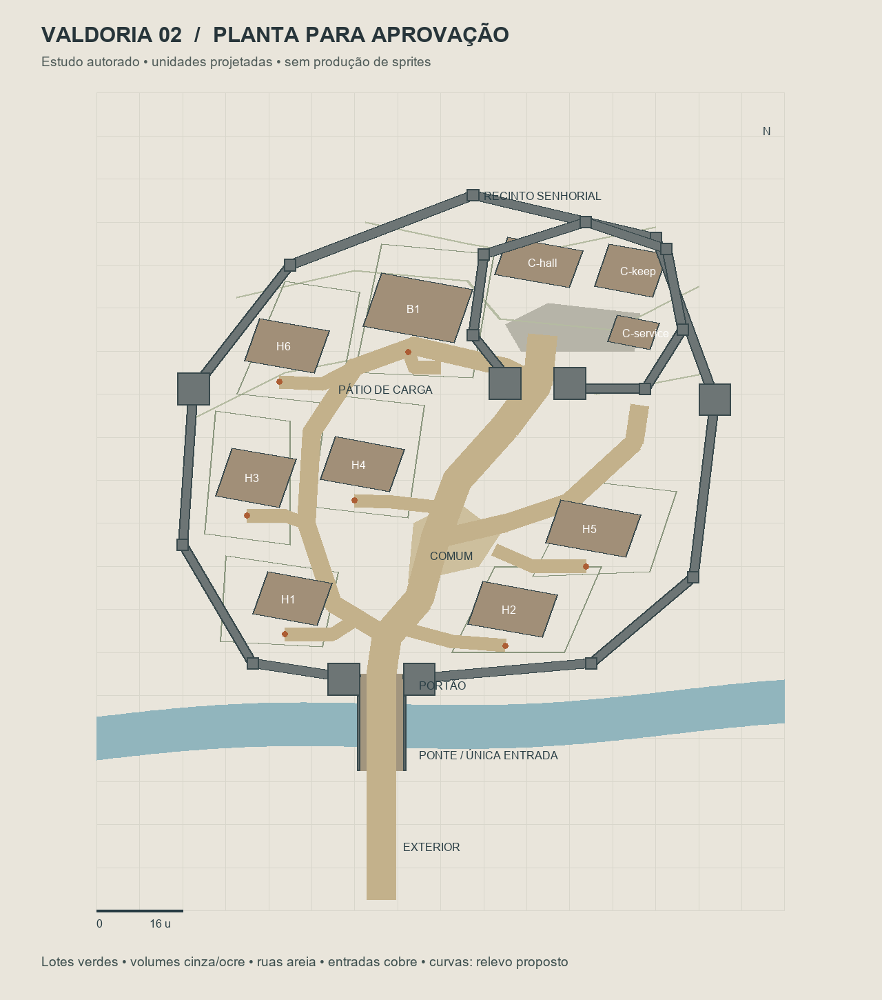
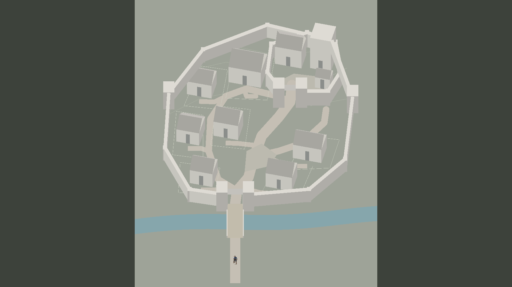
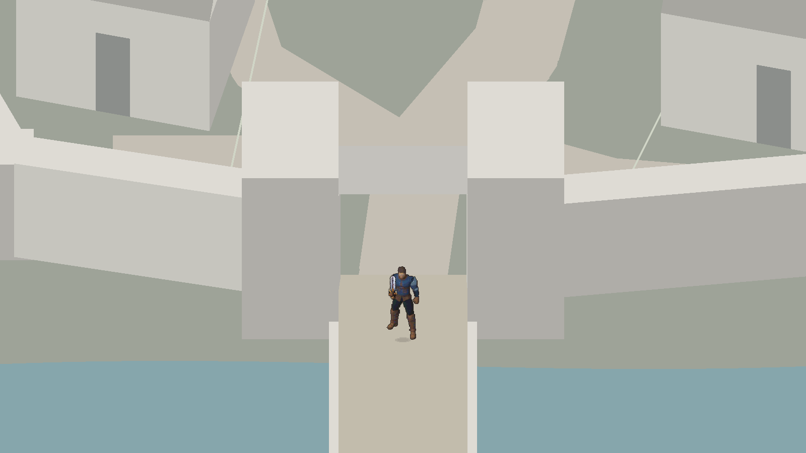
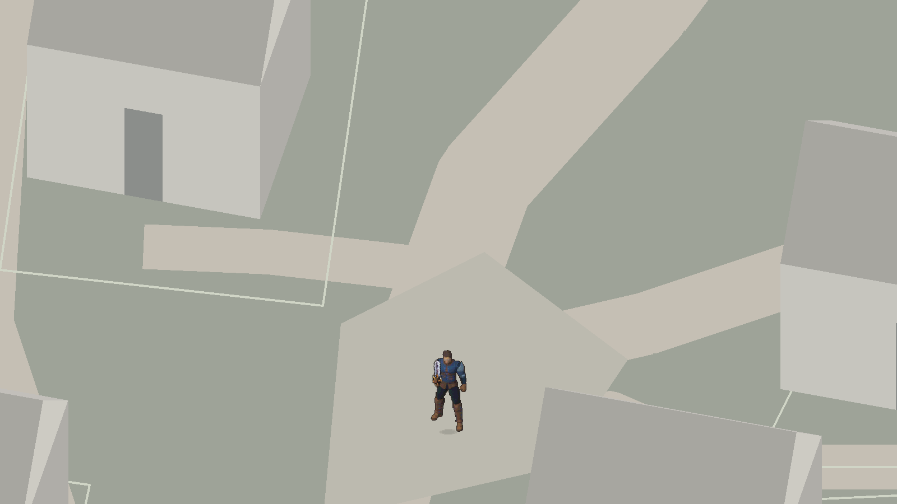
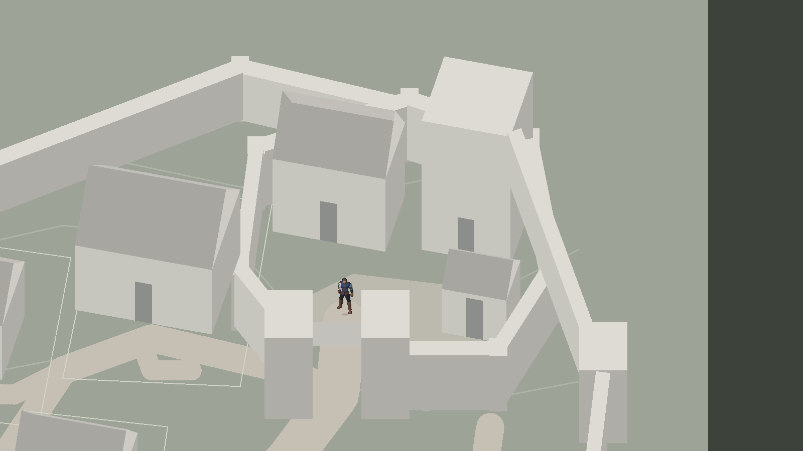

# Valdoria Village02 — pesquisa, planta e blockout para avaliação

Entrega do marco **A–D**, em18–19/10/2026. **Não é a vila definitiva nem uma candidata promovida.** A composição01 foi rejeitada artisticamente pelo usuário. Nenhum sprite final novo foi produzido; as fontes aprovadas Ground11–13R e arquitetura07R/08/09 permanecem intactas.

**Avaliação recebida em19/10/2026:** o usuário respondeu **“parece bom”** à entrega `18ba686aec6aa846edf3c21c01fcf863a5f4bad5`. Registrada como aprovação intermediária da planta e do blockout apresentados, liberando a direção espacial para a próxima etapa. Não aprova sprites finais, encerra pendências técnicas ou promove a cena. [Registro com escopo e hashes](ValdoriaVillage02/QA/layout-blockout-approval.json). As pendências H6/B1, visibilidade e cobertura de contato continuam vigentes; o pedido de avaliação ao final deste relatório fica preservado como histórico do marco.

[Diagnóstico por categoria](ValdoriaVillage02-Diagnosis.md) · [Painel histórico, isekai e jogos de gestão](ValdoriaVillage02-References.md) · [Contrato/reprodução/promoção](../WorldGen/PlayableVillage02BlockoutContract.md) · [Índice de223 capturas](ValdoriaVillage02/Index.md).

## Planta e proposta

Exterior → rio defensivo → ponte → portão de dois corpos → rua com desvio → espaço comum → recinto do senhor ao fundo à direita. Seis moradias, celeiro/pátio de carga e castelo próprio com keep, salão, dependência e pátio. Lotes e rua de serviço distinguem frente pública e fundos de trabalho. Envelope defensivo irregular acompanha o estudo de terreno, sem praça circular centralizada.

A pesquisa adicional solicitada inclui **Axel, E-Rantel, Tempest, Farming Life in Another World e Parnam**, além de **Manor Lords, Foundation e Stronghold**. O painel indica imagens efetivamente abertas, fontes oficiais/comunitárias e indisponibilidades. A comparação favorece hierarquia clara de acessos e bairros dos isekai, funções dos terrenos dos jogos de gestão e continuidade arquitetônica de Stronghold. Não copiamos anéis perfeitos nem plantas/sprites de terceiros. A candidataV1 precede parte dessa ampliação e é apresentada para discussão crítica à luz dela, sem alegar que toda referência já foi incorporada geometricamente.

## Blockout neutro no Editor real

Principais vistas:1600×900, Quaternius1,25, 32PPU de autoria. Gameplay ortho14,0625 (32px de tela/u nessa resolução); visão geral ortho76; castelo ortho28. As primeiras218 capturas usam o Game View original1101×510; as últimas5 usam1600×900. O manifesto registra as condições por imagem. Não comparar esses enquadramentos como pares de escala equivalente. Todos os PNGs em `Original/` são integrais de **Play após `WaitForEndOfFrame`**. Planta e fotos de pesquisa são separadas dessas evidências.

Portas aparentes4,85u servem de régua para o corpo visível do ator (~4,57u). A torre tem16u de altura aparente, salão9u+telhado5u e cortina interna6,8u. São projeções para apresentação2D, não metros nem pisos navegáveis. As curvas indicam topografia **proposta**, ainda sem elevação física/rampas. O cinza avalia massa, não acabamento pixel art.

## Resultado técnico e limites reais

- **Python:**7 testes passaram. Cobrem necessidade da ponte, determinismo sem mutar receita, footprints independentes, atualização conjunta de faces/física, spans sem bloqueio de chão e recusa de casa movida com acesso antigo. Replay do gerador atual reproduziu `layout.json`, navegação e planta **byte a byte**. [Recibo](ValdoriaVillage02/QA/summary.json).
- **Play real:**51.362 frames avançados em193,87s de QA. Percurso contínuo de76,79s, com Input System real/teclado sintético, entrada → comum → pátio senhorial → celeiro → exterior, **sem teleporte no percurso**. Fixtures de contato e de enquadramento usam reposicionamento explícito e estão separadas do trajeto.
- **Contato:**106 fixtures executadas passaram, incluindo faces acessíveis, cantos e esquiva frontal das10 construções e quatro corpos de portão. Cada contato tem PNG antes/depois. **11 aproximações de face não puderam ser armadas com2,2u de afastamento**, devido a água/cortinas/volumes vizinhos. O recibo preserva `allPassed:false`; não foi convertido em aprovação integral. H6 oeste e B1 leste estão apertados e exigem revisão de afastamento; no castelo/portões, várias faces são encontros defensivos intencionais. [Resultado bruto](ValdoriaVillage02/QA/play-qa.json).
- **Geometria:**57 polígonos físicos coincidem com o bake, sem divergências;53 volumes com profundidade própria; um jogador e uma câmera. Ponte necessária também no flood fill da física Unity (.5u, clearance.625). A prova por grade não é prova contínua analítica.
- **Profundidade:**o blockout utiliza casca opaca, sem cutaway01. Atrás de H1 o personagem fica oculto na captura, em vez de aparecer através da fachada. Isso melhora a correspondência exterior, mas **pode ocultar totalmente o ator**. A vista do castelo também mostra coincidência projetada do ator com o topo do portão quando está no pátio; não há acesso físico ao topo, e a ambiguidade de leitura deve entrar na revisão de altura/enquadramento. Não declaramos profundidade visual definitivamente resolvida em toda a futura arte.
- **Compilação/Console:**recompile concluído sem erro C#. Console atual sem erros; o cursor posterior ao baseline39927 registra avisos de APIs obsoletas em arquivos preexistentes. Contadores históricos da sessão não são novos defeitos do blockout. [Console](ValdoriaVillage02/QA/console-since-baseline.json).
- **Encerramento:**Play parado, teclado físico habilitado, sem teclado/probe sintético, timeScale1, resolução original restaurada e cena01 novamente aberta limpa. Nenhuma alteração no Build Settings. [Estado](ValdoriaVillage02/QA/editor-restored.json).

Não houve build standalone ou medição de desempenho de produção nesta etapa. O estudo usa629 meshes separados para inspeção editorial; não é uma arquitetura de batching final. Não há terreno elevado jogável, interior, novo combate, NPC ou monstro.

## Evidências e preservação

223 originais e223 ReviewLite, até21.558bytes cada, sem quantização, redução de dimensões ou dithering. Dimensões, bytes, SHA256, câmera e transformação estão no [manifesto](ValdoriaVillage02/QA/image-manifest.json). [Diagnóstico físico separado](ValdoriaVillage02/ReviewLite/06-physical-diagnostic.png). Os originais não foram sobrescritos. A validação automática de hashes/PNG não substitui inspeção artística.

Cena candidata: `Assets/Mmorpg/Scenes/ValdoriaVillage02Blockout.unity`, isolada e fora do Build Settings. Cena01, `MmorpgWorld`, fontes aprovadas e rollback do commit rejeitado preservados. Nenhum arquivo local preexistente não rastreado foi incluído. Publicação e recuperação remota são registradas separadamente no recibo de acessibilidade após o push.

Publicado inicialmente em `bbaf4de6d4a9a528f4a70eae52fd5cbb7eb451a6`, branch `main`. A visão geral ReviewLite foi recuperada por `github_fetch_file`, `ref:main`, `encoding:base64`, decodificada e aberta integralmente. AssinaturaPNG e SHA256 coincidem com o manifesto. [Recibo da recuperação e inspeção](ValdoriaVillage02/QA/github-accessibility.json). Essa alegação vale somente para essa imagem. Os106 pares de contato também tiveram câmera, dimensões e transformação comparadas: [recibo](ValdoriaVillage02/QA/contact-pair-verification.json). [Integridade do rollback](ValdoriaVillage02/QA/preservation.json): os três arquivos preservam conteúdo e não têm diff Git; cena01/Build Settings diferem do blob Git bruto apenas em finais de linha, e não foram medidos hashes do worktree no início. Portanto não alegamos uma comparação independente de bytes iniciais desses dois arquivos. `MmorpgWorld` coincide também com os bytes do blob. `.gitattributes` protege os novos artefatos assinados contra conversão de finais de linha; hashes da área de stage foram conferidos com o manifesto antes da publicação dessa regra.

## Decisão solicitada neste marco

Atualização19/10: o usuário aprovou o layout/blockout e autorizou a próxima etapa; registro em `e0dcc7d`. A [biblioteca arquitetônica candidata da fase E](ValdoriaVillage02-ArtProduction.md) contém as novas fontes e evidências. A aprovação do layout não aprova automaticamente esses pixels nem promove a cena.

Avaliar **organização de ruas/lotes, escala, entrada e silhueta do castelo**, comparando com o painel ampliado. O estudo ainda pede ajuste dos afastamentos H6/B1 e decisão de visibilidade atrás dos volumes. Conforme a exigência explícita do pedido, **a produção completa de sprites/texturas aguarda sua avaliação do layout/blockout**. Não houve aprovação artística automática nem promoção.
