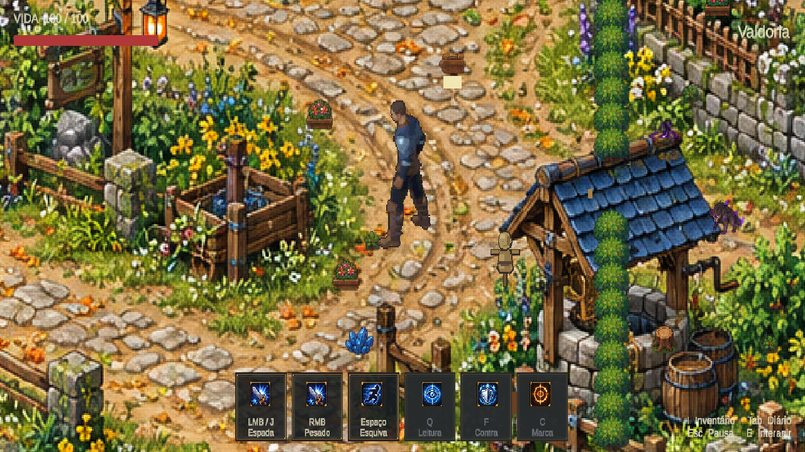

# Proporção pelo poço — NPCs temporariamente ocultos

17/10/2026. O usuário considerou o jogador pequeno após ampliar o mapa. Usando como referência visual a borda e a cobertura do poço, a escala do grupo visual passou de 0.75 para 1.25, aumento de aproximadamente 67%. Corpo, espada e dedos compartilham a escala. O mapa continua 1.74 e a câmera 7.03125; os desenhos/fontes não mudaram. A proporção aguarda avaliação artística do usuário.

NPCs temporariamente desativados, sem apagar assets nem dados pessoais: 17 nós de sprites Healer/Hunter/Smith/Scholar e 10 objetos/etiquetas com nomes Mira, Orin, Helena, Brann, Dorin e Nera. A inatividade é serializada apenas na cena oficial; a reativação dos mesmos objetos restaura a apresentação. Enquanto ocultos, suas interações ficam indisponíveis; não foi implementada migração/reset de missões. O alvo de treino e os inimigos não são NPCs de conversa e permanecem.

Ferramenta: `AgentScripts/CalibratePlayerToWellR10.cs`, métodos `Apply` e `Audit`. QA real na Unity 6000.6.5f1: autotick ativo, recompile/status up_to_date; início em MmorpgWorld com perfil temporário isolado, input de caminhada (0.708 unidades), walk → idle e avanço de frames. Audit em Play confirmou zero sprites de NPC ativos, corpo 1.25, raiz física 1, mapa 1.74 e câmera 7.03125. Console atual sem erros/avisos, sem falha de compilação. Play encerrado e configurações temporárias restauradas. Não houve regressão completa de combate; a origem LegacyGrip continua ligada à mão visual.

