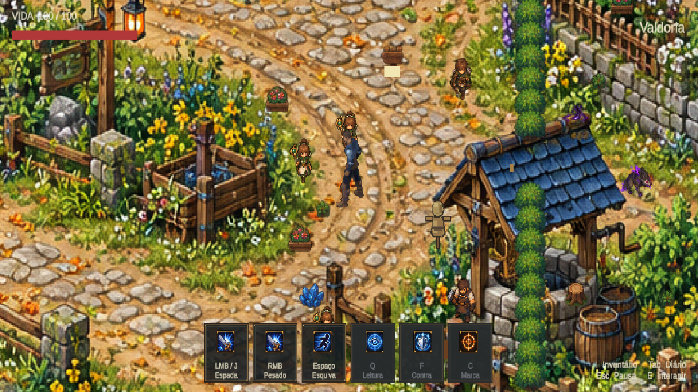

# Valdoria — mapa ampliado e câmera afastada

17/10/2026. A pedido do usuário, o backdrop de Valdoria passou de escala 0.58 para 1.74: três vezes as dimensões lineares, nove vezes a área, aproximadamente 83.52 × 43.50 unidades. O ponto inicial do jogador foi alinhado ao caminho ilustrado por deslocamento do backdrop, sem teleportar o ator. A escala visual do protagonista permanece em 0.75; a raiz física continua em 1.

A câmera ortográfica passou de 5.625 para 7.03125 de meia-altura: campo vertical 25% maior. O viewport ocupa a tela inteira. A configuração de zoom inteiro e o AdaptivePixelViewport foram desabilitados apenas nesta câmera para permitir esse afastamento intermediário. Texturas continuam Point; este enquadramento não garante ampliação inteira dos pixels. FullFrameCameraPresentation restaura o viewport e as matrizes no início do jogo para evitar a moldura persistente do enquadramento anterior.

Autoria repetível: `AgentScripts/ScaleValdoriaWorldR10.cs`, entradas `Apply` e `Audit`, via Unity CLI Pipeline. Não recria a cena nem os desenhos. Outros cenários mantêm suas configurações.

QA real no Editor 6000.6.5f1: recompilação concluída, autotick ativo; perfil temporário isolado configurado antes do Play; caminhada com input D e deslocamento de 0.708 unidades, transição walk → idle, frames avançando. Audit em Play confirmou mapa 1.74, corpo 0.75, raiz 1, câmera 7.03125 e viewport (0,0,1,1). Console atual sem erros ou avisos e sem falha de compilação; histórico do Pipeline contém tentativas anteriores. Play encerrado, dispositivos e configurações temporárias restaurados.

Limite: o mapa continua uma imagem de fundo. Sua ampliação não reconstrói colisões, oclusão individual de árvores/casas, posições de NPCs ou destinos de interação. Esses elementos conservam o mundo lógico anterior e precisam de alinhamento em uma etapa de construção de nível; esta revisão valida enquadramento e proporção visual, não uma remodelagem física completa.
