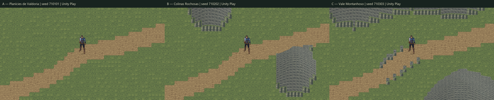

# Valdoria World Studio — Marco 01

Data: 17/10/2026. Projeto `D:\unity\Mmorpg`, Unity **6000.6.5f1**, branch **main**. Primeiro laboratório procedural integrado; **arte experimental aguardando avaliação do usuário**. A cena oficial e os sprites/animações do Quaternius não foram alterados.

## Evidência visual entregue



Capturas reais da Game View, 1280×720, obtidas por `capture_game_view --source screen` após frames avançados. Mesmo ponto de comparação `(33.5,23.5)`, câmera ortográfica 11.25, Quaternius R8 com escala visual 1.25. A imagem comparativa apenas dispõe as três capturas lado a lado; não substitui o render do jogo. Metadados e hashes individuais: `A-capture.json`, `B-capture.json`, `C-capture.json` na pasta de evidências.

| Alternativa | Seed | Receita | Captura | Circulação / bloqueio |
|---|---:|---|---|---|
| A — Planícies de Valdoria | 710101 | [A](../../ArtSource/Labs/World2026/WorldGen/Recipes/valdoria-studio01-A.json) | [Game View A](ValdoriaWorldStudio01/A-gameview.png) | 3.072 livres, zero bloqueadas; um componente |
| B — Colinas Rochosas | 710202 | [B](../../ArtSource/Labs/World2026/WorldGen/Recipes/valdoria-studio01-B.json) | [Game View B](ValdoriaWorldStudio01/B-gameview.png) | 2.804 livres, 268 bloqueadas; um componente |
| C — Vale Montanhoso | 710303 | [C](../../ArtSource/Labs/World2026/WorldGen/Recipes/valdoria-studio01-C.json) | [Game View C](ValdoriaWorldStudio01/C-gameview.png) | 1.910 livres, 1.162 bloqueadas; componentes de 1.885 e 25 células |

Cada região mede **64×48 células de 1 unidade**. As três compartilham uma rota de 283 células, seis waypoints e meia largura de 2,2 células, além de plataforma reservada 10×9. C possui uma pequena ilha de circulação fora do componente principal; a rota principal está no componente maior e foi atravessada integralmente. Não certificar conectividade global de todas as áreas livres de C.

A é a referência de leitura do piso e caminho aberto. B acrescenta afloramentos com relevo visual. C enquadra a rota com massas rochosas maiores. As capturas `A-first.png`, `B-first.png` e `B-relief.png` registram as etapas anteriores da iteração, claramente separadas das imagens finais.

## Implementação

- Especialista principal: `.agents/skills/terrain-generation/SKILL.md`; arte: `.agents/skills/aseprite-pixel-art/SKILL.md`; Unity por CLI com `--caller plugin --skill unity-pipeline`. Nenhum subagente foi executado.
- `Tools/ArtPipeline/WorldGen/terrain_agent.py`, versão **terrain-agent/1.1.0**: altura, inclinação, ruído coerente, morros/vales/platôs, reservas, patches, erosão térmica simplificada e componentes navegáveis.
- `Tools/ArtPipeline/WorldGen/studio01.py`: receitas A/B/C, atlas de materiais, editáveis Aseprite, índices de tiles, manifest de apresentação e verificação byte a byte.
- `Assets/Mmorpg/Editor/TerrainStudioImporter.cs`: leitura semântica, validação de hashes/schema, Tilemap, colisões e importação de revisões em prefabs novos.
- `Assets/Mmorpg/Editor/TerrainReliefBuilder.cs`: relevo visual em quads **2D, Z=0**, com cantos compartilhados entre células. Não converte o projeto para 3D.
- `TerrainRegionData` conserva o JSON; `TerrainLabController` alterna dados/raízes já gravados. Nenhuma geração em Play.

Cena: **`Assets/Mmorpg/Scenes/ValdoriaTerrainLab.unity`**. Abrir, entrar em Play e usar **1 / 2 / 3** para A/B/C; WASD e diagonal usam o PlayerController e ActorMotor reais. Há um Player, uma câmera e uma autoridade offline. Não há HUD nem sessão persistente neste estudo. Combate completo não foi validado aqui; o ActionCombat dependente da sessão/HUD foi desabilitado no laboratório.

Superfícies ficam em Tilemap; `elevationMilli` e navegação no TextAsset; colisões em BoxCollider2D de runs horizontais exatos de `blocked`; limites de região separados; relevo e faces em malhas por linha, ordenadas pela âncora de chão. O personagem usa o conjunto Quaternius de produção e a correção existente de apresentação dos pés, sem regenerar animações.

## Materiais e autoria

[Fontes e atlas](../../ArtSource/Labs/World2026/WorldStudio01/Materials/): `materials-v1.aseprite`, `cliffs-v1.aseprite`, `surfaces.png`, `cliffs.png`, `materials.json`, `assemble.lua`.

São **140 tiles de 32×32**, quatro variantes por família/máscara, atlas 512×288; quatro faces de 32×64 em atlas 128×64. Estudos de grama, terra compactada, caminho, pedra, encosta e transições de grama/terra e grama/rocha. Luz superior esquerda, paletas limitadas e clusters desenhados por receitas Python; Aseprite **1.3.18.6** criou os documentos RGBA com camadas editáveis. Não houve geração de imagem por IA nem downloads de arte. Autoria original do projeto registrada em `materials.json`; Quaternius reutiliza os assets/proveniência já existentes.

Importação: **32 PPU, Point, RGBA, sem mipmaps nem compressão**. Pivô de superfície `(0.5,0.5)`; fonte de face `(0.5,0)`. A malha usa recortes internos do atlas de face. Na captura 720p, a câmera 11.25 fornece 32 pixels por unidade ao terreno; a escala candidata do protagonista continua 1.25, portanto não se promete grade inteira para todos os pixels dele.

Avaliação visual deste marco: o pipeline já produz piso modular e relevo derivado dos dados, mas **a repetição de texturas, o contorno em degraus e a leitura de rocha ainda precisam de refinamento artístico**. Não classificar o resultado como arte final profissional aprovada. A usa altura principalmente nos dados; pequenas elevações caminháveis não têm deslocamento visual de chão. B/C projetam relevo nas áreas bloqueadas. Faltam referências locais de poço/porta/cerca/árvore para concluir a calibração artística de escala; o Quaternius foi a referência presente em Play.

## Erosão e bordas

Erosão térmica simplificada: oito iterações, talus 0.045 normalizado. Cada aresta cardinal transfere 12,5% do excesso de diferença de altura, acumulando deltas simultâneos. Conserva soma de altura em células livres e respeita reservas. Não modela chuva, rios, sedimentos transportados ou geologia calibrada. O ruído estabelece variação de base; features amplas e reservas definem a composição.

Brushes de altura têm suporte circular finito; a erosão posterior tem halo de dependência de até uma célula por iteração. Bordas homogêneas entre variantes usam pixels comuns; a malha compartilha a função de altura nos vértices, evitando fendas geométricas. As 16 máscaras cardinais ainda não resolvem todos os cantos diagonais/encontros de três materiais. Continuidade entre chunks independentes e streaming não foram implementados.

## Regeneração controlada

Menu **Valdoria → World Studio**:

1. **Build Terrain Lab** cria somente destinos ausentes. No checkout entregue, recusa recriar a cena/arte existentes.
2. **Regenerate recipe to NEW output** lê uma receita e gera uma nova revisão sem alterar a região atual.
3. **Import revision as NEW prefab** valida manifest e cria prefab, JSON e malhas em destinos novos. Instanciar/selecionar a revisão no laboratório é uma ação explícita de autoria.

Equivalente por terminal, incluindo patch opcional:

```powershell
python Tools/ArtPipeline/WorldGen/studio01.py generate --recipe ArtSource/Labs/World2026/WorldGen/Recipes/valdoria-studio01-B.json --patch ArtSource/Labs/World2026/WorldGen/Recipes/valdoria-highlands-edit.example.json --output ArtSource/Labs/World2026/WorldStudio01/B-revision-02
python Tools/ArtPipeline/WorldGen/studio01.py verify --output ArtSource/Labs/World2026/WorldStudio01/Regions
python -m unittest discover -s Tools/ArtPipeline/WorldGen -p 'test_*.py' -v
```

A prova com patch foi gerada em `Temp/WorldStudio01/EditorRecipePatchProof` e importada realmente como `Assets/Mmorpg/Art/Experimental/ValdoriaTerrainStudio01/RevisionProof/PatchedRegion.prefab`. O prefab/JSON/malhas estão versionados; o manifest da prova está nas evidências. Uma segunda importação no mesmo destino foi recusada. A UI usa o mesmo endpoint `TerrainStudioImporter.ImportGeneratedRegion` exercitado por CLI. Diálogos de seleção de arquivos não foram automatizados.

## QA executado

- **13 testes Python aprovados**: contrato, seed, tamper de manifest, recusa de destino existente, reservas, conservação/relaxação térmica, patch compacto, bordas de variantes e clearance da rota. O `valid:false` no log do teste de tamper é o resultado esperado da adulteração deliberada, não uma falha da suíte.
- **A/B/C reproduzidos byte a byte**, incluindo PNGs diagnósticos, JSONs e manifests.
- Aseprite `locate`, `validate` e inspeção das duas fontes: executados. Fontes antigas preservadas.
- Compilação final Unity: `completed`, `failed:false`, sem erros.
- **15 checagens em Play real aprovadas**, **21.660 frames avançados**: WASD, diagonal, três rotas completas, contato nas encostas B/C, limite da região, âncora dos pés, sorting do ator e câmera. Input System recebeu eventos reais de teclado sintético; waypoints guiaram intenções, sem teleportar durante a travessia. Teleportes foram usados somente para posicionamento inicial dos fixtures.
- Contato B/C: distância medida **−0.005004883**, dentro de duas vezes `Physics2D.defaultContactOffset`, sem atravessar a face. A primeira asserção exigia penetração zero e falhou; foi corrigida para a tolerância do solver e repetida, preservando os dois relatórios.
- O teste de pés mede a âncora da sombra (erro ≤3,82e−6 unidade) e registra offset visual ~0,5625 e escala 1.25. A avaliação anatômica/artística dos pixels dos pés continua visual; esse teste não a substitui.
- Sorting automático confere a ordem do grupo do ator. O relevo usa profundidade por linha; oclusão por silhueta e todas as posições de contorno ainda não têm uma prova exaustiva.
- Console: houve erro de compilação do importador corrigido e referências temporárias nulas durante uma recompilação em Play na iteração. O Play foi reiniciado. **Após o cursor 39207 não houve erros novos na sessão final**; não confundir o contador histórico do ring buffer com erros atuais. A checagem final do Editor também estava sem falha de compilação.
- Finalização: Play parado, override do perfil `null`, zero teclados `TerrainStudioQA`, timeScale 1, runInBackground e autotick conservados no estado anterior. Capturas temporárias e `.meta` em `Assets/TerrainStudio01` removidos depois de copiadas. Cena oficial, Build Settings, saves e trabalho alheio preservados.

Evidências: [Play final e traces](ValdoriaWorldStudio01/Verified/play-qa.json), [primeira rodada](ValdoriaWorldStudio01/play-qa.json), [Editor e recusa de sobrescrita](ValdoriaWorldStudio01/editor-qa.json), [Python/Aseprite](ValdoriaWorldStudio01/python-aseprite-qa.json), [manifest do patch](ValdoriaWorldStudio01/patch-proof-manifest.json).

## Limites e expansão

Não há hidrologia, escalada, movimento vertical do ator, terreno novo a cada Play, agentes futuros completos ou promoção ao mundo oficial. Montanhas são relevo visual 2D de áreas bloqueadas; **não são fisicamente escaláveis**. Não foi executada suíte longa, backend ou build standalone.

O [contrato WorldRegion](../WorldGen/WorldRegionContract.md) especifica unidades, reservas, outputs, navegação, projeção, sorting e handoffs de **Water, Material, Climate, Architecture, Vegetation e Structures Agents**. Cada especialista deve produzir artefatos próprios vinculados por hash e pedir revisão do Terrain Agent para mudanças na topografia.

O resultado prova a integração procedural e a capacidade de regenerar/importar revisões. Qualidade artística final, proporção com elementos arquitetônicos e promoção ao mundo oficial continuam pendentes da avaliação do usuário.
