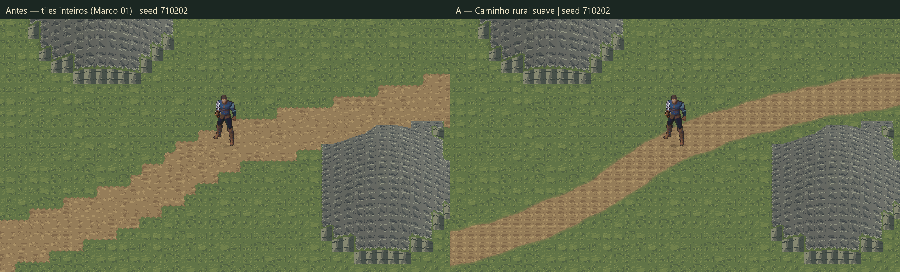
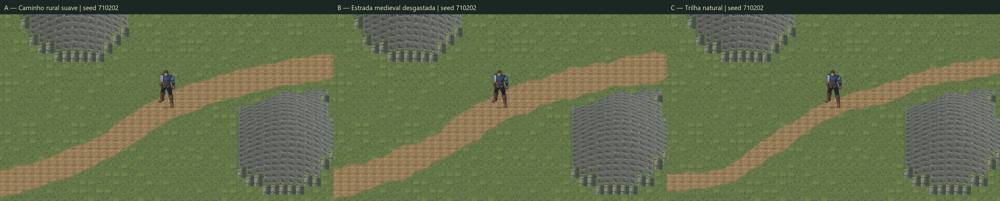
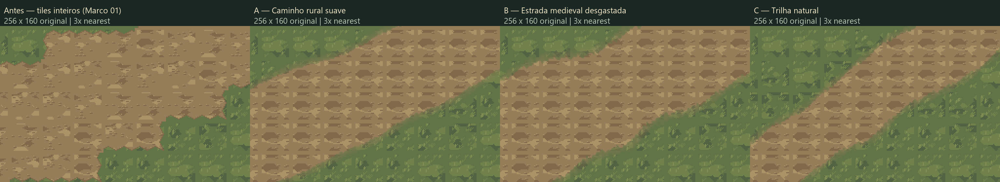

# Valdoria World Studio 02 — Organic Roads

17/10/2026 · Unity **6000.6.5f1** · `D:\unity\Mmorpg` · `main`.
Baseline: `047729445e8b9021972f6091e7dbc20f75ace0a0` (World Studio 01).

**Feedback do usuário:** “parece que ficou bem boa as estradas”. Avaliação positiva registrada para o estudo de estradas. Materiais finais, integração ao mundo oficial e Marco 03 continuam fora desta entrega.

## Resultado visual







As imagens finais são capturas reais da Game View em Play, com resolução de render **1280×720**, câmera ortográfica **11,25**, posição do jogador `(33.5,23.5)`, Quaternius R8 em **1,25**, terreno B do Marco 01 e seed base **710202**. A resolução de saída corresponde à resolução real de render, sem redimensionamento da captura. O terreno tem 32 pixels por unidade nessa condição; a escala 1,25 do protagonista permanece candidata e não implica uma grade inteira para todos os seus pixels.

As pranchas só dispõem capturas lado a lado. Recortes 256×160 sem ampliação estão em `Final/*-edge-native.png`; a prancha amplia esses mesmos pixels 3× por nearest. Metadados: [capture-metadata.json](ValdoriaWorldStudio02/Final/capture-metadata.json), [comparison-proof.json](ValdoriaWorldStudio02/Final/comparison-proof.json).

Quaternius caminhando, capturado ao final do frame durante o percurso real: [A](ValdoriaWorldStudio02/Final/Verified/A-walking.png), [B](ValdoriaWorldStudio02/Final/Verified/B-walking.png), [C](ValdoriaWorldStudio02/Final/Verified/C-walking.png). Os três arquivos também medem 1280×720.

## Onde estava o problema

1. `terrain_agent.py` reservava células inteiras com distância a segmentos retos, classificando a rota como dirt. Isso fornece um corredor lógico, mas não um contorno visual contínuo.
2. `studio01.py::decorate` convertia cada célula em um índice grass/dirt. A escolha era integral por célula.
3. As 16 máscaras cardinais recortavam as bordas dos tiles; curvas e diagonais ainda denunciavam a grade. A textura, sozinha, não corrigiria essa geometria.

O Marco 02 mantém a topografia do baseline imutável e retira a estrada antiga apenas da apresentação do piso no novo laboratório. A estrada passa a ter eixo, largura e máscaras próprios. Não foram alterados `terrain_agent.py`, `studio01.py`, as receitas do Marco 01, seus assets, o protagonista ou `MmorpgWorld.unity`.

## Alternativas

Todas usam exatamente o mesmo WorldRegion de entrada (64×48, célula 1), cujo SHA-256 é:

`cf43e4d5e6a2834d300b851b2f11e3a66bb6701b727432ebc72cec95c1bc5eb1`.

| Estilo | Largura visual observada | Mínimo navegável pedido / observado | Comprimento | Característica |
|---|---:|---:|---:|---|
| A — Rural suave | 2,797–3,283 u | 2,0 / 2,517 u | 60,997 u | Margem discreta, variação gradual e leitura aberta |
| B — Medieval desgastada | 2,893–4,028 u | 2,2 / 2,393 u | 60,997 u | Mais variação de largura e irregularidade lateral |
| C — Trilha natural | 1,800–2,321 u | 1,4 / 1,400 u | 61,290 u | Corredor estreito e dois guias adicionais pelo vale |

A/B compartilham o eixo. C preserva os seis pontos obrigatórios e acrescenta `(20.5,32.7)` e `(39.5,22.9)` no corredor de baixo relevo existente. Sua curvatura máxima amostrada é 0,142660 u⁻¹ contra 0,067906 u⁻¹ em A/B; isso é um diagnóstico geométrico, não uma nota de beleza. Não há zigue-zague aleatório no eixo.

O acesso perto do afloramento usa o ponto obrigatório explicitamente autorado `(44.5,21.0)`: o ponto histórico mais ao sul não oferecia folga suficiente para a margem da alternativa larga. A receita tornou a escolha verificável; o terreno não foi aplanado nem modificado para obter passagem.

**Recomendação técnica: A**, como base geral para o futuro trabalho de materiais. Tem largura moderada e margens mais calmas. B serve como direção para acessos mais usados; C para trilhas secundárias. A avaliação positiva do usuário foi sobre as estradas apresentadas, sem uma seleção explícita de uma alternativa única.

## Arquitetura

Gerador especializado: `Tools/ArtPipeline/WorldGen/organic_roads.py`, versão **organic-roads/1.0.0**.

- A* em oito vizinhos usa distância, altura e inclinação, com clearance e sem cortar cantos de obstáculos. Reservas de acesso são preservadas; exclusões protegidas são explícitas.
- Guias são simplificados por visibilidade/custo e interpolados com **Catmull–Rom centrípeta**. A parametrização foi escolhida com base em [Yuksel, Schaefer e Keyser](https://www.cemyuksel.com/research/catmullrom_param/). Essa propriedade local da curva não substitui a validação de obstáculos; o gerador faz a checagem separadamente.
- Amostragem fina e reamostragem por distância, com espaçamento máximo de **0,125 u**. Curvatura é verificada também nas junções.
- Largura varia suavemente por distância local/seed, limitada por clearance, mínimo/máximo e taxa de variação. A transição entre segmentos recebe limitação de derivada novamente.
- Distância ao eixo e irregularidade espacial de baixa amplitude produzem máscaras em **32 PPU**, com cobertura parcial de células. O núcleo navegável mantém cobertura 255.
- A máscara física/lógica, cobertura, ombros e desgaste são dados diferentes. Nenhuma margem visual gera collider.
- Um percurso impossível, curva que saia do corredor ou falta de largura retorna erro de autoria, antes de criar uma saída. Água/candidatos a água são excluídos conservadoramente; uma travessia explicitamente autorizada não cria ponte nem remove obstáculo sólido.

A topografia permanece v1. `world-region-linked.json` é um envelope **WorldRegion v2** com `terrainRef` e `roadRefs` por hash; não copia os arrays de altura. O [contrato completo](../WorldGen/OrganicRoadsContract.md) documenta unidades, samples, segmentos, largura, máscaras, edição e handoff para Material Agent.

## Receitas, edição e regeneração

Fontes finais: [RoadsR3](../../ArtSource/Labs/World2026/WorldStudio02/RoadsR3/), com `recipe-A.json`, `recipe-B.json`, `recipe-C.json` e `patch-local-example.json`. Cada subpasta A/B/C contém road.json, quatro máscaras, overlay de estudo, envelope v2 e manifest.

```powershell
python Tools/ArtPipeline/WorldGen/organic_roads.py generate --recipe ArtSource/Labs/World2026/WorldStudio02/RoadsR3/recipe-A.json --output Temp/WorldStudio02/Rural-new
python Tools/ArtPipeline/WorldGen/organic_roads.py generate --recipe ArtSource/Labs/World2026/WorldStudio02/RoadsR3/recipe-B.json --patch ArtSource/Labs/World2026/WorldStudio02/RoadsR3/patch-local-example.json --output Temp/WorldStudio02/Edited-new
python Tools/ArtPipeline/WorldGen/organic_roads.py verify --recipe ArtSource/Labs/World2026/WorldStudio02/RoadsR3/recipe-A.json --output ArtSource/Labs/World2026/WorldStudio02/RoadsR3/A
python -m unittest discover -s Tools/ArtPipeline/WorldGen -p 'test_*.py' -v
```

Sem `--region`, o input é o WorldRegion B usado neste estudo. O CLI aceita outro WorldRegion compatível. Destinos devem ser inexistentes; resultados anteriores não foram apagados para passar testes. Rascunhos iniciais ficaram preservados em `Temp/WorldStudio02/Draft-*` e não são versionados.

O patch edita pontos interiores por índice. Sua localidade é por spans: tangentes vizinhas e transições de largura também dependem do ponto alterado. Não é um brush com raio espacial fixo. O teste verifica que as amostras distantes conservam sua fase; o contrato explicita o halo. A geração e verificação do exemplo foram executadas, com [manifest do patch](ValdoriaWorldStudio02/Final/local-patch-manifest.json).

Recortes adjacentes usam a mesma estrada global e origem de amostragem. O teste junta dois recortes e compara todos os pixels ao raster integral. Isso não promete que gerações independentes em chunks, sem compartilhar a estrada global, emendarão automaticamente.

## Unity e apresentação

Cena: **`Assets/Mmorpg/Scenes/ValdoriaOrganicRoadsLab.unity`**. Em Play: **0=Antes, 1=A, 2=B, 3=C**; WASD e diagonais usam o PlayerController/ActorMotor reais.

`OrganicRoadStudioImporter` verifica manifests e cria uma cópia nova do laboratório. Há um único terreno B, TerrainRegionData, colisões e relevo originais; dois Tilemaps alternam piso antigo/piso sem estrada. Só **três GameObjects de overlay**, um por alternativa, usam material compartilhado. Um overlay fica ativo por vez. Não há objeto por detalhe, geração em Play ou collider de estrada.

Importação: Point, 32 PPU, RGBA, mipmaps/compressão desligados, order -1990 entre chão (-2000) e ator/relevo. As texturas de overlay 2048×1536 contêm somente estrada/transparência, não um cenário pronto. O atlas de terra existente do Marco 01 foi reutilizado para visualizar máscaras; o Marco 03 não foi implementado.

Menu `Valdoria/World Studio/04` cria o laboratório apenas em destinos ausentes; `05` gera uma receita de estrada para diretório novo. O refinamento de C foi importado como revisão em pasta nova, preservando as demais alternativas. Assets C intermediários sem consumidores foram removidos após busca por GUID em cenas/prefabs/assets. A recusa do destino existente foi executada a partir da cena de origem correta.

## QA e evidências

**31 testes Python aprovados**: 18 de estradas + 13 do baseline. Incluem seed, repetição, waypoints/tangentes, largura/taxa, conectividade, coerência das máscaras, diagonal longa, edição local, células proibidas, inclinação, água/travessia explícita, áreas protegidas, desvio de morro, parede sem passagem, chunks, manifests e recusa de sobrescrita. O teste de diagonal conta offsets subcélula para detectar travamento na grade; não pretende medir qualidade artística.

A/B/C foram reconstruídos e comparados byte a byte. Os hashes dos materiais reutilizados e da região de entrada também foram verificados. [Log Python e manifests](ValdoriaWorldStudio02/Final/python-qa.json).

**Rodada final Unity: 23 checagens aprovadas**, mais três pedidos de captura confirmados por arquivos reais. Foram **21.359 frames em 68,50 s**:

- WASD e diagonal, 124 alvos no percurso A, 124 em B e 125 em C, seguindo curvas por eventos de teclado do Input System; sem teleporte durante travessia.
- Passagem pelos mínimos de largura e travessia das duas margens em cada estilo, sem barreira visual convertida em física.
- Cantos do collider dos pés comparados ao corredor em amostras de ~12,5 Hz. A pior folga observada foi aproximadamente **0,203 u** em C; não é uma certificação de todos os extremos entre amostras.
- Âncora da sombra no chão, sorting do grupo, escala 1,25, câmera 1280×720/11,25 e um único terreno.
- Capturas de caminhada com estado `walk`, produzidas no fim de frame e inspecionadas. A checagem da sombra não substitui aprovação anatômica dos pixels dos pés.

[Resumo](ValdoriaWorldStudio02/Final/qa-summary.json), [trace/QA final](ValdoriaWorldStudio02/Final/Verified/play-qa.json), [Editor e restauração](ValdoriaWorldStudio02/Final/editor-qa.json).

As tentativas anteriores estão em `Iterations/`. Inicialmente a ferramenta redimensionava o render 1101×510 para 1280×720; essas imagens ficaram identificadas como `ScaledReference`, sem alegação de escala nativa. A rodada nativa inicial também registrou uma fuga de A do corredor. Outra tentativa deixou o ator parado quando o input dependia do foco.

Um [probe curto](ValdoriaWorldStudio02/Final/input-probe.json) confirmou movimento real sem foco com `AllDeviceInputAlwaysGoesToGameView`. O fixture final usa essa opção temporária, eventos apenas em Dynamic Update e teclado sintético isolado; a rodada final passou. As falhas anteriores não foram convertidas em aprovações nem escondidas.

Console: nenhuma nova entrada de erro desde o cursor inicial **39236**; último cursor observado **39265**. O contador histórico inclui sessões anteriores e não indica erros novos deste marco. Compilação final sem falhas. Não foi iniciada suíte longa, backend ou build standalone.

Ao terminar: Play parado, teclado sintético removido, dispositivos originais reabilitados, background/input de Editor restaurados, `timeScale=1`, perfil override `null`; tamanho temporário da Game View removido e seleção anterior restaurada. Capturas temporárias e `.meta` em Assets foram limpos após copiar evidências.

A skill `terrain-generation` foi atualizada com estes recursos e limites. Sua estrutura, frontmatter simples, fences e links foram validados por stdlib; o `quick_validate.py` não pôde executar porque PyYAML não está disponível nos Pythons locais. Nenhuma dependência global foi instalada para essa validação.

## Problemas ainda visíveis e próxima etapa

O contorno deixou de seguir tiles inteiros, mas os pixels individuais continuam visíveis, como esperado em Point. As texturas de terra/grama ainda repetem; largura, ombros e wear fornecem sinais para tratamento artístico futuro, não um sistema completo de materiais. As extremidades abertas têm caps arredondados; entroncamentos, pontes e redes de múltiplas estradas não foram implementados.

O laboratório mantém o relevo visual e o sorting por linha do Marco 01, com suas limitações de silhueta. Montanhas continuam bloqueadas, não escaláveis. Novos rios, vegetação física e objetos deverão revalidar clearance e travessias; não foram adicionados neste marco.

O Material Agent deverá consumir os masks/hashes existentes, sem reconstruir o eixo ou a largura. A recomendação é usar A como ponto de partida visual e conservar B/C como estilos de estrada. O feedback positivo do usuário sustenta o avanço desta geometria; a cena oficial continua preservada conforme o escopo solicitado.
