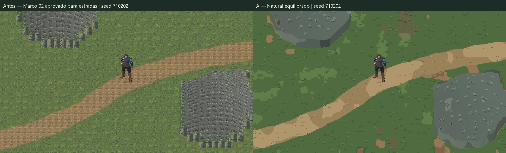
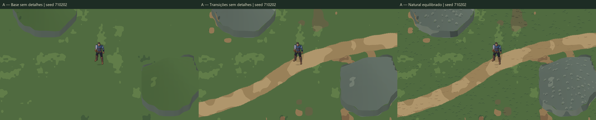
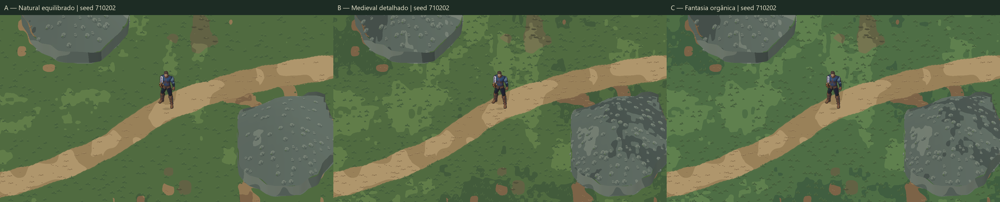
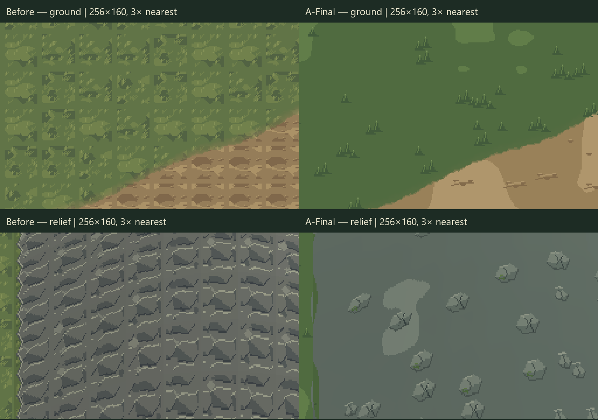
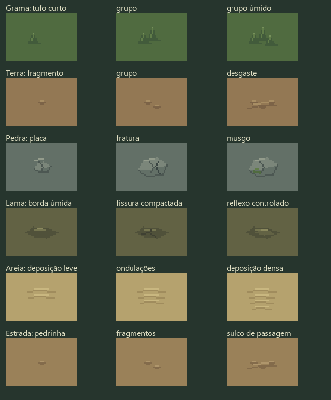

# Valdoria World Studio 03 — Organic Materials

17/10/2026 · Unity **6000.6.5f1** · `D:\unity\Mmorpg` · branch `main`.
Baseline real do Marco 02: **`f5b616341c027cf9412fe0d58485f0e4241e850e`**. Worktree conferido e `git pull --ff-only origin main` executado antes da autoria: já atualizado. Arquivos locais não relacionados foram preservados.

**Estado:** implementação e QA entregues como candidato visual. A aprovação das estradas do Marco 02 foi preservada. **Os materiais novos não receberam aprovação artística e não foram promovidos ao mundo oficial.**

## Comparação principal







Todas são capturas reais da Game View em Play, **1280×720**, sem redimensionamento. Câmera ortográfica **11,25**, posição `(33.5,23.5,-10)`; Quaternius em `(33.5,23.5)`, escala visual **1,25**, orientação sul; seed **710202**. A câmera foi mantida fixa somente para essas comparações e restaurada para seguir o ator no teste de movimento. [Metadados](ValdoriaWorldStudio03/Final/capture-metadata.json) e [prova de comparação](ValdoriaWorldStudio03/Final/comparison-proof.json).

[A — câmera em movimento](ValdoriaWorldStudio03/Final/A-camera-motion.gif) · [B](ValdoriaWorldStudio03/Final/B-camera-motion.gif) · [C](ValdoriaWorldStudio03/Final/C-camera-motion.gif). GIFs têm paleta global de 256 cores e aproximadamente 10 fps; os **90 PNGs originais 1280×720** estão em `Final/PlayQA/Motion/`, acompanhados de frames e posições da câmera no trace. Não são vídeos simulados por deslocamento de uma imagem pronta.

## Diagnóstico antes dos materiais

[Registro inicial](ValdoriaWorldStudio03/initial-grid-diagnosis.json), [tile original ampliado](ValdoriaWorldStudio03/original-tile-border-8x.png) e [teste de repetição lado a lado](ValdoriaWorldStudio03/repetition-stress-comparison.png).

| Causa encontrada | Camada responsável | Correção |
|---|---|---|
| Borda lisa comum de dois pixels em todos os tiles de 32 px | `studio01.py::tile` | Novo pigmento amostrado em coordenadas globais, sem moldura por módulo |
| Poucas variantes e repetição curta de grupos | Seleção/composição | Campos multiescala e candidatos espaciais com contexto, jitter e distância mínima |
| Material integral por célula e transições cardinais | `decorate/transition` | Campos semânticos interpolados, cobertura subcélula, diagonais e junções de materiais |
| UV reiniciado e iluminação plana por célula; contorno de bloco | `TerrainReliefBuilder` | UV global, contorno por isocurva a .25 u, altura/iluminação por vértice e faces contínuas |

A apresentação antiga permanece disponível apenas como referência **Antes**. A correção do relevo pertence à apresentação geométrica: não foi disfarçada por grama ou decals. A base e as transições podem ser vistas sem nenhum stamp sobreposto. Não foi aplicado blur bilinear às texturas.

**Avaliação do grid:** não identifiquei uma grade regular clara de 32×32 nos pixels nativos da base, transições, final e frames móveis examinados. Isso é observação do agente, não aprovação do usuário nem garantia para todas as futuras regiões. As manchas amplas e alguns motivos repetidos continuam visíveis e merecem refinamento. Se o usuário ainda enxergar células, este marco deve permanecer artisticamente incompleto.



O teste de repetição coloca **20×16 cópias idênticas do tile antigo** ao lado de recortes contínuos das três fases novas. O índice de diferença exatamente na borda de 32 px é zero no baseline, revelando a faixa lisa artificial. No atlas A novo, a razão borda/média é aproximadamente **1,03/0,95** na base e **1,00/1,06** no final, nos eixos vertical/horizontal. O teste considera tanto picos como vales de contraste; essas métricas são diagnósticas, não uma nota de beleza. [Métricas](ValdoriaWorldStudio03/repetition-qa.json).

## Material Agent implementado

- Skill real: `.agents/skills/terrain-materials/SKILL.md`, validada pelo `skill-creator/scripts/quick_validate.py`.
- Ferramenta: `Tools/ArtPipeline/WorldGen/terrain_materials.py`: `library`, `export-library`, `recipes`, `generate`, `render`, `verify`.
- Testes: `test_terrain_materials.py`.
- Contrato: [TerrainMaterialsContract.md](../WorldGen/TerrainMaterialsContract.md).
- Direção artística: [TerrainMaterialsStandard.md](../Art/TerrainMaterialsStandard.md).
- Integração no importador existente: `OrganicRoadStudioImporter.Materials.cs` e `TerrainReliefBuilder.Materials.cs`; os tipos originais foram apenas abertos como `partial`.
- Comparação de estados: `TerrainMaterialLabController`, sem geração em Play.

O Terrain Agent mantém topografia e circulação; o Material Agent consome os arquivos e hashes. A distância aproximada aos samples existentes só dirige aparência, sem recriar a curva ou autorizar outra largura. Coverage, shoulders, wear, largura local, tipo rural e inclinação/umidade entram na composição contextual. A cobertura e a navegabilidade originais não são editadas.

Macro pigmento em 193 px, meso em 57 px, variação fina em 17 px; manchas usam outro campo de 37 px. Não são texturas repetidas nesses períodos: cada nó espacial tem hash próprio. A composição quantiza a saída em tons controlados. Motivos transparentes são esparsos, com halo de 32 px e mínimo de 12 px entre centros aceitos; não há rotação/espelhamento que inverta a luz.

## Biblioteca editável e catálogo

Fonte final: `ArtSource/Labs/World2026/WorldStudio03/LibraryV2/terrain-motifs.aseprite`, **384×192 RGBA**, um frame, cinco camadas: refinamento, pigmento, formas, bordas/contato e microacentos. Módulos 128×32 são recipientes de autoria, não células preenchidas do chão.



| Família | Funções dos três motivos |
|---|---|
| Grama | Tufo curto, grupo, grupo úmido |
| Terra | Fragmento, agrupamento, desgaste |
| Pedra | Placa pequena, fratura, musgo |
| Lama | Borda úmida, fissura compactada, reflexo controlado |
| Areia | Deposição leve, ondulações, deposição densa |
| Estrada | Pedrinha, fragmentos, sulco de passagem |

As 18 variantes têm conteúdo distinto, verificado por pixels. A revisão inicial tinha variantes de pedra/lama parecidas demais; a fonte final foi corrigida. Luz superior esquerda, seis tons por família, paleta versionada. Escala útil dos detalhes pequena em relação ao protagonista; não há objeto físico por pedrinha.

Os PNGs de camadas, Lua de montagem, preview, PNG exportado e `library.json` com hashes ficam junto da fonte. Houve inspeção no Aseprite real e roundtrip pixel a pixel; `export-library` também foi executado em destino temporário novo. [Inspeção](ValdoriaWorldStudio03/aseprite-inspect.txt).

Ferramentas executadas: **Aseprite 1.3.18.6**, Python **3.14.7**, Pillow **12.3.0**, NumPy **2.5.4**, SciPy **1.18.1** e Unity Editor conectado. Arte algorítmica original do projeto, orientada pelo agente, sem imagem de cenário pronta, download de sprites, geração ImageGen ou execução de Blender. O protagonista e suas animações não foram regenerados.

## Receitas, entradas e reprodução

Região única: `WorldStudio01/Regions/B/world-region.json`, seed 710202, SHA **`cf43e4d5e6a2834d300b851b2f11e3a66bb6701b727432ebc72cec95c1bc5eb1`**.

Estrada única: **A — rural** de `WorldStudio02/RoadsR3/A/`. A/B/C deste marco são direções de material, não três traçados. Todos preservam curva, máscaras, largura física, colisão e dados do terreno. As **33 caixas de colisão** foram comparadas no Editor com a cena do Marco 02, com igualdade integral dos dados e transforms.

Receitas: `ArtSource/Labs/World2026/WorldStudio03/Recipes/recipe-{A,B,C}.json`. Saídas finais: `WorldStudio03/BuildR7/{A,B,C}/`. Atlas é saída descartável de fontes/receitas modulares; não é a autoridade de topografia ou uma ilustração irreversível.

```powershell
python Tools/ArtPipeline/WorldGen/terrain_materials.py generate --recipe ArtSource/Labs/World2026/WorldStudio03/Recipes/recipe-A.json --library ArtSource/Labs/World2026/WorldStudio03/LibraryV2 --output Temp/Materials/new-candidate
python Tools/ArtPipeline/WorldGen/terrain_materials.py verify --recipe ArtSource/Labs/World2026/WorldStudio03/Recipes/recipe-A.json --library ArtSource/Labs/World2026/WorldStudio03/LibraryV2 --output ArtSource/Labs/World2026/WorldStudio03/BuildR7/A
python Tools/ArtPipeline/WorldGen/terrain_materials.py render --recipe ArtSource/Labs/World2026/WorldStudio03/Recipes/recipe-A.json --library ArtSource/Labs/World2026/WorldStudio03/LibraryV2 --bounds '[1024,704,192,160]' --stage final --output Temp/Materials/local-candidate
```

`render` regenera só o retângulo solicitado. O recorte efetivamente gerado coincide com a área do atlas completo: [evidência local](ValdoriaWorldStudio03/LocalRegeneration/qa.json). Patches atuais permitem alteração localizada de tom; não constituem um editor universal de pintura. `generate` produz nova revisão integral em diretório ausente.

## Unity e desempenho

Cena: **`Assets/Mmorpg/Scenes/ValdoriaOrganicMaterialsLab.unity`**. Menu World Studio **06** cria o laboratório em destino ausente; **07** gera uma receita de material em novo diretório. O guard de destino existente foi executado a partir da cena de origem correta e recusou a operação.

Controles: **0 Antes; 1/2/3 A/B/C; B Base; T Transições; F Final**. WASD e Space continuam com o controlador original. Um terreno, um protagonista, uma câmera e um perfil isolado em `Temp/`. A versão oficial `MmorpgWorld.unity` permanece intacta.

O piso usa atlas mundial com 12 retângulos lógicos de 512 px e UV contínuo. O relevo usa 27 batches de topo e 27 de faces, mais um piso: **55 renderers**, sem colliders visuais e sem GameObjects por detalhe. As malhas iniciais de 214 renderers foram agrupadas por faixa de profundidade; assets substituídos foram auditados por GUID antes da remoção.

No enquadramento medido, `UnityStats.drawCalls` foi **43 Antes e 42 nos nove estados novos**. É leitura do Editor naquele enquadramento, não benchmark de GPU/standalone. Não foi iniciado backend, suíte longa ou build standalone.

Dez texturas de comparação, 2048×1536, **Point, Clamp, sem mipmaps nem compressão**, foram importadas como RGB24. O Profiler reportou **220.210.240 bytes (~210 MiB)** somados para essas texturas no Editor. A manutenção dos nove estados simultâneos pesa no laboratório; um estado e o atlas de faces correspondem a ~42 MiB nessa mesma medida. Ainda não existe streaming nem orçamento final para produção. Não confundir tamanho pequeno dos PNGs em disco com memória de textura.

## QA executado

**53 testes Python aprovados**: 22 de materiais e 31 anteriores. Incluem contratos, biblioteca editável, hashes/tamper, seed, conteúdo contextual, transparência, três fases, diagonais/junções, invariância do terreno/estrada, atlas sem lacunas, quatro recortes concatenados nos dois eixos, patch/local CLI, distância de fase de borda e recusa de sobrescrita. [Log completo](ValdoriaWorldStudio03/python-tests.txt).

A/B/C foram **reconstruídos integralmente e comparados byte a byte**, com ~41–44 s por variante nessa máquina: [rebuild-qa.json](ValdoriaWorldStudio03/rebuild-qa.json). A política Git dos artefatos evita conversão de newline nos arquivos com hash.

**Play final: 24 checagens aprovadas**, mais três capturas de caminhada confirmadas, **20.518 frames / 69,44 s**. WASD, diagonal, esquiva real por Space, percurso completo de 124 alvos em cada estilo, seção estreita, duas margens, sombra/sorting e câmera. Nenhum teleporte durante os percursos; reposicionamento só prepara fixtures. Cantos do collider dos pés foram amostrados contra o corredor original. [Trace e resultados](ValdoriaWorldStudio03/Final/PlayQA/play-qa.json).

**90 frames móveis adicionais**: 30 posições distintas da câmera em cada estilo. O movimento percorreu aproximadamente x26→34,5 e y19→24, mostrando piso, estrada e bordas de relevo. Capturas foram solicitadas ao fim do frame renderizado. [Registro de movimento](ValdoriaWorldStudio03/Final/motion-qa.json). PNGs nativos são a referência de detalhe; o GIF é uma prévia com redução de paleta.

**Contato dirigido com rocha:** input W contra o limite sul y=13 em x47,5, parada em y≈12,76, sem penetração. [Resultado](ValdoriaWorldStudio03/Final/Contact/contact-qa.json) e [Game View](ValdoriaWorldStudio03/Final/Contact/cliff-contact.png). Esse único contato não certifica todas as quinas do contorno suavizado. Montanhas continuam bloqueadas, sem mecânica de escalada.

Compilação final sem falhas. Console desde cursor **39267**: dois timeouts do Pipeline (`39297/39298`) durante a importação/probe inicial e um erro do próprio helper de restauração (`39299`), **sem erro atribuído ao runtime do jogo**. O helper usava índice relativo; a API exige índice absoluto. Foi corrigido, a entrada temporária desta sessão foi removida e Begin/End foi reexecutado com sucesso, preservando a entrada já existente antes da tarefa. [Restauração](ValdoriaWorldStudio03/Final/native-view-restore.json); referência primária da [API interna Unity](https://github.com/Unity-Technologies/UnityCsReference/blob/master/Editor/Mono/GameView/GameViewSizeGroup.cs). O probe de estatísticas com propriedade inexistente e uma primeira tentativa do inspetor também foram corrigidos; não são testes aprovados.

A primeira comparação automatizada de estágios escolhia só grama, onde Base e Transições eram legitimamente iguais. O fixture passou a incluir uma borda real da estrada; a rodada completa final passou. Registros anteriores ficam em `Iterations/`, identificados como versões anteriores.

Ao terminar: **Play parado**, câmera de follow restaurada, resolução/seleção anterior restauradas, teclado sintético removido, teclados originais habilitados, Input System/background originais, timeScale=1 e override de perfil `null`. Capturas temporárias em Assets e seus metas foram removidos. [Editor/colisão/restauração](ValdoriaWorldStudio03/Final/editor-qa.json), [resumo](ValdoriaWorldStudio03/Final/qa-summary.json) e [validação das skills](ValdoriaWorldStudio03/Final/skill-qa.json).

## Limitações e recomendação visual

Recomendo **A como base de legibilidade**, B para áreas que tolerem mais detalhe e C como estudo expressivo. Isso é recomendação, não escolha do usuário.

Os pigmentos ainda têm manchas amplas, algumas bordas muito marcadas e motivos reconhecíveis repetidos. As faces e silhuetas do relevo podem receber acabamento melhor; a suavização visual pode divergir do footprint físico nas quinas, que continua fiel ao WorldRegion. Esses são problemas artísticos/geométricos específicos, separados da antiga grade de textura.

Lama e areia são materiais sobre proxies semânticos existentes; não implementam água, clima ou novos biomas. Não há vegetação física, entroncamentos novos, escalada, streaming ou garantia de continuidade entre regiões geradas de forma independente. A continuidade comprovada é entre recortes de um contexto mundial compartilhado, com origem e halo consistentes.

O próximo avanço artístico deve refinar formas e frequência de pigmento a partir da avaliação destas capturas. **Não declarar aprovação estética nem promover a cena experimental enquanto essa avaliação não existir.**
