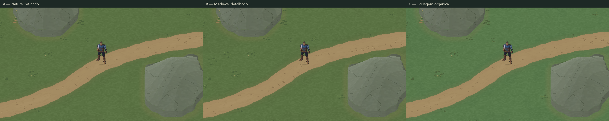

# Valdoria World Studio 04 — Artistic Terrain Refinement

Estado: implementação e QA técnico concluídos; candidato experimental para avaliação visual. **Sem aprovação artística ou promoção ao mundo oficial.**

Projeto `D:\unity\Mmorpg`, Unity 6000.6.5f1, branch `main`. Baseline: `30a518ddb35f18d61af4a7b91857781c28e7ec0b`. Worktree conferido e `git pull --ff-only origin main` executado antes do trabalho. Arquivos locais alheios preservados. `MmorpgWorld.unity` permanece intacta.

## Resultado para avaliar

A direção incorpora o pedido posterior do usuário: menos cartunesco, mais pixel art. Pigmento discreto, clusters de pixels, paleta moderada e luz superior esquerda; sem filtro bilinear, compressão destrutiva ou textura gerada por imagem única. O protagonista Quaternius e suas animações foram preservados.



| Alternativa | Intenção | Captura real | Antes/depois |
|---|---|---|---|
| A — Natural refinado | Equilíbrio e legibilidade; densidade 0,60 | [Game View](ValdoriaWorldStudio04/Final/A-gameview.png) | [Marco03 A → Marco04 A](ValdoriaWorldStudio04/Final/BeforeAfter-A.png) |
| B — Medieval detalhado | Mais textura e desgaste; densidade 0,78 | [Game View](ValdoriaWorldStudio04/Final/B-gameview.png) | [Marco03 A → Marco04 B](ValdoriaWorldStudio04/Final/BeforeAfter-B.png) |
| C — Paisagem orgânica | Variação natural contextual; densidade 0,70 | [Game View](ValdoriaWorldStudio04/Final/C-gameview.png) | [Marco03 A → Marco04 C](ValdoriaWorldStudio04/Final/BeforeAfter-C.png) |

As quatro capturas usam 1280×720, câmera `(33.5,23.5,-10)`, ortográfica 11,25, jogador `(33.5,23.5,0)`, escala visual 1,25 e mesma pose. Capturadas após frames reais renderizados, sem redimensionar. [Metadados](ValdoriaWorldStudio04/Final/capture-metadata.json).

Close-ups comparáveis A/B/C: [grama](ValdoriaWorldStudio04/Final/Closeup-Grama.png), [borda da estrada](ValdoriaWorldStudio04/Final/Closeup-Borda-estrada.png), [rocha](ValdoriaWorldStudio04/Final/Closeup-Rocha.png), [contato rocha/solo](ValdoriaWorldStudio04/Final/Closeup-Contato-rocha-solo.png). São recortes das Game Views, com ampliação nearest 3× explicitamente identificada; os arquivos `*-native.png` conservam os pixels originais.

[Base → transições → detalhes](ValdoriaWorldStudio04/Final/A-three-stages-offline.png) mostra recortes 1:1 dos atlases offline, sem geometria projetada. Não é captura Unity. Os três estados completos existem em cada BuildR6; o laboratório carrega somente os finais para reduzir memória.

## Diagnóstico e mudanças

[Diagnóstico anterior à produção](ValdoriaWorldStudio04/artistic-diagnosis.json) separa forma, cor, frequência, repetição e escala por material.

- **Grama/solo:** a quantização dos campos de 193/57 pixels e o seletor de manchas produziam ilhas grandes, semelhantes a camuflagem. Esses campos agora têm baixo contraste; clusters direcionais de 3–9 pixels explicam a superfície. Solo exposto e umidade dependem de tráfego e contato com rocha. Agrupamentos hierárquicos usam pais espaciais de 112 pixels, filhos de distribuição variável, separação mínima de oito pixels e áreas de descanso. Grama curta acompanha uso; formas altas, rosetas e musgo dependem do contexto.
- **Estrada:** pigmento macro deixou de criar grandes manchas claras/escuras. O desgaste usa distância lateral, largura, tangente e arco acumulado. `localArcUnits` reinicia em cada segmento; a composição soma os comprimentos anteriores sem reconstruir as curvas. Um núcleo irregular de compactação evita trilhos duplos universais. Sulcos curtos aproveitam o alfa editável do Aseprite; a paleta e a luz são reconstruídas no espaço mundial. Plantas e pedras pré-iluminadas não são giradas.
- **Rocha:** juntas conectadas esparsas delimitam planos maiores, com bevels e iluminação superior esquerda derivada da inclinação. Fissuras secundárias concentram-se perto de fraturas; musgo, depósitos e fragmentos dependem do pé da rocha. A rede mineral usa IDs mundiais estáveis e halo de consulta, evitando emendas entre recortes. Nem toda aresta da partição é desenhada, para não criar uma nova malha regular.
- **Lama/areia:** seis funções por família substituem simples permutações de um motivo. São estudos de superfície sobre o proxy de umidade existente, sem hidrologia nova.

Na revisão das capturas estáticas e amostras da sequência de câmera, não identifiquei uma grade nítida de 32×32. Permanecem repetição de certas silhuetas e mineralização regular em alguns trechos. Isto é uma observação visual do agente, não aprovação artística do usuário nem prova universal de ausência de padrões.

## Fontes e reprodução

Especialistas usados: `terrain-materials`, `terrain-generation` e `aseprite-pixel-art`; Unity CLI para Editor real. Aseprite 1.3.18.6 foi localizado, validado e executado. Python faz autoria offline e composição; Aseprite mantém camadas editáveis. Blender e ImageGen não foram usados neste marco.

- [Fonte Aseprite revisada](../../ArtSource/Labs/World2026/WorldStudio04/Library/terrain-motifs.aseprite): RGBA 768×192, camadas semânticas, seis famílias × seis funções = 36 motivos distintos.
- [Biblioteca e proveniência](../../ArtSource/Labs/World2026/WorldStudio04/Library/library.json), [catálogo ampliado](ValdoriaWorldStudio04/editable-material-catalog-3x.png), [inspeção real](ValdoriaWorldStudio04/aseprite-inspect.txt). Fonte original do Marco03 preservada; parent SHA registrado. Trabalho original do projeto, sem material externo novo.
- [Receitas A/B/C](../../ArtSource/Labs/World2026/WorldStudio04/Recipes), seed **710202** em todas. Mesma região B do Marco01 e mesma estrada A `RoadsR3` do Marco02.
- [Saídas finais BuildR6](../../ArtSource/Labs/World2026/WorldStudio04/BuildR6): base, transições, final, faces, relevo, composição e manifest por alternativa.
- Região SHA256 `cf43e4d5e6a2834d300b851b2f11e3a66bb6701b727432ebc72cec95c1bc5eb1`; estrada SHA256 `edd9072ffa8db50f5a97f201a8867c1112f8010e1c63fff4263b7d1bd6eb54a7`. Os manifests registram também biblioteca, receitas e quatro máscaras de estrada.

```powershell
python -m unittest discover -s Tools/ArtPipeline/WorldGen -p 'test_*.py'
python Tools/ArtPipeline/WorldGen/terrain_materials.py verify --recipe ArtSource/Labs/World2026/WorldStudio04/Recipes/recipe-A.json --library ArtSource/Labs/World2026/WorldStudio04/Library --output ArtSource/Labs/World2026/WorldStudio04/BuildR6/A
python Tools/ArtPipeline/WorldGen/terrain_materials.py generate --recipe ArtSource/Labs/World2026/WorldStudio04/Recipes/recipe-A.json --library ArtSource/Labs/World2026/WorldStudio04/Library --output Temp/Materials/new-refinement
```

Trocar A por B/C para as outras receitas. `generate`, exportação e importador recusam destinos existentes. Edição localizada usa `render --bounds '[1024,704,192,160]' --stage final` para destino ausente; [resultado](ValdoriaWorldStudio04/LocalRegeneration/patch.png) e [igualdade exata com recorte do atlas](ValdoriaWorldStudio04/Final/local-regeneration-qa.json).

`material_refinement.py` é extensão do compositor existente, ativada por versão `terrain-materials/1.1.0`, biblioteca v2. O fluxo 1.0 permanece para reproduzir o baseline. Não há segundo gerador de topografia. Skill, padrão artístico e contrato foram atualizados. Validador da skill executado com sucesso.

## Unity e performance

Cena: [ValdoriaArtisticTerrainLab.unity](../../Assets/Mmorpg/Scenes/ValdoriaArtisticTerrainLab.unity). Teclas `0` baseline Marco03 A; `1/2/3` finais A/B/C; `R` reposiciona; WASD e Space mantêm o contrato existente. Sem regeneração em Play. O menu **Valdoria / World Studio / 08** cria o laboratório somente em destino ausente, partindo da cena limpa do Marco03. Regenerar receita é operação offline controlada; não existe botão de pintura universal.

O importador verificou os manifests e reutilizou **55 meshes**; comparação com o Marco03 confirmou WorldRegion e **33 BoxCollider2D idênticos**, sem colliders novos nos visuais. Altura, curvas, larguras e máscaras não mudaram. [Auditoria Editor](ValdoriaWorldStudio04/Final/editor-qa.json).

| Medida | Resultado |
|---|---|
| Texturas de terreno referenciadas no laboratório | 6: três finais 04 + face comum + duas do baseline03 |
| Memória de terreno medida no Editor | ~126 MiB, contra ~210 MiB do laboratório03 |
| Candidato visual A sem comparação | 2 texturas, ~42 MiB |
| Dimensões por textura | 2048×1536, Point, um nível, sem compressão; fonte PNG RGBA, import opaco reportado RGB24 |
| Draw calls nas quatro capturas fixas | 42 |
| Primeira geração final A/B/C | ~71,65 / 72,88 / 68,73 segundos |
| Reconstrução completa verificada | Tempos por alternativa em `rebuild-qa.json`; inclui composição e comparação de arquivos |

A memória reportada é `Profiler.GetRuntimeMemorySizeLong` para texturas referenciadas, com custos do Editor; não é memória total do processo nem benchmark de build. Draw calls incluem a cena capturada. Não foi feito benchmark de FPS em player compilado.

O prefab experimental `FinalOnlyVisuals-A.prefab` fornece implementação concreta para selecionar apenas um final: duas texturas, meshes, sem controlador comparativo, baseline ou física duplicada. Precisa de host WorldRegion/colliders. Ainda referencia os meshes existentes. O manifest descreve chunks de 512 pixels, mas o importador atual usa atlases completos; streaming, carregamento regional e descarte de chunks são trabalho futuro. Implementar carregamento por região e depois chunks com halo semântico/UVs consistentes, mantendo Point e pixels nativos. Não declarar streaming implementado.

## QA executado

- **75 testes Python aprovados**: [log](ValdoriaWorldStudio04/python-tests.txt). Incluem contratos anteriores, seed, reconstrução, continuidade exata em dois eixos, patches locais, 36 motivos distintos, hierarquia/distância mínima, arco acumulado, luz superior esquerda, alfa Aseprite efetivamente consumido e invariância de relevo.
- **Integridade Git**: [55 referências de artefatos verificadas](ValdoriaWorldStudio04/Final/git-artifact-qa.json) contra os blobs staged; receitas, biblioteca, imagens Unity, entradas e máscaras preservam os hashes após normalização Git.
- **Reconstrução A/B/C byte a byte**, manifests e proveniência: [rebuild-qa.json](ValdoriaWorldStudio04/rebuild-qa.json). A verificação usa diretório temporário novo; não sobrescreve as saídas finais.
- [Compilação Unity](ValdoriaWorldStudio04/Final/compile-qa.json): completed, sem falhas. [Console desde cursor 39299](ValdoriaWorldStudio04/Final/console-errors.json): zero entradas novas de erro. Contadores históricos não foram tratados como erros introduzidos. Uma tentativa anterior de compilar isoladamente o arquivo partial no executor de scripts falhou por ausência dos outros membros; isso foi diagnóstico do probe, corrigido usando wrapper e compilação normal do projeto.
- **Play real / Input System real**: [trace completo](ValdoriaWorldStudio04/Final/PlayQA/play-qa.json), 16.174 frames avançados em 69,80 segundos de jogo. 24 checks aprovados; três entradas adicionais são pedidos de captura, não testes. WASD, diagonal, esquiva, percurso completo de 124 alvos por estilo, seção estreita, duas margens transitáveis, pés/sombra/sorting, câmera, terreno único. Câmera ortográfica 11,25; escala 1,25. Nenhuma animação refeita.
- **Colisão dirigida**: W contra o footprint sul da rocha, x47,5. Jogador parou em y12,760001, limite semântico y13, sem penetração: [trace](ValdoriaWorldStudio04/Final/Contact/contact-qa.json), [Game View](ValdoriaWorldStudio04/Final/Contact/cliff-contact.png). Elevação continua apresentação 2D; não há mecânica de escalada.
- **Câmera em movimento**: 30 PNGs por alternativa, 90 originais 1280×720 em [Motion](ValdoriaWorldStudio04/Final/PlayQA/Motion), 30 posições distintas por estilo. Previews [A](ValdoriaWorldStudio04/Final/A-camera-motion.gif), [B](ValdoriaWorldStudio04/Final/B-camera-motion.gif), [C](ValdoriaWorldStudio04/Final/C-camera-motion.gif); [metadados](ValdoriaWorldStudio04/Final/motion-qa.json). GIF usa paleta de 256 cores e duração nominal 100 ms; PNGs são a evidência fiel. Cadência de render variável, não um vídeo CFR nem teste de performance.
- Final: Play parado, cena limpa, um jogador/câmera/terreno; dispositivos sintéticos removidos, teclados habilitados, Input System restaurado, timeScale 1, resolução temporária removida e perfil isolado liberado. Capturas temporárias em Assets e texturas intermediárias sem consumidores foram removidas após [auditoria de dependências](ValdoriaWorldStudio04/Final/cleanup-qa.json).

## Limitações e decisão artística pendente

A é a referência mais equilibrada para a próxima avaliação, sem seleção automática. B/C variam densidade e pigmento; a estrutura geológica e o traçado permanecem iguais para comparação justa. A grama ainda pode parecer homogênea em áreas extensas; certos tufos são reconhecíveis. As grandes silhuetas rochosas continuam simples, e algumas juntas precisam de direção artística adicional. A riqueza do protagonista ainda é maior que a de partes do chão. Nenhuma métrica torna esse acabamento aprovado.

O diagnóstico geométrico encontrou distância máxima **0,4718 unidade** e p95 **0,25** entre amostras do pé visual suavizado e fronteira do footprint bloqueado (490 amostras): [dados](ValdoriaWorldStudio04/contour-collider-diagnosis.json). É diferença herdada do Marco03, não corrigida ocultamente por pigmento. Proposta para Terrain Agent: definir footprint semântico subcélula compartilhado por contorno, colisão e navegação; revisar/validar essas três camadas juntas em outro marco. O teste local de colisão aprovado não elimina essa divergência global.

Sem água completa, vegetação física, arquitetura, clima, streaming ou escalada. Futuros especialistas continuam consumindo WorldRegion/material composition e máscaras com proveniência; materiais não alteram autoridade física. Arte experimental aguarda feedback explícito do usuário. Iterações anteriores em `Iterations/` são estudos identificados R3/R4; **Final e BuildR6 são as evidências desta entrega**.
