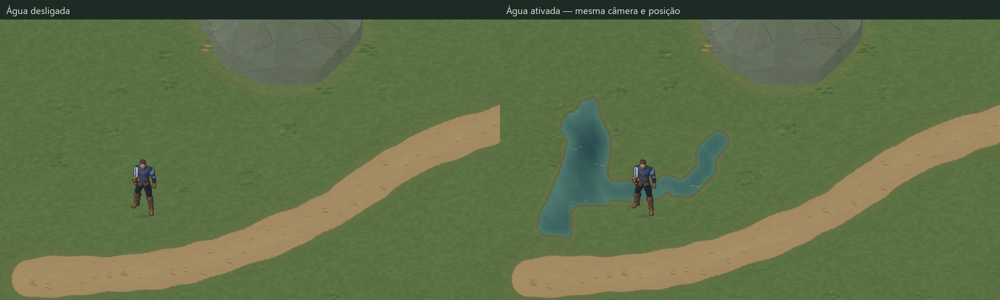

# Valdoria World Studio 05 — Hydrology

18/10/2026. Implementação e QA técnico do Water Agent; **candidato artístico experimental, sem promoção automática**. A alternativa A04 é a referência provisória do terreno. Cena oficial `MmorpgWorld.unity`, protagonista e animações não foram alterados.

Projeto `D:\unity\Mmorpg`, Unity **6000.6.5f1**, branch **main**, baseline `dccc729eb0b4c0cd7ccd134aba03ef99d7aad806`. Worktree conferido, `git pull --ff-only origin main` executado e atualizado. Arquivos locais alheios preservados. Skills utilizadas: `terrain-generation`, `terrain-materials`, `aseprite-pixel-art`; apoio de `skill-creator` e Unity CLI/física 2D. Nenhum subagente ou serviço novo foi executado.

## Resultado para avaliação



- [Água desligada](ValdoriaWorldStudio05/Final/WaterOff-gameview.png) / [ativada](ValdoriaWorldStudio05/Final/WaterOn-gameview.png), capturas reais de Game View, **1280×720 sem resize**.
- [Dois ciclos da água com câmera fixa](ValdoriaWorldStudio05/Final/StaticWater/water-two-cycles.gif), [oito frames nativos](ValdoriaWorldStudio05/Final/StaticWater) e [comparação de pixels](ValdoriaWorldStudio05/Final/StaticWater/pixel-qa.json): quatro fases renderizadas distintas, idênticas ao repetir o ciclo; textura do shader conferida.
- [Câmera e água em movimento](ValdoriaWorldStudio05/Final/camera-water-motion.gif), [30 PNGs originais](ValdoriaWorldStudio05/Final/PlayQA/Motion), [metadados](ValdoriaWorldStudio05/Final/motion-qa.json). GIF é prévia com paleta de 256 cores e duração nominal de 80 ms; os PNGs preservam a imagem original.
- [Lago em pixels nativos](ValdoriaWorldStudio05/Final/Lake-native.png) / [3× nearest](ValdoriaWorldStudio05/Final/Lake-3x-nearest.png); [riacho e margem nativos](ValdoriaWorldStudio05/Final/River-native.png) / [3× nearest](ValdoriaWorldStudio05/Final/River-3x-nearest.png).
- [Vau durante travessia](ValdoriaWorldStudio05/Final/PlayQA/ford-mid-crossing.png), [passagem concluída](ValdoriaWorldStudio05/Final/PlayQA/ford-crossed.png), [contato com lago](ValdoriaWorldStudio05/Final/PlayQA/lake-contact.png), [contato com rio](ValdoriaWorldStudio05/Final/PlayQA/river-contact.png), [circulação na margem](ValdoriaWorldStudio05/Final/PlayQA/bank-walk.png).
- [Mapa semântico de navegação](ValdoriaWorldStudio05/Final/semantic-navigation-map.png): diagnóstico de dados, não arte final nem screenshot de gameplay.

Comparação on/off: mesma câmera `(20,23,-10)`, ortográfica **11,25**, jogador `(11.5,18.5,0)`, pose sul e escala visual Quaternius **1,25**, seed/receita iguais. [Captura e draw calls](ValdoriaWorldStudio05/Final/capture-metadata.json). No modo seco diagnóstico, água visual, colliders aquáticos e restrição aquática de navegação são desligados juntos; o relevo sólido continua ativo.

## Water Agent e autoria real

Skill: [world-hydrology/SKILL.md](../../.agents/skills/world-hydrology/SKILL.md). Ferramentas: [world_hydrology.py](../../Tools/ArtPipeline/WorldGen/world_hydrology.py), [environment_geometry.py](../../Tools/ArtPipeline/WorldGen/environment_geometry.py), [water_art.py](../../Tools/ArtPipeline/WorldGen/water_art.py). São ferramentas offline reais operadas pelo agente, não uma alegação de especialistas autônomos já em execução.

Contratos versionados: [hidrologia](../WorldGen/WorldHydrologyContract.md), [fronteiras ambientais](../WorldGen/EnvironmentBoundaryContract.md), mais handoffs atualizados de WorldRegion, estradas e materiais. Schemas de receita/patch/build/hidrologia/drenagem/navegação/arte e hashes de entradas/saídas estão documentados. A biblioteca e os outputs de terreno04 e estradas02 não foram regenerados.

[Receita](../../ArtSource/Labs/World2026/WorldStudio05/Recipes/recipe.json): seed **710205**, mesmo WorldRegion B01 e estrada A02, material A04. [BuildR4](../../ArtSource/Labs/World2026/WorldStudio05/BuildR4) é a revisão final. Os builds anteriores ficam somente no Temp ignorado; evidências anteriores em `Iterations/` são identificadas como estudos/probes.

O modelo usa flood por heap para níveis de vertimento e pais de drenagem, seguido de descida D8 onde há declive estrito. Em flats, o rank de flood evita ciclos. A implementação local segue o princípio de [Barnes, Lehman e Mulla — Priority-Flood](https://rbarnes.org/sci/2014_depressions.pdf); não é um solver de vazão, pressão ou balanço hídrico.

O lago foi selecionado numa depressão natural no oeste, sem esculpir a altura original:

| Parâmetro | Resultado |
|---|---|
| Lago | `lake-west`, seed de bacia `(7.5,23.5)` em coordenadas Y sul |
| Fundo / vertimento | 0,340 / 0,3615, escala normalizada do terreno |
| Nível autorado | 0,359995 — abaixo do vertimento |
| Profundidade máxima do lago | 0,019995 normalizada; **não metros** |
| Área estimada por amostras de vértices | ~35,56 u², não medição cartográfica exata |
| Rio | `brook-west`, fonte `(17.5,23.5)`, comprimento ~12,2604 u até o lago |
| Largura permitida | 1,05–1,65 u, variando ao longo do arco/seed |
| Vau | `ford-west`, centro `(12,27.5)`, raio 1,05 u, autorização explícita |

O rio é um **afluente**. Este estudo não força saída do lago ou rio até a borda do mapa. O nível do lago é um snapshot de autoria; não há acumulação temporal de volume. O nível auxiliar preenchido não sobe no percurso; o terreno bruto tem uma pequena subida máxima de **0,000125** em depressão intermediária. Essa diferença é reportada e não foi apagada por escavação. O perfil transversal dos rios é aproximação autorada de profundidade; não é batimetria medida.

Água superficial, profundidade, raso transitável, bloqueio, margem úmida e fluxo são outputs separados. Caminhos, reservas e rocha são exclusões, com validação também entre os vértices da análise. Retângulos protegidos menores que uma subcélula não são ignorados. A estrada aprovada não é desviada nem recebe travessia implícita.

## Correção estrutural do relevo antes da água

O desvio do Marco04 vinha de duas representações: pé visual recortado por um campo contínuo a **.25 u** e colisão por células de **1 u**. A correção05 deriva loops da mesma união de triângulos usada pelo relevo04: diagonal A-B-C/A-C-D, clipping no zero, arestas internas canceladas e precisão de vértices 1e-6 u. Não se inferiu geometria das cores do terreno.

**Revisão física explícita, somente no laboratório05:** 29 boxes grosseiros de relevo foram removidos e substituídos por um PolygonCollider2D com três paths compartilhados. Os quatro boxes de borda continuam. A área sólida derivada muda de 268 u² para ~262,014 u²; isso é uma correção deliberada de footprint, não alteração de altura do WorldRegion. Os meshes do relevo04 continuam os mesmos.

[Auditoria real na Unity](ValdoriaWorldStudio05/Final/editor-qa.json): **49.152 centros** de navegação comparados com a ocupação física, **zero divergências**. Os **860 vértices** do contorno sólido foram comparados com os pés dos meshes existentes: desvio máximo **0,000005395 u**, dentro da tolerância float de 1e-5 u. Não se cobriu a diferença antiga com margem decorativa. A [verificação do corredor aprovado](ValdoriaWorldStudio05/Final/road-clearance-qa.json) encontrou zero pixels navegáveis da estrada dentro do sólido refinado.

A água usa a mesma representação triangular para superfície e limiar de profundidade. Sua geometria visível externa e sua fronteira bloqueante são distintas por intenção: existe raso transitável e vau, identificados nos dados. O segundo PolygonCollider2D possui dois paths profundos, separados pelo vau. A navegação subcélula amostra esses mesmos campos. Não inclui raio do ator; planejadores futuros devem verificar clearance e segmentos contra os polígonos.

## Aseprite e pixel art

[Aseprite editável](../../ArtSource/Labs/World2026/WorldStudio05/Library/water-motifs.aseprite), [manifest da biblioteca](../../ArtSource/Labs/World2026/WorldStudio05/Library/library.json), [prévia dos módulos](../../ArtSource/Labs/World2026/WorldStudio05/Library/preview.gif). Canvas **128×192 RGBA**, seis camadas: água rasa, profunda, reflexos, sedimento de margem, espuma localizada e traços de fluxo. **Quatro frames ×180 ms**, ciclo 720 ms.

Aseprite **1.3.18.6** foi localizado, validado, executado em batch e usado para montar e exportar a fonte com camadas/frames/tags. [Inspeção](ValdoriaWorldStudio05/aseprite-inspect.txt) e [roundtrip dos quatro frames](ValdoriaWorldStudio05/aseprite-export-qa.json) aprovados pixel a pixel. Autoria original do projeto, registrada no manifest; nenhuma imagem externa ou licença nova. Blender e ImageGen não foram usados.

Cores de raso/profundo são lidas da fonte; reflexos, sedimento, espuma e alfa de fluxo são consumidos na composição. Paleta moderada azul-esverdeada, degraus discretos de cor e iluminação superior esquerda. Reflexos mantêm orientação autorada; somente o alfa geométrico do fluxo acompanha a tangente, com cor reaplicada. Sem blur de textura. Nenhuma animação do protagonista foi refeita.

Os pixels são distribuídos por coordenadas globais e halo, com quatro frames por chunk de **256 px /8 u**. O importador cria **seis meshes recortados** em água/margem semântica e 24 pequenas texturas, não um quad com PNG de cenário completo. A água anima materiais já gravados; não regenera hidrologia em Play.

## Receitas, recortes e patches

```powershell
python Tools/ArtPipeline/WorldGen/world_hydrology.py generate --recipe ArtSource/Labs/World2026/WorldStudio05/Recipes/recipe.json --library ArtSource/Labs/World2026/WorldStudio05/Library --output Temp/Water/new-region
python Tools/ArtPipeline/WorldGen/world_hydrology.py verify --recipe ArtSource/Labs/World2026/WorldStudio05/Recipes/recipe.json --library ArtSource/Labs/World2026/WorldStudio05/Library --output ArtSource/Labs/World2026/WorldStudio05/BuildR4
python Tools/ArtPipeline/WorldGen/water_art.py export-library --source ArtSource/Labs/World2026/WorldStudio05/Library/water-motifs.aseprite --output Temp/Water/edited-library
python -m unittest discover -s Tools/ArtPipeline/WorldGen -p 'test_*.py' -v
```

`--region`, `--road` e `--relief` aceitam entradas explícitas compatíveis. A integração de estudo usa o conjunto acima por hash; não promete suportar qualquer escala/origem de mundo sem adaptar o contrato. Destinos existentes são recusados. O importador também verifica inputs/biblioteca e desfaz somente seus próprios destinos novos se falhar.

[Patch de largura](../../ArtSource/Labs/World2026/WorldStudio05/Recipes/width-patch.json) altera o arco 2–4 do riacho em 12%, com suporte finito e transição. [Recorte base](ValdoriaWorldStudio05/Local/Base/surface.png) / [editado](ValdoriaWorldStudio05/Local/WidthPatch/surface.png), bounds `[480,768,128,128]`: **271 pixels** de superfície alterados. [QA local](ValdoriaWorldStudio05/local-qa.json) confirma igualdade do recorte base com o build completo. Centro do rio, drenagem e lago permanecem iguais no teste de patch. Alterar nível/fonte/bacia requer nova receita e revalidação global de dependências.

## Unity, custo e QA

Cena: [ValdoriaHydrologyLab.unity](../../Assets/Mmorpg/Scenes/ValdoriaHydrologyLab.unity). Menu **Valdoria / World Studio /09**, partindo do laboratório04 limpo e somente para destino ausente. Em Play: **0** seco diagnóstico, **1** água, **R** reposiciona, **WASD** movimento, **Space** esquiva. Perfil isolado em `Temp/ValdoriaHydrology05/IsolatedProfile`.

| Medida no Editor | Resultado |
|---|---|
| Texturas de água | 24 ×256×256 RGBA32, Point, sem mipmaps/compressão |
| Memória de texturas aquáticas | ~12,02 MiB |
| Terreno A04 referenciado | duas texturas, ~42,00 MiB; sem carregar B/C/baseline comparativo |
| Total dessas texturas | ~54,02 MiB; não é memória total do processo |
| Meshes aquáticos | seis; 10.168 vértices, 3.876 triângulos, 788.160 bytes (~0,75 MiB) |
| Draw calls na câmera fixa | seco 18 →água 24, acréscimo de seis |
| Reconstrução completa cronometrada | [rebuild-qa.json](ValdoriaWorldStudio05/rebuild-qa.json), inclui geração e comparação de hashes |

Medição por `Profiler.GetRuntimeMemorySizeLong` no Editor; não é benchmark de player compilado ou garantia de FPS. [Meshes/custo](ValdoriaWorldStudio05/Final/mesh-performance.json). Chunks existem como geometria/arte de autoria; não há streaming regional ou descarregamento dinâmico. Todos os seis chunks estão referenciados no laboratório.

- **103 testes Python aprovados** em execução completa (incluindo 28 de hidrologia): [log](ValdoriaWorldStudio05/python-tests.txt): contratos, seeds, drenagem acíclica, conexão lago/rio, restrições, limites entre vértices, máscaras, navegação, patches, recortes em ambos os eixos, pixels Aseprite, hashes/determinismo e regressões01–04. [Suíte de hidrologia](ValdoriaWorldStudio05/python-hydrology-tests.txt): 28 casos direcionados.
- [Integridade Git](ValdoriaWorldStudio05/Final/git-artifact-qa.json): 100 referências de artefatos conferidas contra os blobs staged; bytes de inputs/fontes/outputs preservados.
- [Reconstrução final](ValdoriaWorldStudio05/rebuild-qa.json): **byte-identical**, em diretório temporário novo. Altura e estrada originais mantêm os SHAs do baseline. [Cópias importadas](ValdoriaWorldStudio05/Final/import-byte-qa.json) conferidas com BuildR4 para os 24 frames e os dois JSONs Unity.
- [Recompile](ValdoriaWorldStudio05/Final/compile-qa.json) e [Console desde cursor39328](ValdoriaWorldStudio05/Final/console-errors.json): sem falha de compilação ou erros novos. Contadores históricos não foram atribuídos à cena nova.
- [Play real/Input System](ValdoriaWorldStudio05/Final/PlayQA/play-qa.json): **14 checks aprovados**, 4.754 frames avançados, **18,08 s** de jogo. WASD/diagonal, esquiva, circulação lateral, água profunda, lago, vau, pés/sombra/sorting, rocha compartilhada e toggle seco. Sem teleporte para fingir travessia: reposicionamentos só preparam cenários; trajetos testados usam teclado sintético real do Input System.
- Vau: y18,5→23,34 em mundo Unity, sem bloqueio indevido. Rio profundo: parou em `(10.5,19.63)`; lago em `(8.97,24.5)`, sem penetração. Rocha: parou em `(47.5,12.76)`. Pés/sombra no vau: delta visual **0**; sorting esperado/medido **-225**.
- [Câmera/água](ValdoriaWorldStudio05/Final/motion-qa.json): 30 PNGs renderizados, **28 posições distintas de câmera**, quatro frames aquáticos observados. Revisão das capturas fixas e amostras em movimento não revelou emendas de chunks ou grid32 claro nesta área; não é garantia universal ou aprovação estética.
- Final: Play encerrado, cena limpa, um jogador/câmera/terreno, dispositivos sintéticos removidos, input e timeScale restaurados, resolução temporária removida, perfil isolado liberado. Capturas temporárias em Assets removidas após [auditoria](ValdoriaWorldStudio05/Final/cleanup-qa.json).

Probes anteriores estão em `Iterations/`: uma guarda de importação contava33 boxes no filho que continha29 (quatro eram bordas separadas), corrigida antes da entrega. O primeiro QA de pés comparou sombra visual com Rigidbody interpolado e falhou por ~0,0125 u; o teste final compara a posição renderizada, registra a diferença física/render e mantém checagem de sorting. O Editor também havia importado uma revisão anterior: as capturas finais foram repetidas após conferência byte a byte do BuildR4. Esses resultados intermediários não são apresentados como QA final aprovado.

## Limitações e próximos consumidores

A água ainda precisa de avaliação artística: margens e reflexos podem ganhar variedade e alguns contornos/degraus de profundidade refletem a topografia de baixa resolução. Não houve refinamento indefinido do solo04. A leitura do vau é por cor rasa; não há ponte, placas ou sinalização ambiental própria. A animação é um loop curto de textura, sem reação ao ator.

**Sem natação, corrente empurrando o jogador, física de líquido, submersão dos pés, flutuação, chuva, vazão calibrada ou balanço de volume.** O personagem caminha no plano físico2D; profundidade é dado ambiental/proxy de autoria, não elevação do Rigidbody. Montanhas continuam sem escalada. Não há cachoeiras ou rios subterrâneos. Bacias/redes independentes não podem ser geradas por chunk e presumidas contínuas.

Vegetation Agent pode consultar água, profundidade, solo úmido e distâncias às margens; Architecture Agent deve evitar inundação e validar acessos/clearance; Structures Agent pode acrescentar travessias mediante contrato explícito. WorldRegion original e hydrology manifest fornecem proveniência; `EnvironmentRegionData` expõe amostras rápidas de ocupação. Nenhum desses futuros agentes foi implementado inteiro aqui. **Arte experimental aguarda avaliação do usuário; cena oficial intacta.**
