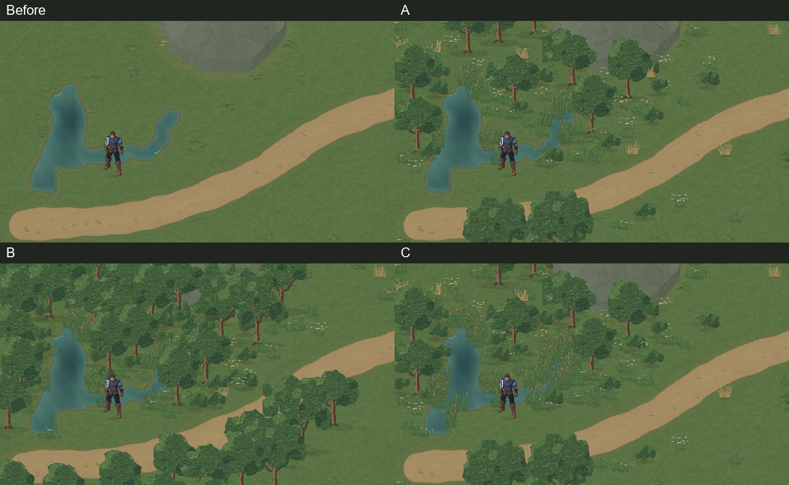
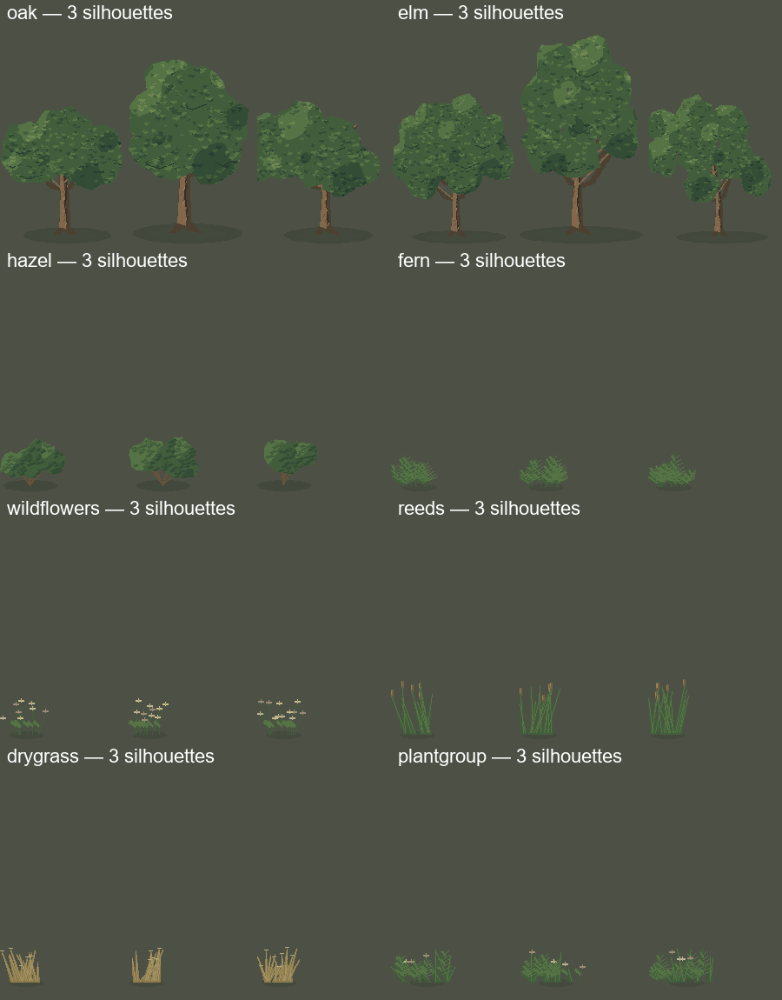
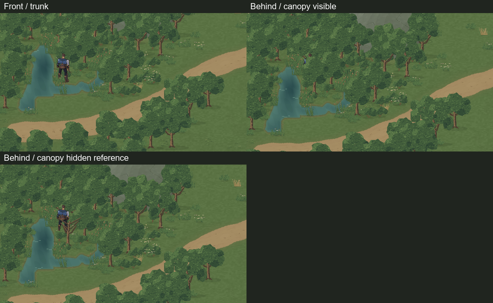

# Valdoria World Studio 06 — Vegetation Agent

Execução: 18/10/2026, projeto `D:/unity/Mmorpg`, Unity **6000.6.5f1**, branch **main**. Baseline **73a32976b59b38a001d126942adcc6a29dad4e64**. Worktree conferido e `git pull --ff-only origin main` executado antes da tarefa, sem atualização pendente. Trabalho alheio não incluído.

Implementados skill, ferramentas de autoria/reexportação, distribuição ecológica determinística, contratos, biblioteca editável e laboratório jogável. **Arte candidata para avaliação do usuário; nenhuma promoção ao mundo oficial.** `MmorpgWorld.unity`, protagonista e dados dos produtores anteriores permanecem inalterados.

## Comparação visual real



A prancha acima reduz capturas reais por nearest-neighbor para comparação. Os PNGs originais abaixo têm **1280×720**, câmera **(20,23,-10)**, orthographicSize **11.25**, Quaternius em **(11.5,18.5)**, escala visual **1.25**, mesma região e seed de vegetação **710206**. Sem edição dos pixels da Game View.

| Estado | Captura original | Movimento real | Resultado |
|---|---|---|---|
| Antes | [Sem vegetação](ValdoriaWorldStudio06/Final/Before-gameview.png) | — | Terreno/estradas/água existentes |
| A — Campo natural | [Game View A](ValdoriaWorldStudio06/Final/A-gameview.png) | [GIF A](ValdoriaWorldStudio06/Final/A-camera-motion.gif) | Clareiras, árvores moderadas, flores e plantas baixas |
| B — Bosque medieval | [Game View B](ValdoriaWorldStudio06/Final/B-gameview.png) | [GIF B](ValdoriaWorldStudio06/Final/B-camera-motion.gif) | Massas arbóreas agrupadas, sombra e arbustos; mais denso |
| C — Margens vivas | [Game View C](ValdoriaWorldStudio06/Final/C-gameview.png) | [GIF C](ValdoriaWorldStudio06/Final/C-camera-motion.gif) | 70 grupos de juncos concentrados nas margens/raso |

[Metadados das capturas](ValdoriaWorldStudio06/Final/capture-metadata.json). Os GIFs são previews de 20 frames por composição, com paleta GIF limitada; os **60 PNGs originais** em `ValdoriaWorldStudio06/Final/PlayQA/Motion/` preservam as cores. O [trace](ValdoriaWorldStudio06/Final/PlayQA/play-qa.json) registra frame, câmera, input e posição. A câmera acompanha o mesmo percurso nas três composições.

## Biblioteca e autoria



- Fontes: `ArtSource/Labs/World2026/WorldStudio06/LibraryR5/` — **oak.aseprite, elm.aseprite, hazel.aseprite, fern.aseprite, wildflowers.aseprite, reeds.aseprite, drygrass.aseprite, plantgroup.aseprite**.
- Oito famílias: árvore média, árvore grande, arbusto, samambaia/rasteira, flores, juncos, vegetação seca e agrupamento misto. Três variantes com alterações de galhos, inclinação, massa e contorno; não são apenas recolorações.
- Seis camadas funcionais: sombra de chão, tronco, casca/galhos, copa escura, planos de folhagem e luz. **Três frames são variantes estáticas, não animação de vento.**
- Autoria Python original de galhos/placas de folhas, montagem e exportação no **Aseprite 1.3.18.6 real**, sem Blender ou ImageGen nesta entrega. Luz superior esquerda, verdes contidos, bordas recortadas e textura em grupos de pixels; a primeira copa arredondada foi substituída por massas conectadas e folhas menores.
- 72 exports de partes incluindo vazios → **69 sprites não vazios** em um atlas **1024×1024 RGBA**, **32 PPU**, Point, sem mipmaps/compressão. Recortes preservam offset em relação à âncora original. Sem espelhamento de iluminação.
- `vegetation_art.py export-library` lê as fontes Aseprite efetivamente editadas; não recria galhos por cima das edições. Roundtrip final: todos os PNGs de partes, atlas e metadados reproduzidos **byte a byte**. [QA de reconstrução](ValdoriaWorldStudio06/Final/rebuild-qa.json), inspeções [oak](ValdoriaWorldStudio06/aseprite-oak-inspect.txt) e [elm](ValdoriaWorldStudio06/aseprite-elm-inspect.txt).
- Licença/proveniência no library.json: trabalho original do projeto; não foram redistribuídos sprites externos novos. Quaternius existente foi utilizado como referência e ator, sem refazer animações.

## Distribuição e receitas

Receitas: `ArtSource/Labs/World2026/WorldStudio06/Recipes/recipe-{A,B,C}.json`. Outputs: `.../WorldStudio06/BuildR6/{A,B,C}/` com vegetation.json, navigation.json, manifest.json e imagem diagnóstica separada da arte.

| Espécie | A | B | C |
|---|---:|---:|---:|
| Oak / árvore média | 18 | 38 | 15 |
| Elm / árvore grande | 7 | **6 de 20 solicitadas** | 9 |
| Hazel / arbusto | 26 | 55 | 40 |
| Fern / rasteira | 35 | 65 | 65 |
| Flores | 45 | 32 | 35 |
| Juncos | 24 | 24 | 70 |
| Seca | 30 | 20 | 14 |
| Grupos mistos | 32 | 42 | 42 |
| **Total colocado** | **217** | **282** | **290** |

O orçamento de candidatos de elm em B esgotou antes da densidade pretendida. Exclusões, competição e adequação foram preservadas; densityResults registra a deficiência explicitamente.

O gerador valida hashes e referências comuns a WorldRegion, Organic Roads, Terrain Materials, Water Agent e EnvironmentBoundaryContract. Consulta altura, declive, umidade e solo originais; proximidade de estrada, água, relevo sólido e reservas; nível raso/profundidade; sombra aproximada das árvores; agrupamentos elípticos e distância mínima. Metade dos pais de agrupamento usa foco de autoria explícito em torno do lago; a outra metade explora a região. Não é uma simulação climática ou de crescimento temporal.

Árvores ocupam chão seco, com margem adicional do ator. Só juncos podem entrar no raso autorizado (profundidade normalizada até .0025); vegetação seca exige afastamento da água. Vau e retângulo de aproximação têm reservas próprias. Nenhuma geometria de água, relevo ou estrada foi alterada para encaixar plantas. Patches atuais são exclusões retangulares: a competição pode propagar mudanças para fora da área, portanto não garantem estabilidade local absoluta.

## Integração Unity e profundidade

Cena: **`Assets/Mmorpg/Scenes/ValdoriaVegetationLab.unity`**, derivada do laboratório hidrológico, com água habilitada e perfil isolado em `Temp/ValdoriaVegetation06/IsolatedProfile`. Um Player, uma câmera, um EnvironmentRegionData e um VegetationRegionData. Nenhuma geração ao Play. **0** alterna antes; **1/2/3** selecionam A/B/C; **R** restaura pose inicial. WASD e Space continuam no Input System do protagonista.

`VegetationAnchor` mantém identidade, espécie e footprint. Troncos oak/elm têm CircleCollider2D de raio **.30/.40 u**, camada 8. Arbustos, folhas, sombras e copas não têm collider. Copa de até aproximadamente 2.3/3 u não vira obstáculo retangular. Posição do tronco, sombra e recortes é derivada da mesma âncora de chão.

Árvores mantêm SortingGroup individual **100-round(worldY×16)**, tronco/copa em ordens locais 0/1. Plantas baixas e sombras foram agrupadas em meshes estáticos; plantas usam faixas Y de .25 u (aproximação máxima .125 u de âncora), árvores continuam com sorting exato. LabController alterna apresentação, colliders e overlay juntos. Árvores/água/relevo continuam no plano físico 2D; não há altura 3D jogável.



Capturas originais: [frente](ValdoriaWorldStudio06/Final/PlayQA/B-front-tree.png), [atrás com copa](ValdoriaWorldStudio06/Final/PlayQA/B-behind-tree.png), [mesma posição com apenas a copa ocultada para referência](ValdoriaWorldStudio06/Final/PlayQA/B-behind-canopy-hidden-reference.png). A última é uma intervenção diagnóstica identificada, não o estado visual de produção. A captura inicial ocorria no fim do frame após a próxima troca de visibilidade; o fixture ganhou espera entre estados e a prova final foi recapturada.

## QA executado

**Python: 128 testes passaram** no conjunto WorldGen, incluindo 25 casos de vegetação. [Log integral](ValdoriaWorldStudio06/python-tests.txt). Cobertura: seed/repetição/outro seed, contratos inválidos, manifests/adulteração, exclusões, ocupação e clearance, competição/agrupamentos, habitat, vau, água profunda, nav/componentes, silhuetas, recorte/âncora/RGBA, não sobrescrita e imutabilidade upstream. Verificação posterior reconstruiu A/B/C byte a byte em aproximadamente .30/1.88/.60 s, excluindo preparação do Context. Skill validada com quick_validate: válida.

**Unity: compilação aprovada e Play real, 19/19 checks aprovados**, com Input System sintético enviando estados de teclado pelo sistema real, 6.695 frames avançados na execução final. WASD, diagonal, esquiva observada, colisão de tronco sem penetração, caminhar lateralmente sob copa, ordens de frente/trás, circulação junto à margem, vau e câmera em A/B/C. [Resultados e traces](ValdoriaWorldStudio06/Final/PlayQA/play-qa.json). Capturas de contato e vau estão na mesma pasta.

**Geometria/navegação:** 49.152 amostras por composição, **zero divergências** entre overlay combinado e Physics2D. Apenas círculo de tronco nas árvores; sorting por âncora conferido. O overlay .25 u não inclui inflação pelo raio do ator; conectividade de células não prova todos os corredores para qualquer tamanho de personagem. As passagens de estudo foram testadas com o Quaternius real. [QA Editor/restauração](ValdoriaWorldStudio06/Final/editor-qa.json).

**Console:** baseline cursor39357, final39388. O intervalo inclui warnings legados de APIs obsoletas; um erro novo CS1061 do importador (`Sprite.vertexCount`) foi corrigido para vertices.Length, e um timeout de transporte de 30 s aconteceu enquanto a importação continuava no Editor. A cena terminou de importar e foi verificada antes dos testes finais; reprodução recomenda timeout120. Não são erros novos de gameplay em Play. Ground truth final: **0 erros, 0 warnings, compilação sem falhas**. [Intervalo capturado](ValdoriaWorldStudio06/Final/console-final.json), [estado do Console](ValdoriaWorldStudio06/Final/console_status-final.json), [compilação](ValdoriaWorldStudio06/Final/recompile_status-final.json), [Editor/versão](ValdoriaWorldStudio06/Final/unity-status.json).

Ao encerrar: Play parado, cena limpa, dispositivos sintéticos removidos, teclados e configurações de foco restaurados, timeScale1, override de perfil limpo, resolução temporária removida. Capturas transitórias em Assets foram apagadas após cópia para Docs. Importador recusou destino existente no teste real.

## Custo medido

| Estado | Instâncias | Árvores físicas | Renderers ativos em Play, incluindo mundo | Draw calls na câmera de comparação | Meshes vegetação ativos | Memória dos meshes |
|---|---:|---:|---:|---:|---:|---:|
| Antes | 0 | 0 | 74 | 24 | 0 | 0 |
| A | 217 | 25 | 239 | 104 | 115 | 698.480 bytes |
| B | 282 | 44 | 282 | 168 | 120 | 802.860 bytes |
| C | 290 | 24 | 239 | 112 | 117 | 847.224 bytes |

Memória runtime medida do atlas: **8.389.536 bytes** (RGBA32, CPU/GPU contabilizados pelo Profiler, importação legível). Não é apenas 4 MiB de pixels. Os 352 meshes das três alternativas ocupam **2.348.564 bytes** somados no Editor. A cena carrega as três alternativas para comparação; desativar GameObject não é streaming nem libera assets. Memória total do processo/terreno/protagonista não está atribuída a esta tabela. Renderers no Editor são quatro a menos que em Play por objetos runtime do mundo.

O primeiro arranjo por parte de planta mediu **394/619/622 draw calls**; batching reduziu para **104/168/112** na mesma câmera. [Medição anterior](ValdoriaWorldStudio06/Final/pre-batch-performance.json). Isso ainda pede otimização para regiões maiores; não foi realizado benchmark em hardware alvo nem inferida taxa de quadros pelo ritmo acelerado do Editor.

## Reprodução e contratos

Skill: `.agents/skills/environment-vegetation/SKILL.md`. [VegetationContract v1](../WorldGen/VegetationContract.md), com handoff adicionado aos cinco contratos produtores. Geradores recusam destino existente; o importador também exige HydrologyLab limpo e destinos novos. O manifesto assina bytes, com gitattributes preservando arquivos hashados no checkout Windows.

```powershell
python Tools/ArtPipeline/WorldGen/vegetation_art.py export-library --source ArtSource/Labs/World2026/WorldStudio06/LibraryR5 --output Temp/Vegetation/new-export
python Tools/ArtPipeline/WorldGen/environment_vegetation.py generate --recipe ArtSource/Labs/World2026/WorldStudio06/Recipes/recipe-A.json --output Temp/Vegetation/new-A
python Tools/ArtPipeline/WorldGen/environment_vegetation.py verify --recipe ArtSource/Labs/World2026/WorldStudio06/Recipes/recipe-A.json --output ArtSource/Labs/World2026/WorldStudio06/BuildR6/A
python -m unittest discover -s Tools/ArtPipeline/WorldGen -p 'test_*.py' -v
unity command run_script --caller plugin --skill unity-pipeline --timeout 120 --file AgentScripts/BuildVegetation06.cs --entry BuildVegetation06.Main --format json
```

A cena/artes entregues já existem: o último comando deve recusar sobrescrita. Para novo bake, use destinos novos e ajuste as constantes Source/Library/Art/Scene no importador. API Context aceita outros inputs; o CLI inicial usa esta região de estudo. `ValidateVegetation06.Main` requer Play isolado e pasta de evidências ausente; `InspectVegetation06.Main` roda fora de Play.

## Pendências artísticas e limites

A leitura está mais viva e com massas distintas. A oferece leitura mais aberta, B enquadra e oclui mais o ator, C destaca margem e raso. Ainda há motivos de folha repetidos, apenas três silhuetas por família e densidade alta em B; a naturalidade e o acabamento das copas precisam da avaliação visual do usuário. Nenhuma alternativa está aprovada automaticamente. O terreno base conserva seu acabamento anterior; esta tarefa não refez materiais ou hidrologia.

Sem vento animado, crescimento, estações, colheita/destruição, clima científico, streaming, natação ou física de água. Árvores não possuem occlusion fade automático; oclusão convencional pode ocultar parte do protagonista no bosque. Fontes editáveis e receitas permitem revisão posterior sem transformar o mapa em uma ilustração única.
