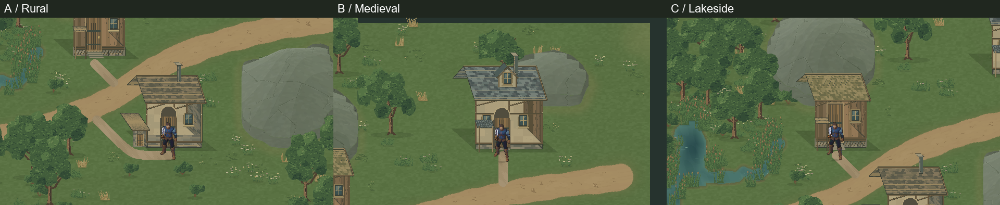
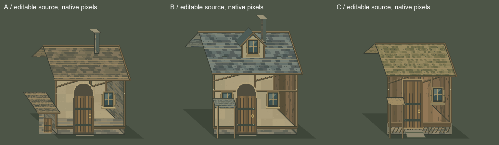

# Valdoria World Studio 07 — Architecture Agent

Execução: **18/10/2026**, `D:/unity/Mmorpg`, Unity **6000.6.5f1**, branch **main**. Baseline real **a9910b41d133b6f8f824724e7cf3ef9681617c0e**, correspondente ao prefixo informado no pedido. Worktree conferido e **git pull --ff-only origin main** executado no início; repositório atualizado. Arquivos alheios não rastreados foram preservados.

Entregues especialista em skill, autoria paramétrica/modular, fontes Aseprite editáveis, três edifícios, análise de lotes/acessos e integração na cena **Assets/Mmorpg/Scenes/ValdoriaArchitectureLab.unity**. **Arte candidata à avaliação do usuário. Nenhuma promoção ao mundo oficial.** A aprovação visual do Marco06 permanece registrada; o estudo07 adota A no campo, juncos de C nas margens e B somente no bosque delimitado.

## Comparação em contexto — capturas reais



Prancha reduzida por nearest-neighbor a partir da Game View. Capturas originais **1280×720**, orthographicSize **11.25**, Quaternius na escala visual **1.25**, mesma região e iluminação. A câmera é centrada em cada edifício para permitir comparação de escala; não se afirma que três posições geográficas distintas usam a mesma posição absoluta de câmera.

| Arquétipo | Frente / escala | Lado / fundação | Atrás / oclusão | Movimento |
|---|---|---|---|---|
| A — Casa rural | [Frente A](ValdoriaWorldStudio07/Final/PlayQA/A-front.png) | [Lado A](ValdoriaWorldStudio07/Final/PlayQA/A-side.png) | [Atrás A](ValdoriaWorldStudio07/Final/PlayQA/A-behind.png) | [Estrada até A](ValdoriaWorldStudio07/Final/A-access-motion.gif) |
| B — Casa medieval | [Frente B](ValdoriaWorldStudio07/Final/PlayQA/B-front.png) | [Lado B](ValdoriaWorldStudio07/Final/PlayQA/B-side.png) | [Atrás B](ValdoriaWorldStudio07/Final/PlayQA/B-behind.png) | [Estrada até B](ValdoriaWorldStudio07/Final/B-access-motion.gif) |
| C — Cabana do lago | [Frente C](ValdoriaWorldStudio07/Final/PlayQA/C-front.png) | [Lado C](ValdoriaWorldStudio07/Final/PlayQA/C-side.png) | [Atrás C](ValdoriaWorldStudio07/Final/PlayQA/C-behind.png) | [Estrada até C](ValdoriaWorldStudio07/Final/C-access-motion.gif) |

[Prancha frente/lado/trás](ValdoriaWorldStudio07/Final/front-side-behind.png). Cada GIF usa 20 frames reais; os **60 PNGs originais**, sem redução de paleta GIF, estão em `ValdoriaWorldStudio07/Final/PlayQA/Motion/`. O [trace de Play](ValdoriaWorldStudio07/Final/PlayQA/play-qa.json) registra input, frames, câmera e posição; [motion-qa.json](ValdoriaWorldStudio07/Final/motion-qa.json) confirma 20/9/8 posições de câmera distintas em A/B/C. Nas poses estacionárias o fixture usa SetPreviewFacing(0), API de apresentação existente, para comparar o mesmo idle; não modifica animações aprovadas nem autoridade física.

## Biblioteca, módulos e ferramentas



Fontes finais: **ArtSource/Labs/World2026/WorldStudio07/LibraryR7/**. Documentos **A.aseprite, B.aseprite, C.aseprite**, RGBA **512×512**, um frame, dez camadas funcionais: sombra, fundação, paredes, vigas, portas, janelas, telhado, chaminé, varanda e acabamentos/dormer. Módulos opcionais vazios são omitidos do consumo; **26 partes não vazias** viram sprites recortados com âncoras preservadas.

Há ainda **module-door-arched.aseprite**, **module-door-square.aseprite** e **module-window-timber.aseprite** para recombinação de aberturas. library --modules-source lê essas fontes editadas no Aseprite; o teste de edição de uma porta prova mudança nas aberturas mantendo paredes/telhado idênticos. export-library lê os documentos completos efetivamente editados, preservando os pixels sem regenerar o desenho.

- A: alvenaria baixa, madeira/reboco, anexo lateral mais baixo, telha de madeira e chaminé.
- B: volume maior, estrutura aparente, cobertura de ardósia, dormer projetado e cobertura lateral independente.
- C: tábuas, base ventilada/embasamento elevado, cobertura de fibras/telhas e pequena varanda com postes.

**architecture_art.py** implementa a gramática e a montagem/exportação no **Aseprite 1.3.18.6 real**. A receita artística permite dimensões dentro de limites validados. Paletas e pequenos acabamentos são editáveis nas fontes; não há promessa de trocar arbitrariamente qualquer módulo entre plantas incompatíveis. Autoria original do projeto por Python/Aseprite, luz superior esquerda, Point, **32 PPU**, sem compressão/mipmaps. Não foi usado Blender ou ImageGen neste marco. Nenhum sprite do protagonista foi refeito.

Inspeções reais das fontes: [A](ValdoriaWorldStudio07/aseprite-A-inspect.txt), [B](ValdoriaWorldStudio07/aseprite-B-inspect.txt), [C](ValdoriaWorldStudio07/aseprite-C-inspect.txt). Licença/proveniência: trabalho original do projeto registrado nos metadados; sem novos packs externos redistribuídos.

## Receitas, seeds e lotes

Receitas versionadas: **ArtSource/Labs/World2026/WorldStudio07/Recipes/architecture-library.json** e **region.json**. Biblioteca **LibraryR7**, build final **BuildR5**. Seed arquitetônica **710207**; seeds por edifício **710207 / 718126 / 726045**. Vegetação mantém seed **710206**. [Inventário e verificação da receita artística](ValdoriaWorldStudio07/Final/inventory.json).

| Edifício | Posição x/y sul | Largura × profundidade de autoria | Altura de parede / elevação visual da base | Altura semântica no lote | Maior declive normalizado | Distância mínima da água no bounds amostrado |
|---|---|---|---|---|---|---|
| rural-01 | 33,34 | 6.6×3.6 u + anexo | 5.6 / 0 u | .419–.462 | .019 | 11.69 u |
| medieval-01 | 46,14 | 8×4.4 u | 6.2 / 0 u | .422–.507 | .050 | 23.24 u |
| lake-01 | 24,23 | 6×3.6 u | 5.5 / .45 u | .420–.493 | .043 | 1.12 u |

A profundidade de autoria é projetada a metade no chão 2D; o footprint inclui também o deslocamento lateral dessa projeção. Consulte o contrato para a fórmula. Não são casas com profundidade/altura 3D física. A região não foi aplainada; lotes impraticáveis retornam erro. A cabana tem afastamento conservador da água e proteção visual à umidade, **sem cálculo estrutural ou simulação de cheia**.

A orientação inicial é única, autorada para sudeste, sem espelhar luz. Como a casa rural está ao sul da estrada e a fachada olha para sul, seu acesso contorna o anexo: **10.34 u**, contra **3.25 u** em B e **3.18 u** em C. Isso é uma limitação/composição explícita da primeira gramática, não uma nova rua escondida. Os acessos foram percorridos em Play.

## Distribuição e ecossistema

environment_architecture.py consome hashes comuns a WorldRegion, Organic Roads, materiais, hidrologia/fronteiras e manifests de vegetação. architecture.json registra IDs, seeds, dimensões, posição/orientação, âncora, footprint, postes, entrada/aproximação, acesso, partes/módulos e siteQA. Não altera os produtores para encaixar construções.

Foram criadas **63 exclusões versionadas** para volume/copa e corredores. Regenerados apenas os consumidores A/B/C da vegetação, sob **BuildR5/Vegetation/**; preservadas as fontes e outputs06. O relatório de diferenças mostra por que não se pode prometer que uma exclusão altera apenas plantas dentro do retângulo:

| Consumidor | Antes → novo total | IDs/instâncias inteiramente iguais | IDs removidos ou com dados reposicionados/alterados |
|---|---:|---:|---:|
| A | 217 → 217 | 18 | 199 |
| B | 282 → 276 | 12 | 270 |
| C | 290 → 290 | 23 | 267 |

A competição propaga mudanças. O pipeline reconstrói o consumidor inteiro e registra os efeitos; não implementa atualização ecológica incremental estável. Composição final: **271 plantas**, sendo **169 de A, 33 de B e 69 juncos de C**, com **28 árvores físicas**. B só é selecionada dentro de groveRect=(2,12,10,8); A cobre o restante, e competição final remove conflitos entre conjuntos. Um dos 70 juncos de C é rejeitado na combinação final. [Exclusões e efeitos](../../ArtSource/Labs/World2026/WorldStudio07/BuildR5/vegetation-exclusions.json).

O acabamento dos acessos pertence ao Architecture Agent: três texturas locais recortadas, com posição explícita em access-render.json. Organic Roads permanece byte-idêntico. A superfície visual do acesso não cria collider. Não se usa uma imagem pronta de cenário para inferir navegação.

## Escala, física e oclusão

A primeira inspeção mostrou portas pequenas para o protagonista atual. A versão final mede o corpo visível do idle real: **117 pixels ×1.25 /32 = 4.5703125 u**, contra **5 u de altura e 2.2 u de largura** do módulo de porta. [Medição](ValdoriaWorldStudio07/Final/quaternius-scale.json). Os contatos com a fachada estão registrados em A/B/C-door-contact.png na pasta PlayQA.

Footprints físicos: A tem polígono com **7 vértices**, B/C têm plantas em paralelogramo com quatro vértices e **dois pequenos círculos de postes** cada. Nenhuma copa, sombra, parede alta ou retângulo de telhado vira collider. As casas são **cascas exteriores fechadas**: a entrada é um ponto de acesso até uma porta fechada, sem interação ou interior completo.

SortingGroup do edifício deriva da mesma âncora de chão do footprint. Personagem à frente fica à frente dos volumes; atrás fica na ordem de profundidade correta. ArchitectureOcclusion reduz telhado/chaminé/dormer a alpha **.18** e volumes superiores da fachada a **.28** quando a projeção do personagem fica atrás e intercepta o prédio. Fundação/varanda permanecem. Isso é cutaway exterior para leitura do ator; não é um interior renderizado. O estado opaco retorna ao sair.

## QA executado

**156 testes Python aprovados**, incluindo **28 casos de arquitetura**. [Log integral](ValdoriaWorldStudio07/python-tests.txt). Contratos inválidos, seed, repetição, lotes inviáveis, estabilidade, água, portas, silhuetas, footprint/contorno fechado, navegação, exclusões, ecótono, vau, recortes, manifests/adulteração, não sobrescrita, reexportação Aseprite, recombinação e edição real de módulo. Nenhum teste técnico aprova a arte.

Reconstrução compara bytes da geometria/navegação/arte e semântica dos resultados. Os caminhos de proveniência dos consumidores regenerados mudam conforme o diretório de saída: verify normaliza somente sourceBuilds nessa comparação e valida cada cadeia real por hashes. Não se normalizam posições, seeds, máscaras ou pixels para obter igualdade.

**Unity: compilação aprovada, Play real com Input System e 23/23 checks aprovados**, **7.209 frames** avançados em **34.25 s** na execução final. WASD, diagonal, esquiva observada, percurso estrada-porta, colisão de fachada sem penetração, circulação lateral, frente opaca, atrás com cutaway em A/B/C, vau e margem após a composição ecológica. Os estados de teclado sintético passam pelo Input System real; poses de comparação são preparadas explicitamente, enquanto os percursos são movimento real. [Resultados/traces](ValdoriaWorldStudio07/Final/PlayQA/play-qa.json).

**Geometria:** **49.152 amostras, zero divergências** entre Physics2D e navegação combinada. Foram encontradas e corrigidas 16 diferenças exatamente sobre as diagonais: a física incluía a borda e o teste de polígono a excluía. A regra de contorno fechado foi corrigida no gerador, com teste de regressão, sem deslocar a parede nem esconder o erro na arte. [Diagnóstico anterior](ValdoriaWorldStudio07/Final/nav-edge-diagnosis.json), [QA anterior com 16](ValdoriaWorldStudio07/Final/nav-before-edge-fix.json), [QA final com zero](ValdoriaWorldStudio07/Final/editor-qa.json).

A grade é .25 u e não inclui clearance do ator no bit walkable. Os acessos são verificados com margem e percorridos pelo Quaternius. Consumidores futuros precisam inflar footprints analíticos, especialmente postes menores que uma célula; zero divergências nos centros não prova todo ponto contínuo do mundo.

**Console:** baseline cursor39388, final39418. Um CS1061 no importador (spriteAlignment) foi corrigido usando TextureImporterSettings; warnings legados de APIs obsoletas foram separados. Não houve erro novo de gameplay nos Plays finais. Ground truth final: **0 erros, 0 warnings, compilationFailed=false**. [Intervalo do Console](ValdoriaWorldStudio07/Final/console-final.json), [estado atual](ValdoriaWorldStudio07/Final/console_status-final.json), [compilação](ValdoriaWorldStudio07/Final/recompile_status-final.json), [Editor real](ValdoriaWorldStudio07/Final/unity-status.json).

Ao terminar: Play parado, cena limpa, um Player/câmera/EnvironmentRegionData/ArchitectureRegionData, sem overlay VegetationRegionData duplicado, perfil isolado limpo, teclados/configurações de foco restaurados, nenhum dispositivo sintético, timeScale1 e resolução temporária removida. Importador recusou destino existente no teste real. Captura temporária em Assets foi removida depois da inspeção. MmorpgWorld.unity permanece inalterada.

## Performance medida

| Vista frontal real | Renderers ativos de toda a cena em Play | Draw calls |
|---|---:|---:|
| A / câmera (33,17.4,-10) | 282 | 120 |
| B / câmera (46,37.4,-10) | 282 | 78 |
| C / câmera (24,28.4,-10) | 282 | 175 |

As câmeras mostram conjuntos visíveis diferentes; não se comparam essas draw calls como custo isolado de cada casa. As três casas e todo o ecótono estão carregados na cena. **29 texturas novas** (26 partes +3 acessos), runtime **8.196.792 bytes** medidos pelo Profiler, todas RGBA32/Point/um mip. **123 meshes** de vegetação agrupada, **809.808 bytes**. O atlas de vegetação e os assets ambientais continuam compartilhados com os laboratórios anteriores; esses valores não são memória total do processo.

Acessos foram recortados para evitar uma textura transparente 2048×1536 para a região inteira. As partes arquitetônicas ainda usam texturas individuais, sem atlas de produção: há espaço para reduzir draws ao ampliar a biblioteca. Não foi feito benchmark de build em hardware alvo; o ritmo acelerado de frames do Editor não representa FPS do jogo publicado. [Inventário de memória/formatos](ValdoriaWorldStudio07/Final/editor-qa.json).

## Reprodução, contratos e entrega

Skill: **.agents/skills/environment-architecture/SKILL.md**, validada por quick_validate. Contrato: [ArchitectureContract.md](../WorldGen/ArchitectureContract.md); handoffs adicionados aos seis contratos produtores e skills pertinentes. Importador compartilha o construtor de instâncias/batching com VegetationStudioImporter, sem criar uma arquitetura de vegetação paralela. Assets06 e cena06 existentes não foram regravados. [Auditoria dos bytes no índice Git e cópias Unity](ValdoriaWorldStudio07/Final/git-artifact-qa.json): 176 referências hashadas e 29 PNGs conferidos.

```powershell
python Tools/ArtPipeline/WorldGen/architecture_art.py library --recipe ArtSource/Labs/World2026/WorldStudio07/Recipes/architecture-library.json --output Temp/Architecture/new-library
python Tools/ArtPipeline/WorldGen/architecture_art.py library --modules-source ArtSource/Labs/World2026/WorldStudio07/LibraryR7 --output Temp/Architecture/recombined-library
python Tools/ArtPipeline/WorldGen/architecture_art.py export-library --source ArtSource/Labs/World2026/WorldStudio07/LibraryR7 --output Temp/Architecture/edited-export
python Tools/ArtPipeline/WorldGen/environment_architecture.py generate --recipe ArtSource/Labs/World2026/WorldStudio07/Recipes/region.json --output Temp/Architecture/new-region
python Tools/ArtPipeline/WorldGen/environment_architecture.py verify --recipe ArtSource/Labs/World2026/WorldStudio07/Recipes/region.json --output ArtSource/Labs/World2026/WorldStudio07/BuildR5
python -m unittest discover -s Tools/ArtPipeline/WorldGen -p 'test_*.py' -v
unity command run_script --caller plugin --skill unity-pipeline --timeout 120 --file AgentScripts/BuildArchitecture07.cs --entry BuildArchitecture07.Main --format json
```

A cena/arte entregues já existem: o último comando deve recusar sobrescrita. Para outro bake, abra VegetationLab limpo e configure Source/Library/Art/Scene em destinos novos. ValidateArchitecture07.Main requer Play isolado e diretório de evidências ausente. InspectArchitecture07.Main roda fora de Play e verifica ocupação, formatos, sorting, não sobrescrita e restauração.

## Pendências e limites artísticos

A arquitetura já produz silhuetas distintas, volumes por função e contato físico coerente, mas o acabamento continua candidato. Reboco, vigas e telhados ainda têm uma leitura geométrica regular; a biblioteca tem apenas três gramáticas e uma orientação. O usuário deve avaliar riqueza das fachadas, proporção dos telhados, repetição das telhas, contraste e integração com Quaternius pelas imagens em contexto. Não declarar o Marco artisticamente aprovado a partir do QA.

Sem interiores, porta interativa, escadas jogáveis/altura 3D, simulação de inundação, danos estruturais, vila completa ou streaming. A cabana elevada é uma solução visual de embasamento; a navegação continua no chão 2D. A composição permanece exclusivamente no laboratório.
