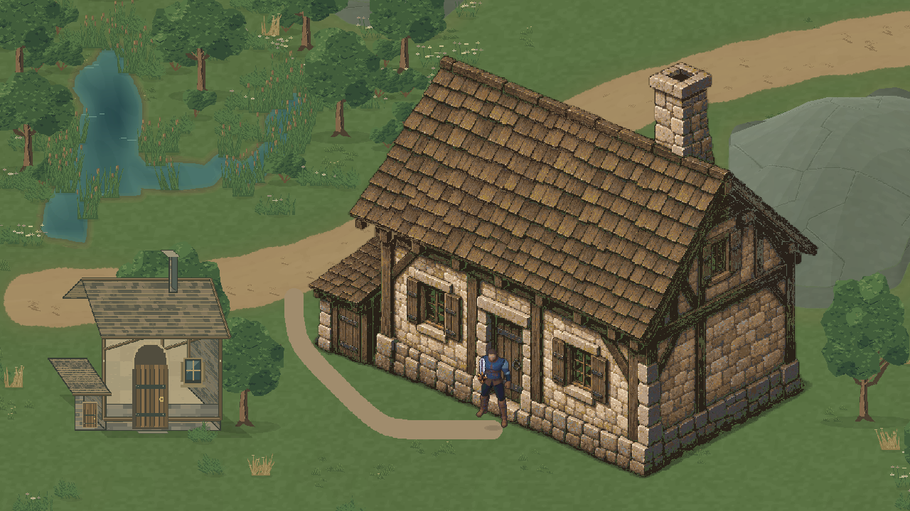
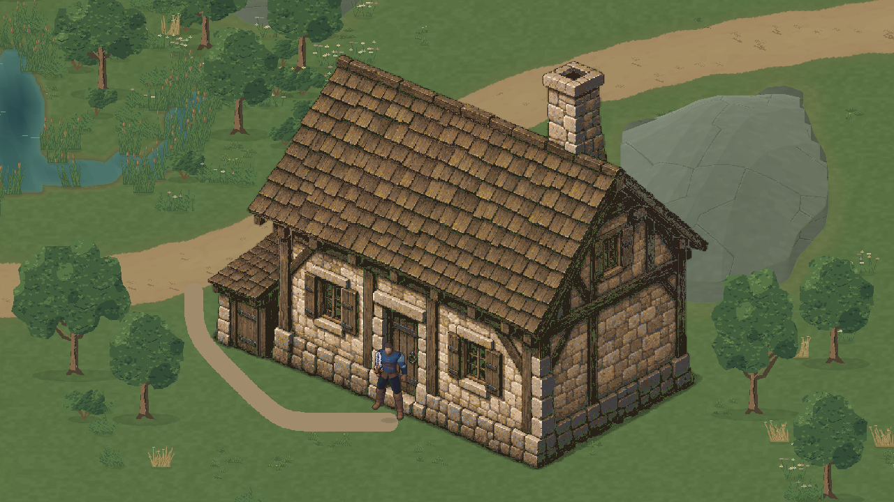
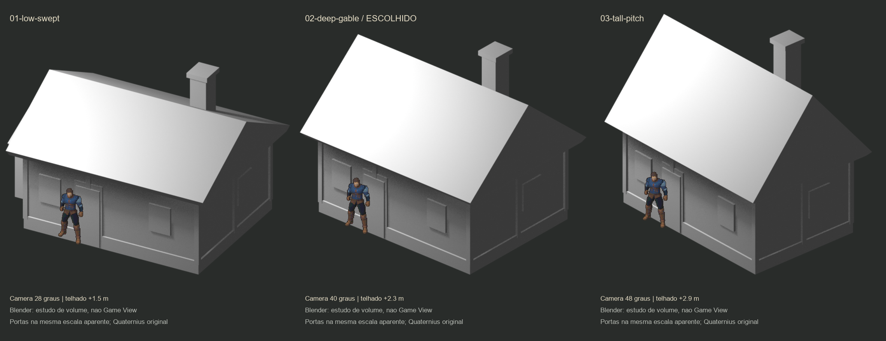

# Valdoria World Studio 07R — Architecture Art Reboot

**Estado: uma casa candidata à avaliação visual.** As casas do Marco 07 foram rejeitadas artisticamente; seus testes não constituíram aprovação. Este marco não amplia a biblioteca e não promove arte à cena oficial.

Projeto `D:\unity\Mmorpg`, Unity 6000.6.5f1, branch `main`, baseline `04530b339b98979a0061833f594535ccd31fbf63`. Worktree conferido e `git pull --ff-only origin main` executado antes do trabalho: já atualizado. Os arquivos locais não relacionados foram preservados. `MmorpgWorld.unity`, protagonista e produtores ambientais anteriores permanecem sem alteração.

## Comparação real na Unity

Mesma câmera, 1280×720, ortográfica 14,5, 32 PPU e escala 1 para ambas as casas. Quaternius conserva escala visual 1,25. À esquerda, A rejeitada; à direita, a nova referência. A casa antiga é apenas um rig de comparação desativado na cena salva, sem collider ou instância de edifício.





O ganho procurado é uma lateral substancial, cobertura com espessura, sombras de contato sob os beirais e alvenaria/estrutura que acompanham os planos. O canvas maior não é usado como justificativa de qualidade: geometria, proporções e projeção foram revistas antes dos materiais. A referência tem uma planta e uma orientação próprias; não são três fachadas recoloridas.

## Diagnóstico do Marco 07

Foram inspecionados `architecture_art.py`, `LibraryR7/`, o contrato e as capturas reais A/B/C (`ValdoriaWorldStudio07/Final/PlayQA/*-front.png`).

| Decisão anterior | Consequência visual | Decisão 07R |
|---|---|---|
| Projeção `(240+32(x+.5z),438+16z-32h)` | Fachada quase frontal; lateral reduzida a uma faixa cisalhada | Estudos ortográficos de dois planos amplos, com fachada também inclinada no chão |
| Portas/janelas frontais sobrepostas sem projetar cada plano | Aberturas pareciam adesivos sobre uma superfície | Aberturas desenhadas dentro da pintura dos planos, com rebaixo, moldura e sombra |
| Planos de telhado pouco espessos | Cobertura parecia uma placa solta | Cumeeira, inclinações, espessura, beiral profundo e estrutura sob a cobertura |
| Porta 5 u e paredes altas recalibradas isoladamente | Fachada estreita e verticalizada | Comparação do programa inteiro com o corpo visível real do protagonista |
| Repetição de cursos/planks e ruído sobre polígonos | Textura tentava compensar a falta de volume | Material subordinado à construção e à iluminação dos volumes |
| Sorting em uma linha horizontal única | Inadequado para a nova fachada diagonal | Linha frontal calculada a partir do footprint na coordenada X do ator |

O gerador visual antigo não foi utilizado para desenhar a casa nova. Sua engenharia de lotes, acesso, exclusões e navegação foi aproveitada.

## Estudos de forma e escolha

Blender **5.2.2 LTS**, renderização ortográfica real, materiais clay, programa comum de casa rural com anexo baixo. São três **estudos da mesma casa**, sem três sistemas ou três fontes artísticas finais.



| Estudo | Câmara / volume | Leitura |
|---|---|---|
| 01 low-swept | yaw 28°, profundidade 4,6 m, elevação do telhado 1,5 m | Cobertura baixa; lateral menos presente |
| **02 deep-gable — escolhido** | yaw 40°, profundidade 4,5 m, elevação 2,3 m | Melhor equilíbrio entre lateral, fachada, beiral e porta legível |
| 03 tall-pitch | yaw 48°, profundidade 3,9 m, elevação 2,9 m | Cobertura dominante e vertical; menos apropriado para a referência rural |

Dimensões dos estudos são unidades de autoria Blender, não metros anatômicos inferidos do sprite. A prancha alinha a altura aparente das portas e usa o Quaternius aprovado sem redesenho. É uma composição diagnóstica de renders Blender, **não Game View**. A pintura final usa o estudo 02 como direção volumétrica, sem prometer equivalência exata de vértices com o bloqueio.

Fontes: [script Blender](../../Tools/ArtPipeline/WorldGen/architecture07r_blockout.py), [estudo .blend](../../ArtSource/Labs/World2026/WorldStudio07R/VolumeStudies/chosen-volume-study.blend), [parâmetros/cantos projetados](../../ArtSource/Labs/World2026/WorldStudio07R/VolumeStudies/studies.json).

## Autoria e autoridade dos pixels

Skills utilizadas: `environment-architecture`, `aseprite-pixel-art`, `terrain-materials`; apoio `imagegen` para **uma** pintura assistida por IA, com o estudo Blender escolhido como referência. Ferramenta integrada `image_gen`, sem CLI/API/key externo. Aseprite **1.3.18.6**, executado realmente em batch para escala, paleta, camadas, exportação e inspeção.

- [Brief/prompt de direção e proveniência](../../ArtSource/Labs/World2026/WorldStudio07R/ArtDirection/design-brief.md).
- [Master assistido por IA, RGBA 1254²](../../ArtSource/Labs/World2026/WorldStudio07R/ArtDirection/cottage-painted-master-v1.png).
- **[Fonte editável Aseprite](../../ArtSource/Labs/World2026/WorldStudio07R/SourceV1/rural-reference.aseprite)**: 966², RGBA, um frame, doze camadas.
- [Metadados de escala, âncora e contornos](../../ArtSource/Labs/World2026/WorldStudio07R/SourceV1/house-source.json).
- [Export assinado](../../ArtSource/Labs/World2026/WorldStudio07R/ExportV1/manifest.json).

Camadas: Shadow, Foundation, WallsFront, WallsSide, TimbersFront, TimbersSide, Door, Windows, Roof, Eaves, Chimney, Details. Aseprite reduziu a pintura a 120 valores RGBA, sem dithering automático; a organização copia cada pixel existente uma única vez. Teste de recomposição integral passou. Não se alega pintura manual pixel a pixel.

A autoridade agora é a fonte Aseprite. `architecture07r_reference.py export` lê os pixels editados e recorta partes preservando a âncora. Não chama o gerador geométrico, Blender ou ImageGen. Os scripts de quantização/montagem ficam como proveniência inicial e não devem sobrescrever futuras edições. Não há promessa de regenerar a pintura bit a bit pelo modelo de IA; os exports da fonte e o build semântico são reproduzíveis.

As camadas separam uma pintura exterior, **não** contêm todas as superfícies escondidas sob telhado/vigas. Ainda não são módulos intercambiáveis. Há uma única casa, uma orientação, sem interiores.

## Proporção e integração

O corpo aprovado usado como referência é `pose_008`, atlas `body-f4b5619d.png`, SpriteRect 128×160; alpha visível de 117 px de altura. A 32 PPU e escala visual 1,25: **4,5703125 u** de corpo aparente. O retângulo completo do sprite não é a altura do personagem.

A abertura da porta foi anotada entre os pixels master y=802 e y=1003. Após escala **966/1254**, mede **154,8373 px = 4,838666 u**, aproximadamente **5,9%** acima do corpo visível. Não foi mantida automaticamente em 5 u. É uma calibração aparente sujeita à avaliação visual, não uma medida física em metros.

Cena nova: **`Assets/Mmorpg/Scenes/ValdoriaArchitectureArtLab07R.unity`**, derivada de Vegetation Lab. Apenas uma casa ativa. Posição geográfica `(29,41)`, Unity `(29,7)`; seed de build `710207`. O seed identifica o build de autoria e não inventa uma nova casa por sorteio.

O footprint de seis vértices acompanha a base e o anexo, não o telhado. Lote sem terraform: altura normalizada .413–.483, declive máximo .03, distância mínima da água ≈8,996 u. Acesso até a estrada ≈15,47 u, clearance final ≥.57 u. A porta é fechada, sem portal ou interior.

O build reserva a fundação e o acesso, regenera somente vegetação A e consome B apenas no bosque e C nos juncos. A permanece com 217 instâncias, mas somente **75 IDs/valores são idênticos**; **142 IDs antigos foram removidos ou mudaram** por exclusão/competição. Não se afirma estabilidade fora do lote. A composição final contém 216 instâncias sem conflitos. [Exclusões e diferenças por ID](../../ArtSource/Labs/World2026/WorldStudio07R/RegionV1/exclusions.json).

`ReferenceHouseDepth` calcula a borda frontal projetada em X, mantendo o protagonista à frente/atrás da casa. Reduz alpha apenas dos volumes cujos bounds interceptam o corpo quando os pés estão atrás da borda; fundação e sombra continuam. O collider físico continua inteiro e bloqueante. Não há física 3D no runtime.

## Evidências reais da Unity

Todas as imagens abaixo são frames renderizados em Play no Editor, perfil isolado `Temp/ValdoriaArchitecture07R/IsolatedProfile`, 1280×720. Não são renders Blender ou montagens da pintura sobre um cenário.

| Evidência | Arquivo |
|---|---|
| Casa isolada em fundo neutro | [09-isolated-unity.png](ValdoriaWorldStudio07R/PlayQA/09-isolated-unity.png) |
| Contexto e personagem diante da porta | [01-context-door.png](ValdoriaWorldStudio07R/PlayQA/01-context-door.png) |
| Contato com parede/porta | [02-door-contact.png](ValdoriaWorldStudio07R/PlayQA/02-door-contact.png) |
| Personagem na lateral | [03-side.png](ValdoriaWorldStudio07R/PlayQA/03-side.png) |
| Personagem atrás / cutaway | [04-behind-cutaway.png](ValdoriaWorldStudio07R/PlayQA/04-behind-cutaway.png) |
| Close do telhado / paredes | [05-roof-closeup.png](ValdoriaWorldStudio07R/PlayQA/05-roof-closeup.png), [06-walls-closeup.png](ValdoriaWorldStudio07R/PlayQA/06-walls-closeup.png) |
| Antiga/nova, mesma escala e câmera | [07-old-new-same-scale.png](ValdoriaWorldStudio07R/PlayQA/07-old-new-same-scale.png) |
| Quaternius junto à antiga, mesma câmera | [08-old-door-character-same-camera.png](ValdoriaWorldStudio07R/PlayQA/08-old-door-character-same-camera.png) |
| Detalhes nativos 1 px de arte : 1 px de tela | [roof-1to1.png](ValdoriaWorldStudio07R/NativeReview/roof-1to1.png), [walls-1to1.png](ValdoriaWorldStudio07R/NativeReview/walls-1to1.png) |
| Câmera em movimento, 20 frames reais e trace | [GIF](ValdoriaWorldStudio07R/camera-motion.gif), [frames PNG](ValdoriaWorldStudio07R/PlayQA/Motion), [trace](ValdoriaWorldStudio07R/PlayQA/play-qa.json) |

Contexto usa zoom amplo, fator de apresentação ≈.776 px de tela por pixel de arte. Close inicial usa 1,5× Point. As capturas adicionais usam ortográfica 11,25: **720/(2×11,25×32)=1**. Não se afirma pixel perfect inteiro em todos os zooms do laboratório.

## Testes executados e custo

Python: **8/8** dirigidos, [log](ValdoriaWorldStudio07R/python-tests.txt). Cobrem hashes/inputs e manifests, recomposição exata da fonte, PNGs importados idênticos, ocupação/acesso, proporção da porta, recusa de sobrescrita, repetição do build com saídas semânticas/geométricas/pixels idênticos e edição temporária real de um pixel Aseprite propagada ao export sem alterar a fonte entregue. [Inspeção Aseprite](ValdoriaWorldStudio07R/aseprite-inspection.txt).

Unity: compilação concluída sem falha; Play real com Input System, WASD, diagonal, esquiva, estrada até aproximação da porta, colisão frontal, circulação pela lateral, sorting frontal opaco e cutaway atrás: **12/12 verificações passaram**, 5.454 frames avançados / 21,488 s de tempo simulado. A colisão impediu entrar na parede sem penetração. Atores foram reposicionados explicitamente para as poses de revisão; o percurso de acesso e os movimentos/collision tests usaram input real sintético. [Resultados completos](ValdoriaWorldStudio07R/PlayQA/play-qa.json).

Editor: **49.152 pontos** de navegação versus Physics2D, **zero divergências**; um Player/câmera/EnvironmentRegionData/ArchitectureRegionData, um collider de seis vértices da casa e nenhum no telhado. Importador recusou destino existente. [Editor QA](ValdoriaWorldStudio07R/editor-qa.json).

| Medição no Editor | Resultado |
|---|---|
| Draw calls, mesma câmera sem casa/acesso → com casa/acesso | **115 → 128**, delta 13 |
| Renderers habilitados, mesmo controle | **219 → 232**, delta 13 |
| Componentes Renderer ativos na cena (incluindo desabilitados) | 240 |
| Memória reportada das 13 texturas novas, inclusive acesso | **28.162.992 bytes ≈26,86 MiB** |
| Meshes estáticas da vegetação reaproveitada | 103, 672.632 bytes medidos |
| Texturas importadas | RGBA32, Point, 32 PPU, um mip, sem compressão |

[Controle de custo / resolução](ValdoriaWorldStudio07R/NativeReview/review.json). É custo medido no Editor, não benchmark de build nem promessa de FPS. Ainda não há atlas/otimização final da referência; armazenamento de camadas esparsas é caro. O custo precisa ser reduzido antes de multiplicar edifícios.

Console: ground truth final **0 erros / 0 warnings**, compilação sem falhas. Desde o cursor de preflight houve **29 avisos de APIs obsoletas em código preexistente** e **um erro do próprio agente**, que chamou `play` em vez do comando correto `editor_play`; não houve erro de runtime da casa. [Entradas incrementais por seq](ValdoriaWorldStudio07R/console-new-entries.json). Contadores históricos do plugin não foram tratados como erros novos. Um probe de revisão tentou usar `UnityStats.batches`, inexistente nesta API; foi corrigido antes de executar, sem alteração do código do jogo. Um teste Python inicialmente pressupôs alpha=255 na pintura; passou após selecionar um pixel realmente presente. Esses ajustes de probes não são aprovação artística nem defeitos ocultados do runtime.

Ao terminar: Play parado, perfil normal restaurado, dispositivos sintéticos removidos, teclados reativados, Input System/configuração anterior e resolução da Game View restaurados, timeScale=1, cena limpa. Capturas foram gravadas diretamente em Docs, sem PNG/.meta temporário em Assets. [Estado final](ValdoriaWorldStudio07R/final-status.json).

## Limitações e próximo passo

O novo volume é uma candidata mais convincente para revisão, mas **não recebeu aprovação artística automática**. O usuário deve avaliar sobretudo a integração de escala, o acabamento dos shingles/alvenaria e a relação com Quaternius. Os testes não resolvem essa decisão.

O cutaway exterior usa bounds por parte, não máscaras exatas por pixel; superfícies escondidas não foram repintadas. Atrás da casa o chão aparece através das faces translúcidas e alguns acabamentos permanecem opacos. Isso mantém a leitura do ator, mas ainda não é um interior nem uma solução universal de oclusão para múltiplos atores/edifícios. A gramática de sorting é específica à orientação e ao protagonista deste estudo.

O acesso pedonal tem acabamento simples e curva de autoria técnica; não houve novo marco de estradas. Fundação sobre um plano 2D, sem adaptar cada pedra a uma superfície 3D. Telhado não é escalável; porta não abre. Sem outras casas completas, novas orientações, biblioteca expandida ou interiores.

**Depois da avaliação visual**, a referência escolhida poderá orientar módulos com encaixes, faces ocultas pintadas, telhados/vigas compatíveis, pivôs e atlas. Não transformar agora esta pintura em dezenas de variantes por recoloração, escala ou fórmulas. Primeiro resolver os ajustes artísticos apontados pelo usuário nesta única referência.

## Reprodução

```powershell
python Tools/ArtPipeline/WorldGen/architecture07r_reference.py export --output Temp/Architecture07R/new-export
python Tools/ArtPipeline/WorldGen/architecture07r_reference.py build --output Temp/Architecture07R/new-region
python Tools/ArtPipeline/WorldGen/architecture07r_reference.py verify --output ArtSource/Labs/World2026/WorldStudio07R/RegionV1
python -m unittest discover -s Tools/ArtPipeline/WorldGen -p test_architecture07r.py -v
unity command run_script --caller plugin --skill unity-pipeline --file AgentScripts/BuildArchitecture07R.cs --entry BuildArchitecture07R.Main --format json
```

Export/build exigem destinos ausentes. O importador exige Vegetation Lab limpo e recusa cena/arte já entregues. Para outra revisão, selecionar novos destinos constantes, sem sobrescrever a fonte artística. `ValidateArchitecture07R`, `ReviewArchitecture07R` e `InspectArchitecture07R` registram QA dirigido; captures/QA também recusam destinos existentes. Fontes e outputs assinados usam `-text` no Git para preservar hashes entre checkouts.
