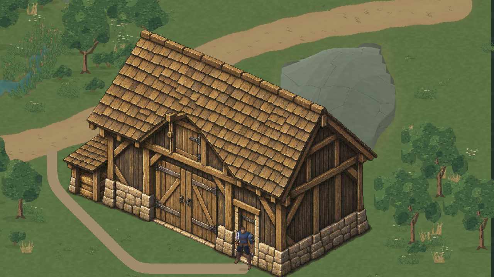
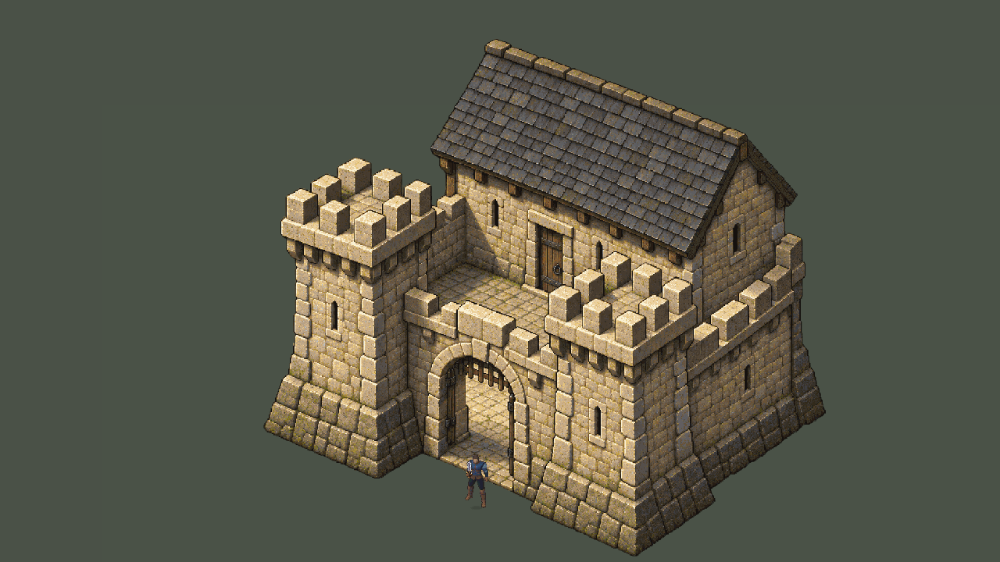
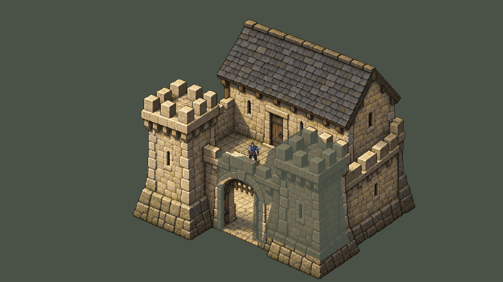

# Valdoria — celeiro e pequeno castelo

Pedido autorizado após a avaliação positiva da casa 07R: criar um celeiro e depois um pequeno castelo pelo mesmo processo de volume, arte editável e revisão com Quaternius. **Celeiro e pequeno castelo aprovados pelo usuário como referências visuais em 18/10/2026**, após o feedback literal “ficou bem boas”. A aprovação se refere à entrega `43ee9e4657e894340001e183ff4065c763d79b5f`; não promove os assets automaticamente à cena oficial nem aprova variantes futuras. [Registro versionado com hashes](ValdoriaWorldStudio08/artistic-approval.json).

Projeto `D:\unity\Mmorpg`, Unity 6000.6.5f1, `main`, baseline `e256f626ec9466c900c438045d8d1c2f630b28ee`. Worktree conferido e `git pull --ff-only origin main` executado: já atualizado. Arquivos locais não relacionados preservados. Cena oficial, protagonista, casa 07R e produtores ambientais anteriores intactos.

## Resultado real na Unity

**Celeiro:** salão de madeira com portões de carga, porta humana separada, travamentos e anexo baixo. Lote da região existente, acesso à estrada e exclusões de vegetação verificadas.



**Pequeno castelo:** fortificação compacta com duas torres, muralha, portão aberto, pátio transitável e corpo principal fechado. Apresentado em um **pátio técnico de revisão**, sem implantar automaticamente o castelo na geografia existente.





O castelo ainda exige decisão de lote/plataforma antes de entrar no mundo. Seu contrato marca `reviewOnly=true` e `worldLotAccepted=false`. Não se aplanou terreno, desviou água, alterou estrada ou removeu ecossistema para acomodá-lo. A superfície neutra é um chão técnico contínuo, não arte ambiental final ou um WorldRegion novo.

## Processo e fontes

Skills: `environment-architecture`, `aseprite-pixel-art`, `terrain-materials`, apoio `imagegen` e `unity-cli`. Blender **5.2.2 LTS** para dois estudos ortográficos de composição por modelo; escolhida a alternativa 1 de cada. O celeiro 2 aumentava profundidade e cobertura; o castelo 2 elevava o telhado do keep. As opções mais contidas preservaram a leitura rural/fortificada.

[Comparação dos quatro estudos Blender](ValdoriaWorldStudio08/volume-studies-comparison.png), [parâmetros](../../ArtSource/Labs/World2026/WorldStudio08/VolumeStudies/studies.json), [fontes .blend](../../ArtSource/Labs/World2026/WorldStudio08/VolumeStudies). São estudos auxiliares, não renders de gameplay nem geometria 3D em runtime.

Uma pintura assistida por IA para cada referência, usando a composição Blender e a casa aprovada como referência de acabamento. Ferramenta integrada `image_gen`, sem CLI/API/key externo. Prompts exatos: [celeiro](../../ArtSource/Labs/World2026/WorldStudio08/barn-prompt.txt), [castelo](../../ArtSource/Labs/World2026/WorldStudio08/castle-prompt.txt). [Proveniência, hashes e versões](../../ArtSource/Labs/World2026/WorldStudio08/provenance.json).

**Aseprite 1.3.18.6 executado realmente** para escala nativa nearest, limpeza de alpha abaixo de 100, paleta octree limitada a 128 cores, sem dithering automático, organização semântica e export. Fontes RGBA, um frame, doze camadas semânticas cada; dez partes não vazias exportadas por modelo. Não há alegação de pintura manual pixel a pixel. Quaternius não foi redesenhado.

| Fonte editável | Canvas / cores RGBA | Porta humana aparente |
|---|---|---|
| [barn-reference.aseprite](../../ArtSource/Labs/World2026/WorldStudio08/Barn/SourceV1/barn-reference.aseprite) | 1100² / 128 | 4,879386 u |
| [castle-reference.aseprite](../../ArtSource/Labs/World2026/WorldStudio08/Castle/SourceV1/castle-reference.aseprite) | 1650² / 123 | 4,893092 u |

Referência humana: alpha visível do Quaternius 117 px × escala 1,25 / 32 PPU = **4,5703125 u**. Folga aparente das portas ≈6,8% e 7,1%; não se reutilizou cegamente 5 u. O portão principal do castelo é maior que a porta humana do keep. Medidas aparentes em perspectiva, sem inferir metros anatômicos.

A autoridade dos pixels é cada `.aseprite`. O exportador compartilhado lê `sourceFile`, canvas, camadas e papéis dos metadados; não chama ImageGen, Blender ou o antigo gerador geométrico. A preparação inicial copia os pixels existentes para camadas; não redesenha alvenaria, madeira ou telhas. `prepare` recusa destino existente e não deve ser reaplicado sobre edição artística. Recomposição das camadas igual à pintura quantizada, pixel a pixel.

Ainda são pinturas exteriores separadas em funções, sem todas as faces ocultas reconstruídas. As partes não são módulos intercambiáveis entre plantas arbitrárias.

## Integração e geometria

Importador compartilhado `ArchitectureArt07RImporter.BuildReference`, com wrapper [BuildArchitectureModels](../../AgentScripts/BuildArchitectureModels.cs). Reutiliza os componentes de personagem, física, sorting, navegação e perfil isolado. Destinos novos, recusa de sobrescrita testada. Nenhuma geração no Play.

- **`Assets/Mmorpg/Scenes/ValdoriaBarnLab.unity`**: seed **810801**, posição geográfica **(38,5;45,5)**, um polígono físico de sete vértices. Lote: alturas normalizadas .384–.495, declive máximo .03, água a pelo menos 7,8196 u. Percurso até a porta ≈26,53 u. A primeira posição-guia (38;44) foi recusada por estrada/reservas; o lote efetivo foi escolhido sem alterar os produtores.
- **`Assets/Mmorpg/Scenes/ValdoriaCastleLab.unity`**: seed **810802**, pátio técnico 80×80, sete polígonos físicos independentes e cinco volumes de profundidade. Percurso do portão à aproximação do keep ≈18,54 u. Navegação .25 u, sem inflação embutida do ator; corredor verificado com clearance ≥.57 u.

Celeiro: apenas o consumidor de vegetação A foi regenerado pelas exclusões; bosque B e juncos C continuam seleções dos produtores anteriores. A composição final tem 213 instâncias. [Exclusões e diferenças por ID](../../ArtSource/Labs/World2026/WorldStudio08/Barn/RegionV1/exclusions.json) registram os efeitos de competição; não se promete estabilidade fora do retângulo. [Manifest do build](../../ArtSource/Labs/World2026/WorldStudio08/Barn/RegionV1/manifest.json).

Castelo: `footprint` externo é guia visual; **não** bloqueia todo o pátio. Física/navegação usam a união de `footprints`. Portão, torres, muralha e keep têm planos de chão/sorting próprios, reutilizando `ReferenceHouseDepth`. Piso do pátio fica fora dos grupos; quando o ator passa atrás do arco, o keep permanece opaco enquanto está à frente dele. [Contrato e máscaras](../../ArtSource/Labs/World2026/WorldStudio08/Castle/ReviewV1/house.json).

O QA inicial encontrou três amostras em que um `PolygonCollider2D` com sete contornos sobrepostos não produzia a união esperada. A representação foi corrigida para **sete colliders independentes**, usando os mesmos polígonos. Repetidos comparação completa e Play: zero divergências. [Diagnóstico inicial preservado](ValdoriaWorldStudio08/initial-collider-diagnosis.json). Não houve tentativa de esconder o problema com arte.

## Evidências e testes

| Evidência | Celeiro | Castelo |
|---|---|---|
| Contexto / escala | [frente](ValdoriaWorldStudio08/BarnQA/01-context-front.png) | [frente no pátio técnico](ValdoriaWorldStudio08/CastleQA/01-context-front.png) |
| Chegada por input real | [estrada–porta](ValdoriaWorldStudio08/BarnQA/02-arrival.png) | [portão–pátio–keep](ValdoriaWorldStudio08/CastleQA/02-arrival.png) |
| Colisão de porta fechada | [captura](ValdoriaWorldStudio08/BarnQA/04-door-collision.png) | [captura](ValdoriaWorldStudio08/CastleQA/04-door-collision.png) |
| Lateral / atrás | [lateral](ValdoriaWorldStudio08/BarnQA/05-side.png), [atrás](ValdoriaWorldStudio08/BarnQA/06-behind.png) | [lateral](ValdoriaWorldStudio08/CastleQA/05-side.png), [atrás](ValdoriaWorldStudio08/CastleQA/06-behind.png) |
| Detalhe nativo 1:1 | [telhado](ValdoriaWorldStudio08/BarnQA/07-roof-native.png), [paredes](ValdoriaWorldStudio08/BarnQA/08-walls-native.png) | [telhado](ValdoriaWorldStudio08/CastleQA/07-roof-native.png), [paredes/portão](ValdoriaWorldStudio08/CastleQA/08-walls-native.png) |
| Câmera em movimento | [GIF](ValdoriaWorldStudio08/barn-motion.gif), [20 PNGs](ValdoriaWorldStudio08/BarnQA/Motion) | [GIF](ValdoriaWorldStudio08/castle-motion.gif), [20 PNGs](ValdoriaWorldStudio08/CastleQA/Motion) |
| Resultado Play / traces | [11/11 verificações](ValdoriaWorldStudio08/BarnQA/play-qa.json) | [12/12 verificações](ValdoriaWorldStudio08/CastleQA/play-qa.json) |
| Física × navegação | [49.152 amostras, 0 divergências](ValdoriaWorldStudio08/BarnQA/editor-qa.json) | [102.400 amostras, 0 divergências](ValdoriaWorldStudio08/CastleQA/editor-qa.json) |

Capturas reais de Game View, 1280×720, após renderização. Contexto do celeiro em ortográfica 14,5; castelo 24 para enquadrar o conjunto maior. Não são a mesma escala de apresentação entre as duas capturas gerais. **Mesmos 32 PPU e Quaternius 1,25**; os detalhes usam ortográfica 11,25, resultando em 1 pixel de arte por pixel de tela. Não se afirma pixel perfect inteiro em todos os zooms.

Input System real com teclado sintético: WASD, diagonal, esquiva, percursos, parede fechada e poses de frente/lado/trás. Poses foram reposicionadas explicitamente para revisão; os percursos usaram movimento físico por input. Castelo foi novamente testado após a correção dos colliders. Perfil isolado em `Temp/ValdoriaArchitectureModels/<id>/IsolatedProfile`.

Python: **6/6 testes dos modelos**, mais **8/8 de regressão da casa 07R**, cobrindo hashes, fontes, recomposição, PNGs importados, reconstrução determinística, ecologia do celeiro, união dos polígonos, passagem no portão, proporções e recusa de sobrescrita. [Log dos modelos](ValdoriaWorldStudio08/python-tests.txt), [regressão](ValdoriaWorldStudio08/house-regression-tests.txt), [inspeção Aseprite do celeiro](ValdoriaWorldStudio08/barn-aseprite.txt) e [castelo](ValdoriaWorldStudio08/castle-aseprite.txt). O teste de recusa precisou aceitar o `ValueError` efetivamente usado pelo contrato existente; a recusa funcionava.

| Custo medido no Editor | Celeiro, com região | Castelo, pátio técnico |
|---|---|---|
| Texturas novas importadas | 24.862.896 bytes ≈23,71 MiB | 41.570.760 bytes ≈39,65 MiB |
| Draw calls na captura de detalhe | 48 | 15 |
| Renderers em GameObjects ativos | 242 | 24 |
| Collider da construção | 1, sete vértices | 7, total 28 vértices |
| Grupos de profundidade | 1 | 5 |

As cenas/câmeras têm conteúdos diferentes: draw calls não são comparação de eficiência entre modelos. RGBA32, Point, 32 PPU, sem compressão/mips. Memória inclui texturas auxiliares e medição do Editor; não é benchmark de build/FPS. Partes esparsas ainda custam memória e precisam de recortes/atlas melhores antes de multiplicar construções.

Compilação concluída sem falhas, Console ground truth final **0 erros / 0 warnings**, nenhuma entrada nova desde o cursor do preflight. [Estado final de compilação, Console e restauração](ValdoriaWorldStudio08/final-status.json). Ao terminar: Play parado, perfil normal restaurado, nenhum teclado sintético, dispositivos/configurações de input e resolução de Game View restaurados, timeScale=1 e cenas limpas. Nenhum screenshot temporário em Assets. Resultados históricos do plugin não foram tratados como erros novos.

## Reconstrução e limites

```powershell
python Tools/ArtPipeline/WorldGen/architecture07r_reference.py export --source ArtSource/Labs/World2026/WorldStudio08/Barn/SourceV1 --output Temp/Architecture08/new-barn-export
python Tools/ArtPipeline/WorldGen/architecture07r_reference.py build --source ArtSource/Labs/World2026/WorldStudio08/Barn/SourceV1 --exported ArtSource/Labs/World2026/WorldStudio08/Barn/ExportV1 --position '[38.5,45.5]' --output Temp/Architecture08/new-barn-region
python Tools/ArtPipeline/WorldGen/architecture07r_reference.py export --source ArtSource/Labs/World2026/WorldStudio08/Castle/SourceV1 --output Temp/Architecture08/new-castle-export
python Tools/ArtPipeline/WorldGen/architecture_models.py yard --source ArtSource/Labs/World2026/WorldStudio08/Castle/SourceV1 --exported ArtSource/Labs/World2026/WorldStudio08/Castle/ExportV1 --output Temp/Architecture08/new-castle-yard
python -m unittest discover -s Tools/ArtPipeline/WorldGen -p test_architecture_models.py -v
```

`BuildArchitectureModels.Barn` e `.Castle` usam o Editor conectado e recusam os destinos já entregues. Para nova revisão, selecionar novos destinos. Nenhum normal export regenera a pintura de IA. Reprodução da geometria/exports é determinística; geração original por IA não tem promessa de repetição bit a bit.

**Pendências após aprovação visual:** implantação geográfica do castelo; acabamento dos acessos; melhor separação das faces ocultas e recorte/atlas. Cutaway por bounds é aproximado e reduz volumes inteiros interceptados. Sem porta interativa, interior do celeiro/keep, subida de escadas, passagem sobre muralhas, andares, destruição ou cerco. Usar as fontes aprovadas como referência para modularização; novas variantes continuam exigindo avaliação própria. Nada foi promovido a `MmorpgWorld.unity`.

O status candidato preservado nos manifests assinados descreve o momento da geração. O registro de aprovação acima atualiza a decisão artística sem modificar os pixels aprovados, as fontes Aseprite ou seus hashes históricos. Esta publicação altera somente documentação/metadados de aprovação; não houve nova execução de QA Unity.
