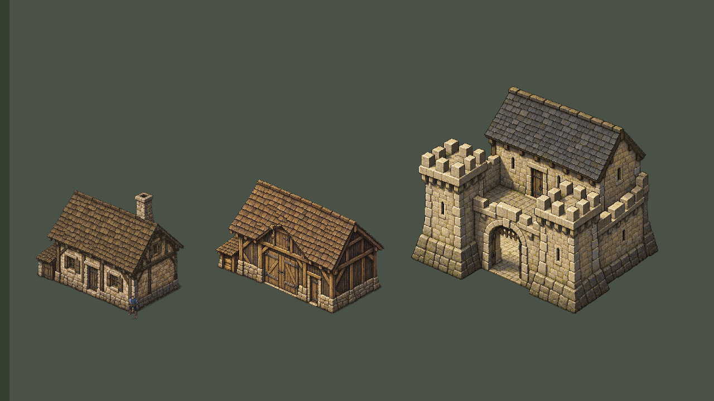

# Valdoria World Studio09 — direção unificada e catálogo autorado

18/10/2026 · Unity6000.6.5f1 · `main`. Entrega experimental. **Construções apresentadas aprovadas como referência visual; terreno e vegetação ainda precisam de qualidade.** Nenhum prédio novo, vila, interior ou promoção à cena oficial.

## Avaliação do usuário após a entrega

Feedback literal: **“Ficou boa as casas, mas a vegetação e terreno ainda falta qualidade”**. Revisão avaliada: `a6ec7065e77fcc9b90ec1e1a523c2baad4967358`. [Registro com hashes das referências apresentadas](ValdoriaWorldStudio09/artistic-review.json).

Preservar a arquitetura apresentada como referência. Terreno e vegetação não estão artisticamente concluídos; a mudança de pigmento09 não foi suficiente. O próximo estudo deve trabalhar massas e planos, formas vegetais, casca/ramificação, materiais do solo e rocha e transições, comparando com o acabamento arquitetônico. Essa direção de trabalho não é uma aprovação de novas variantes, de todos os estados de conservação ou da implantação geográfica do castelo. Nenhum asset foi alterado ou promovido ao registrar esta avaliação.

O pedido anexado amplia a unificação arquitetônica para materiais/vegetação e produção por catálogo. `git pull --ff-only origin main` foi executado antes do trabalho: atualizado, HEAD inicial `c7f82c317209cd6f4972a8a9ad5a141961a0620f`. Referências: casa `e256f626ec9466c900c438045d8d1c2f630b28ee`; celeiro/castelo `43ee9e4657e894340001e183ff4065c763d79b5f`. Fontes aprovadas e seu [registro08](ValdoriaWorldStudio08/artistic-approval.json) foram preservados.

## Revisar primeiro



Galeria neutra de comparação, **sem alegação de lote geográfico para o castelo**. Os prédios têm a mesma escala entre si; este enquadramento reduz os pixels. Os close-ups abaixo têm resolução nativa própria.

- [Casa: A/B/C, mesma câmera e ator](ValdoriaWorldStudio09/house-ABC-same-camera.png).
- [Celeiro: A/B/C, mesma câmera e ator](ValdoriaWorldStudio09/barn-ABC-same-camera.png).
- [Castelo no sublaboratório](ValdoriaWorldStudio09/CastleQA/00-C-same-pose.png).
- [Materiais reais e rampas](ValdoriaWorldStudio09/visual-language-material-board.png).
- [Conservação nas três famílias](ValdoriaWorldStudio09/architecture-variants-board.png) e [galeria com variantes](ValdoriaWorldStudio09/GalleryQA/02-three-weathered-variants-same-scale.png).

## Diagnóstico e decisões

A casa07R já possui duas paredes legíveis, entrada recuada, telhado construído, contato e detalhe suficientes para servir de referência. Celeiro e castelo partilham essa abordagem, mas o celeiro apresentava cobertura mais dourada e fundação mais clara; a cantaria do castelo tinha maior brilho quente. Terreno e vegetação tinham menor riqueza cromática e planos de folhagem pouco separados.

Não havia evidência para deformar as formas aprovadas. As alturas de abertura medidas são 4,8387u na casa, 4,8794u na porta de serviço do celeiro e 4,8931u no torreão. Quaternius: 117px visíveis ×1,25/32 =4,5703u. Variação entre essas portas é pequena; a grande porta agrícola e o portão externo possuem outra função. Nenhuma porta foi automaticamente fixada em5u.

As guias de chão têm inclinações diferentes, documentadas em [measured-style.json](ValdoriaWorldStudio09/measured-style.json). Não equivalem a bordas exatas da pintura nem justificam projetar novamente os sprites. As fontes mantêm dimensões, alpha, anchors, footprints, volumes, fundações e oclusão.

Criados [ValdoriaVisualLanguage.md](../Art/ValdoriaVisualLanguage.md) e [ArchitectureStyleGuide.md](../Art/ArchitectureStyleGuide.md), com paletas, valores medidos, luz superior esquerda, hierarquia de detalhe, escala, regras de fundação/aberturas/telhado e limites de modularização. Seis skills ambientais consultam agora esses documentos.

## Revisões artísticas e fontes

Raiz nova: `ArtSource/Labs/World2026/WorldStudio09/`.

| Área | Trabalho09 | O que permanece |
|---|---|---|
| Casa | Estado `maintained` conserva a referência; `weathered` acrescenta desgaste/líquen localizado | Silhueta e pixels da referência no estado mantido |
| Celeiro | Cobertura menos dourada, fundação aproximada à família da casa; conservação localizada | Estrutura, anexos e aberturas aprovados |
| Castelo | Cantaria discretamente menos quente/brilhante; conservar ardósia; líquen localizado | Cinco volumes, pátio, sete polígonos físicos |
| Terreno | Seis rampas por material; pigmentContrast1,12;36 motivos editáveis remapeados no Aseprite | Seed710202, campos contínuos, traçado, relevo e colisão |
| Vegetação | Carvalho, olmo, aveleira, samambaia e junco: verdes mais ricos, planos quentes/frios, recessos de copa e tratamento da casca | Três silhuetas por espécie, alpha, UV, anchors, habitats e distribuição |
| Água | Avaliação em contexto; família azul esverdeada funciona como contraponto frio | Arte05, lago, riacho, margens, vau, fluxo e física intactos |

Arquitetura: `Architecture/{house,barn,castle}/{maintained,weathered}/Source/*.aseprite`, camadas e metadados individuais. Vegetação: `Vegetation/Source/*.aseprite`, seis camadas e três frames estáticos por espécie. Terreno: `Terrain/Source/terrain-motifs.aseprite`,768×192, quatro camadas e36 motivos. As outras três espécies06 não recebem tratamento nesta seleção.

Conservação altera cerca de **2,75% /2,47% /3,74%** dos pixels opacos da casa/celeiro/castelo: colônias discretas e desgaste, sem alterar alpha ou fabricar geometria. [Medição](ValdoriaWorldStudio09/variant-pixel-coverage.json).

Autoria09: Lua no Aseprite1.3.18.6 e composição Python/Pillow/NumPy/SciPy. Não houve nova geração ImageGen nem necessidade de novo bloqueio Blender, pois os volumes aprovados foram preservados. A proveniência de pintura assistida por IA dos originais07R/08 continua ligada nos metadados. Quaternius não foi alterado.

O script `author` é montagem inicial de uma revisão nova, recusa destino existente e não deve ser executado sobre fonte final editada. Exportação lê o Aseprite real; Python não redesenha a pintura aprovada por cima dele.

### Vegetação a 1×

- [Carvalho](ValdoriaWorldStudio09/vegetation-oak-native.png).
- [Olmo maior](ValdoriaWorldStudio09/vegetation-elm-native.png).
- [Aveleira](ValdoriaWorldStudio09/vegetation-hazel-native.png).
- [Samambaia](ValdoriaWorldStudio09/vegetation-fern-native.png).
- [Juncos](ValdoriaWorldStudio09/vegetation-reeds-native.png).

Cada prancha mostra original/revisão das três silhuetas sem redimensionamento. O acabamento vegetal ainda é mais simples que a arquitetura; esta revisão não é declarada equivalência artística perfeita.

## Catálogo e produção verificável

`catalog.json`: schema `valdoria-architecture-catalog/v1`, versão `valdoria-visual-direction/1.0.0`. Cada família informa source aprovado, metadata, IDs de layers, revisões com source/export por SHA256, dimensões projetadas, âncora, footprint, papéis e combinações suportadas. As peças pintadas são específicas da família; materiais, papéis e ferramentas são reutilizáveis.

Receitas novas `valdoria-authored-architecture-recipe/v1` não são o planejador histórico07. Fixam orientaçãoSE, dimensões projetadas autoradas, cobertura, aberturas, anexo, decoração e material compatível. Aceitam seed, posição e conservação. Outro telhado, orientação, dimensão ou abertura é recusado e exige nova arte. Não há stretching.

As três receitas entregues usam seed **910209** e estado `weathered`. `maintained` e `weathered` são dois estados automáticos disponíveis; `seeded` seleciona um deles por hash de família/versão/seed. O padrão de conservação tem patternSeed910209 nas fontes; não prometer edifícios ou formas infinitos por seed.

Posições geográficas: casa(29;41), celeiro(38,5;45,5). Seus builds09 reproduzem exatamente navegação, exclusões e plantas anteriores, respectivamente216/213 instâncias. Posição física e sprite não mudam em A/B/C. O compilador continua calculando acesso/exclusões e regenerando o consumidor em um lote novo; competição ecológica pode mudar plantas fora da exclusão.

Castelo: `review-yard` fixo(32;32). `world` é recusado até existir lote aceito. Os testes [recusam ocupações sobre água, rocha e estrada](ValdoriaWorldStudio09/lot-rejections.json); as razões podem combinar vários impedimentos no mesmo footprint. Também rejeitam campos desconhecidos, versão, orientação, dimensões e módulos incompatíveis.

```powershell
# Destinos devem ser inexistentes. Exportar a fonte efetivamente editada.
python Tools/ArtPipeline/WorldGen/architecture07r_reference.py export --source ArtSource/Labs/World2026/WorldStudio09/Architecture/house/weathered/Source --output Temp/WorldGen/09-house-reexport-new
python Tools/ArtPipeline/WorldGen/visual_unification09.py build --catalog ArtSource/Labs/World2026/WorldStudio09/catalog.json --recipe ArtSource/Labs/World2026/WorldStudio09/Recipes/house.json --output Temp/WorldGen/09-house-new
python -m unittest discover -s Tools/ArtPipeline/WorldGen -p test_visual_unification09.py -v
```

`build --catalog` aceita outro catálogo versionado com referências novas: não é necessário redesenhar por fórmula nem manter compatibilidade com a gramática rejeitada07. Export/layout/receitas e entradas precisam ser regenerados conscientemente depois de editar uma fonte.

Para primeira importação no Editor, com outputs ausentes: `unity command run_script --file AgentScripts/BuildVisualUnification09.cs --entry BuildVisualUnification09.Main --caller plugin --skill unity-pipeline --format json`. A operação é enfileirada para não exceder o limite5s da chamada do pipeline; acompanhar `Temp/WorldGen/BuildVisualUnification09.json`. Os laboratórios entregues já existem e a ferramenta recusa sobrescrevê-los.

## Unity e capturas reais

| Cena | Finalidade |
|---|---|
| `Assets/Mmorpg/Scenes/ValdoriaVisualHouse09.unity` | Casa no terreno/água/estrada/ecologia existentes |
| `Assets/Mmorpg/Scenes/ValdoriaVisualBarn09.unity` | Celeiro em seu lote validado |
| `Assets/Mmorpg/Scenes/ValdoriaVisualCastle09.unity` | Sublaboratório de revisão do castelo |
| `Assets/Mmorpg/Scenes/ValdoriaVisualGallery09.unity` | Comparador dos três modelos, sem implantação geográfica |

`VisualUnification09Importer.Build()` cria somente em destinos ausentes. Clona a engenharia validada, importa atlas/receitas/seleções verificadas, conserva meshes de chão, ecologia e colliders. `VisualUnificationLab` troca referências, não gera terreno em Play. Texturas Point/RGBA32/32PPU, sem mips/compressão/resampling. Atlases por família:1658×2046,2164×1261,2034×2601, com padding2 e partes recortadas sem perda.

Teclas: **1**=A ambiente anterior/arquitetura original; **2**=B materiais09/arquitetura mantida09; **3**=C também vegetação09. **V** compara conservação. **P** aplica os estados das receitas compiladas — weathered nas três entregues. **F1–F4** abrem os quatro laboratórios em Play no Editor, sem alterar Build Settings oficial. WASD/Space continuam no Input System.

Comparações A/B/C da casa: câmera(29;15,5), ortho14,5, ator(28,67385;6,24555). Celeiro: câmera(38,5;15,5), ortho14,5, ator no mesmo approach. Castelo: câmera(34;65), ortho24. Trace registra posições/frames; nenhuma troca de exposição/tint entre estados. Estado C inicial é mantido para isolar a revisão vegetal; P é a demonstração separada das receitas weathered.

| Evidência | Casa | Celeiro | Castelo |
|---|---|---|---|
| Frente/porta | [PNG](ValdoriaWorldStudio09/HouseQA/01-context-front.png) | [PNG](ValdoriaWorldStudio09/BarnQA/01-context-front.png) | [PNG](ValdoriaWorldStudio09/CastleQA/01-context-front.png) |
| Lateral | [PNG](ValdoriaWorldStudio09/HouseQA/05-side.png) | [PNG](ValdoriaWorldStudio09/BarnQA/05-side.png) | [PNG](ValdoriaWorldStudio09/CastleQA/05-side.png) |
| Atrás/cutaway | [PNG](ValdoriaWorldStudio09/HouseQA/06-behind.png) | [PNG](ValdoriaWorldStudio09/BarnQA/06-behind.png) | [PNG](ValdoriaWorldStudio09/CastleQA/06-behind.png) |
| Telhado nativo | [PNG](ValdoriaWorldStudio09/HouseQA/07-roof-native.png) | [PNG](ValdoriaWorldStudio09/BarnQA/07-roof-native.png) | [PNG](ValdoriaWorldStudio09/CastleQA/07-roof-native.png) |
| Parede/fundação nativa | [PNG](ValdoriaWorldStudio09/HouseQA/08-walls-native.png) | [PNG](ValdoriaWorldStudio09/BarnQA/08-walls-native.png) | [PNG](ValdoriaWorldStudio09/CastleQA/08-walls-native.png) |
| Movimento | [GIF](ValdoriaWorldStudio09/HouseQA/camera-motion.gif) | [GIF](ValdoriaWorldStudio09/BarnQA/camera-motion.gif) | [GIF](ValdoriaWorldStudio09/CastleQA/camera-motion.gif) |

Close-ups:1280×720, ortho11,25 →1 pixel da arte/pixel da captura. PNGs são evidência de cor; GIFs derivados dos frames reais podem quantizar a paleta. As sequências não são animações produzidas fora da Unity.

## QA executado

- **12 testes Python dirigidos passaram**: contratos, seed, rejeições, fontes aprovadas, alpha/anchors/escala, variantes, atlas sem perdas/overlaps, UVs vegetais idênticos, reexport Aseprite e reconstrução determinística de região. [Log](ValdoriaWorldStudio09/python-tests.txt).
- A composição material09 foi gerada novamente e comparada por bytes pelo `terrain_materials.py verify`: reproduzível. Biblioteca/receita/máscaras/manifest verificados; `relief-field.json` permanece byte-idêntico ao04.
- Recompile real e polling concluídos sem erros de compilação. Play real, perfil em `Temp`, frames avançaram. Casa/celeiro/castelo:5614/6196/5625 frames nos percursos; WASD, diagonal, esquiva, estrada→entrada ou portão→pátio, colisão de parede, lateral e cutaway passaram. [Logs individuais](ValdoriaWorldStudio09/HouseQA/play-qa.json).
- Physics2D × navegação: **0 divergências em49.152/49.152/102.400 amostras**. Casa:1 polígono/6 vértices; celeiro:1/7; castelo:7/28 e5 grupos de profundidade. [Editor QA](ValdoriaWorldStudio09/CastleQA/editor-qa.json).
- Vegetação: contato de tronco, frente/trás, passagem sob copa, vau, circulação na margem e12 frames de câmera em movimento passaram. [Log](ValdoriaWorldStudio09/EnvironmentQA/play-qa.json), [vau](ValdoriaWorldStudio09/EnvironmentQA/C-ford.png), [movimento](ValdoriaWorldStudio09/EnvironmentQA/camera-motion.gif).
- Catálogo: P e F1–F4 exercitados pelo Input System real, referências persistem após carregar as cenas e todas as partes arquitetônicas passam às texturas weathered selecionadas. [Log](ValdoriaWorldStudio09/CatalogQA/play-qa.json), [captura](ValdoriaWorldStudio09/CatalogQA/3-selected-recipe.png).

Console é registrado por cursor desde39448, sessão do preflight: [registro completo](ValdoriaWorldStudio09/console-observed.json). Três erros são da operação do agente: timeout5s nos seq39478/39508 durante importação/ligação de referências, que terminaram no Editor e foram verificadas; seq39509 chama um nome de comando inexistente, corrigido para `console`. Não são falhas de gameplay. Os avisos incluem APIs obsoletas de código anterior e diagnósticos de helpers; não são tratados como aprovação nem novos defeitos do jogo. Um helper inicialmente tentou `UnityStats.batches`, indisponível nesta versão; a sequência executada usa `drawCalls` e compilou. Não houve erro novo de jogo observado nos Plays. A amostra final do Console mostra0 erros/0 warnings visíveis e compilationFailed=false; o histórico por cursor continua preservado.

A galeria inicial revelou faixas por UV fora do atlas e foi reprovada como prancha. [Primeira passagem preservada](ValdoriaWorldStudio09/Diagnostics/GalleryFirstPass/01-three-families-same-scale.png); piso neutro corrigido e recapturado. Isso não alterou os materiais dos laboratórios geográficos.

## Custo medido e limites

Dados de `UnityStats` e `Profiler.GetRuntimeMemorySizeLong` no Editor, enquadramento fixo. Memória é das texturas vinculadas aos renderers ativos, incluindo Quaternius; não representa toda a memória do processo nem medição de VRAM do driver.

| Cena | Draw calls A→C | Renderers ativos | Texturas vinculadas A→C | Memória vinculada A→C,MiB |
|---|---:|---:|---:|---:|
| Casa | 129→129 |232 |26→15 |166,44→172,43 |
| Celeiro |117→117 |234 |24→15 |163,29→169,19 |
| Castelo |17→17 |16 |15→6 |126,21→127,76 |

[Medição completa](ValdoriaWorldStudio09/performance-summary.json). As referências A/B/C e weathered ficam carregadas para comparar: dependências de textura residentes estimadas pelo Editor somam **437.281.891 /420.877.027 /356.074.099 bytes** nos três laboratórios. Isso é maior que o estado ativo e não deve ser omitido.

Os atlases diminuem o número de texturas gerenciadas, preservam os pixels e facilitam partilhar material por família, mas **não reduziram draw calls nesta implementação** e acrescentaram padding/memória. Não apresentar consolidação como otimização de desempenho comprovada. Antes de povoar uma região maior, avaliar batching/overdraw e descarregar estados de comparação; não reduzir resolução para esconder o custo.

Permanecem: apenas três exteriores autorados, dois estados de conservação por família; sem recombinação livre, faces ocultas ou novas orientações. Castelo sem lote mundial. Portas de casa/celeiro/torreão fechadas; portão do pátio aberto. Sem interiores, natação, hidráulica completa ou escalada de montanhas. Cutaway continua baseado em bounds. Acesso pedestre secundário mantém o desenho simples anterior; vegetação/rocha ainda têm acabamento menos elaborado que a arquitetura. Essas são pendências de avaliação, não aprovações automáticas.

`MmorpgWorld.unity`, topografia, estradas, água e fontes aprovadas não foram modificados. O teste da cena normaliza apenas CRLF/LF do Git; fontes binárias são comparadas byte a byte. Nenhum dado pessoal/cache/executável foi incluído. Worktree não relacionado foi preservado. Play, dispositivos sintéticos, input e resolução temporária são restaurados ao finalizar; [estado restaurado](ValdoriaWorldStudio09/final-editor-restored.json), [inventário de imagens/artefatos](ValdoriaWorldStudio09/artifact-inventory.json) e [verificação dos bytes staged](ValdoriaWorldStudio09/staged-artifact-qa.json).
