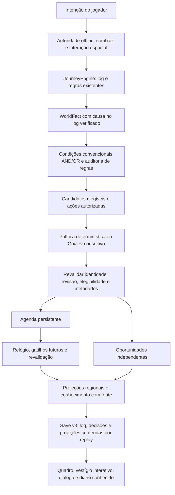
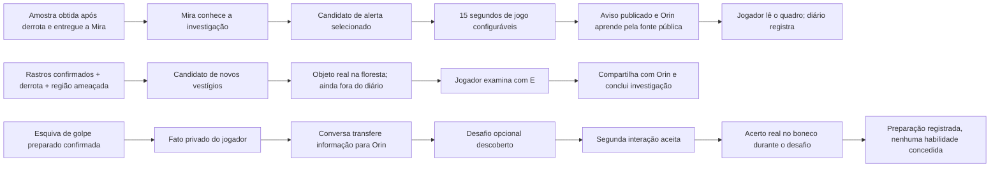

# Marco 04 — mundo reativo

O módulo `Domain/WorldEventOrchestrator` consome fatos confirmados do `JourneyEngine` e escolhe consequências permitidas. Não possui inventário, desbloqueio de habilidades ou regras de progressão. As rotas A/B e Leitura de Fraquezas continuam no motor anterior. Todos os novos acontecimentos são opcionais.

## Fluxo e responsabilidades



| Módulo | Responsabilidade |
|---|---|
| `WorldEventContracts.cs` | Contratos v1, identidade, configurações, relógio e cópias defensivas |
| `WorldEligibility.cs` | Definições de conteúdo, AND/OR, fatos, conhecimento, região, estado de oportunidade, acontecimento anterior e tempo; evidências por ID de regra |
| `WorldEventOrchestrator.cs` | Importação verificada, seleção, revalidação, agenda, descoberta/conclusão/expiração, disseminação e replay |
| `JourneyContracts/JourneyEngine` | Evento de ação de combate acrescentado no fim do enum; save v3 com mundo opcional e validação conjunta |
| `OfflineAuthority/WolfBrain` | Preparação registrada e consumida uma vez; esquiva só confirmada se o golpe aceito encontra o jogador vivo, no alcance/cone, sem parede e durante a esquiva |
| `WorldClock` | Tempo de jogo acumulado a partir do checkpoint; UTC real separado |
| `WorldEventSession` | Referências serializadas, relógio, decisões assíncronas, apresentação e autosave; avaliação HTTP somente com candidatos novos |
| `WorldDecisionClient/Coordinator` | Mesmo endpoint local do Marco 03, timeout, fallback e descarte de sessão substituída |
| `backend/decisions/world.go` | Extensão do serviço existente: contrato e regras de consistência para candidatos A/B/C |
| `AgentScripts/AddWorldEvents.cs` | Extensão idempotente da cena existente; recusa cena suja, Play, conflito ou autoria parcial; não gera nem substitui uma cena |

## Contratos versionados

Todos os contratos novos têm versão **1**. O envelope Journey passa a **3**, mantendo o envelope de armazenamento/checksum v1 e o nome `journey-v1.json`. O ID de avalia??o combina a primeira causa verificada da jornada e a revis?o, evitando colis?es entre novas jornadas e permanecendo est?vel ap?s reload. O POST Decisions continua **v1**, com a nova política `world-context-v1` e `candidates` opcional. Requests de Mira anteriores não incluem esse campo e continuam compatíveis.

| Contrato | Campos relevantes |
|---|---|
| `WorldFact` | id `fact:<Journey eventId>`, kind, subjectId, causeId, gameTime e realTime; importa apenas entradas aceitas pelo Journey |
| `EventCandidate` | id de conteúdo estável, type, scope, causeId, context, ruleId, conditions e authorizedActions; não contém valores de dano/recompensa |
| `WorldOpportunity` | id, candidateId, causeId, status, discovered, expiresAtGameTime |
| `ScheduledConsequence` | id estável `schedule:forest-alert`, actionId, causeId, relógio escolhido, dueAt, condição de fato/conhecimento, gatilhos futuros, createdRevision, executed/cancelled |
| `WorldState` | ator/mundo, revisão, dois relógios, ameaça regional, aviso publicado/lido, fatos, oportunidades, agenda, conhecimento, decisões, comandos e auditoria de elegibilidade |
| `WorldEvaluation` | eventId da avaliação, actorId, worldId, stateVersion, policyId, characterFacts, npcKnowledge, regionState, candidates, eligibleConsequences |
| `WorldKnowledge` | npcId, factId, causeId, senderId e fonte Observation/Conversation/Message/PublicNotice |

`WorldCommand` usa IDs `<tipo>:<revisão>` e registra os horários observados. O replay valida fonte, ordem, decisões e todas as projeções. A revisão avança somente com alterações efetivas; checkpoints de relógio não criam requisições de IA nem entradas a cada frame. A auditoria registra regras satisfeitas/rejeitadas depois de cada comando efetivo, incluindo `active-limit` e `already-considered`, sem texto privado ou credenciais.

Não há API pública que aceite fatos arbitrários, conhecimento sem fonte ou ações inventadas pelo modelo. `ApplyValidated` e os adaptadores continuam pontos **internos da autoridade offline**. Nomes de fontes não autenticam um cliente malicioso.

## Os três acontecimentos



**A — Alerta:** entrega válida gera conhecimento de Mira. A política pode selecionar o alerta e agendar publicação. A agenda revalida ameaça, fato de investigação e fonte de Mira antes de publicar. Só então Orin aprende pelo aviso público. O jogador lê o quadro para registrar a informação no diário. Derrota ou rumor sem investigação não produz esse aviso.

**B — Vestígios:** um único combate verificado, rastreamento e ameaça regional são suficientes. Não depende de dezenas de derrotas nem de entrega a Mira. A seleção faz surgir a pista em **(3, 2.5)**. Ela permanece interativa após reload; conversar com Orin antes de examiná-la não conclui a nova investigação. Examinar e compartilhar conclui. A pacificação regional fecha a oportunidade e esconde o vestígio.

**C — Treinamento:** apertar esquiva sozinho não basta. A autoridade confirma um golpe preparado que teria alcançado o jogador e foi evitado durante sua janela de esquiva. Ataque comum, erro por distância/parede, recusa de cooldown ou imunidade de dano não geram esse fato. A informação é privada até a conversa com Orin. Depois, o jogador aceita o desafio com uma segunda interação e acerta o boneco. O resultado verificado é comunicado e vira conhecimento de preparação; não concede habilidade, XP ou nível.

## Decisões e contingência

O Jev recebe todos os candidatos elegíveis de uma avaliação, suas condições, contexto e ações permitidas. A pergunta `world_event` usa `choice`, com IDs A/B/C presentes naquela avaliação e `none`. O modelo e endpoint OpenRouter validados no Marco 03 são preservados: `typesafe/jev-1.13`, POST `/api/alpha/decisions`. Referência consultada: [tutorial oficial de Jev](https://openrouter.ai/blog/tutorials/how-to-use-jev/).

Exemplo ilustrativo de seleção: candidatos `[forest-alert, new-threat-tracks, none]`, escolha `new-threat-tracks`, probabilidades `{forest-alert:0.2,new-threat-tracks:0.65,none:0.15}`, confidence `0.42`. A confiança não é a probabilidade da escolha. Esse exemplo não representa chamada paga executada.

O domínio revalida revisão, identidade, IDs, opções/probabilidades e metadados antes de aplicar. Contexto alterado descarta a resposta; fallback usa uma **nova** avaliação atual. A política determinística reutiliza `DeterministicPolicy`: primeiro ID elegível na ordem alerta → vestígios → treino. Processa no máximo três seleções independentes por rodada. Selecionar uma mantém as outras pendentes. `none` adia os candidatos daquele contexto; novos fatos/conhecimento/estado regional permitem reconsideração, sem repetir chamadas sobre o mesmo contexto. As rotas essenciais anteriores permanecem resolvidas pelas regras Journey, independentemente de `none` ou de confiança.

Unity em Deterministic não realiza HTTP. Em OpenRouter, conversa com o serviço loopback; o modo do provedor continua configurado no Go. Go em Deterministic permite testar transporte sem custo. Serviço desligado, timeout ou resposta inválida geram seleção local persistida. Cache/fingerprint/409, checksum e fallback persistido do backend são reutilizados. Nenhuma chamada é disparada por movimento, frame ou ataque sem nova candidatura. O polling da agenda é local, uma vez por segundo.

## Agenda, conhecimento e limites

- Padrão: alerta após **15.000 ms de jogo**; jogo pausado/offline não soma esse relógio. Tempo real UTC é uma escolha explícita em `alertTimeBasis`; inclui tempo offline.
- `IWorldClock` permite simulação sem esperas longas. Configuração opcional pode também aguardar um fato de rastreamento posterior e/ou interação posterior com Orin. A agenda registra revisão de criação para diferenciar um gatilho futuro do histórico anterior.
- Consequências vencidas são reconsideradas em ordem estável de dueAt/id, no máximo `maximumDuePerTick` por tick (**2** por padrão). Executadas/canceladas nunca executam novamente; o efeito e sua marca ficam no mesmo snapshot validado.
- Máximo **3** oportunidades ativas, configurável entre 1 e 3; alerta público ocupa a agenda, sem slot de missão. Candidatos retidos por limite podem surgir quando outro slot termina. Expiração padrão **15 minutos de jogo**. Descobertas expiradas ficam no diário; pistas nunca descobertas continuam privadas.
- Conhecimento nasce da entrega observada por Mira, da conversa verificada já existente sobre rastros, da conversa do jogador com Orin, da comunicação do resultado de treino ou da publicação do aviso. Não há difusão automática de combate privado.
- Histórico do mundo limitado a **8192 comandos**. Não há compactação nesta etapa; ao atingir a capacidade, novos comandos são recusados. Conteúdo deste marco tem três candidatos e duas ações de combate únicas por jornada. Evolução persistente de longo prazo exigirá compactação e tratamento de capacidade na UI.

## Persistência e recuperação

Save v3 contém Journey + WorldState no mesmo arquivo seguro e mantém checksum, flush, substituição, `.bak` e `.tmp`. Antes de gravar e após ler, replay Journey valida as regras anteriores; replay World confere fontes e projeções de fatos/agenda/conhecimento/oportunidades/decisões/elegibilidade. Cache alterado ou história inventada é recusada. Saves v1/v2 sem world carregam a jornada original; a continuação importa seus fatos válidos para o mundo novo, sem reselecionar decisões Mira persistidas ou conceder novamente a técnica.

Autosave a cada mudança, checkpoint de relógio a cada cinco segundos e ao sair; após crash pode haver até cinco segundos de tempo de jogo não gravados. Reload restaura o tempo acumulado e projeta quadro/pista. Consequências em tempo real são reconsideradas após carregar, com o mesmo limite de tick. Se a gravação falhar, permanece o estado em memória e o aviso de erro já existente; não há garantia transacional com uma futura autoridade remota.

Testes usam `MemoryJourneyPersistence` ou diretórios temporários isolados. O validador ao vivo preserva as opções originais de Play do Editor e injeta persistência temporária antes do Start, sem carregar ou modificar o save do jogador. Não se armazenam autenticação, chave OpenRouter ou headers.

## Testar na cena

Cena: `Assets/Mmorpg/Scenes/OfflineClearing.unity`. Controles existentes: WASD/setas, J/clique ataque, Espaço/Shift esquiva, E interação, Q técnica, Tab diário, R continuação. Use uma persistência de teste isolada para reproduzir sem alterar sua jornada; N inicia explicitamente uma nova jornada conforme o comportamento anterior.

1. **A:** derrote o lobo, colete a amostra, converse e entregue a Mira; aguarde 15 s de jogo e leia com E o quadro em **(-6, 2.5)**. R e E no quadro devem manter o aviso.
2. **B:** examine rastros em **(0, 2)**, converse com Orin e derrote o lobo; examine os novos vestígios em **(3, 2.5)** e retorne a Orin. Tab registra a nova investigação. A rota B antiga e a habilidade permanecem disponíveis.
3. **C:** permaneça no alcance do lobo durante o preparo laranja; esquive pouco antes de o golpe atingir. Converse com Orin em **(-2, 3)**, consulte novamente para aceitar o treino e acerte o boneco em **(-4, -2)**. Tab mostra preparação concluída, sem desbloqueio automático.

Pode ignorar quadro, vestígios ou treino e continuar explorando. Fatos internos não exibem notificações gerais. Para validação reproduzível: `WorldEventTests.ThreeIndependentHistoriesProduceDifferentPersistentConsequences`, `WorldSceneTests` e `WorldDecisionTests`. Evidência de execução em [Marco04](Validation/Marco04.md).

## Autoridade futura e limitações

Tudo ainda é offline e consultivo. Go verifica consistência das candidaturas recebidas, mas não autentica fatos enviados pela Unity. **Não expor esse endpoint como autoridade de multiplayer público.** O futuro Go deverá produzir os fatos a partir de movimento/colisão/hits/saúde/interações autoritativos, calcular elegibilidade, revalidar revisão e persistir efeitos com índices únicos em transação. Não aceitar dano, inventário, habilidades ou conhecimento declarado pelo cliente/modelo.

A disseminação é pequena e explícita, a cena usa placeholders e três definições fixas, não há simulação global/Nakama/multiplayer. Relógio UTC offline não impede adulteração do sistema operacional. Persistência local e backend continuam adequados a uma instância e histórico pequeno; a falha entre cobrança OpenRouter e gravação Go ainda pode repetir a chamada paga, embora efeitos locais sejam idempotentes. Não houve chamada paga no Marco 04.


## Valida??o manual paga autorizada

A su?te autom?tica n?o habilita `JEV_MANUAL_TEST`. Para uma chamada real direta com os tr?s candidatos, apenas ap?s autoriza??o expl?cita:

```powershell
$env:JEV_MANUAL_TEST = '1'
try { go test -count=1 -run '^TestManualWorldOpenRouter$' -v }
finally { Remove-Item Env:/JEV_MANUAL_TEST -ErrorAction SilentlyContinue }
```

O teste direto usa um contexto sint?tico rotulado, n?o comprova a??es na cena. As a??es reais s?o verificadas separadamente pelo validador Unity e pelos testes PlayMode. `AgentScripts/ValidateWorldEventsPlay.cs` oferece prepara??o de Play isolada, atores novos, ataques, esquiva preparada, di?logos, metadados reais e reload. `RealMetrics` recusa tratar fallback como chamada Jev bem-sucedida. A inst?ncia de valida??o deve usar o servi?o existente em porta/diret?rio separados, sem interromper o backend do usu?rio. Nunca habilitar OpenRouter nos testes de regress?o.

A valida??o de teclado das cenas isola dispositivos nativos do Input System apenas dentro da su?te, para que entrada f?sica n?o substitua o teclado sint?tico. Estado habilitado ? restaurado ao terminar; n?o bloqueia teclado/mouse do Windows. As assertions dos 54 testes anteriores foram preservadas.
