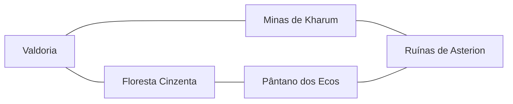

# Mapa jogável — Marco 05

`Marco05World.unity` apresenta cinco áreas e transições confirmadas pelo backend. WASD movimenta a representação local; a intenção `travel` valida conexão e ausência de encontro ativo. Só após confirmação a área e o ponto de entrada mudam. `OfflineClearing.unity` continua disponível e é preservada.

| Área | Gameplay próprio |
|---|---|
| Valdoria | Treino de defesa/esquiva, forja, alquimia, consumíveis, descanso |
| Floresta Cinzenta | Rastros, caça, pesquisa de corrupção, bosque silencioso, recuperação regional |
| Minas de Kharum | Picareta, fratura de veios, voo/armadura/escavação, ressonância agendada |
| Pântano dos Ecos | Veneno, lótus condicionado, ecos etéreos, regeneração, memória histórica |
| Ruínas de Asterion | Inscrições/glifos, comparação de registros, guardião e farol único compartilhado |

Memórias do pântano abrem estudo nas ruínas e recuperação da floresta; mineração produz materiais usados na forja e em Asterion. As áreas são salas placeholder dentro da mesma cena, sem necessidade de recarregar sessão/saves; não são cinco cópias da cena offline.
