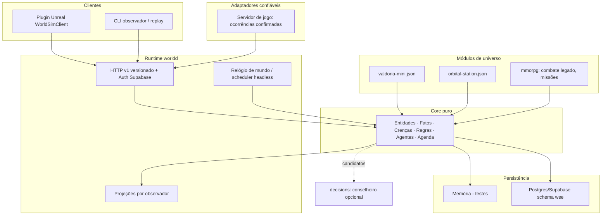

# Marco Zero — World Simulation Engine (auditoria e plano)

> **Histórico.** Esta auditoria descreve o repositório antes da reconstrução de 19/10/2026. O projeto Unity e o backend `backend/`/`supabase/` foram removidos (recuperáveis no branch `archive/unity-2026-10-19`). A arquitetura vigente está em [Architecture.md](../Architecture.md).

Data: 19/10/2026. Missão somente de auditoria/planejamento: **nenhum código, schema ou cena foi alterado**. Base auditada: `main` em `88ad73f7` (igual a `origin/main`), mais o worktree com a fundação Action3D Unity em *staged* e não commitada.

## 0. Checkpoint e evidência

| Item | Valor |
|---|---|
| Tag anotada (local) | `checkpoint/pre-worldsim-2026-10-19` → `88ad73f7` |
| Snapshot do worktree (local) | `refs/checkpoints/pre-worldsim-2026-10-19` → `ca81b859` (`git stash create`: index + arquivos rastreados modificados, sem alterar o worktree) |
| Não coberto pelo snapshot | arquivos *untracked* (`Assets/_Recovery/`, `test.aseprite`, `build-stalled-c.json` etc.) — continuam só no disco |
| Restaurar o snapshot | `git stash apply refs/checkpoints/pre-worldsim-2026-10-19` |

As refs são locais; não foram enviadas ao GitHub.

**O que foi executado nesta auditoria:** leitura de código, docs e logs; inventário do ambiente (Go, PostgreSQL, Docker, Supabase CLI, Unreal, disco, hardware); pesquisa web sobre Unreal.
**Não executado:** nenhum teste Go, Unity ou SQL. **Go não está instalado** (a distribuição portátil citada em `Docs/JevIntegration.md`, `%TEMP%\mmorpg-go-tools`, não existe mais). Os resultados de testes abaixo vêm de **logs históricos** de 14/10/2026 (`Docs/Validation/m05c-*.jsonl`, UTF-16), e o código do backend não mudou desde então (`git log -- backend supabase`: último commit `0296067c`, 14/10).

## 1. Auditoria real dos componentes

### 1.1 `backend/authority/journey` — motor de regras (Go puro)

Implementado: `catalog.go` (370 linhas), `engine.go` (603), `simulation.go` (532), `content.json` (1385). Sem banco nem rede.

- `Catalog.Step(state, world, actor, action) → Change`: função pura sobre cópias; comando inválido não tem efeito colateral. Mesmo código no servidor e no simulador.
- **Primitivas genéricas que já existem:** fatos booleanos por personagem (`State.Facts`), fatos de mundo compartilhados com autoria (`World.Facts`/`Authors`), condições `Requires`/`Excludes`, agenda com `Pending` e **cancelamento com devolução exatamente uma vez** quando outro autor vence, limite de 3 candidatos visíveis, `LegalActions` derivado de `Step`.
- `Catalog.Validate`: fecho monotônico de alcançabilidade (detecta ilhas de dependência, regiões desconectadas, IDs duplicados, itens sem uso). É o algoritmo mais reutilizável do repositório.
- Simulação: 6 perfis de *jogador* com sementes, digest por jornada, distância de Jaccard e replay byte a byte.

Acoplamento ao MMORPG (medido no código): `State` fixa `HP`, `Poison`, `Inventory`, `Abilities`, `Equipment`, `Encounter`; o combate por turnos está dentro de `engine.go`; IDs fixos no código (`"valdoria"`, `"training-dummy"`, `"mining-pick"`, `"done:mining-tools"`, `"weakness-reading"`, `"toxic-resistance"`); enums fechados de temas (`forest|mines|swamp|asterion`), efeitos de habilidade e padrões de criatura dentro de `Validate`.

Limitações estruturais para a nova direção:
- **Não há agentes.** NPCs são linhas estáticas do catálogo (`Knowledge []string`). Nenhum NPC tem objetivo, decide ou age.
- **Tempo é por personagem** (`State.Step`). Não existe relógio de mundo; nada avança sem um comando do jogador.
- Conhecimento = `map[npc][]fato`, **sem procedência** (fonte, momento, causa).
- Relação = um inteiro de confiança jogador→NPC. Não há relações NPC↔NPC nem organizações.
- Fatos são strings sem causa. A causalidade só existe parcialmente nas tabelas SQL (`source_fact_id`).

Testes: `engine_test.go` (9) e `simulation_test.go` (3) — passaram no log de 14/10.

### 1.2 `backend/authority` — persistência e HTTP (Go + pgx)

Implementado e com evidência real no Supabase de desenvolvimento (Marco05A/B):
- `auth.go`: validação de JWT do Supabase (JWKS RS256/ES256, ou HS256 pelo Auth Server), com issuer, audience, exp e sub. **Genérico.**
- `database_config.go`/`store.go CheckRole`: recusa superuser/BYPASSRLS, exige TLS fora do loopback, `SET LOCAL ROLE game_backend` e `app.user_id` por transação. **Genérico.**
- `env.go`: parser literal de `.env`. **Genérico.**
- `store.go Apply`: transação com receipt por `requestId`, `expectedRevision`, fatos, outbox, decisão e rollback total. **Padrão genérico; código específico.**
- `store.go applyIntent` (05A): intenções escritas à mão (`examine-tracks`, `brief-orin`, `deliver-mira`, lobo por turnos). **Específico, legado.**
- `expanded.go`: adapta `journey.Step` às tabelas normalizadas; lock consultivo por mundo (`pg_advisory_xact_lock`) — explicitamente "não é desenho de escala MMO".

Apenas planejado/inexistente: **consumidor do outbox**, **worker global** (agenda só avança com `tick` autenticado do próprio dono), revogação por `session_id`, rate limiting, Nakama, autoridade de movimento/colisão.

Testes (log 14/10): **93 pass, 1 skip** (`TestSupabaseLocalAuthAndPersistentCharacters`, opt-in). Os testes PostgreSQL exigem `TEST_DATABASE_URL` com Postgres nativo em 127.0.0.1 — que **não está instalado** nesta máquina hoje.

### 1.3 `backend/decisions` — seleção consultiva (Jev/OpenRouter)

- `DecisionProvider` (interface), `DeterministicDecisionProvider`, `OpenRouterJevProvider` (pergunta do tipo *choice* restrita a IDs elegíveis), persistência em arquivo por hash (ator, mundo, evento, política), fingerprint → 409, fallback persistido. **Arquitetura genérica.**
- Acoplamento: políticas e descrições estão **no código** (`mira-reaction-v1`, `world-context-v1`, `descriptions`, `worldDescriptions`, `worldDefinitions()` com Mira/Orin/floresta). Armazenamento em arquivo com mutex de um processo.
- Testes (log 14/10): **39 pass, 3 skip** (os três manuais/pagos). Nenhuma chamada paga automática.

### 1.4 `supabase/`

Três migrações (`20261013000100_game.sql`, `20261014000100_expanded_world.sql`, `20261014000200_sourced_regional_updates.sql`), 23 tabelas no schema privado `game`, FORCE RLS, papel `game_backend` NOLOGIN/NOBYPASSRLS, seed idempotente com mundos `is_test`. pgTAP 8/8 executado em transação revertida no banco de dev (não via `supabase test db`). Docker e Supabase CLI **não estão instalados** agora.
Tabelas com forma genérica: `character_facts`, `character_memories`, `world_events` (UNIQUE por mundo + autor), `scheduled_consequences`, `decision_records`, `event_outbox`, `command_receipts`. As demais são do jogo (`character_inventory`, `character_equipment`, `encounters`, `journey_*`, `npc_*`).

### 1.5 Unity `Assets/Mmorpg/Domain` (C# puro, `noEngineReferences`)

`WorldEventOrchestrator.cs`/`WorldEligibility.cs`/`WorldEventContracts.cs` têm **os melhores conceitos** do projeto, ausentes no Go: árvore de condições AND/OR com evidência auditável por regra, conhecimento com **fonte** (`Observation | Conversation | Message | PublicNotice`), dois relógios (jogo/UTC), replay que confere projeções, histórico limitado a 8192 comandos. Mas o conteúdo está fixo no código (`ForestContent`, `MiraReactions`, três candidatos) e roda só offline na Unity 2D. **Portar os conceitos, não o código.**

### 1.6 Documentação × implementação

| Doc | Afirma | Status real |
|---|---|---|
| `GameVision.md` 4–8 (propostas proativas, 1 missão ativa) | modelo de missões | **Só diretriz**; o próprio doc diz que não foi implementado |
| `Architecture.md` "Transição Go + Nakama" | servidor autoritativo futuro | **Não existe** |
| `WorldEventOrchestrator.md` | mundo reativo | Implementado **em C#/Unity offline**; Go só valida consistência dos candidatos |
| `SupabaseIntegration.md` outbox | gravado na transação | Gravado, **sem consumidor** |
| `Simulation.md` | 120 jornadas, diversidade 0,80 | Real, mas são *perfis de jogador* roteirizados, não agentes do mundo |
| `Docs/Architecture.md` | caminho `Backend/authority` | O diretório real é `backend/` minúsculo (funciona no Windows; quebraria em Linux/CI) |

## 2. Matriz de reutilização

| Componente | Classe | Justificativa / ação |
|---|---|---|
| `authority/auth.go` (JWT Supabase) | **Genérico direto** | Importar no daemon do motor via `go.work` |
| `authority/env.go`, `database_config.go`, `CheckRole` | **Genérico direto** | Idem |
| Helpers HTTP estritos (`decode`, recusa de campo desconhecido/Origin, limite de corpo) | **Genérico direto** | Extrair só quando houver segundo consumidor |
| Padrão receipts + `expectedRevision` + outbox + rollback | **Genérico direto (padrão)** | Repetir no adaptador Postgres do motor |
| Papel restrito + FORCE RLS + schema privado | **Genérico direto (padrão)** | Novo schema aditivo `wse` com as mesmas regras |
| `journey.Catalog.Validate` (fecho de alcançabilidade) | **Após desacoplamento** | Generalizar sobre produtores/consumidores de fatos declarados |
| `journey.Step` (fatos, requires/excludes, fato de mundo com autor, agenda com cancelamento/devolução) | **Após desacoplamento** | Viram primitivas do núcleo; HP/inventário/combate saem |
| Harness de simulação (sementes, digest, Jaccard, replay) | **Após desacoplamento** | Perfis de jogador → políticas plugáveis de agentes |
| `decisions` (provider, persistência, fallback, Jev *choice*) | **Após desacoplamento** | Políticas/descrições passam a vir do módulo/requisição; continua opcional |
| Tabelas `*_facts`, `memories`, `world_events`, `scheduled_consequences`, `decision_records`, `event_outbox`, `command_receipts` | **Após desacoplamento** | Modelo de referência para o schema `wse`; **as tabelas atuais ficam intactas** |
| Conceitos C# de condição/evidência/fonte/relógio/replay | **Após desacoplamento (conceito)** | Reescrever em Go no núcleo |
| `journey/content.json`, `combat()`, `Encounter`, equipar/usar/HP/veneno, efeitos de habilidade | **Módulo MMORPG** | Combate em tempo real será do Unreal; isto vira módulo legado/opcional |
| `store.go applyIntent` 05A (Mira/Orin/lobo), `contracts.ResolveEncounter`, `seed.sql` | **Módulo MMORPG (legado)** | Congelar; não portar |
| Políticas `mira-reaction-v1`, `world-context-v1` | **Módulo MMORPG** | Configuração de universo |
| Regras de missão do `GameVision` (1 ativa, 1 proposta pendente) | **Módulo MMORPG** | Política de oportunidades do jogo, fora do núcleo |
| `Assets/Mmorpg/Runtime`, `CombatState`, `ActionCombatRules`, `WeaknessReading`, `JourneyEngine.cs`, saves v1–v3, cenas 2D, `AgentScripts`, pipeline de arte | **Legado Unity 2D** | Sem migração; preservado no Git |
| `SupabaseSession`/`OnlineAuthorityClient` (Unity) | **Legado (padrão útil)** | Refazer o equivalente no plugin Unreal |
| Fundação Action3D/3D Game Kit (staged, não commitada) | **Legado/avaliação** | Preservada no snapshot; decisão do dono |

## 3. Arquitetura proposta

### 3.1 Núcleo (`backend/worldsim/core`, Go puro)

Regra de dependência: `core` importa só a biblioteca padrão (sem `net`, `database`, `os/exec`), e nenhum módulo de universo. Isso é verificado por teste (T1).

| Conceito | Forma mínima |
|---|---|
| Entidade | `Entity{ID, Kind, Props map[string]Value}`; *kinds* e propriedades declarados pelo módulo |
| Fato | `Fact{ID, Predicate, Subject, Object, Value, Scope, Causes []FactID, At WorldTime, Origin}`. `Scope` = `World` (verdade compartilhada) ou `Private(holder)` |
| Crença/conhecimento | `Belief{Holder, FactID, Source(observation\|communication\|publication\|inference), From, At}`. **Separada da verdade**: o agente decide pelas crenças; a autoridade valida contra o mundo |
| Relação/organização | Fatos com predicados declarados (`trusts`, `member_of`) e propriedades numéricas limitadas — sem tipo especial no núcleo |
| Regra | `Rule{ID, When Condition, Then []Effect}`. Condição em árvore AND/OR/NOT sobre fato, crença, propriedade e tempo (portada do C#) |
| Efeitos | conjunto fechado: `assert`, `retract`, `set`, `adjust` (com limites), `inform(holder, fact, source)`, `schedule(after, rule)`, `cancel` |
| Agente | `Agent{EntityID, Goals []Goal, Policy}`. Goal = condição desejada + prioridade. Ações do módulo têm pré-condição avaliada **sobre as crenças do agente** |
| Política | determinística por padrão (utilidade + desempate estável + semente). Conselheiro externo pode só escolher entre candidatos válidos |
| Tempo | `WorldTime` em ticks; agenda em fila ordenada (`due`, `id`); no máximo N vencimentos por tick (padrão herdado do C#) |
| Comando | `Command{RequestID, ExpectedRevision, Actor, Kind, Args}` → `Delta` (fatos, crenças, agenda, decisões) |
| Determinismo | `Step(world, cmd) → (world', delta)` puro; `Digest(world)` canônico; replay do log reproduz o digest |

### 3.2 Módulos de universo

Configuração declarativa (JSON versionado + validação): kinds, predicados, ações (pré-condições/efeitos), regras, agentes iniciais e objetivos, cenas de observação. O validador generaliza o fecho de `journey.Validate` (referências, alcançabilidade, ciclos fechados de agenda, limites). Extensão em Go só por interface pequena (`Module.Validate`) e **nunca** dentro de `core`. Combate, criaturas, itens, classes e missões ficam em `modules/mmorpg`.

### 3.3 Persistência

`EventLog` (append de comando + delta com revisão e receipt) + `Snapshot` periódico. Adaptadores:
- **memória**: testes e simulação;
- **Postgres**: pgx, nova migração **aditiva** em `supabase/migrations` criando o schema `wse` (`wse.commands`, `wse.facts`, `wse.beliefs`, `wse.schedules`, `wse.receipts`, `wse.outbox`), FORCE RLS e o mesmo modelo de papel restrito. Sem DROP/ALTER em `game`. Aplicação em banco remoto só com aprovação.

Isto reutiliza a infraestrutura existente (Postgres/Supabase + pgx); não é uma infraestrutura nova.

### 3.4 Runtime `worldd` e contrato público

Daemon headless: o relógio avança o mundo sem sessões de jogador. HTTP v1 versionado (schema JSON publicado em `Docs/WorldSimulation/contracts/`):
- `POST /v1/worlds/{w}/occurrences` — somente identidades de **adaptador confiável** (servidor de jogo), nunca o cliente do jogador;
- `POST /v1/worlds/{w}/intents` — intenção do jogador (falar, informar, agir), sempre revalidada;
- `GET /v1/worlds/{w}/views/{observer}` — projeção filtrada: verdade pública + crenças do observador;
- `GET /v1/worlds/{w}/events?after=` — feed para clientes (SSE depois);
- `GET /healthz`.

Auth: reutilizar `authority.SupabaseAuth` via `go.work`. O Unreal nunca acessa o banco nem as regras internas.

### 3.5 Clientes

Plugin Unreal `WorldSimClient` (`UGameInstanceSubsystem` + `FHttpModule`) consome o contrato v1. A autoridade de combate fica no Unreal (servidor dedicado no futuro); o motor recebe apenas **acontecimentos confirmados** ("criatura X derrotada por Y em Z"), sem receber dano ou HP.

## 4. Base Unreal 3D

Estado da máquina (medido hoje):

| Item | Resultado |
|---|---|
| Unreal Engine | **Não instalado** — `LauncherInstalled.dat` com `InstallationList: []`; só restos de `C:\ProgramData\Epic` e o Epic Online Services |
| Epic Games Launcher | executável ausente |
| Disco livre | C: **18,5 GB**, D: **13,4 GB**, E: **11 GB** |
| Hardware | Ryzen 7 1700X, **24 GB RAM**, Radeon RX 5700 XT (sem ray tracing por hardware; Lumen por software funciona) |
| Codex CLI | no PATH do bash (`OpenAI/Codex/bin`); integração MCP não testada |

Segundo relatos da comunidade, uma instalação binária recente (5.8.1) ocupa cerca de 40–70 GB; build a partir do código-fonte, mais de 150 GB. **Nenhum disco atual comporta.** Este é o principal impedimento do Objetivo C.

Automação disponível (documentada; **não verificada localmente**): `UnrealEditor-Cmd.exe` com `-ExecutePythonScript` (plugin Python Editor Script), commandlets `-run=`, testes `-ExecCmds="Automation RunTests …" -unattended -nullrhi`, `RunUAT BuildCookRun`, plugin Remote Control API (HTTP local) e o plugin oficial **Unreal MCP** (experimental, UE 5.8; HTTP/SSE local sem autenticação → somente loopback).

| Base | Licença / custo | Prós | Contras |
|---|---|---|---|
| **Third Person template — variante Combat** (Epic, vem com a engine) | UE EULA, grátis | Combate corpo a corpo, alvo e vida prontos; leve; C++ ou Blueprint; mantido a cada versão | Single-player básico, sem GAS/replicação robusta |
| Lyra Starter Game (Epic) | UE EULA; conteúdo só para uso em UE | GAS, Game Features, replicação, Common UI — arquitetura próxima de MMO | Shooter, pesado, sem corpo a corpo; curva alta |
| Game Animation Sample (Epic) | UE EULA | Locomoção com *motion matching* | Sem combate; grande |
| Action RPG Sample (Epic) | UE4 | ARPG com GAS | Somente UE4; não serve |
| Templates *soulslike* no Fab | pagos | Combate completo | **Excluídos** (sem compras) |

**Seleção: Third Person (variante Combat) em projeto C++**, só como cliente da PoC: a PoC precisa de avatar, NPCs, um gatilho que emite acontecimentos e UI de crenças — não de GAS. Reavaliar **Lyra** quando multiplayer/replicação entrar no escopo. O projeto Unreal fica em pasta/repositório separado; conteúdo de licença UE/Fab não vai para o repositório público (mesma política do 3D Game Kit).

## 5. Prova de conceito (sem Unreal)

**Universo A — `valdoria-mini`:** vila, poço, curandeira Mira (objetivo: saúde da vila), guarda Orin (objetivo: segurança), jogadores P1 e P2.
1. O adaptador confirma "P1 encontrou o poço envenenado" → fato de mundo `well.status=poisoned` + crença privada de P1 (observação).
2. Regra autônoma: a cada K ticks com poço envenenado, a saúde da vila cai — **sem nenhum jogador conectado**.
3. P1 `informa` Mira → crença de Mira com `source=communication, from=P1`. O objetivo de Mira gera o plano "coletar erva → preparar antídoto → purificar" (agenda).
4. P2 nunca falou com ninguém: sua visão não contém o envenenamento; sua história é diferente da de P1.
5. Mira só reage depois de *acreditar*; sem a crença, não age em 200 ticks.

**Universo B — `orbital-station`:** reator, engenheira-chefe, técnicos, dois tripulantes. "Vazamento de refrigerante confirmado" → pressão cai por tick → técnico informa a engenheira → plano de reparo agendado. **Mesmo binário e mesmo `core`**; só a configuração muda.

### Incrementos

| Fase | Entrega | Testes | Pré-requisito |
|---|---|---|---|
| P1 | `core`: tipos, condições, efeitos, agenda, `Step`, digest, store em memória | T1–T5, T9 | Go 1.23+ |
| P2 | Loader/validador de universo; JSON A e B | T8 | P1 |
| P3 | Agentes: objetivos, ações gated por crença, política determinística | T4 | P2 |
| P4 | `EventLog` + Postgres (`wse`, migração aditiva) + replay | T7, T11, T12 | Postgres local (nativo ou Docker) |
| P5 | `worldd` headless + HTTP v1 + Supabase Auth + CLI observador | T6, T13 | P4 |
| P6 | Conselheiro `decisions` genérico (opcional) | T10 | P3 |
| P7 | Plugin Unreal + projeto Third Person Combat | E2E manual registrado | Disco ≥ 100 GB livre, aprovação |

O `journey` atual permanece intocado e funcionando. Depois da PoC, a decisão é migrá-lo para `modules/mmorpg` sobre o novo núcleo ou congelá-lo — evitando duas arquiteturas paralelas por muito tempo.

## 6. Critérios de aceitação e testes automatizáveis

Todos rodam com `go test ./...`, sem rede e sem IA; os de Postgres usam `TEST_DATABASE_URL` em loopback, como hoje.

| ID | Critério | Teste |
|---|---|---|
| T1 | Núcleo independente | `go list -deps ./core` não contém `net`, `database/sql`, pgx nem `modules/*`; falha caso contrário |
| T2 | Acontecimento confirmado altera o estado | ocorrência → fato de mundo presente, revisão +1, `Causes` aponta para o comando |
| T3 | Idempotência | mesmo `requestId` 2× → um único delta; revisão esperada errada → recusa sem efeito |
| T4 | Agente reage conforme conhecimento e objetivos | Mira sem crença: 0 ações em 200 ticks; com crença: plano em ≤ K ticks; sem o objetivo (variante de config): sem reação |
| T5 | Mundo compartilhado × informação privada | `View(P2)` não contém crenças de P1; fatos `Private(P1)` são invisíveis a P2; fatos públicos são visíveis a ambos |
| T6 | Avanço sem jogador | `worldd` com 0 sessões por N ticks → saúde da vila cai e eventos são emitidos |
| T7 | Persistência após reinício | execução contínua de 100 ticks = 40 ticks + encerrar processo + reiniciar + 60 ticks (digest idêntico); replay do log = digest ao vivo |
| T8 | Dois universos sem mudar o núcleo | o mesmo harness passa os invariantes de A e B; o validador recusa configs inválidas (predicado desconhecido, regra inalcançável, ciclo de agenda fechado) |
| T9 | Determinismo e diversidade | mesma semente + log → digest idêntico; P1 e P2 com histórias diferentes (Jaccard > 0) |
| T10 | IA opcional | conselheiro desligado/timeout/escolha fora da lista → fallback determinístico persistido |
| T11 | Migração não destrutiva | lint: a migração `wse` não contém `DROP`, `TRUNCATE`, `ALTER … DROP` nem toca no schema `game` |
| T12 | Paridade de stores | a mesma suíte de contrato passa em memória e em Postgres |
| T13 | Contrato público | respostas validam contra o JSON Schema v1; campos desconhecidos são recusados; cliente sem papel de adaptador recebe 403 em `occurrences` |

## 7. Riscos e impedimentos

| # | Risco / impedimento | Impacto | Mitigação |
|---|---|---|---|
| 1 | **Go ausente** | Bloqueia P1+ e a reexecução dos testes atuais | Baixar Go portátil oficial (go.dev) fora do repositório — precisa de aprovação |
| 2 | **Postgres/Docker/Supabase CLI ausentes** | Bloqueia P4 (T7/T12) | PostgreSQL nativo ou Docker Desktop; até lá, só o store em memória |
| 3 | **Disco: 11–18,5 GB livres por drive** | Bloqueia Unreal (40–70 GB+) e já fez um build Unity falhar (`build-failed-space.json`) | Liberar espaço (`Library/`, `Builds/`, caches) ou disco novo antes de P7 |
| 4 | 24 GB de RAM, GPU sem RT por hardware | Editor UE lento; Lumen só por software | Aceitável para a PoC; não exigir recursos RT |
| 5 | Unreal MCP experimental, sem autenticação | Superfície local aberta | Somente loopback; não tratar como estável |
| 6 | Licenças UE/Fab no repositório público | Redistribuição indevida | Projeto UE fora do repo público; registrar origem/licença |
| 7 | Duas arquiteturas (`journey` + `core`) | Contraria o `AGENTS.md` | Prazo de decisão após a PoC: migrar para módulo ou congelar |
| 8 | Confiança nas ocorrências | Cliente pode forjar fatos | Ocorrências só de adaptador com papel próprio; jogador envia intenções |
| 9 | Crescimento do log causal | Custo e latência | Snapshots + compactação planejados na P4; limites explícitos |
| 10 | Lock por mundo herdado | Não escala | Não reutilizar no `wse`; particionar por região/entidade depois |
| 11 | Worktree com Action3D *staged* não commitado | Risco de perda/conflito | Preservado em `refs/checkpoints/...`; o dono decide commitar ou descartar |
| 12 | Branch padrão `master` × trabalho em `main` | PRs/CI na branch errada | Sempre especificar `main` |
| 13 | `AGENTS.md`/`GameVision.md` ainda descrevem a direção Unity Action 3D | Agentes seguem a direção antiga | Atualizar a diretriz quando a implementação for autorizada |
| 14 | Caminhos `Backend/` nos docs × `backend/` real | Quebra em Linux/CI | Corrigir ao tocar nesses docs |

## Fontes externas consultadas (19/10/2026)

- [Third Person template — Epic](https://dev.epicgames.com/documentation/unreal-engine/third-person-template-in-unreal-engine)
- [Unreal MCP in Unreal Editor — Epic](https://dev.epicgames.com/documentation/unreal-engine/unreal-mcp-in-unreal-editor?lang=en-US)
- [Fórum: espaço para instalar UE 5.8.1](https://forums.unrealengine.com/t/storage-required-to-install-unreal-engine-5-8-1/2740177)
- [Fórum: espaço para build UE5 via código-fonte](https://forums.unrealengine.com/t/required-disk-space-to-install-ue5-from-source/2742506)
